# WFS-214 — captures avant / après

Branche `feature/waforspeed-214` comparée à `origin/main` ; banc d'essai PC (lavapipe, 1280x720, même rendu que la CI). Même méthode que `tools/qa/captures_pr.sh` (main compilé dans un arbre à part, mêmes bancs des deux côtés, JPG 1280 px qualité 85), bancs lancés en parallèle.

- `realisme` (`WFS_LUMIERE_SEUL=1`), `realisme` (`WFS_PASSES_SEUL=1`), `depart` (`WFS_DEPART_SEUL=departs`).
- **Moments de WFS-208 (`realisme-ciel-<moment>-*`) et `depart-jour-campagne-4`** (retour du lead dev, 2e passage) : « avant » = `origin/main` **avec la même correction du banc** (exposition qui atteint sa cible avant la capture, départ de jour en Campagne), pour ne comparer que l'effet du ticket. Sans cette correction, sur main, l'exposition des moments restait figée à celle de l'aube (EV 8,2 à midi) : images blanches avant comme après.
- Luminance moyenne (0 à 255) notée pour chaque moment.

| Capture | Avant (main) | Après (branche) |
|---|---|---|
| `realisme-ciel-campagne-h70` — RG-02 : ciel de midi (soleil à 70°, EV 15 imposé) : gris-bleu sombre → bleu clair (zénith 2 667 → 7 034 cd/m²) |  |  |
| `realisme-ciel-circuit-h10` — RG-01 / RG-02 : ciel du soir (soleil à 10°) autour du soleil : dégradé continu |  |  |
| `zoom-tramage-ciel-h10` — RG-01 : zoom × 2 autour du soleil, contraste renforcé (niveaux 25-75 %) : plus de marches |  |  |
| `realisme-ciel-midi-campagne` — moment midi, Campagne (retour du lead dev) : luminance moyenne 46 → 65 / 255 | 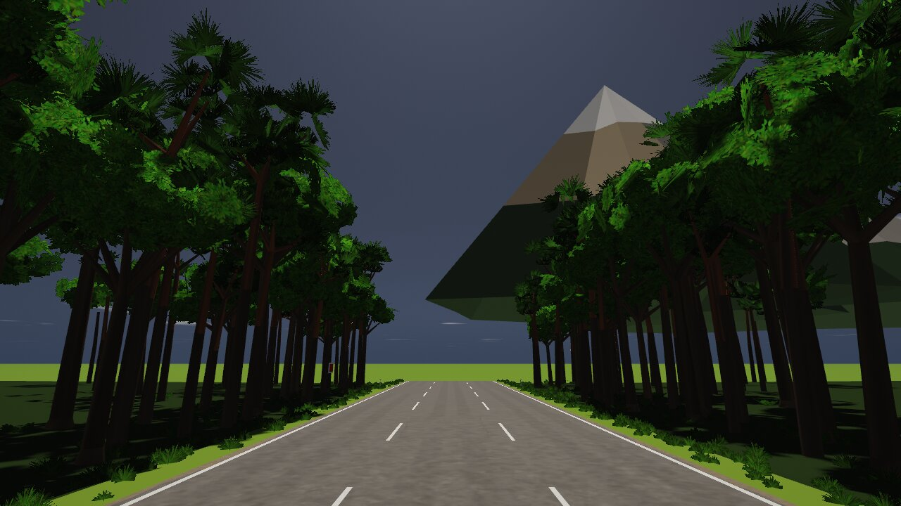 | 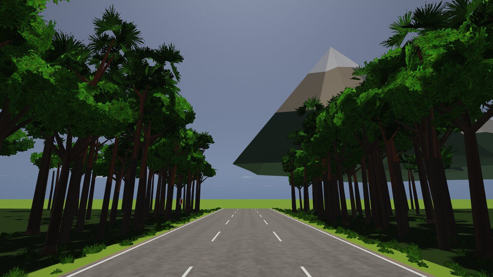 |
| `realisme-ciel-midi-circuit` — moment midi, circuit : 79 → 123 / 255 | 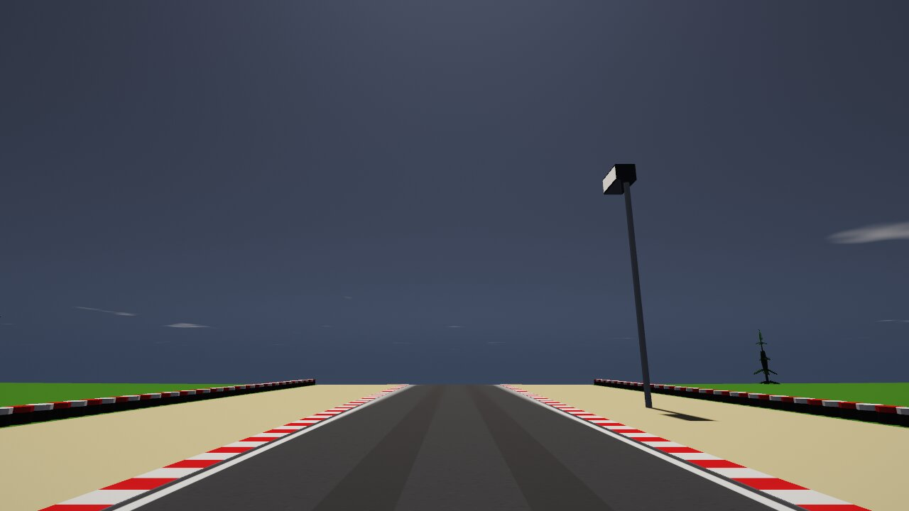 | 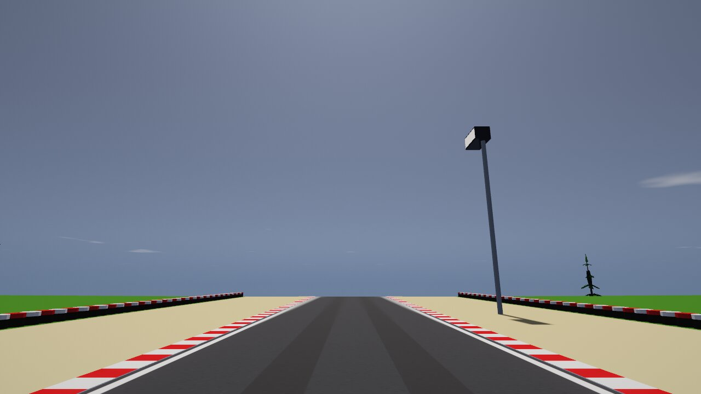 |
| `realisme-ciel-matin-campagne` — moment matin (soleil à 25°, vue « h 30 » du PO), Campagne : 61 → 90 / 255 |  |  |
| `realisme-ciel-matin-circuit` — moment matin, circuit : 84 → 130 / 255 (la plus claire : rien de blanc) | 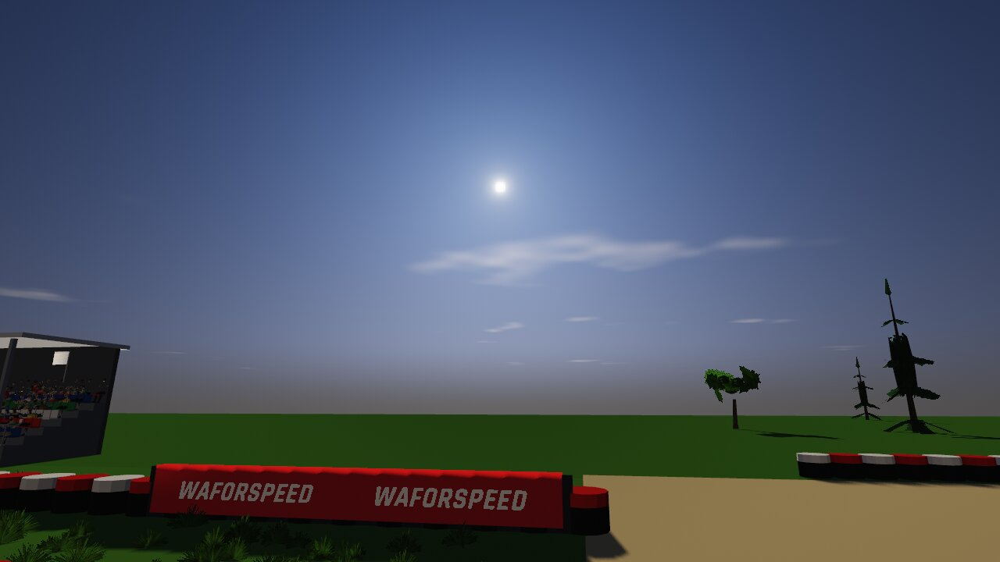 | 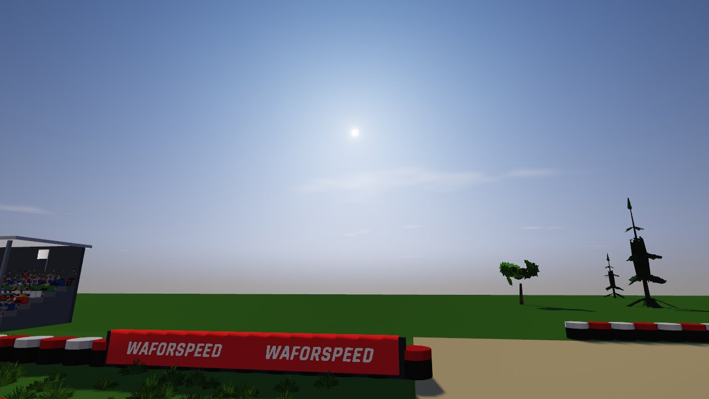 |
| `realisme-ciel-doree-campagne` — heure dorée (coucher, condition 4), Campagne : 60 → 60 / 255 |  | 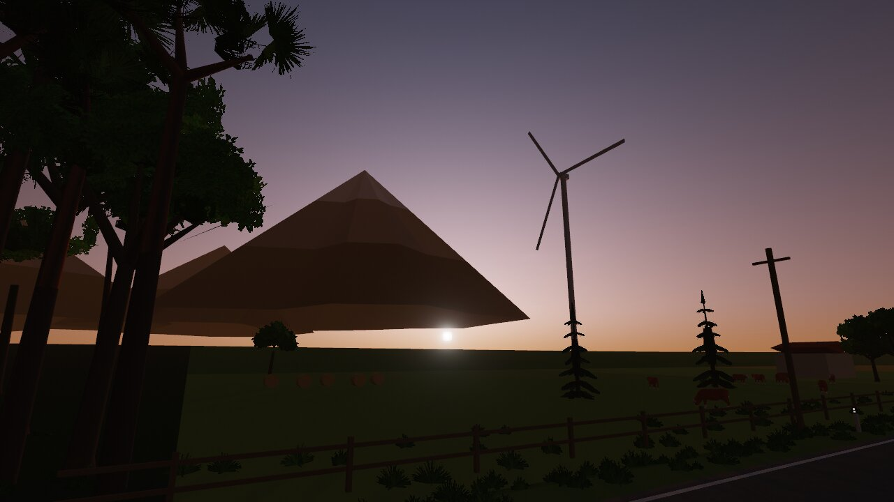 |
| `realisme-ciel-doree-circuit` — heure dorée, circuit : 71 → 78 / 255 | 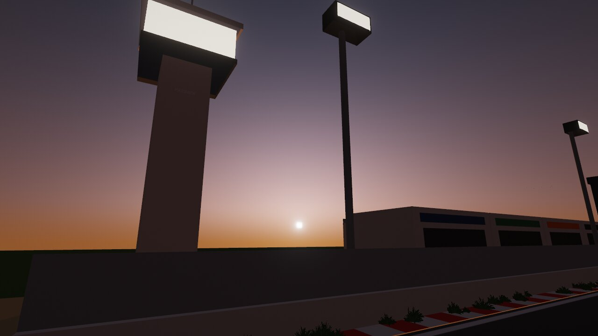 | 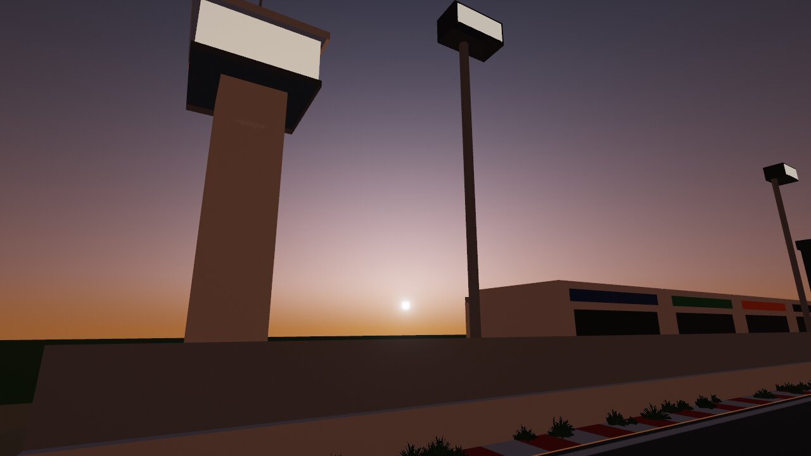 |
| `realisme-ciel-aube-campagne` — condition 3 : aube (soleil sous l'horizon) identique (66 → 66) |  |  |
| `depart-jour-campagne-4` — jeu de jour hors de la Ville (retour du lead dev) : ombres un peu plus claires, relief gardé (97 → 104 / 255) | 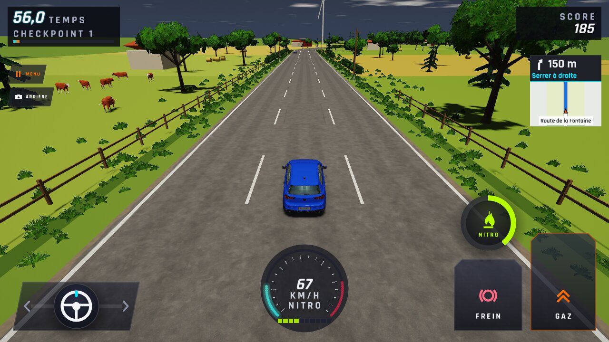 | 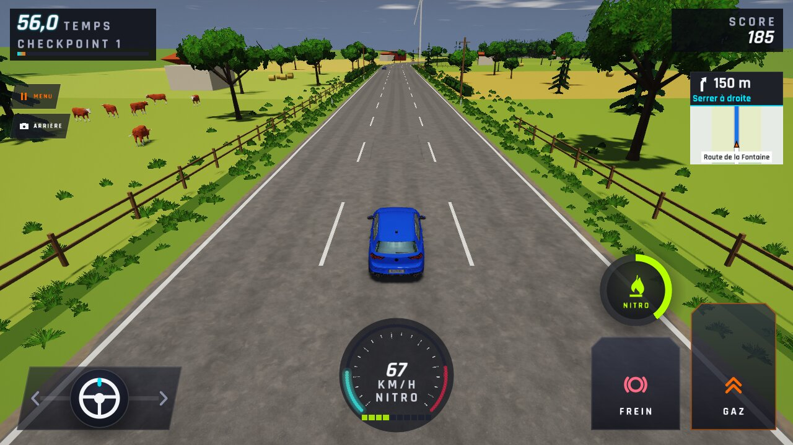 |
| `depart-jour-ville-4` — RG-02 : Ville de jour, ombres (dessous de la Golf, façades) ; EV 15 avant et après |  |  |
| `parcours-ultra-course` — RG-03 : capture d'origine d'ANO-106 (sur main, ce banc n'atteint plus Ultra : ANO-211 / WFS-377) |  |  |
| `chaussee-ultra-course` — RG-03 : vrai Ultra (sonde 256 px), même instant que la suivante | — |  |
| `chaussee-haute-course` — RG-03 : Haute (sonde 128 px) : chaussée ΔE2000 0,02 à 0,03, trottoir 0,92 avec Ultra | — |  |
| `depart-nuit-ville-4` — RG-05 : nuit, Golf sous les lampadaires de la Ville : garde le bleu de sa peinture |  |  |
| `depart-nuit-campagne-4` — RG-05 / condition 3 : nuit en Campagne loin des lumières : vision de nuit gardée (66 → 66) |  |  |
| `realisme-ciel-campagne-nuit` — condition 3 : ciel de nuit inchangé |  |  |
