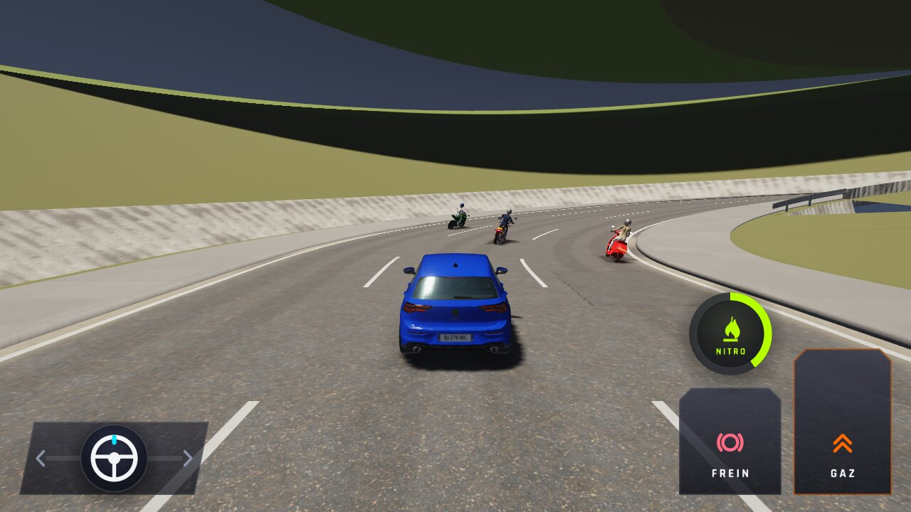
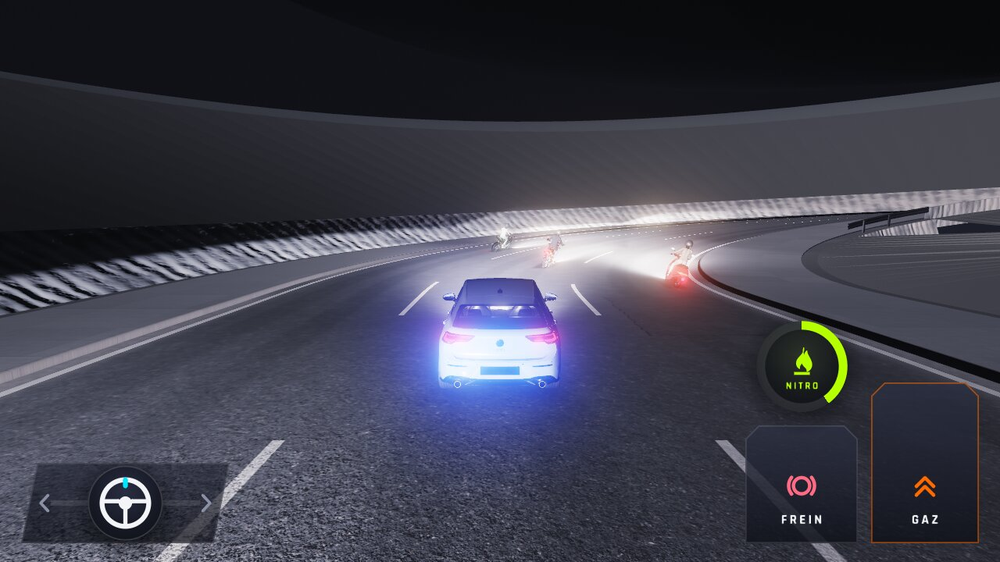
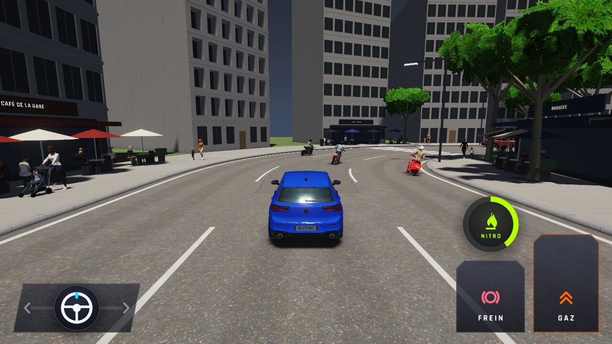
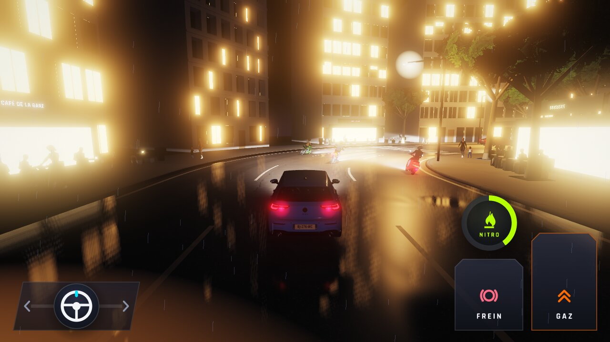

# WFS-232 — captures avant / après (tools/qa/captures_pr.sh)

Branche `feature/waforspeed-232` comparée à `origin/main` ; bancs : motos (sans « avant » : banc nouveau, absent de `main`) et parcours (avant / après, 0 écart des deux côtés) ; filtres : `trafic-motos-*`, `parcours-course`, `parcours-fin`. Deux passages du script (le banc motos relancé seul après un réglage du lieu de la courbe de la Corniche), tableaux réunis.

| Capture | Avant (main) | Après (branche) |
|---|---|---|
| `trafic-motos-plage-jour` | — |  |
| `trafic-motos-plage-nuit` | — |  |
| `trafic-motos-pres-plage-jour` | — |  |
| `trafic-motos-pres-plage-nuit` | — |  |
| `trafic-motos-pres-ville-jour` | — |  |
| `trafic-motos-pres-ville-nuit` | — |  |
| `trafic-motos-ville-jour` | — |  |
| `trafic-motos-ville-nuit` | — |  |
| `trafic-motos-virage-plage-jour` | — |  |
| `trafic-motos-virage-plage-nuit` | — |  |
| `trafic-motos-virage-ville-jour` | — |  |
| `trafic-motos-virage-ville-nuit` | — |  |
| `parcours-course` |  |  |
| `parcours-fin` |  |  |
