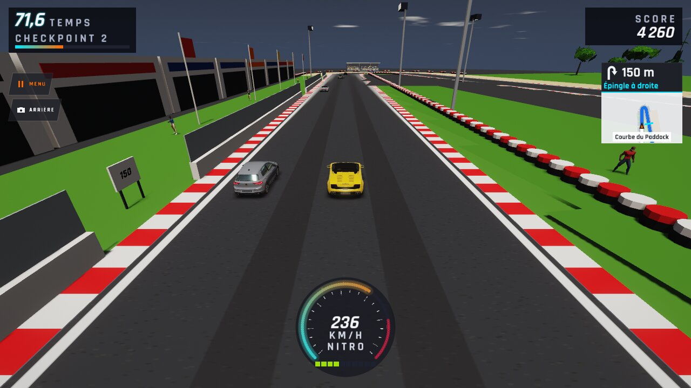
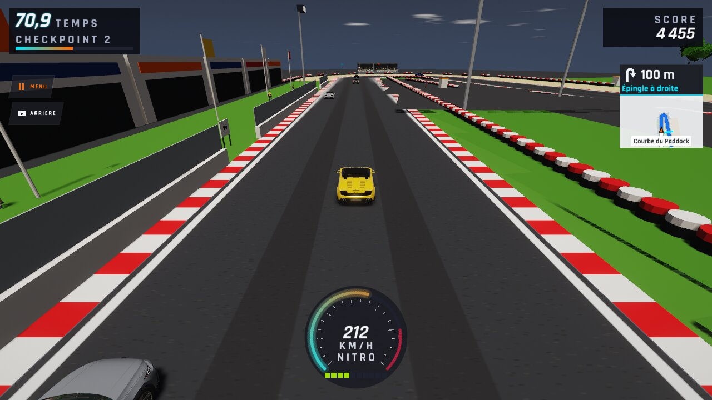
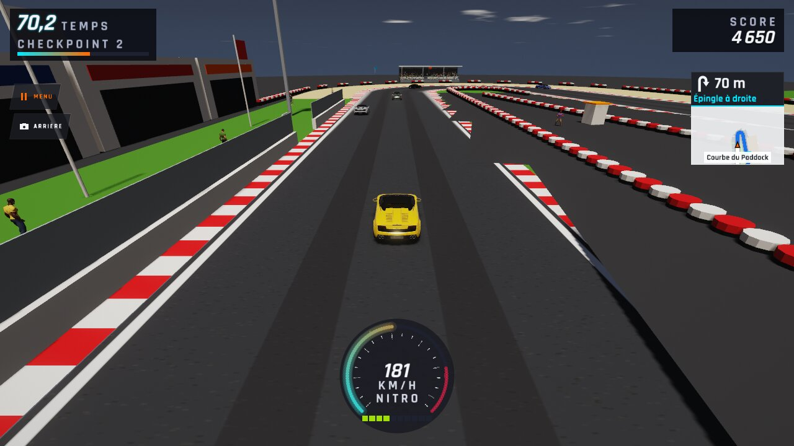
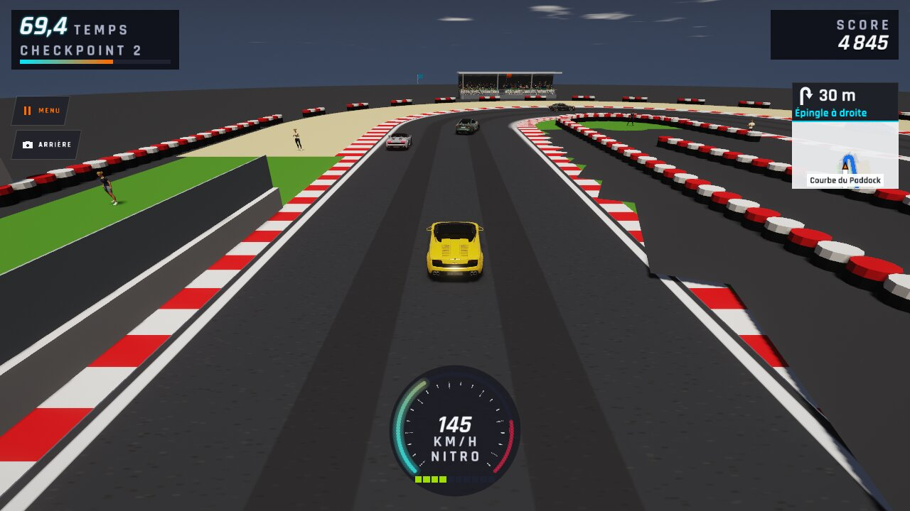
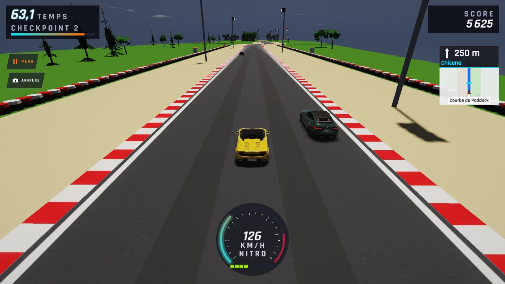
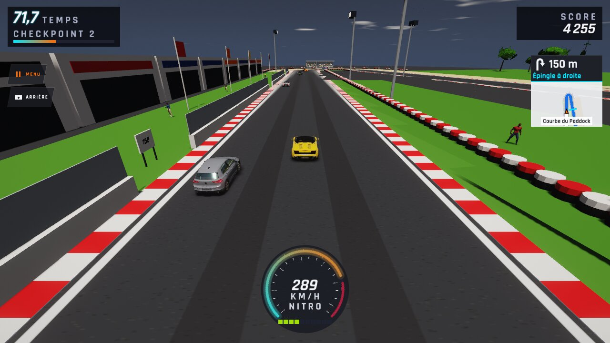
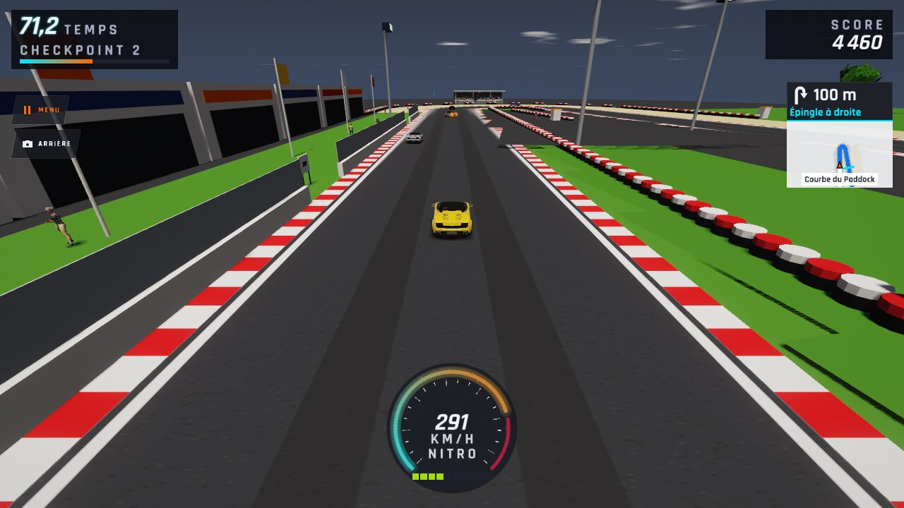
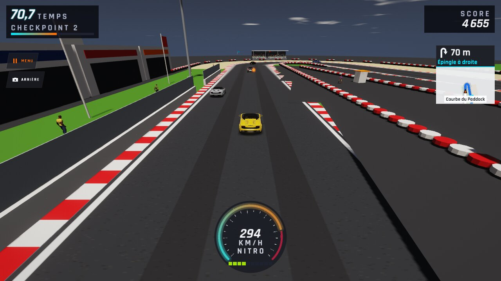
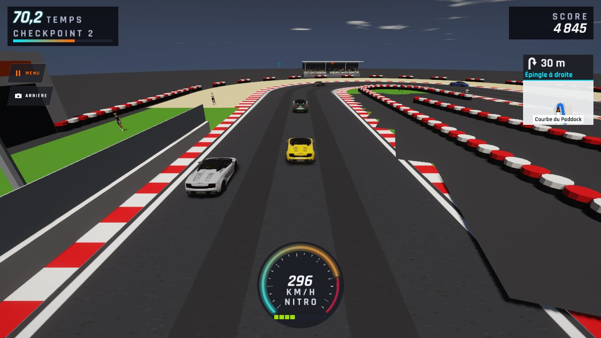
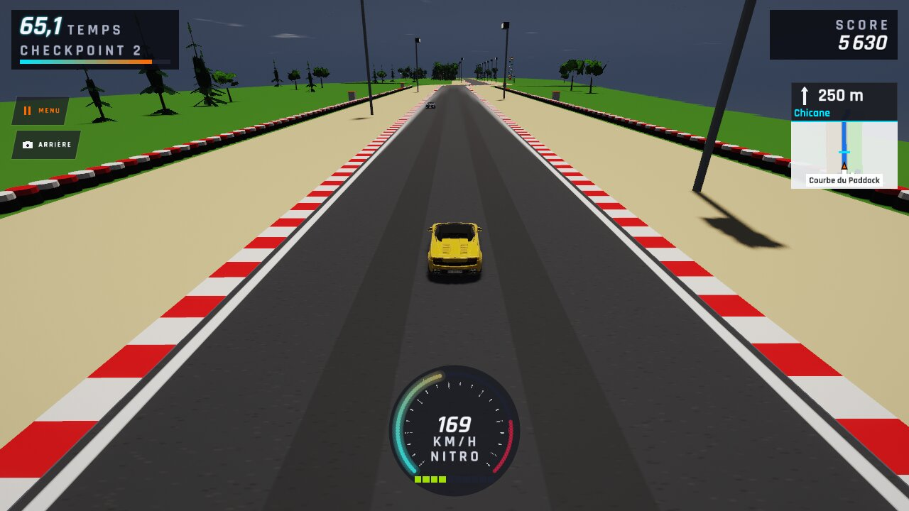

# WFS-258 — captures avant / après (tools/qa/captures_pr.sh)

Branche `feature/waforspeed-258` comparée à `origin/main` ; bancs : virages ; filtre : `virages-gp-aide-*`.

| Capture | Avant (main) | Après (branche) |
|---|---|---|
| `virages-gp-aide-apres-00` | — |  |
| `virages-gp-aide-apres-01` | — |  |
| `virages-gp-aide-apres-02` | — |  |
| `virages-gp-aide-apres-03` | — |  |
| `virages-gp-aide-apres-04` | — |  |
| `virages-gp-aide-apres-05` | — |  |
| `virages-gp-aide-apres-06` | — |  |
| `virages-gp-aide-apres-07` | — |  |
| `virages-gp-aide-avant-00` | — |  |
| `virages-gp-aide-avant-01` | — |  |
| `virages-gp-aide-avant-02` | — |  |
| `virages-gp-aide-avant-03` | — |  |
| `virages-gp-aide-avant-04` | — |  |
| `virages-gp-aide-avant-05` | — |  |
| `virages-gp-aide-avant-06` | — |  |
| `virages-gp-aide-avant-07` | — |  |
