# WFS-258 — captures avant / après (tools/qa/captures_pr.sh)

Branche `feature/waforspeed-258` comparée à `origin/main` ; bancs : virages ; filtre : `virages-vif*`.

| Capture | Avant (main) | Après (branche) |
|---|---|---|
| `virages-vif-apres-00` | — | 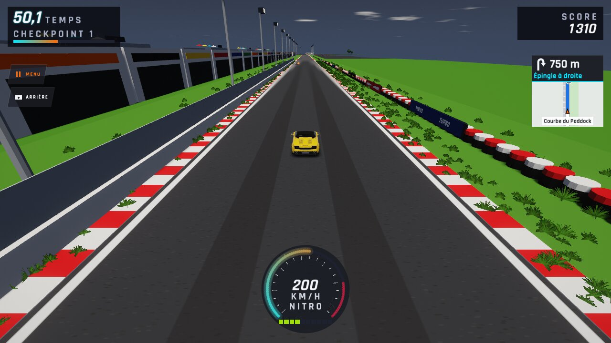 |
| `virages-vif-apres-01` | — | 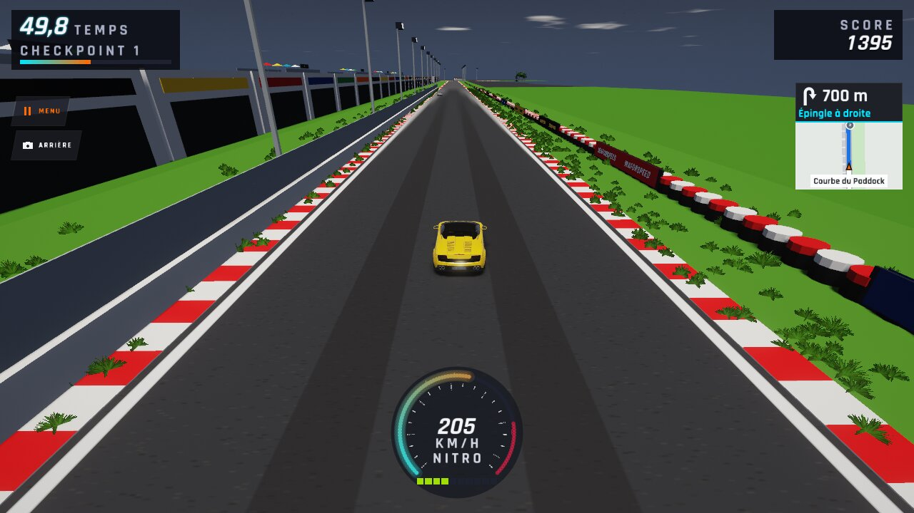 |
| `virages-vif-apres-02` | — | 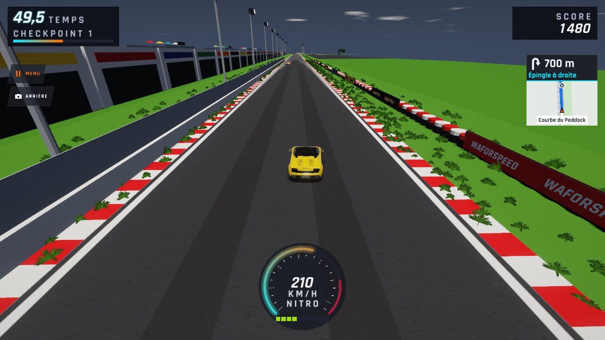 |
| `virages-vif-apres-03` | — | 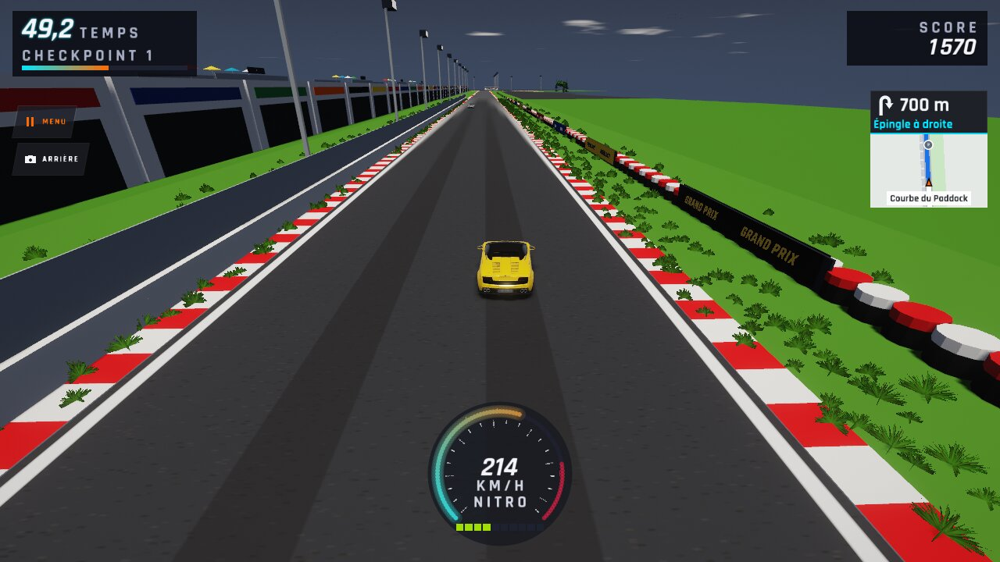 |
| `virages-vif-apres-04` | — | 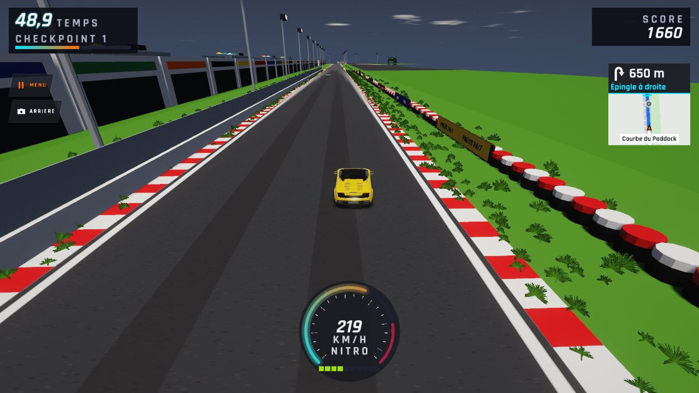 |
| `virages-vif-apres-05` | — | 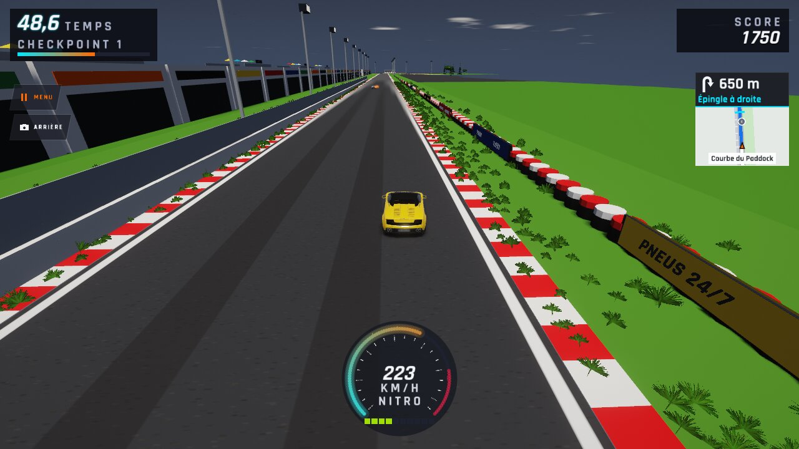 |
| `virages-vif-avant-00` | — | 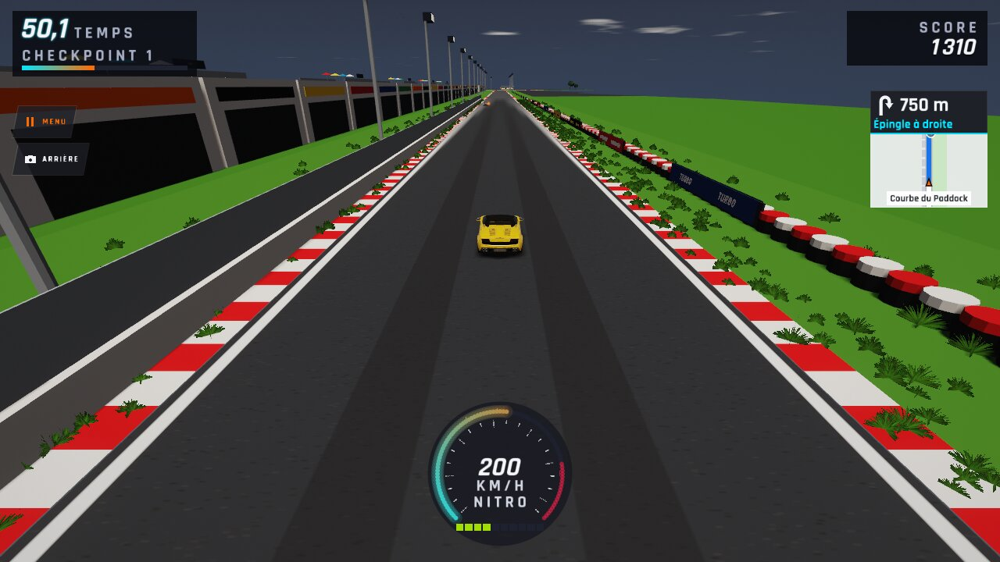 |
| `virages-vif-avant-01` | — | 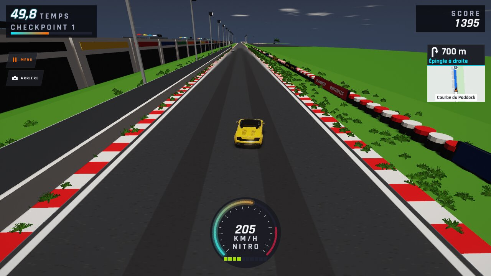 |
| `virages-vif-avant-02` | — | 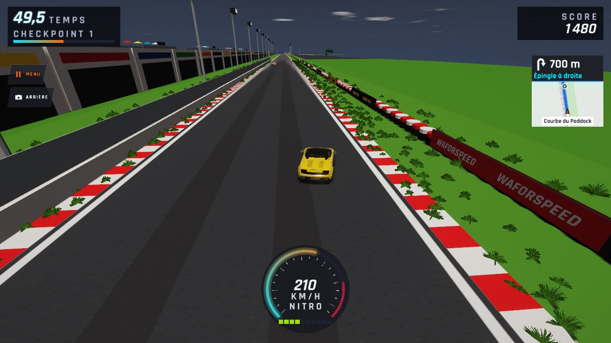 |
| `virages-vif-avant-03` | — | 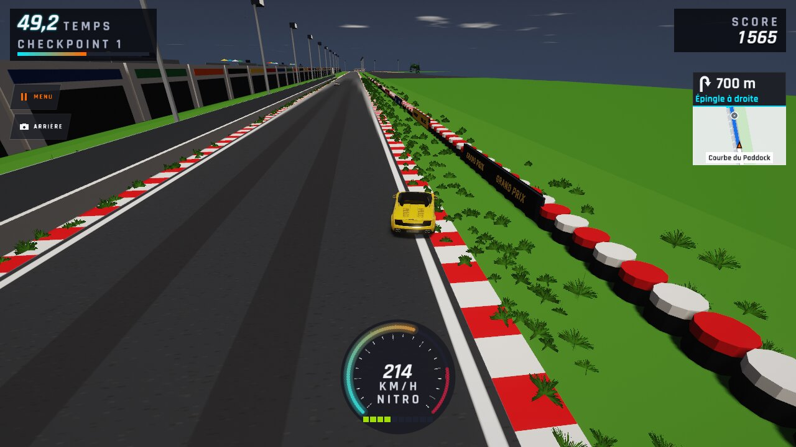 |
| `virages-vif-avant-04` | — | 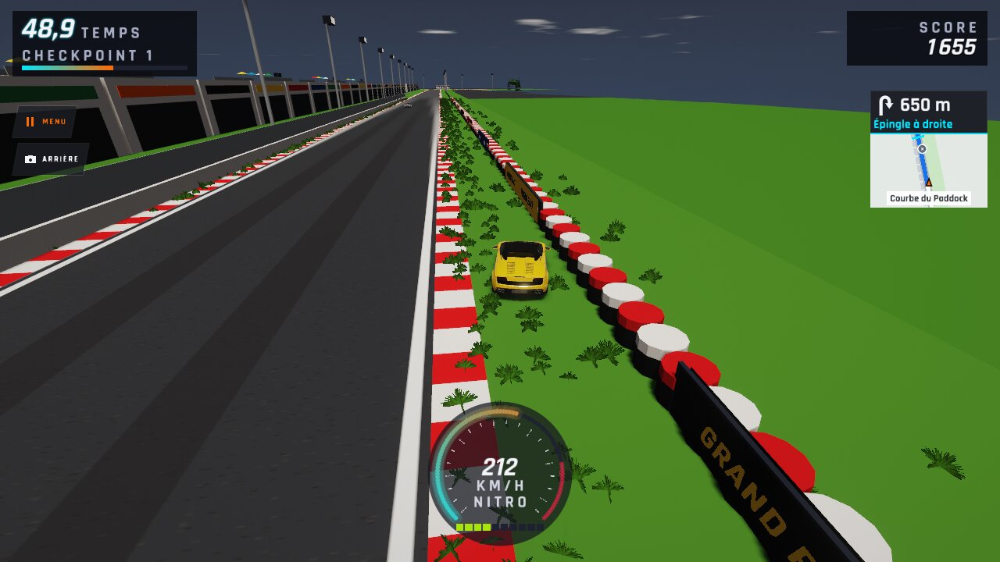 |
| `virages-vif-avant-05` | — | 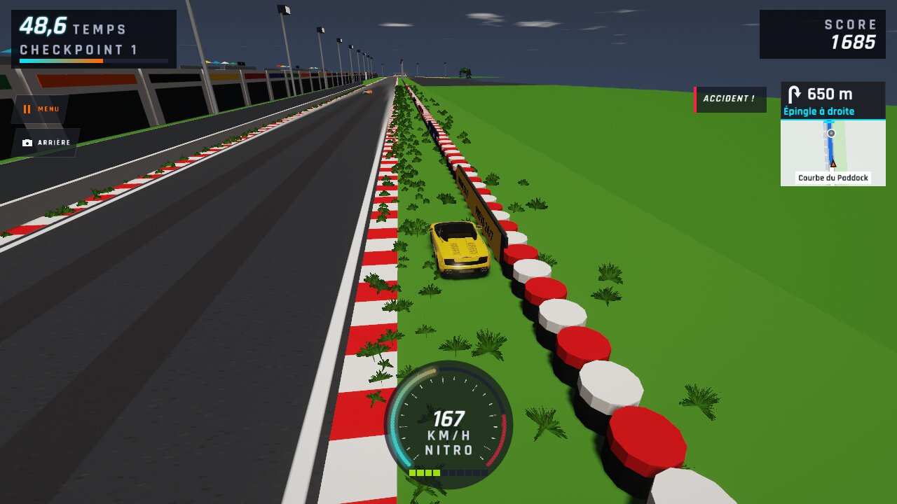 |
| `virages-vif-dessus-apres` | — | 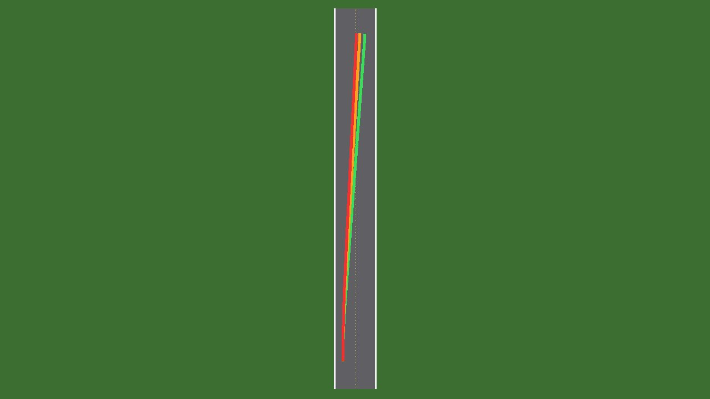 |
| `virages-vif-dessus-avant` | — | 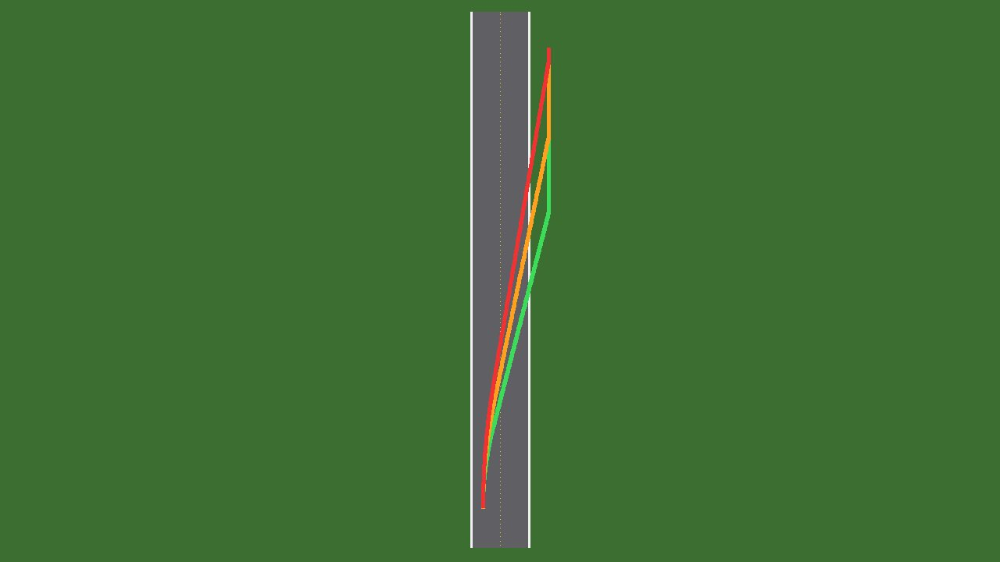 |
