# WFS-262 — captures avant / après (tools/qa/captures_pr.sh)

Branche `feature/waforspeed-262` comparée à `origin/main` ; bancs : menu2:2400x1080 perf ; filtre : `[rp][ee][gr]*`.

| Capture | Avant (main) | Après (branche) |
|---|---|---|
| `reglages-108` | 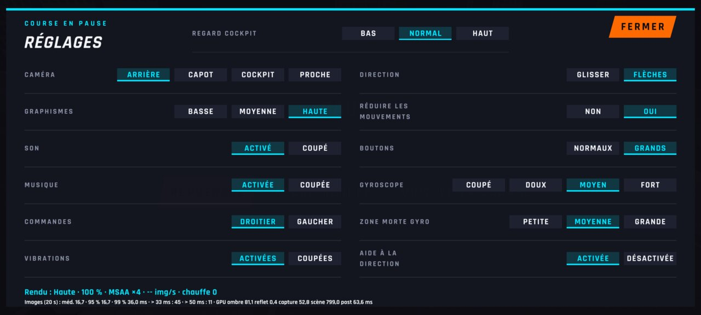 | 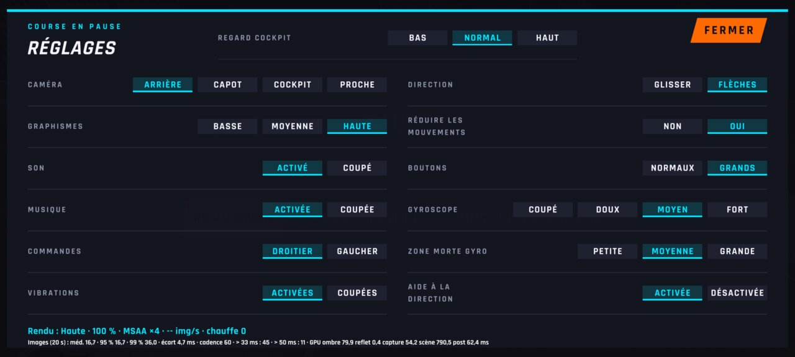 |
| `reglages-basse` | 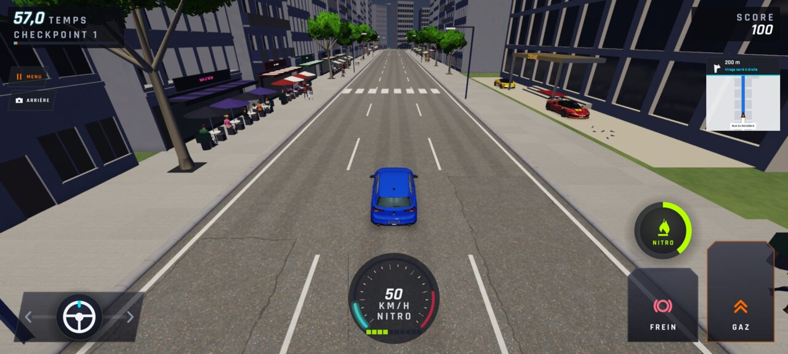 |  |
| `reglages-commandes` | 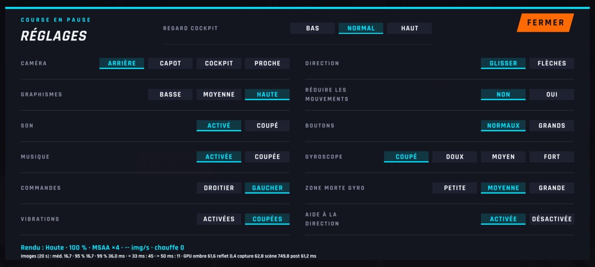 | 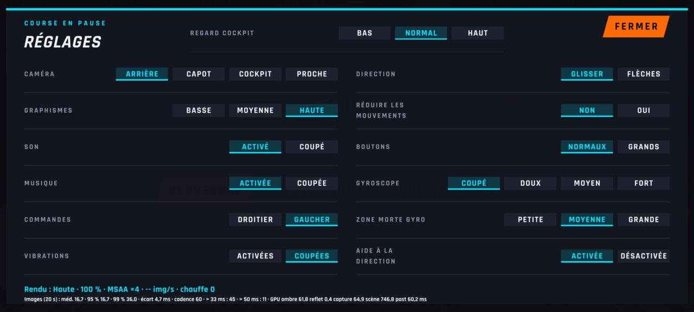 |
| `reglages-menu` | 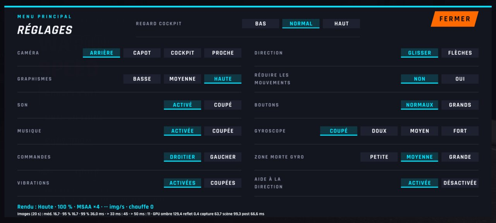 | 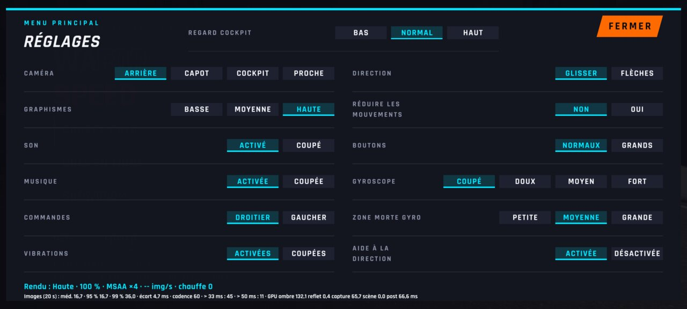 |
| `reglages-musique` |  | 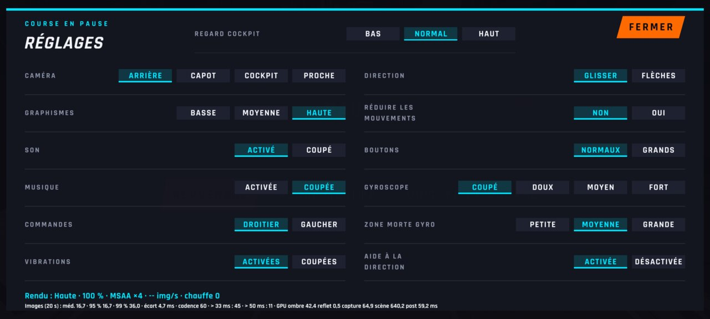 |
| `reglages-pause` | 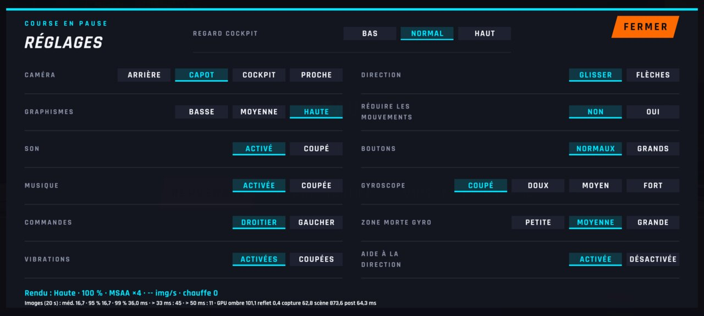 | 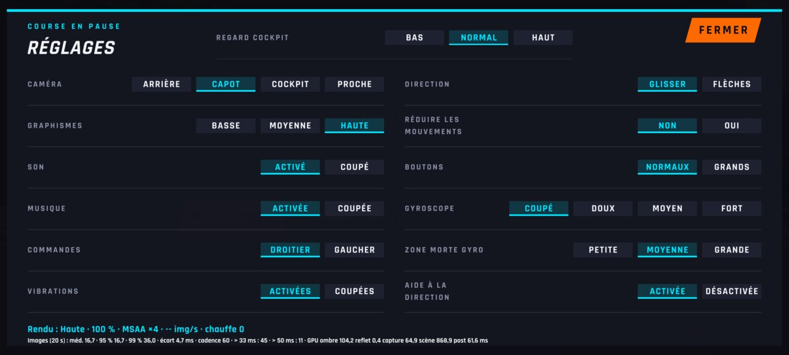 |
| `reglages` | 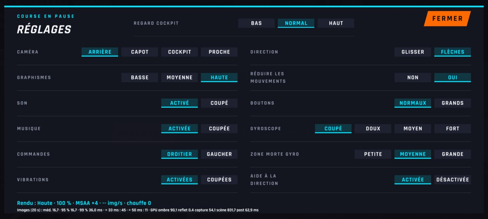 | 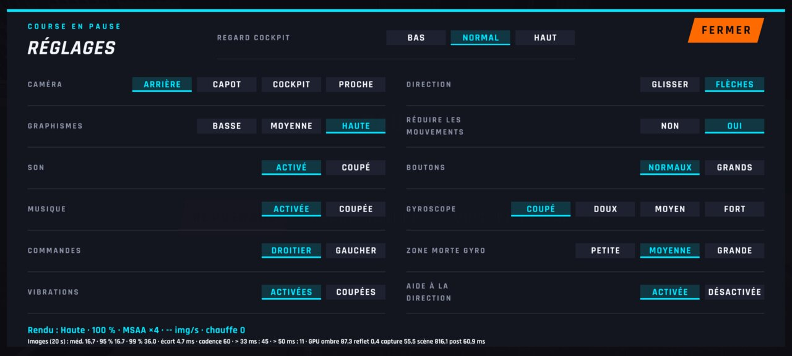 |
| `perf-ville-basse` |  | 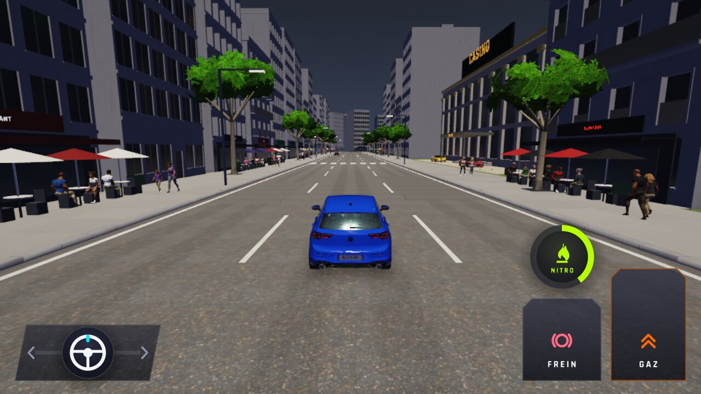 |
| `perf-ville-haute` | 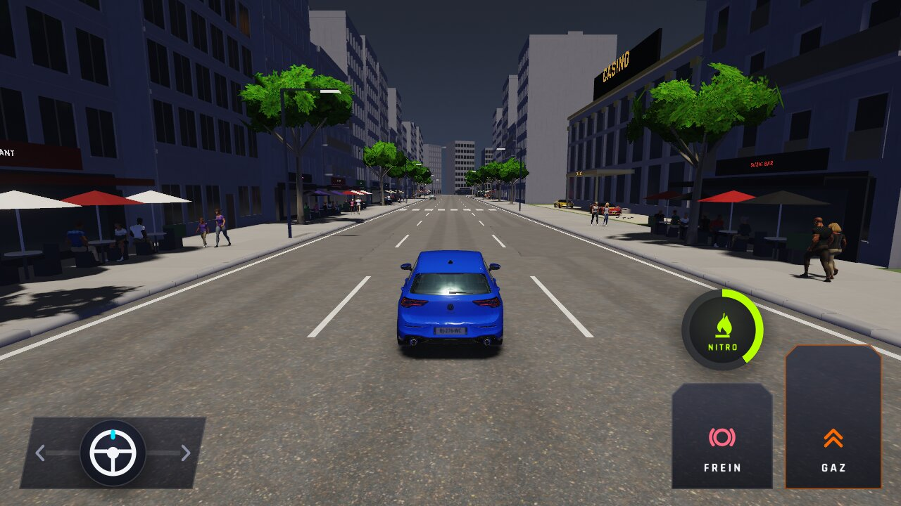 |  |
