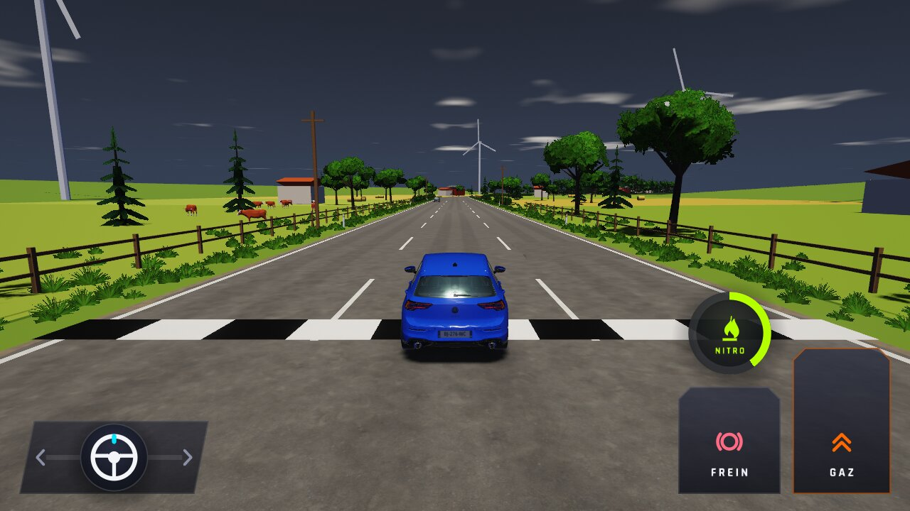
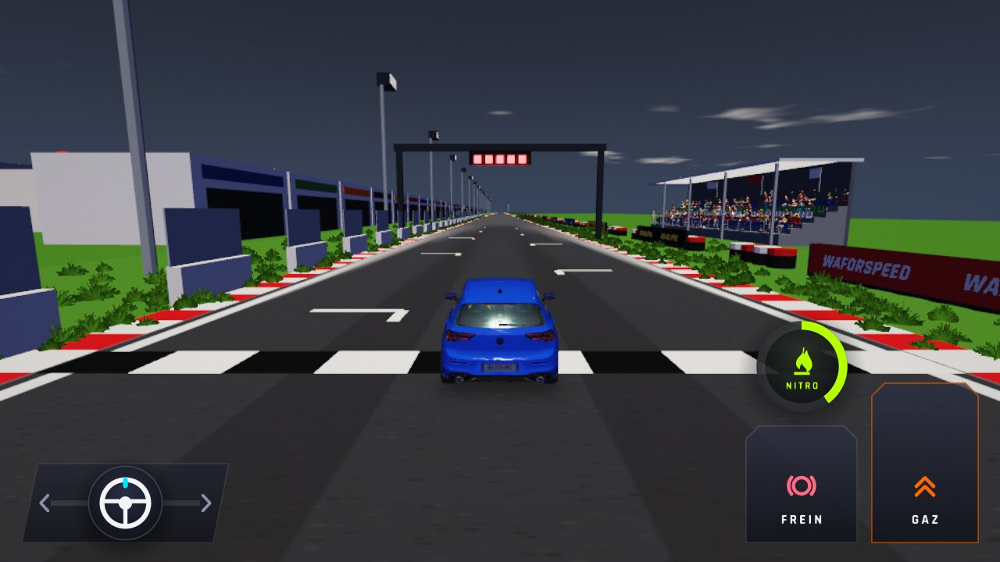
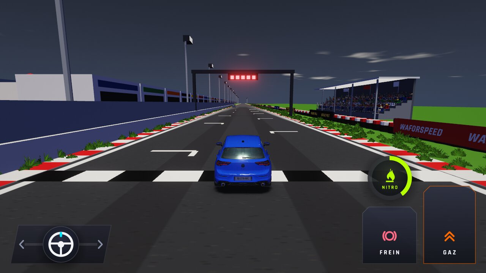
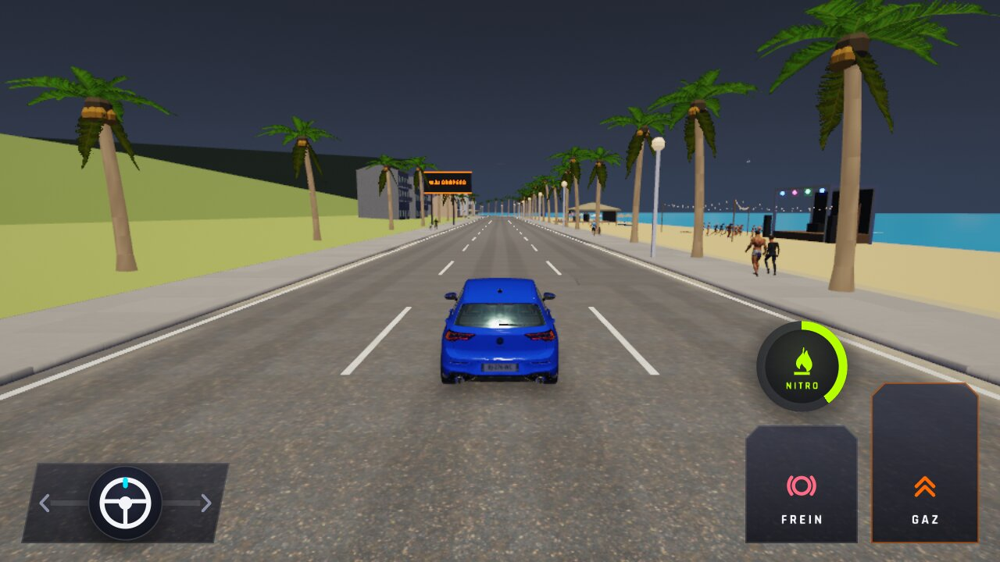
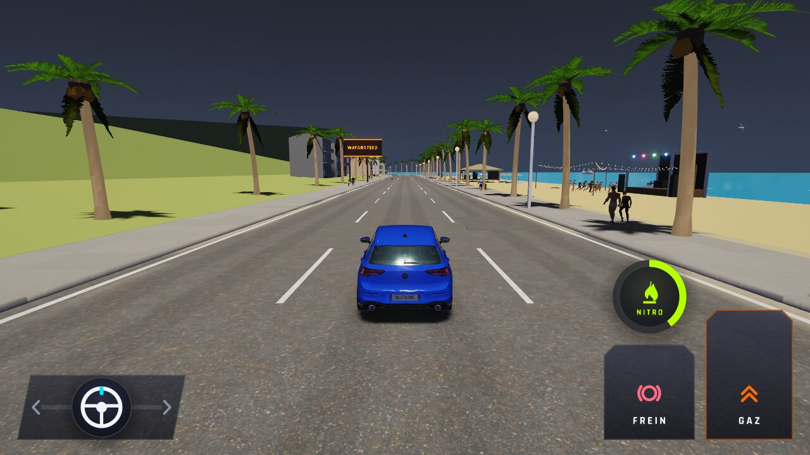
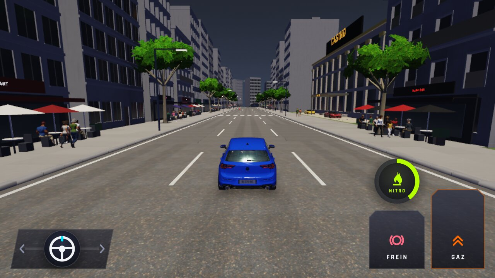
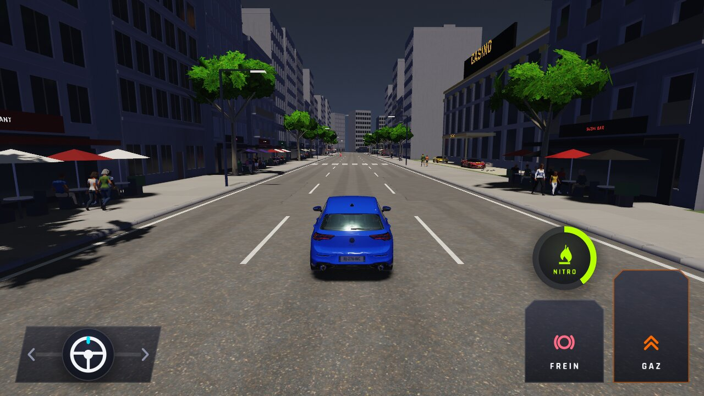
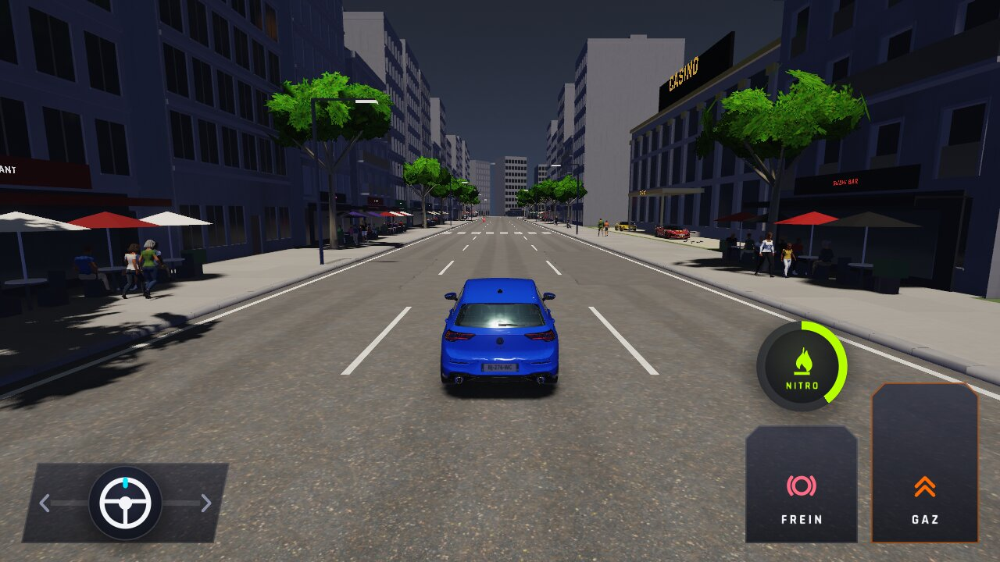

# WFS-265 — captures avant / après (tools/qa/captures_pr.sh)

Branche `feature/waforspeed-265` comparée à `origin/main` ; bancs : `qualite` (même voiture du trafic devant le joueur à 10, 25, 50, 60, 80, 120 et 180 m, Haute et Basse, Ville) et `perf` (4 cartes, Haute et Basse, jour).

| Capture | Avant (main) | Après (branche) |
|---|---|---|
| `voiture-distance-10` |  |  |
| `voiture-distance-10-basse` |  |  |
| `voiture-distance-25` |  |  |
| `voiture-distance-25-basse` |  |  |
| `voiture-distance-50` |  |  |
| `voiture-distance-50-basse` |  |  |
| `voiture-distance-60` |  |  |
| `voiture-distance-60-basse` |  |  |
| `voiture-distance-80` |  |  |
| `voiture-distance-80-basse` |  |  |
| `voiture-distance-120` |  |  |
| `voiture-distance-120-basse` |  |  |
| `voiture-distance-180` |  |  |
| `voiture-distance-180-basse` |  |  |
| `perf-campagne-basse` |  |  |
| `perf-campagne-haute` |  |  |
| `perf-circuit-basse` |  |  |
| `perf-circuit-haute` |  |  |
| `perf-plage-basse` |  |  |
| `perf-plage-haute` |  |  |
| `perf-ville-basse` |  |  |
| `perf-ville-haute` |  |  |
