# WFS-266 — captures avant / après (tools/qa/captures_pr.sh)

Branche `feature/waforspeed-266` comparée à `origin/main` ; bancs : squelette conducteurs ; filtre : `[rc][eo][an]*`.

| Capture | Avant (main) | Après (branche) |
|---|---|---|
| `conducteurs-golf-arriere-jour` | 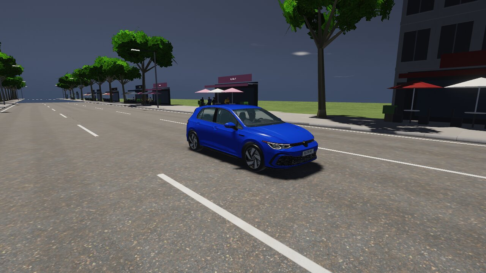 |  |
| `conducteurs-golf-arriere-nuit` | 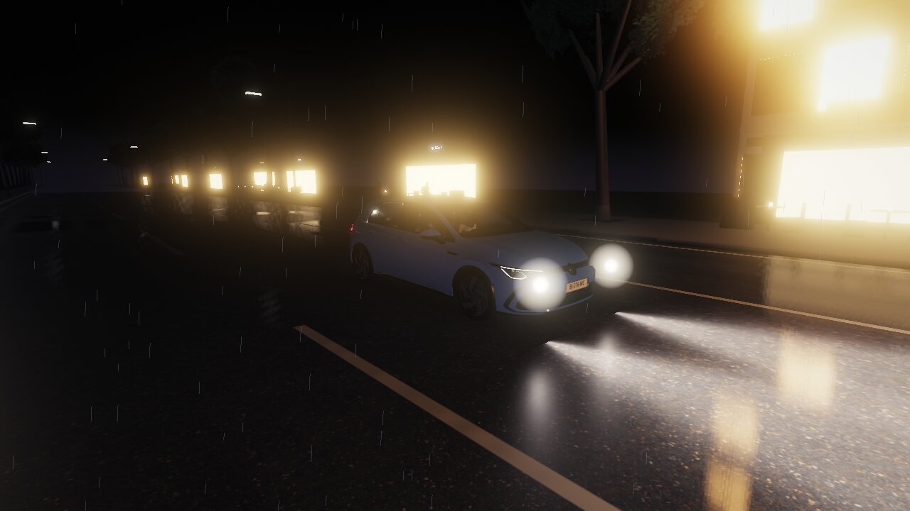 |  |
| `conducteurs-golf-jour` | 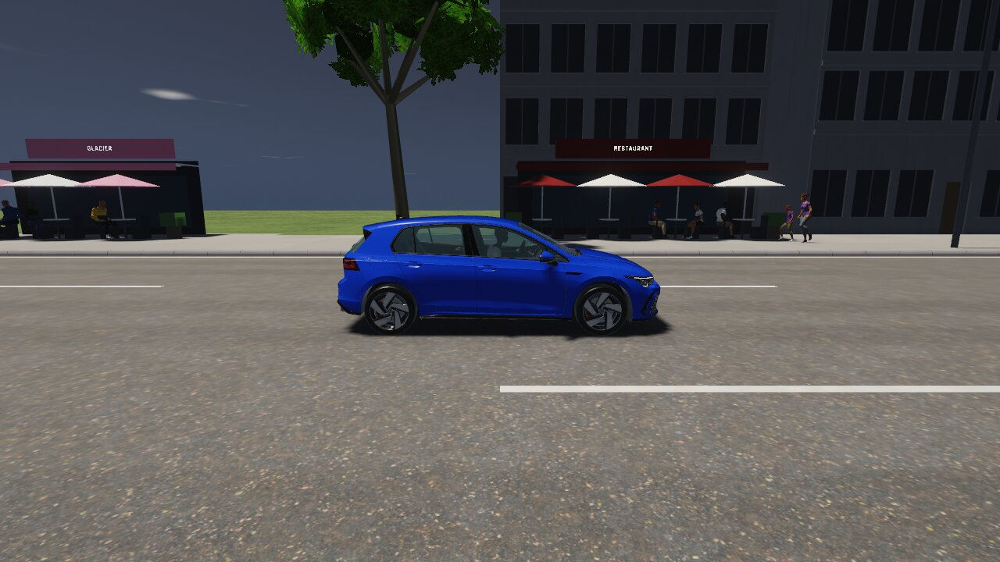 |  |
| `conducteurs-golf-nuit` | 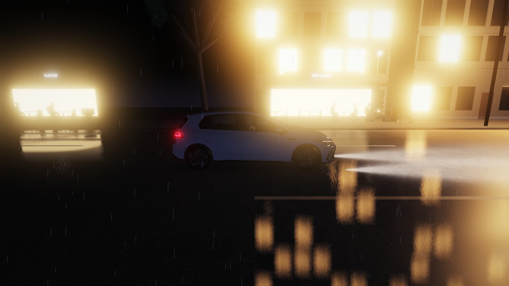 |  |
| `conducteurs-rrsport-jour` | 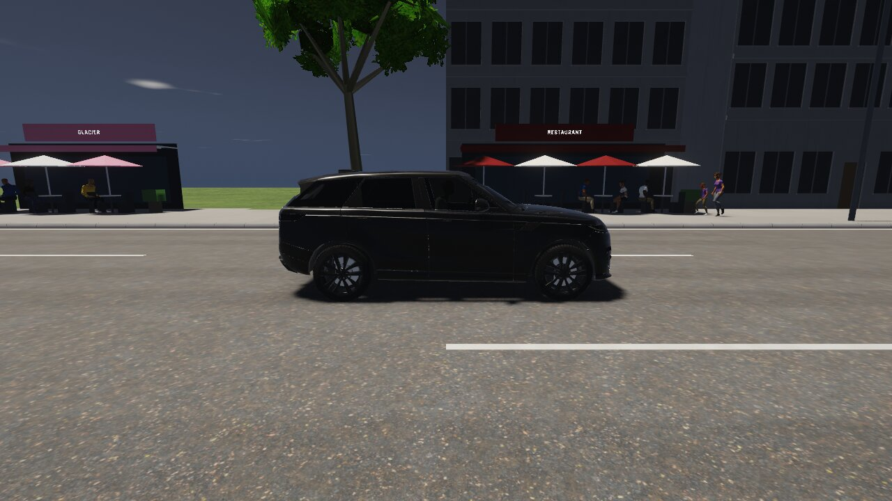 |  |
| `conducteurs-rrsport-nuit` |  | 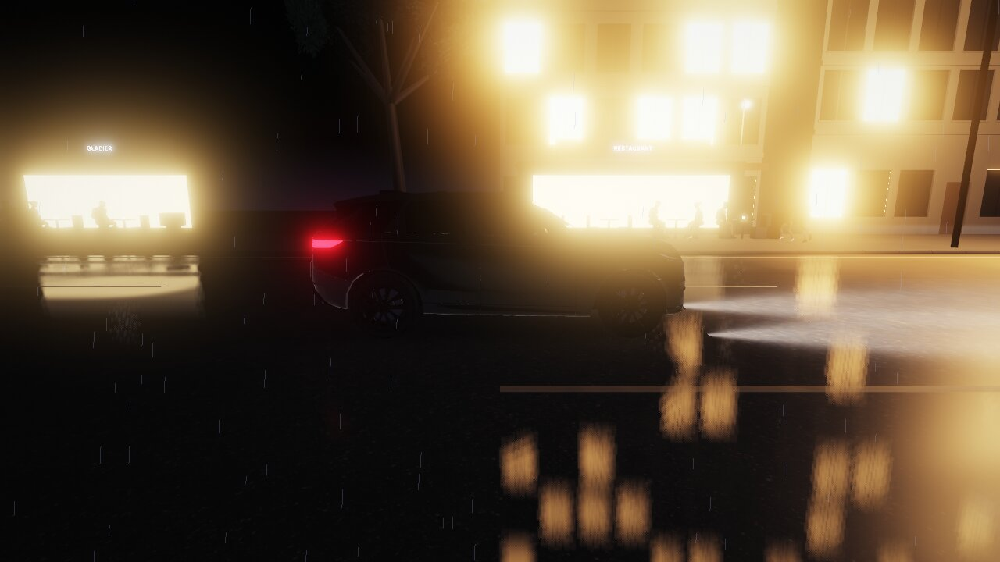 |
| `conducteurs-sf90-jour` | 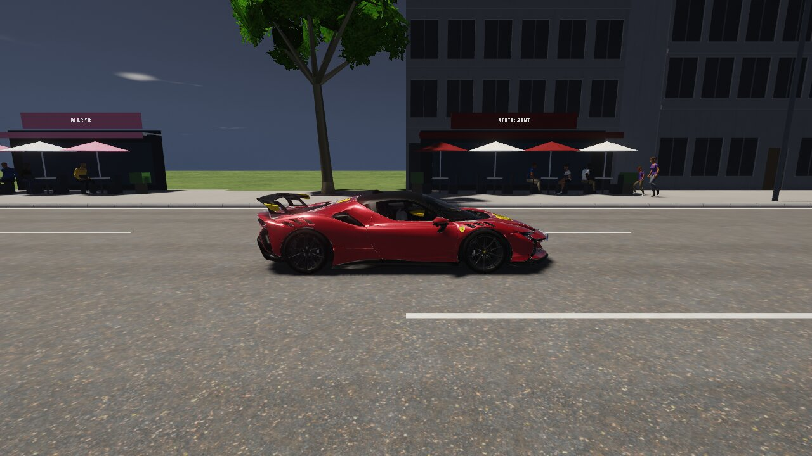 |  |
| `conducteurs-sf90-nuit` |  | 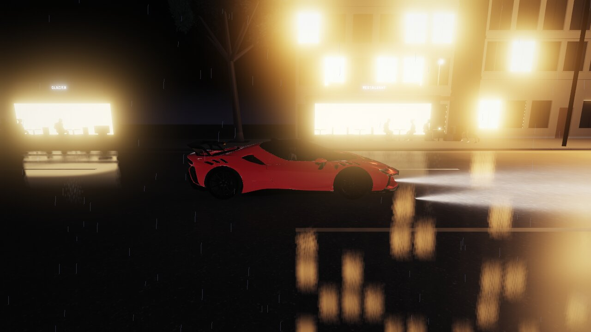 |
| `realisme-pietons-humains-assis` | 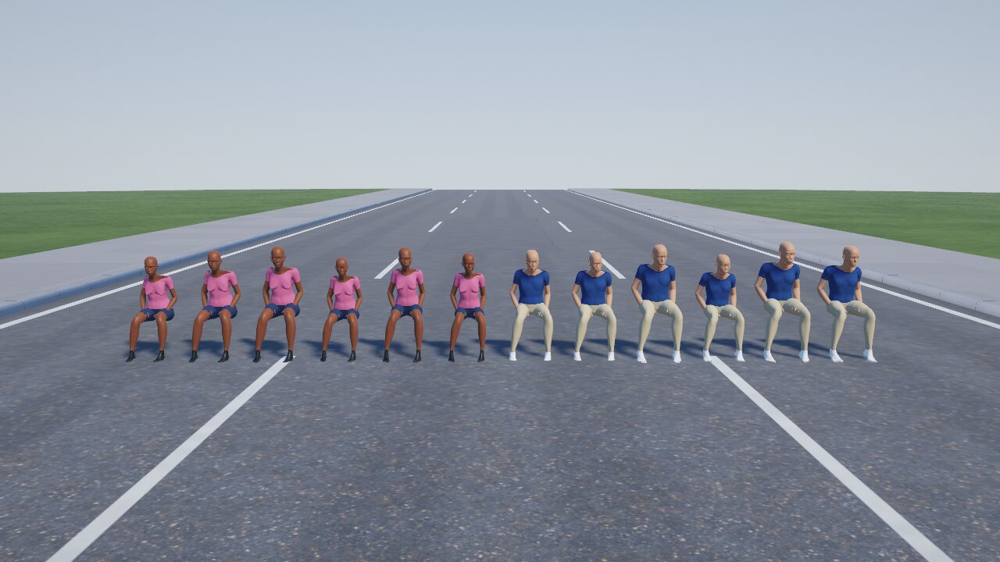 | 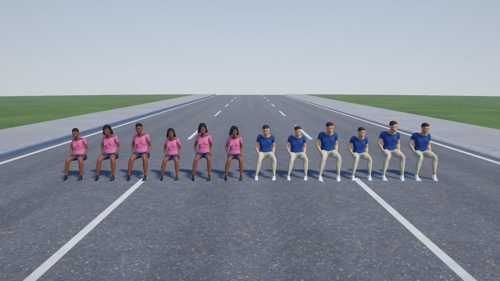 |
| `realisme-pietons-humains-debout` | 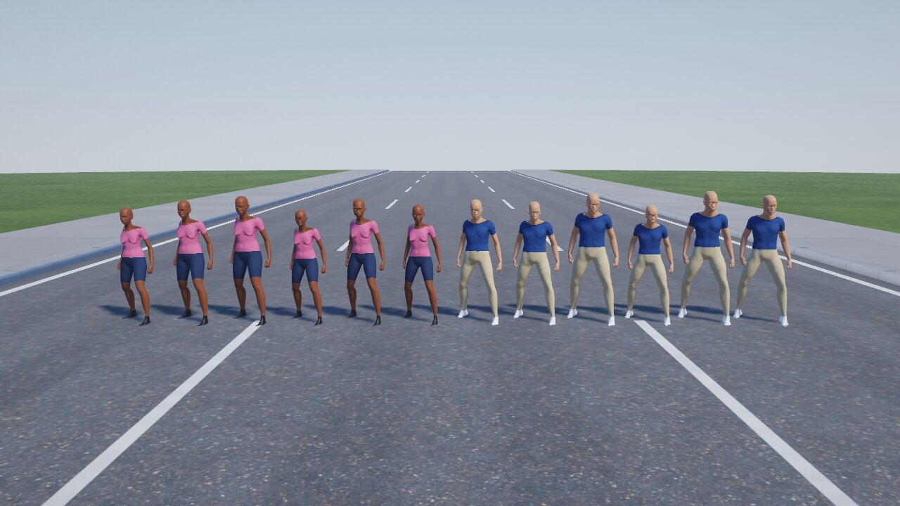 |  |
| `gros-plan-tetes-jour` | 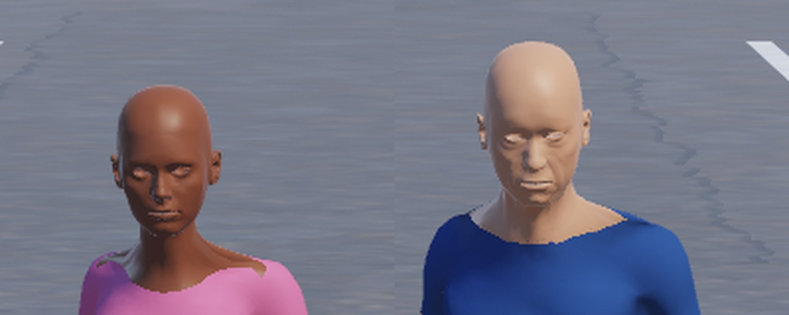 | 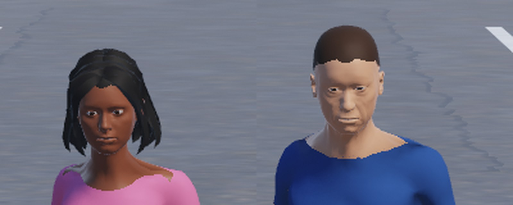 |
| `gros-plan-conducteur-golf-jour` | 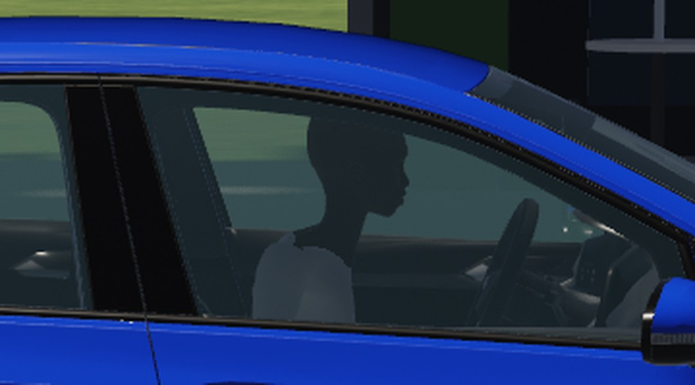 | 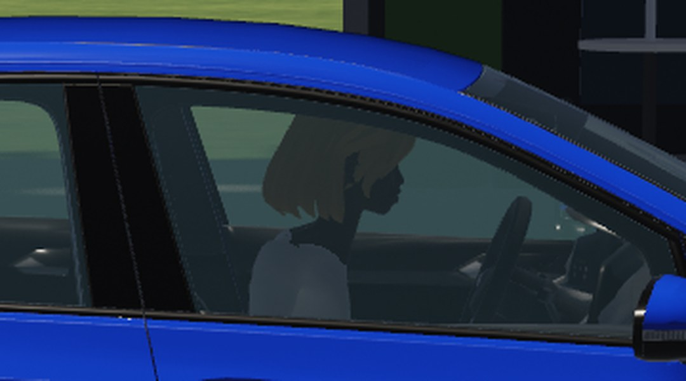 |
| `gros-plan-conducteur-golf-nuit` | 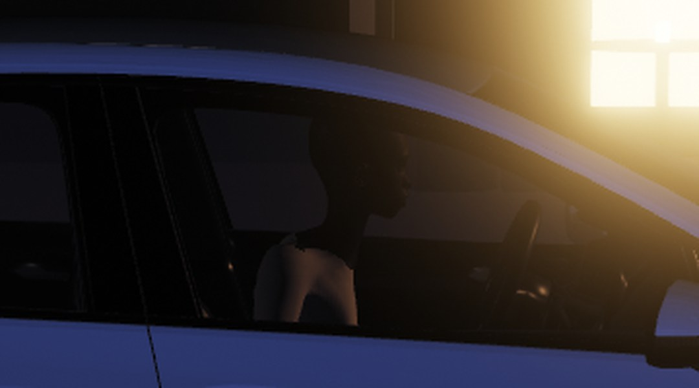 | 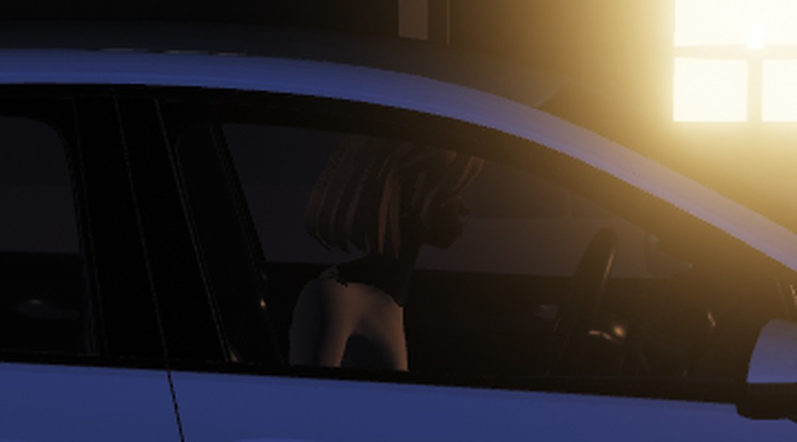 |
