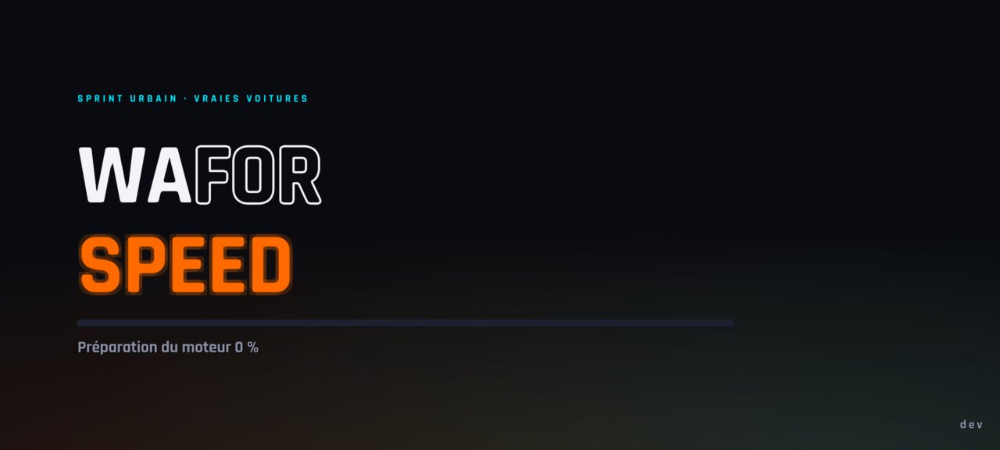
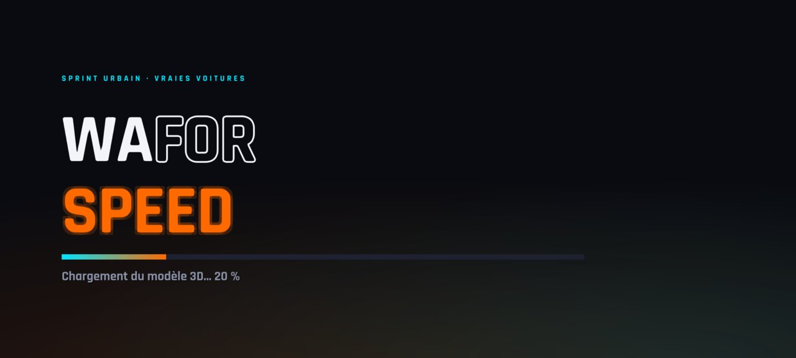
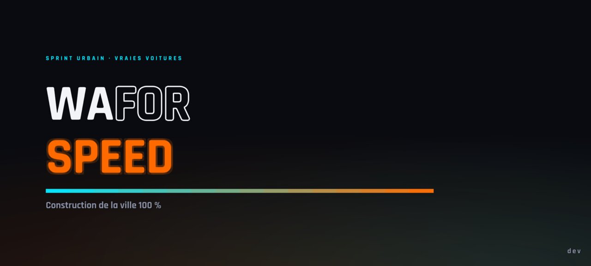
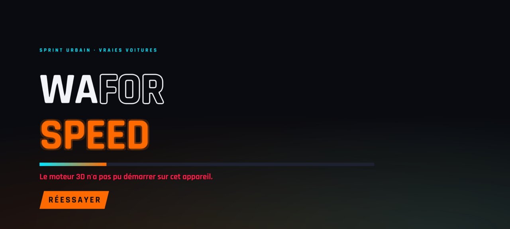
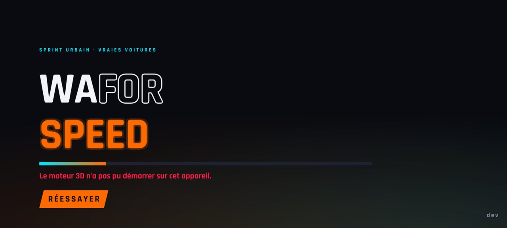
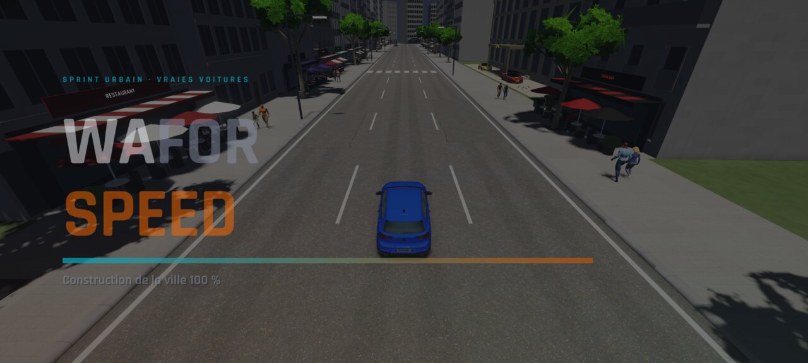
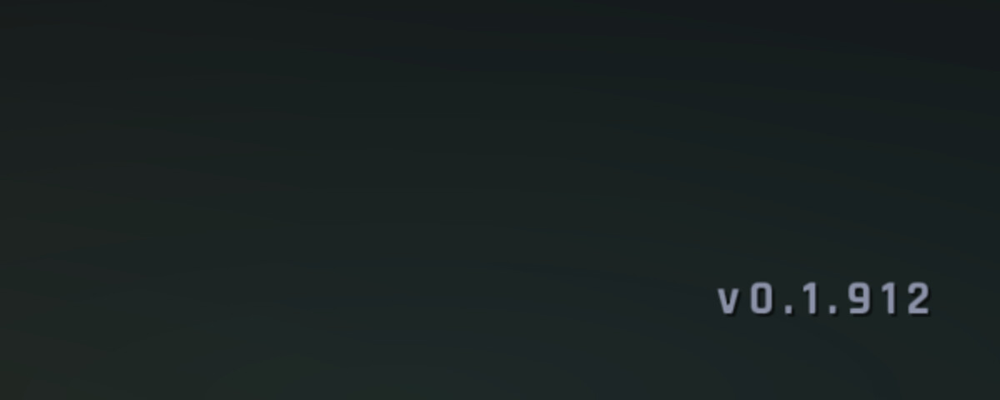
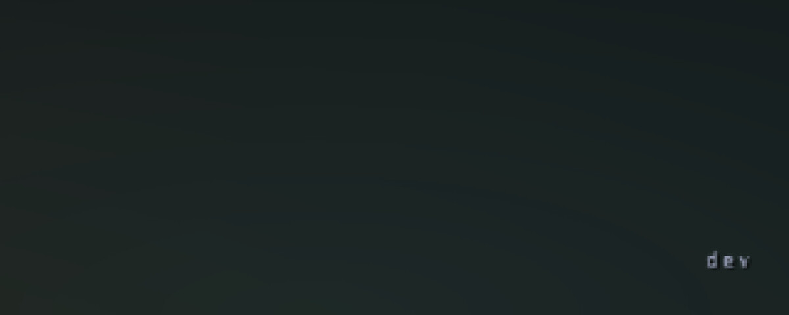

# WFS-279 — captures avant / après (tools/qa/captures_pr.sh)

Branche `feature/waforspeed-279` comparée à `origin/main` ; bancs : chargement:2400x1080 ; filtre : `*`.

| Capture | Avant (main) | Après (branche) |
|---|---|---|
| `chargement-0` |  |  |
| `chargement-1` |  |  |
| `chargement-2` |  |  |
| `chargement-erreur` |  |  |
| `chargement-fondu` |  |  |
| `zoom coin 2400×1080, -DWFS_VERSION=0.1.912` (valeur d'un APK, compilé en local) | — |  |
| `zoom coin 1280×720` (PC : « dev ») |  |  |
