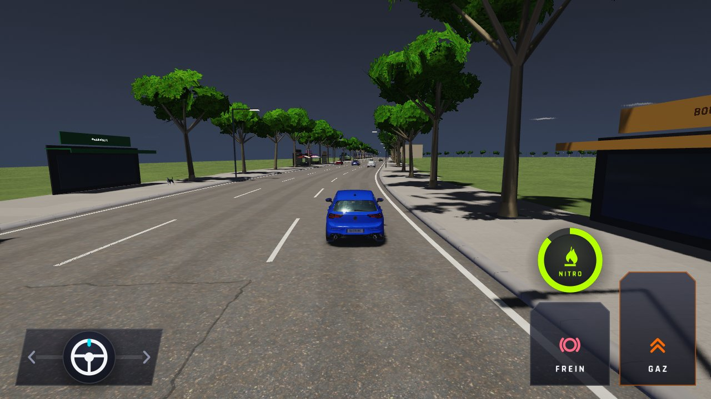
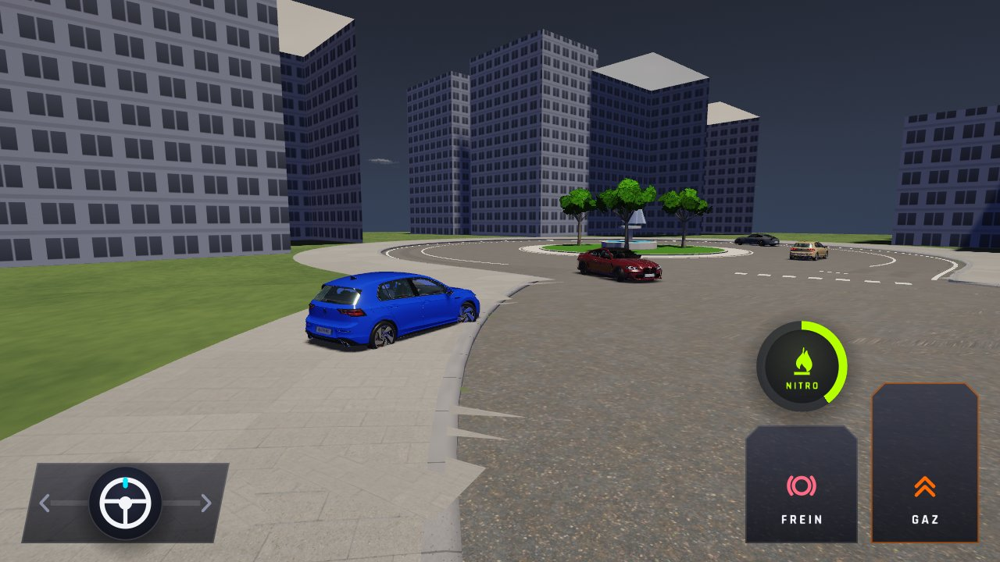
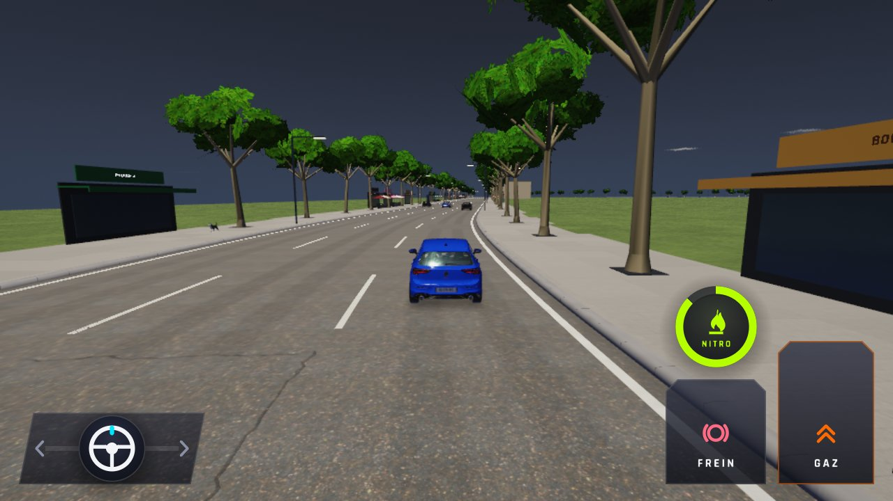
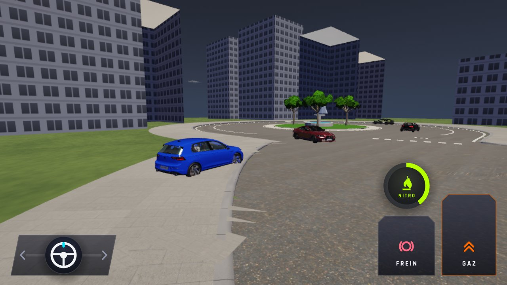
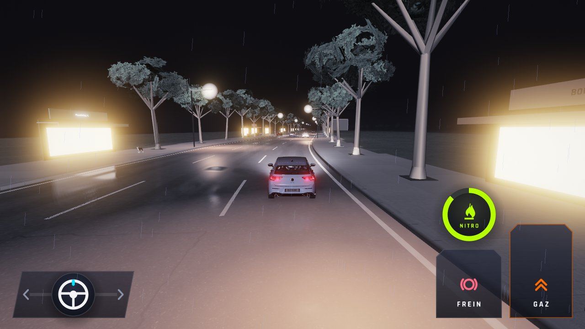
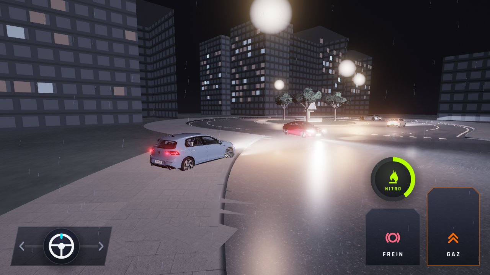

# WFS-281 — captures avant / après

Agent : agent arwa (Claude, session trafic). Banc `perf` (WFS_BANC=perf, Ville sauf mention, pilote automatique, vue du joueur),
`WFS_PERF_AVANCE` = 0 / 10000 / 36000 / 38000 images de course, `WFS_PERF_AVANCE_RENDU=0`, `WFS_PERF_CHAUFFE=5`, `WFS_PERF_IMAGES=20` ;
nuit : `WFS_MOMENT=nuit`. Dernière image de la mesure, réduite en JPG (1280 px, qualité 85), même format que `tools/qa/captures_pr.sh`.
**Avant** = la branche synchronisée avec `main` (c49a5f2) où `traffic.cpp`, `traffic.h` et `traffic_system.cpp` sont ceux de `origin/main` ;
**après** = la branche. Les deux binaires ont la même accroche de mesure du banc perf (le banc d'avant ne sait pas avancer 36000 images
sans dessiner : 1200 images à ≈ 2 s chacune sur lavapipe). Le script `captures_pr.sh` n'a donc pas été lancé tel quel : il recompile `main`
sans l'accroche, et le banc est trop lent pour 36000 images.

| Capture | Avant (main) | Après (branche) |
|---|---|---|
| `ville-haute-depart` — Ville, Haute, départ (WFS_PERF_AVANCE=0) |  |  |
| `ville-haute-2min50` — Ville, Haute, ≈ 2 min 50 (10000 images) |  |  |
| `ville-haute-10min` — Ville, Haute, 10 min (36000 images) |  |  |
| `ville-haute-10min30` — Ville, Haute, 10 min 30 (38000 images) : trafic vivant devant le joueur |  |  |
| `ville-basse-10min30` — Ville, Basse, 10 min 30 |  |  |
| `ville-nuit-haute-10min30` — Ville, nuit, Haute, 10 min 30 : phares du trafic (WFS-226) |  |  |
| `corniche-haute-10min` — Corniche, Haute, 10 min |  |  |
| `campagne-haute-10min` — Campagne, Haute, 10 min |  |  |
