# WFS-286 — captures avant / après (tools/qa/captures_pr.sh)

Branche `feature/waforspeed-286` comparée à `origin/main` ; bancs : menu2 manette ; filtre : `@(reglages-menu|reglages-pause|reglages|manette-reglages|duel-resultat-4|salon-amis-fin)`.

| Capture | Avant (main) | Après (branche) |
|---|---|---|
| `duel-resultat-4` | 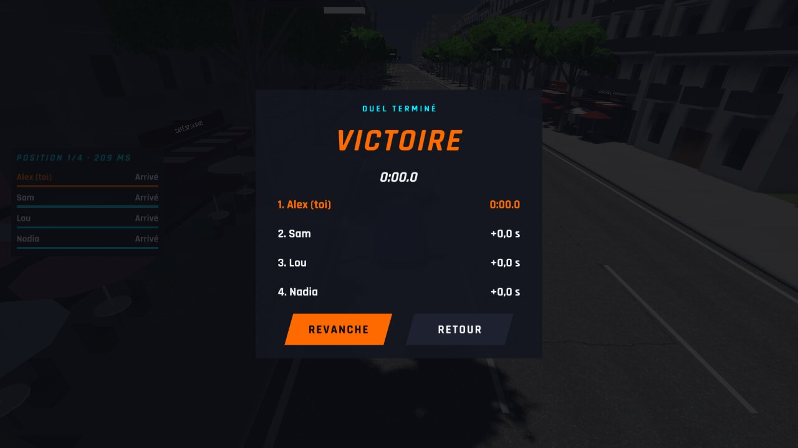 | 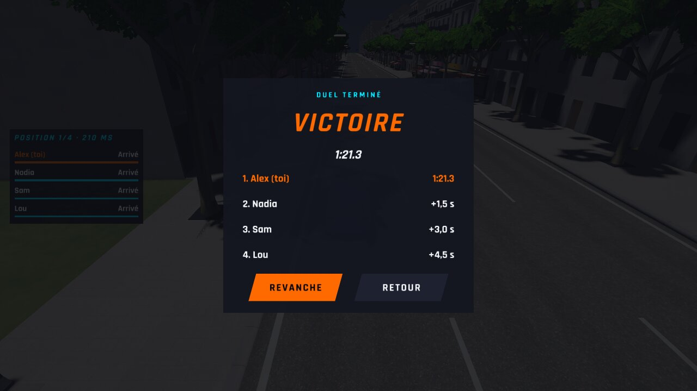 |
| `manette-reglages` | 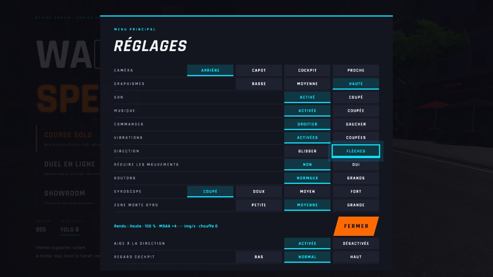 | 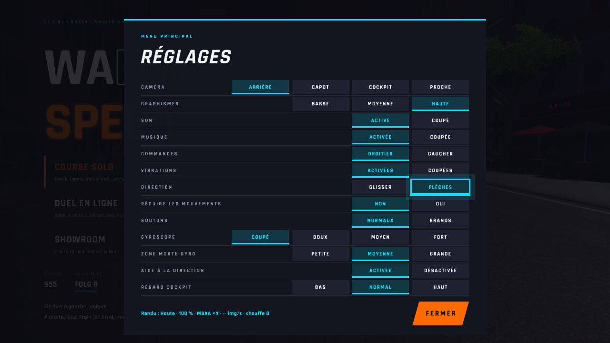 |
| `reglages-menu` | 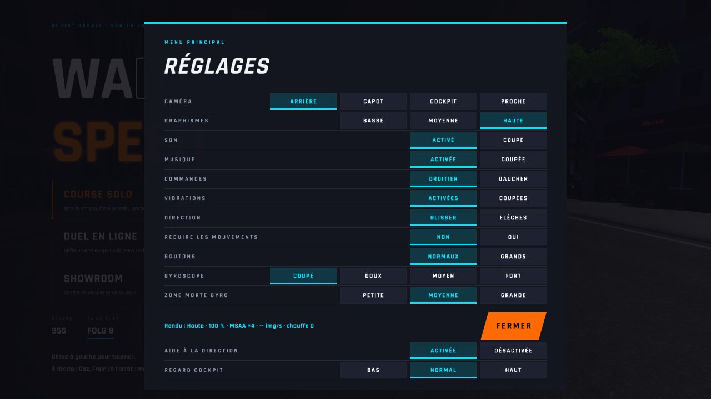 | 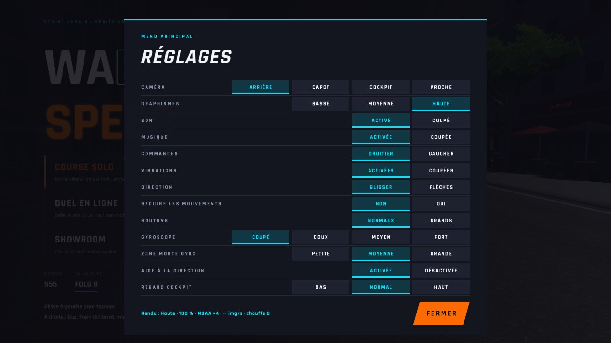 |
| `reglages-pause` | 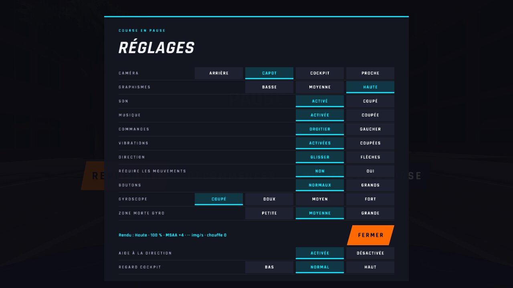 | 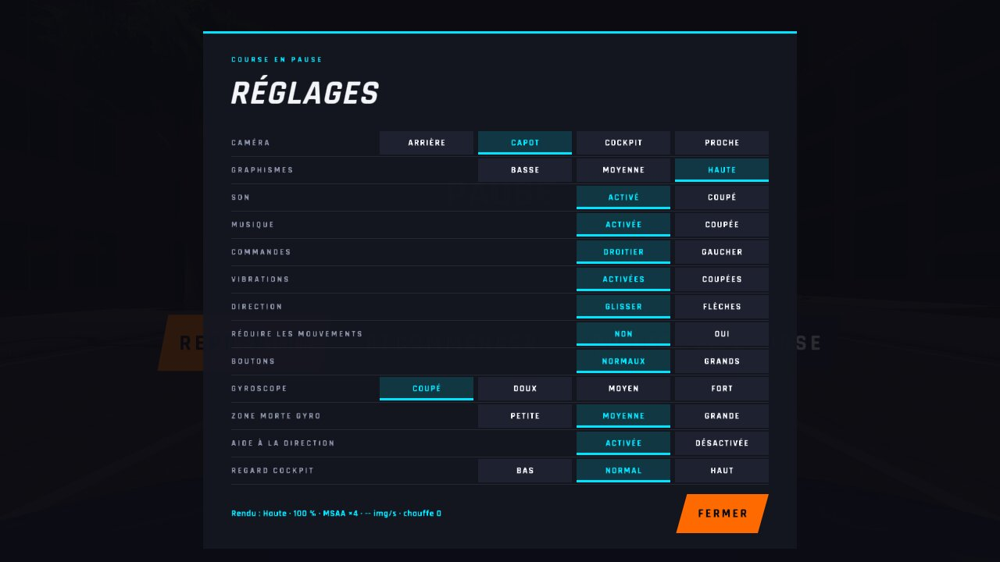 |
| `reglages` | 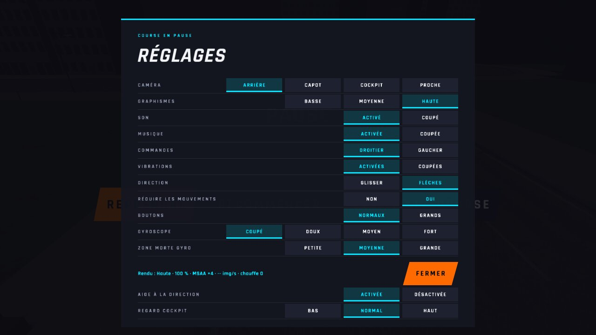 | 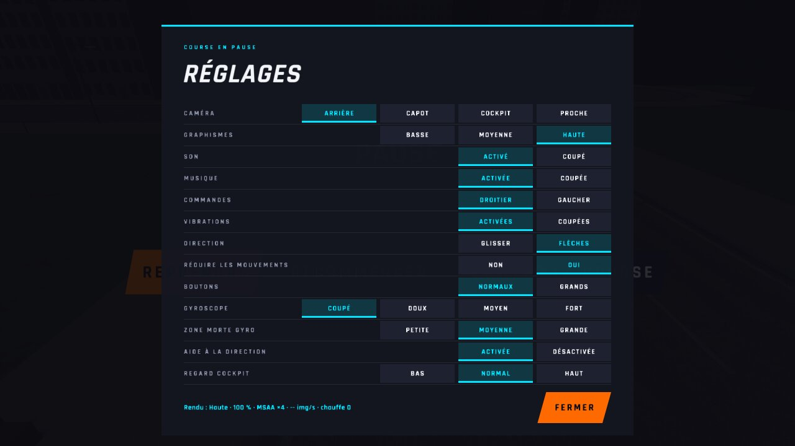 |
| `salon-amis-fin` |  | 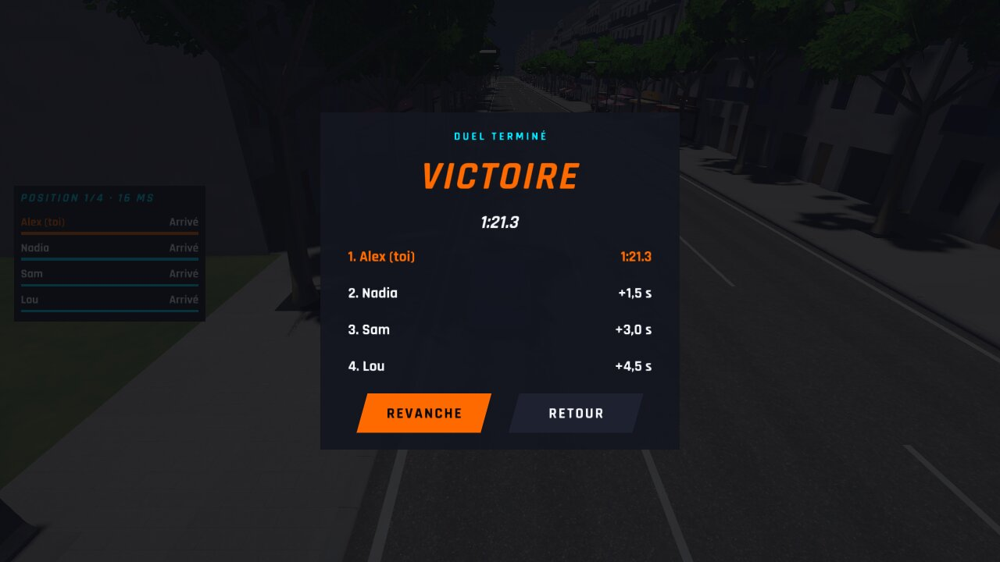 |
