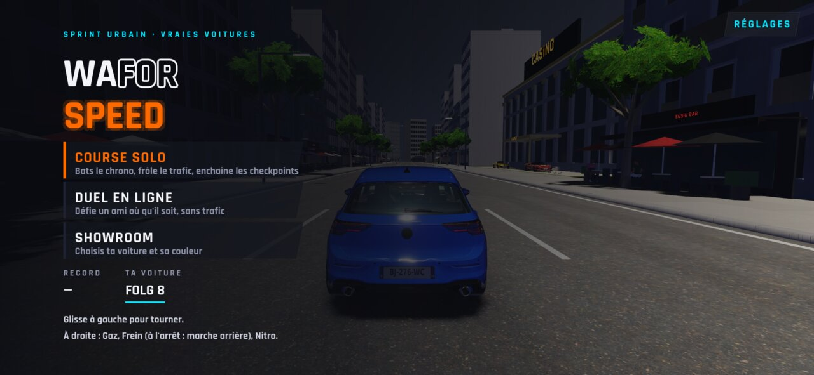
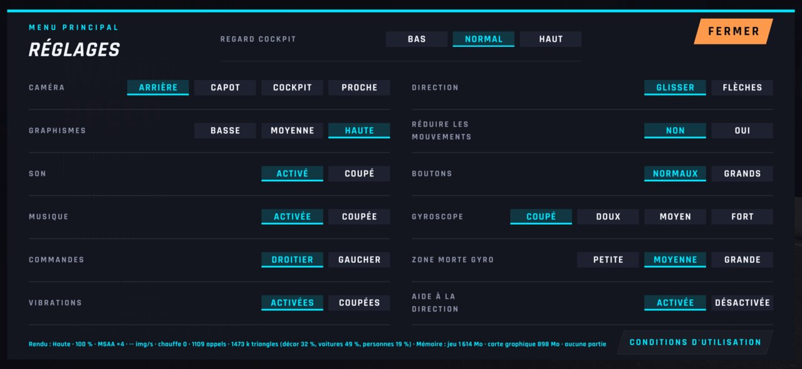
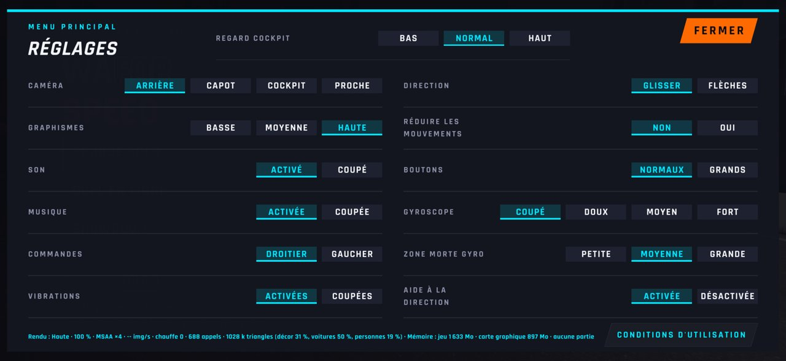
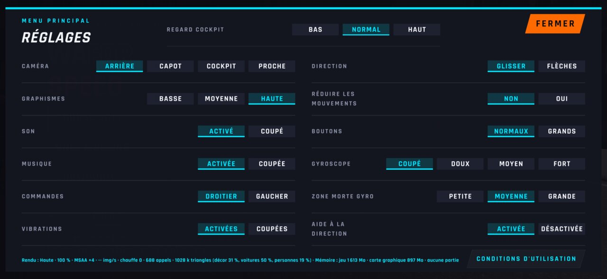
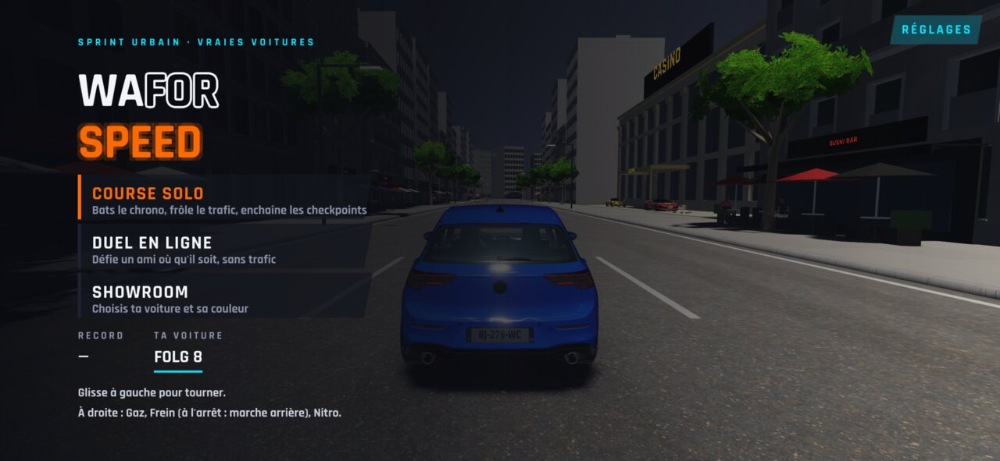
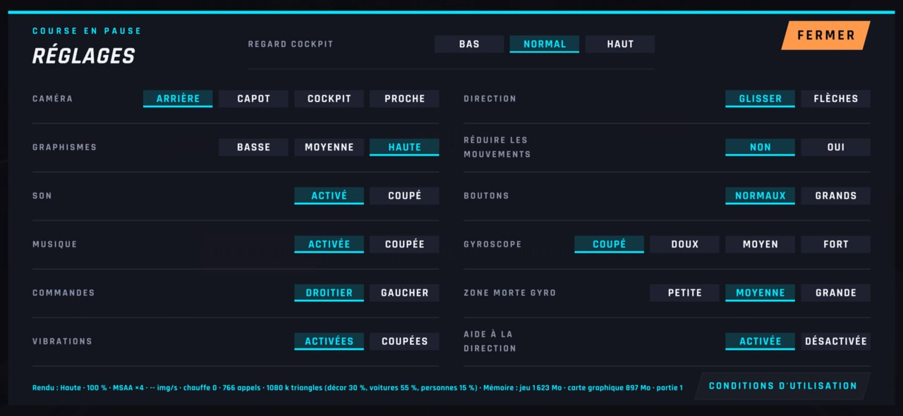

# WFS-290 — captures avant / après (tools/qa/captures_pr.sh)

Branche `feature/waforspeed-290` comparée à `origin/main` ; bancs : reglages-appuis:2340x1080 ; filtre : `*`.

| Capture | Avant (main) | Après (branche) |
|---|---|---|
| `reglages-appuis-menu-ferme` |  |  |
| `reglages-appuis-menu-fermer-appuye` |  |  |
| `reglages-appuis-menu-ouvert` |  |  |
| `reglages-appuis-menu-reglages-appuye` |  |  |
| `reglages-appuis-pause-ferme` |  |  |
| `reglages-appuis-pause-fermer-appuye` |  |  |
| `reglages-appuis-pause-ouvert` |  |  |
| `reglages-appuis-pause-reglages-appuye` |  |  |
