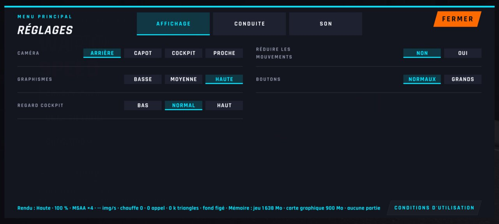
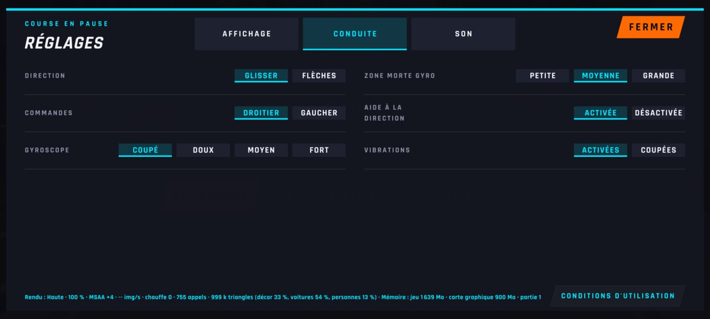
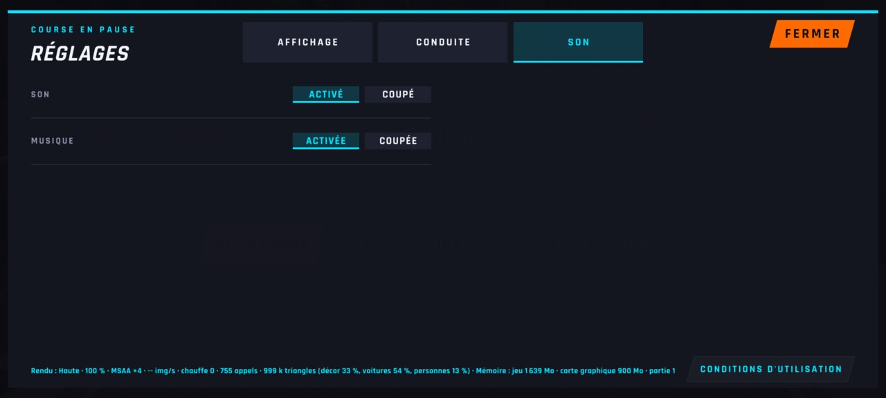

# WFS-291 — captures avant / après (tools/qa/captures_pr.sh)

Branche `feature/waforspeed-291` comparée à `origin/main` ; bancs : reglages-onglets:2400x1080 ; filtre : `*`.

| Capture | Avant (main) | Après (branche) |
|---|---|---|
| `reglages-onglet-affichage-menu` | — |  |
| `reglages-onglet-conduite-pause` | — |  |
| `reglages-onglet-son-gaucher` | — |  |
| `reglages-onglet-son-pause` | — |  |
