# WFS-292 — captures avant / après (tools/qa/captures_pr.sh)

Branche `feature/waforspeed-292` comparée à `origin/main` ; bancs : effets campagne ; filtre : `[fca][uhac][mocr]*`.

| Capture | Avant (main) | Après (branche) |
|---|---|---|
| `carte-campagne-cascade-nuit` | 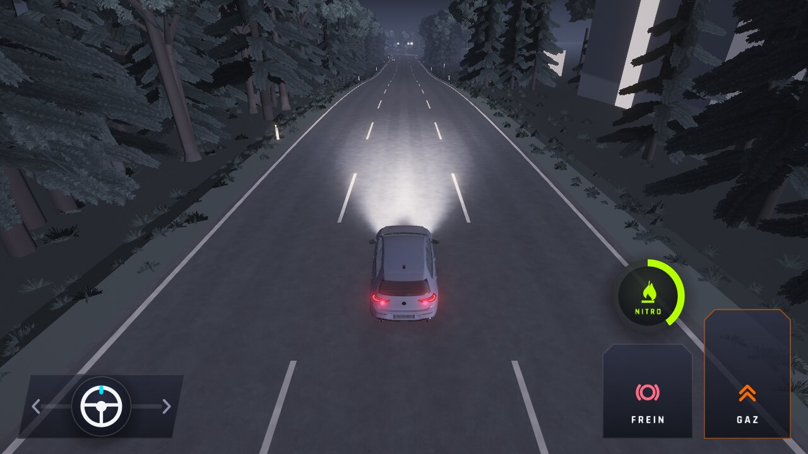 |  |
| `carte-campagne-cascade` |  | 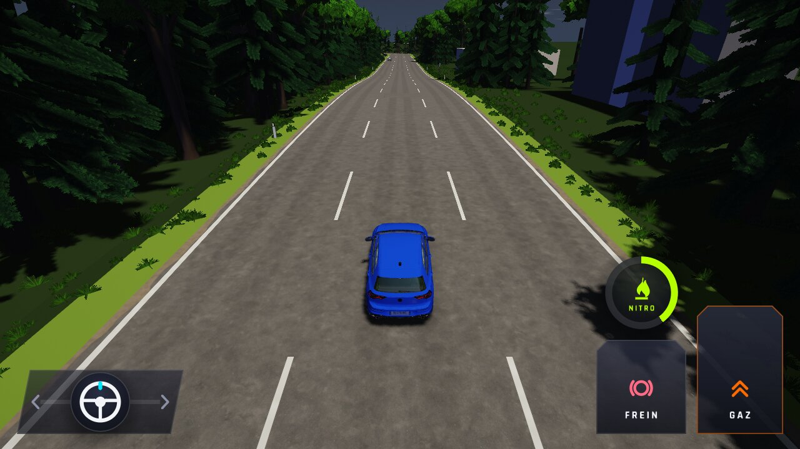 |
| `carte-campagne-haut-du-col` | 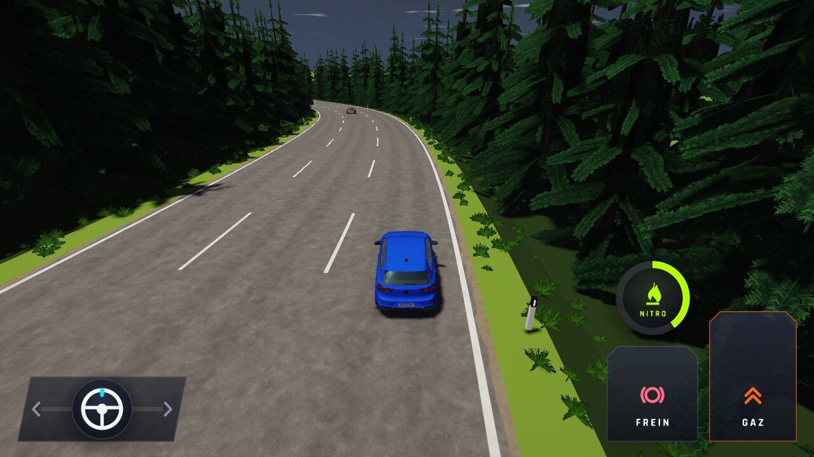 |  |
| `accident-fumee-nuit` | 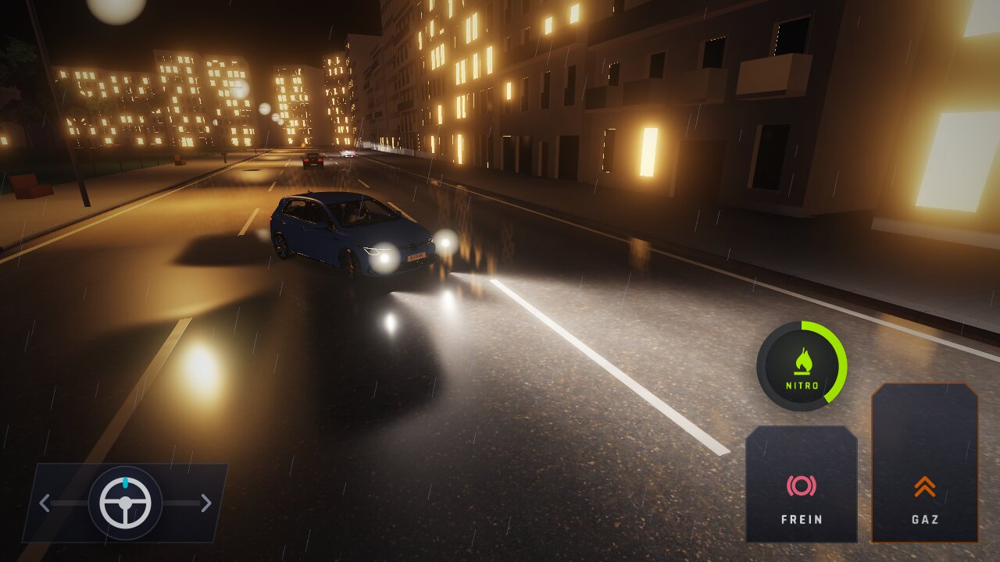 | 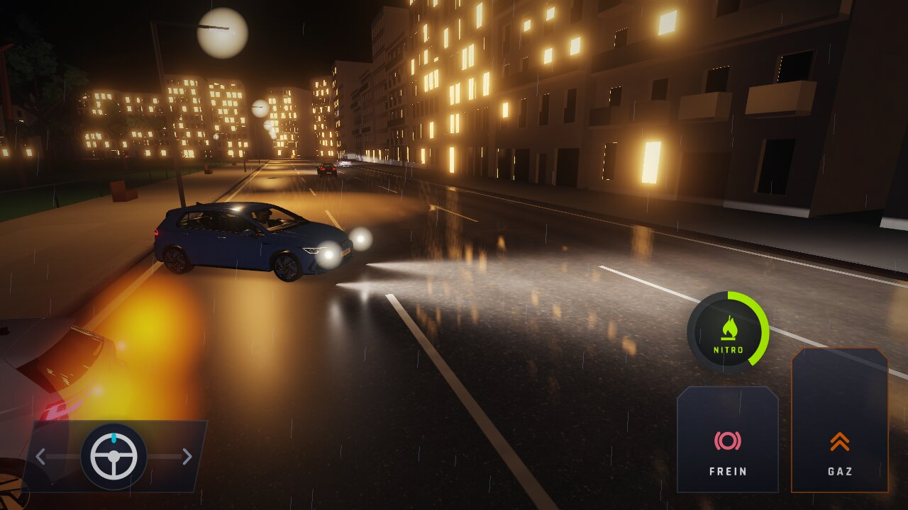 |
| `accident-fumee` | 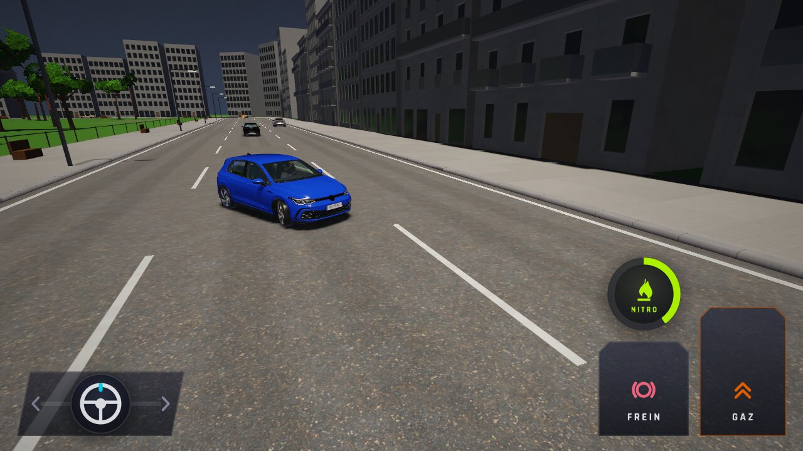 | 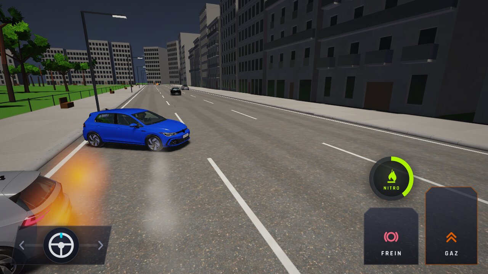 |
| `choc-etincelles` | 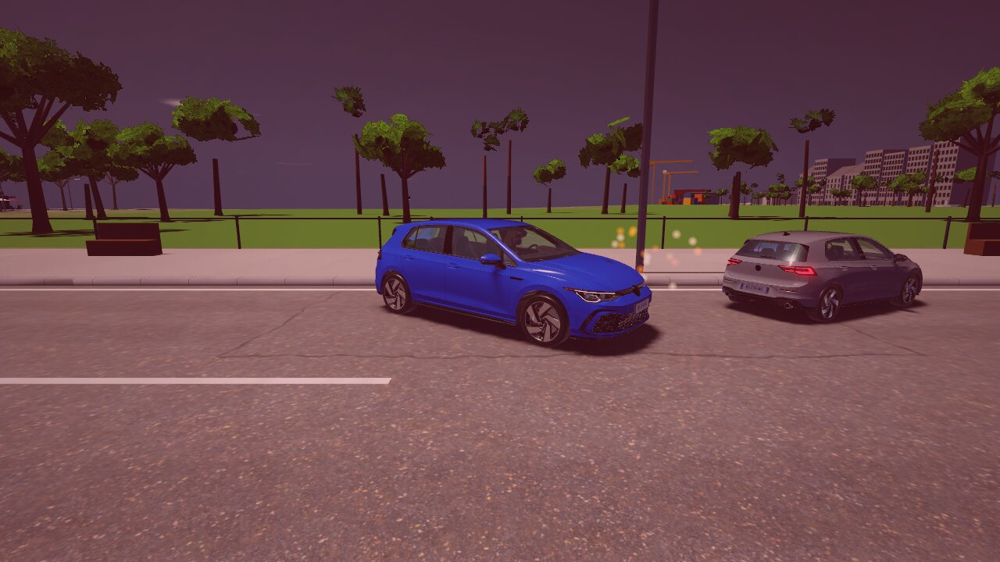 | 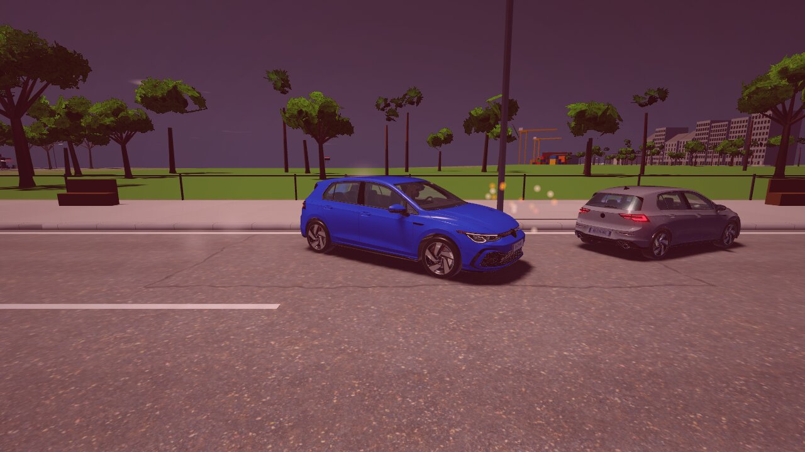 |
| `fumee-derapage-jour` | 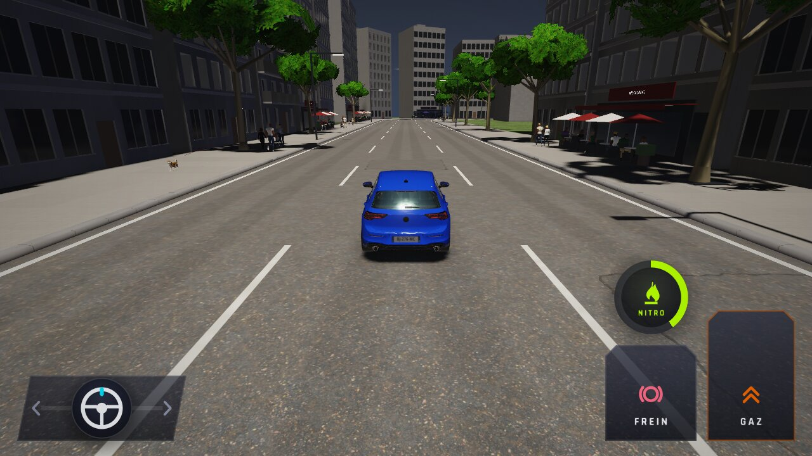 | 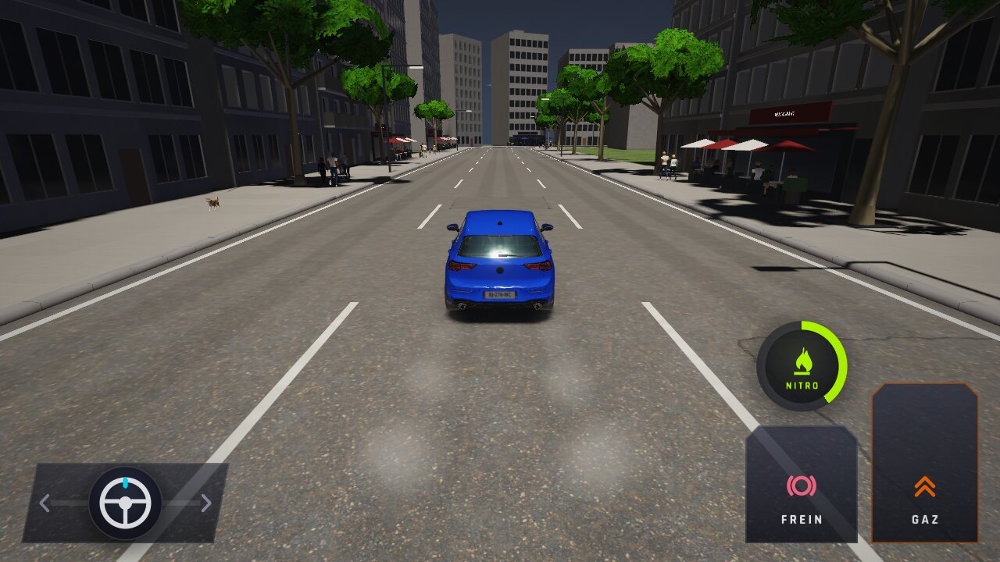 |
| `fumee-derapage-nuit` | 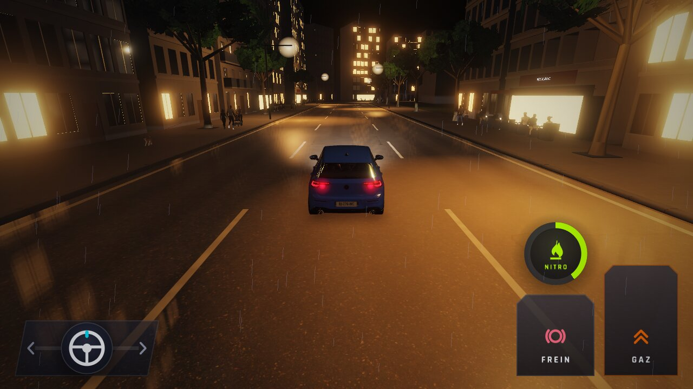 | 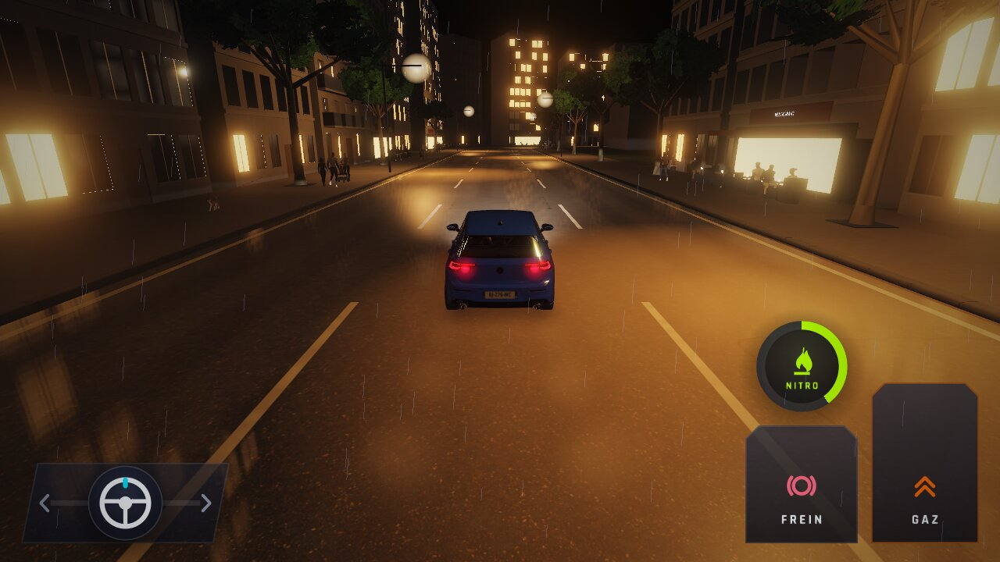 |
