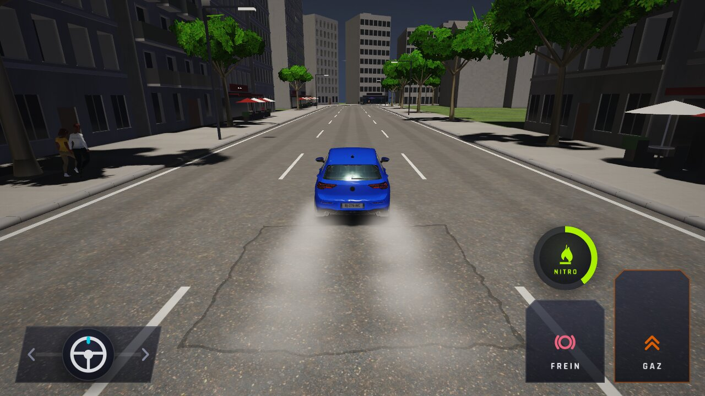
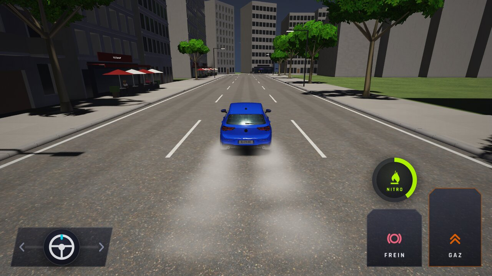
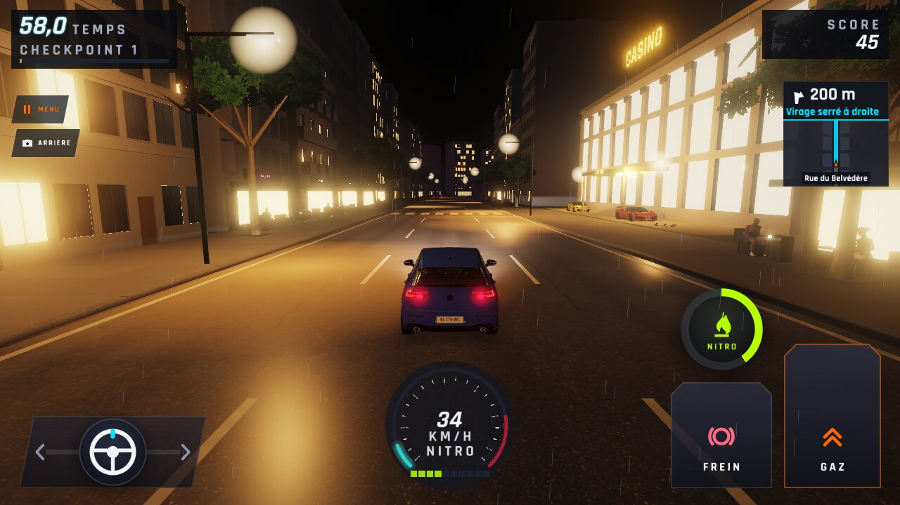
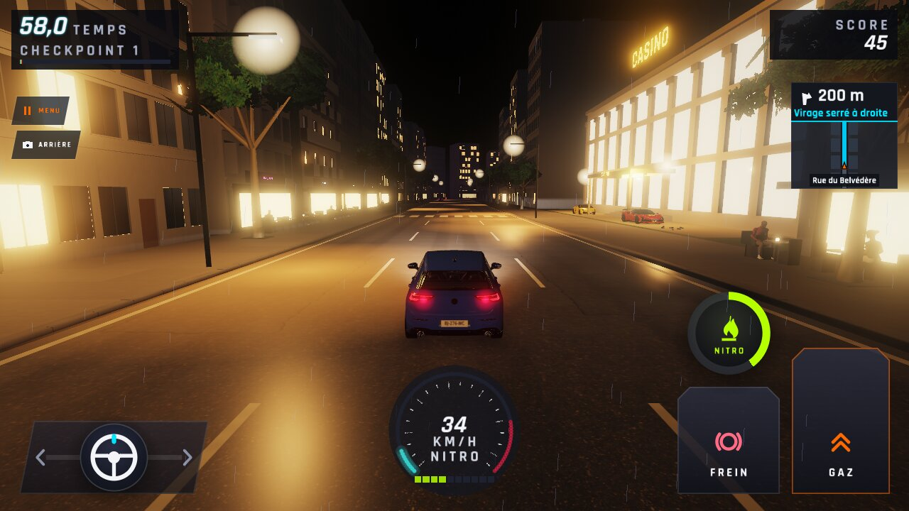
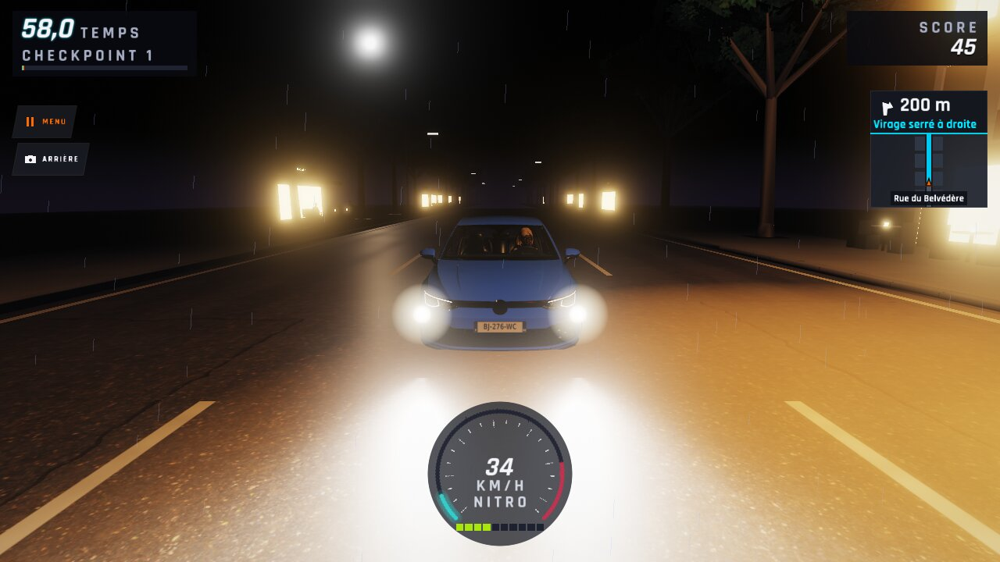
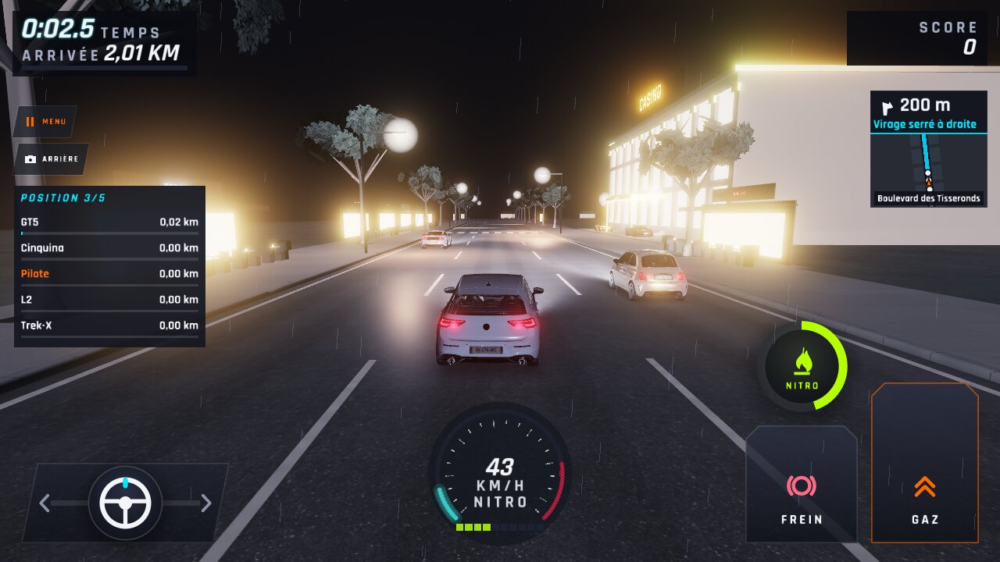

# WFS-292 — captures avant / après (tools/qa/captures_pr.sh)

Branche `feature/waforspeed-292` comparée à `origin/main` (eb87d8e). Bancs : `effets`, `nuit`. Les « après » viennent de `tools/qa/captures_pr.sh`, coupé par la limite de 2 h, la machine étant très chargée. Les « avant » de `effets` viennent du même passage. Les « avant » de `phares-autres-ville-*` viennent d'un banc `nuit` de `main` réduit à ces scènes. `phares-autres-course5-go-haut` n'a pas d'« avant » valable : dans le banc réduit, l'adaptation de l'œil part d'un autre état (image blanche au départ, WFS-328).

| Capture | Avant (main) | Après (branche) |
|---|---|---|
| `fumee-derapage-jour` |  |  |
| `fumee-derapage-jour-05s` | — |  |
| `fumee-derapage-jour-1s` | — |  |
| `fumee-derapage-nuit` |  |  |
| `choc-etincelles` |  |  |
| `accident-fumee` |  |  |
| `accident-fumee-nuit` |  |  |
| `phares-autres-ville-haut` |  |  |
| `phares-autres-ville-face` |  |  |
| `phares-autres-course5-go-haut` | — |  |
