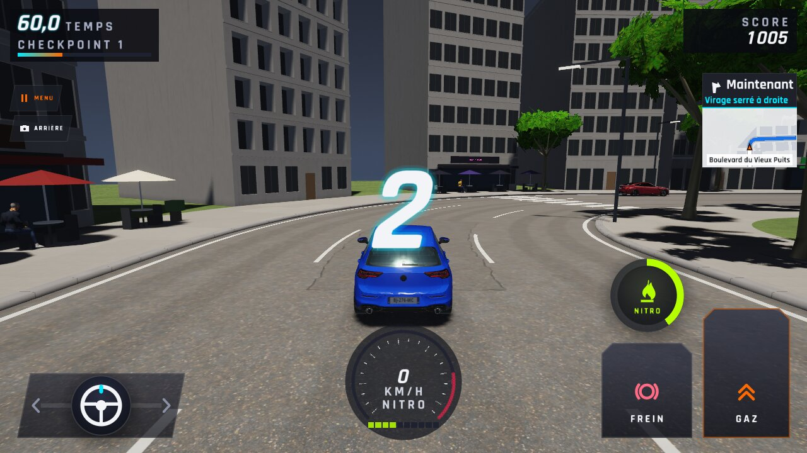
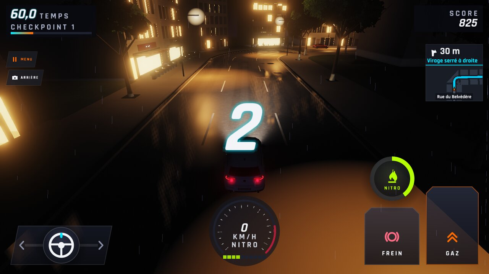
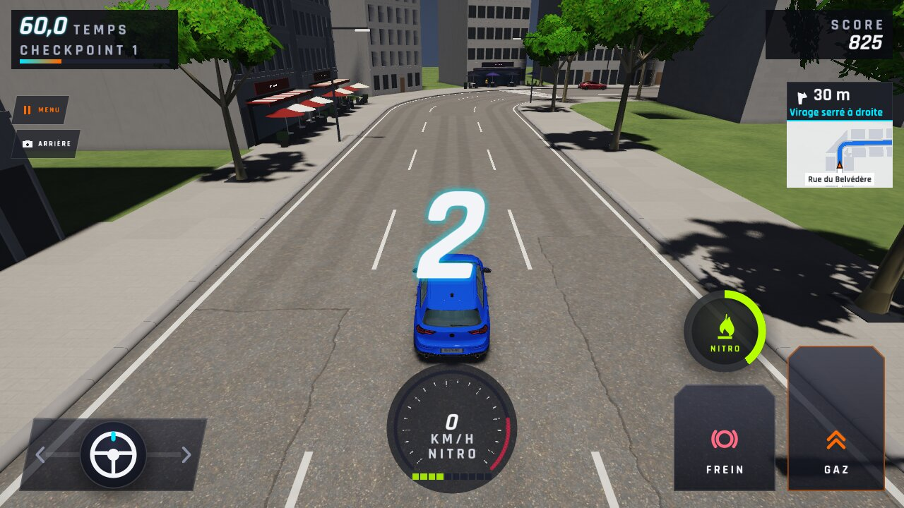
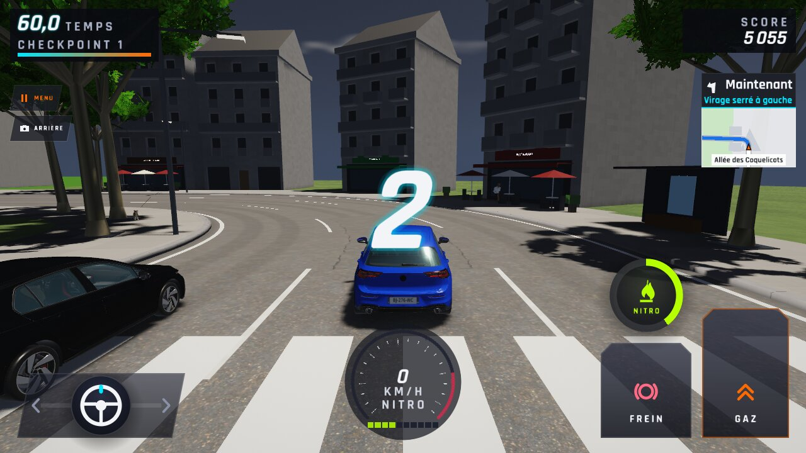
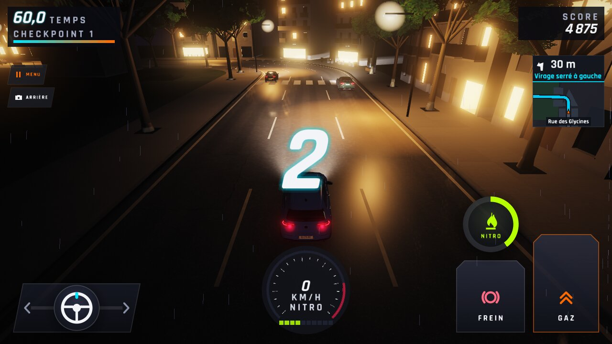
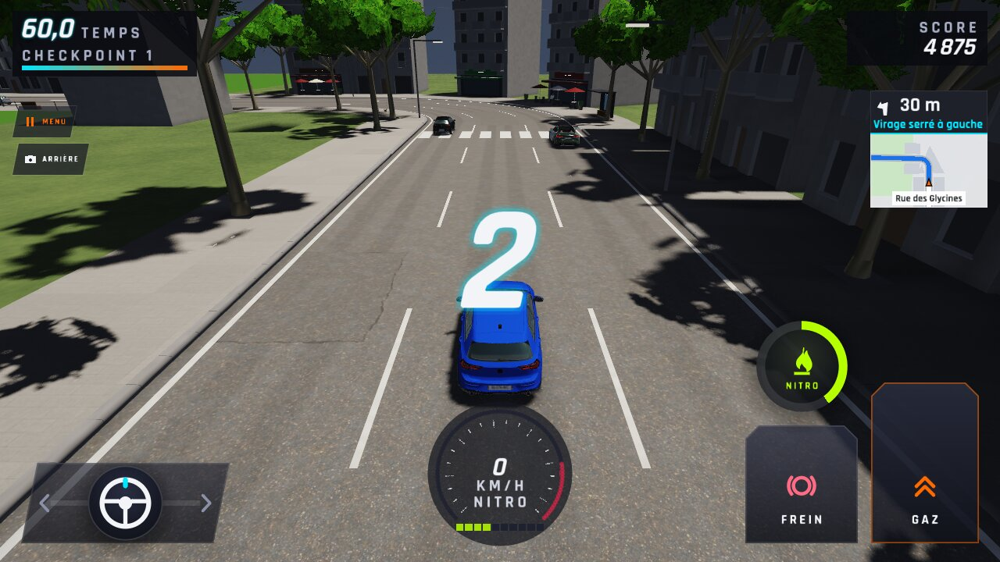
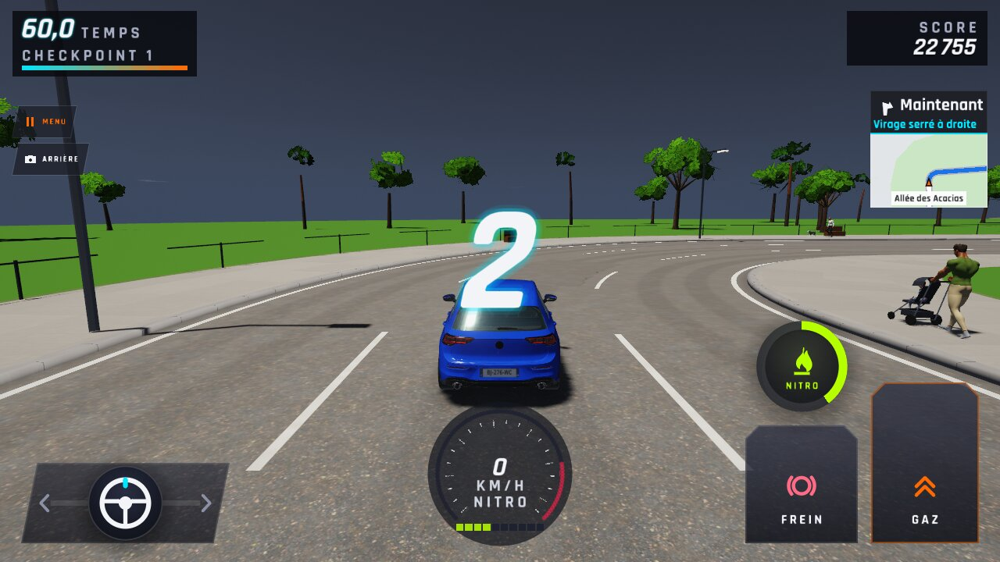
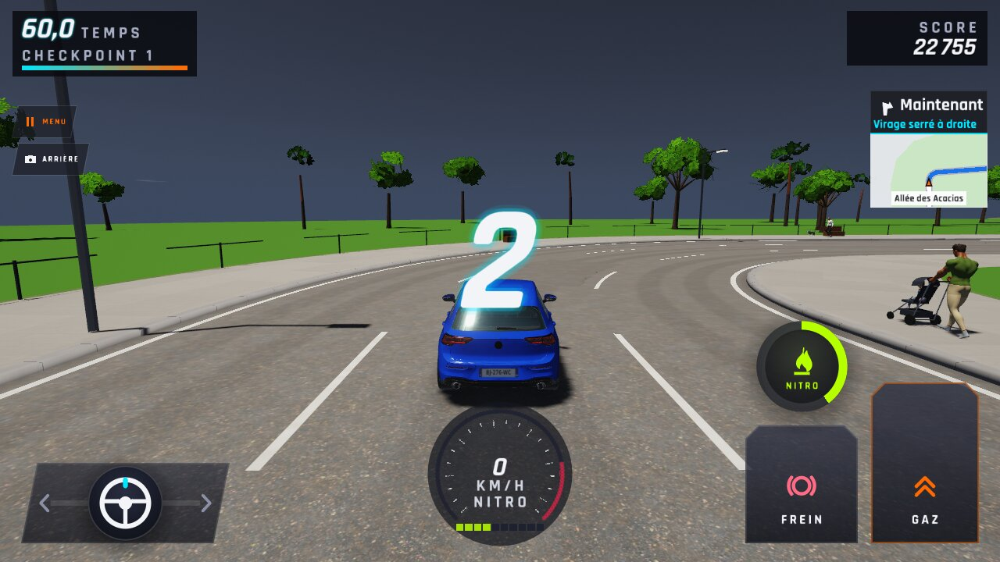
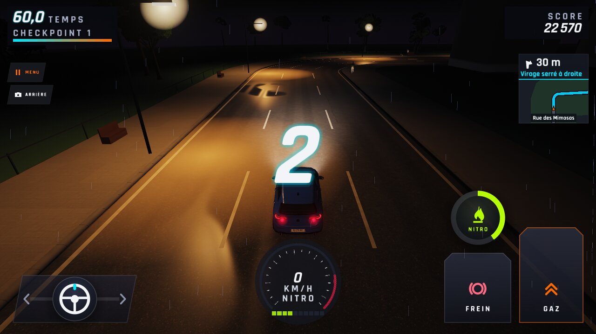
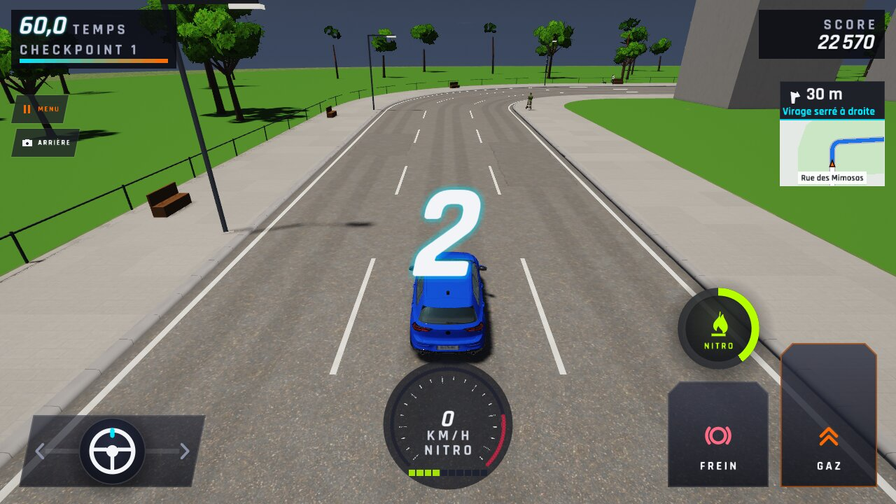

# WFS-293 — captures avant / après (tools/qa/captures_pr.sh)

Branche `feature/waforspeed-293` comparée à `origin/main` ; bancs : ville ; filtre : `carte-ville-virage-*`.

| Capture | Avant (main) | Après (branche) |
|---|---|---|
| `carte-ville-virage-1-haut` |  |  |
| `carte-ville-virage-1-nuit` |  |  |
| `carte-ville-virage-1` |  |  |
| `carte-ville-virage-2-haut` |  |  |
| `carte-ville-virage-2-nuit` |  |  |
| `carte-ville-virage-2` |  |  |
| `carte-ville-virage-3-haut` |  |  |
| `carte-ville-virage-3-nuit` |  |  |
| `carte-ville-virage-3` |  |  |
