# WFS-296 — captures avant / après (tools/qa/captures_pr.sh)

Branche `feature/waforspeed-296` comparée à `origin/main` ; bancs : hud:2340x1080 ; filtre : `hud-[asc][rho]*`.

| Capture | Avant (main) | Après (branche) |
|---|---|---|
| `hud-arc-120` |  | 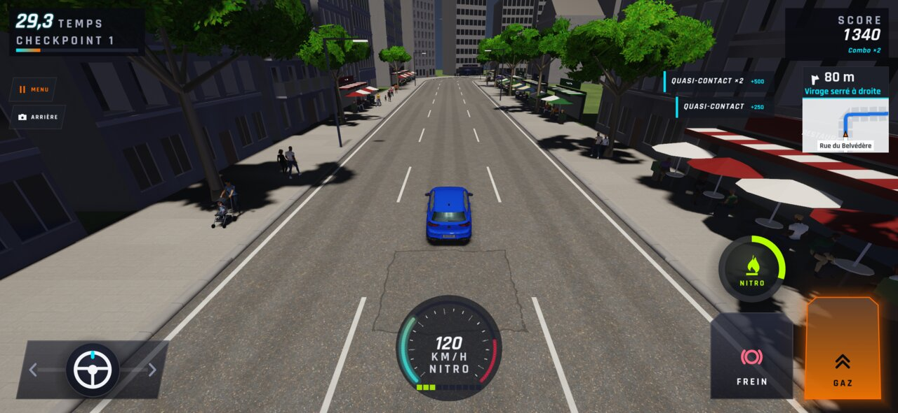 |
| `hud-arc-320` | 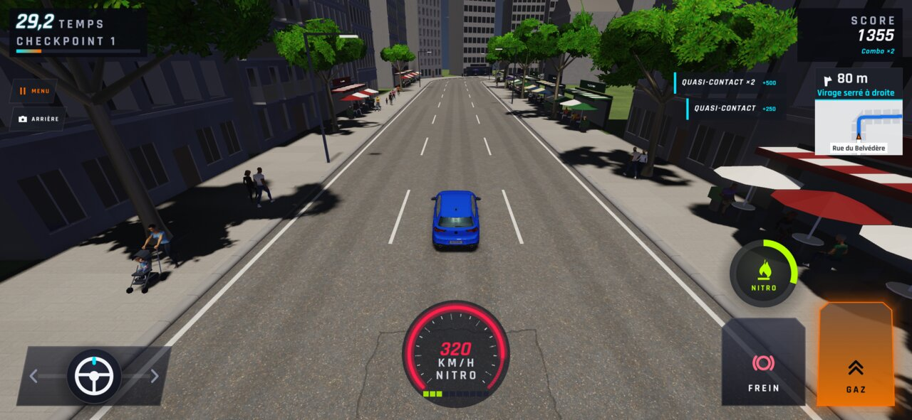 |  |
| `hud-arriere-cockpit-jour` | — | 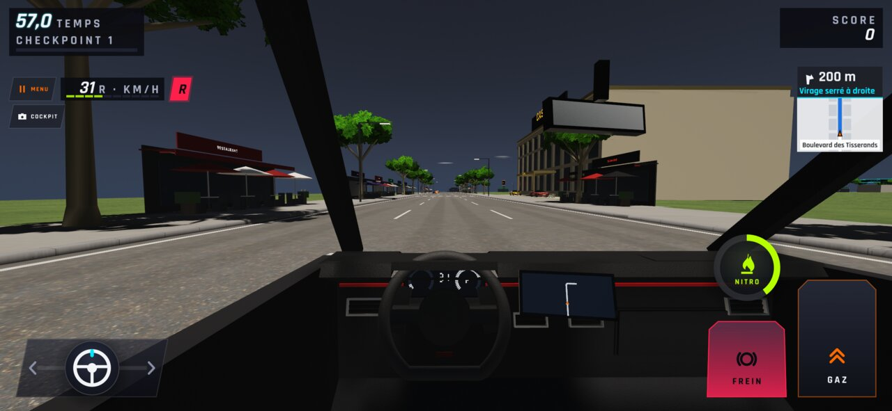 |
| `hud-arriere-cockpit-nuit` | — | 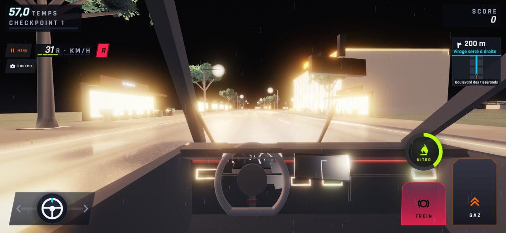 |
| `hud-arriere-jour` | — | 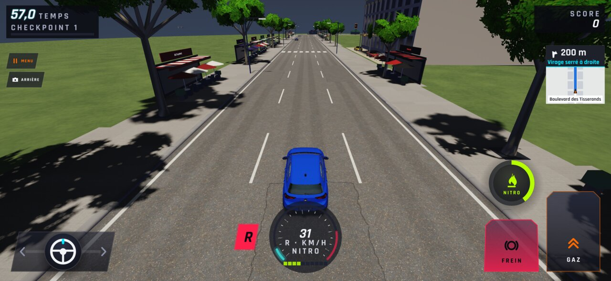 |
| `hud-arriere-nuit` | — | 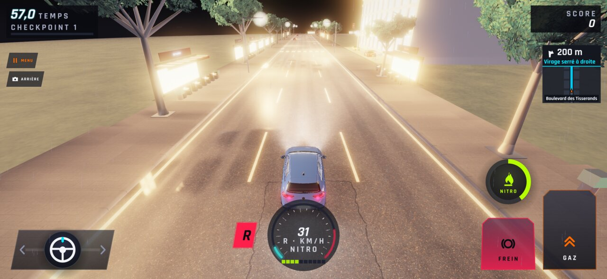 |
| `hud-cockpit-jour` | 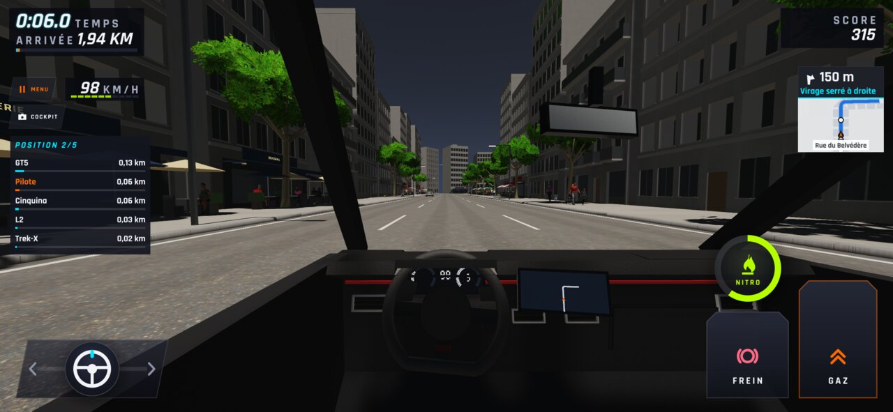 |  |
| `hud-cockpit-nuit` |  | 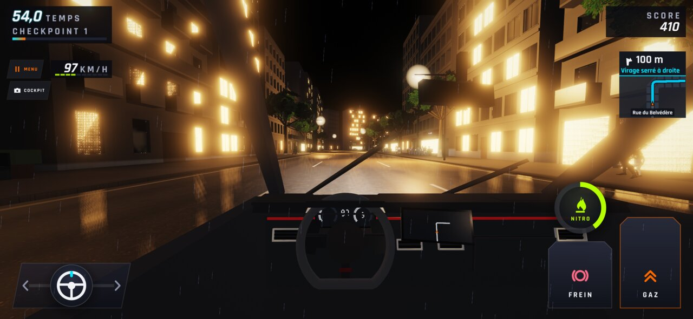 |
| `hud-combo` |  | 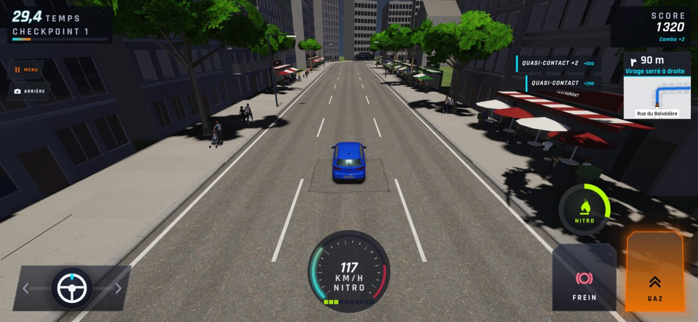 |
| `hud-course` | 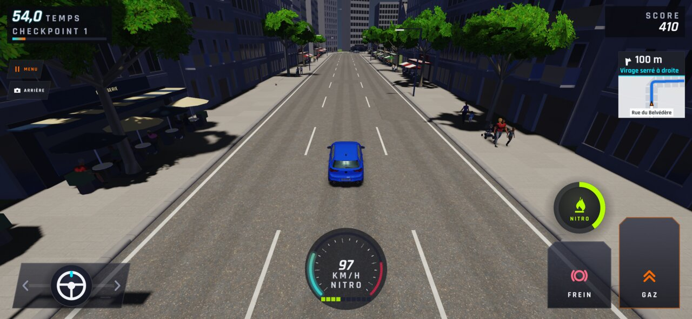 |  |
| `hud-course5-jour` |  | 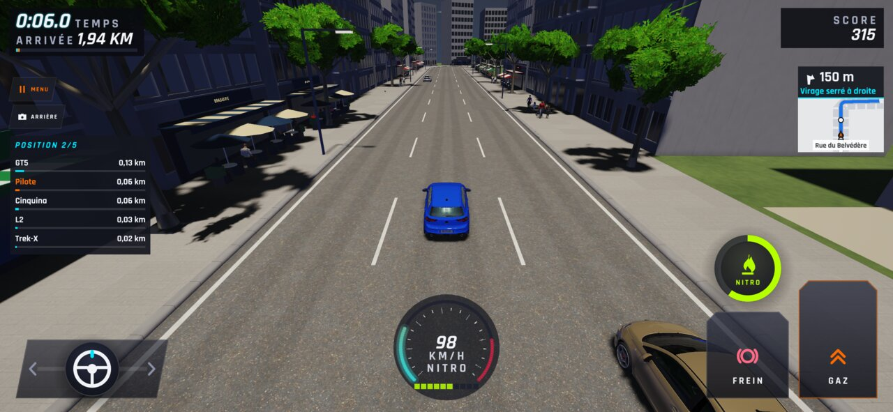 |
| `hud-course5-nuit` |  | 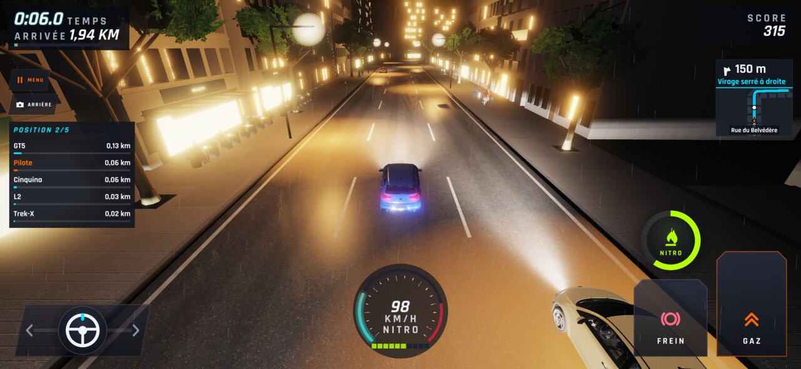 |
| `hud-solo-jour` |  |  |
| `hud-solo-nuit` |  | 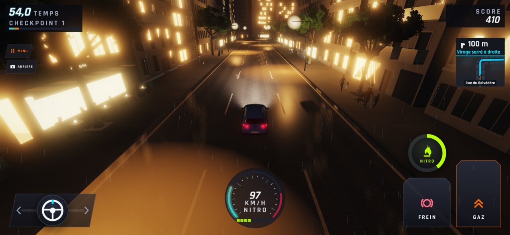 |
