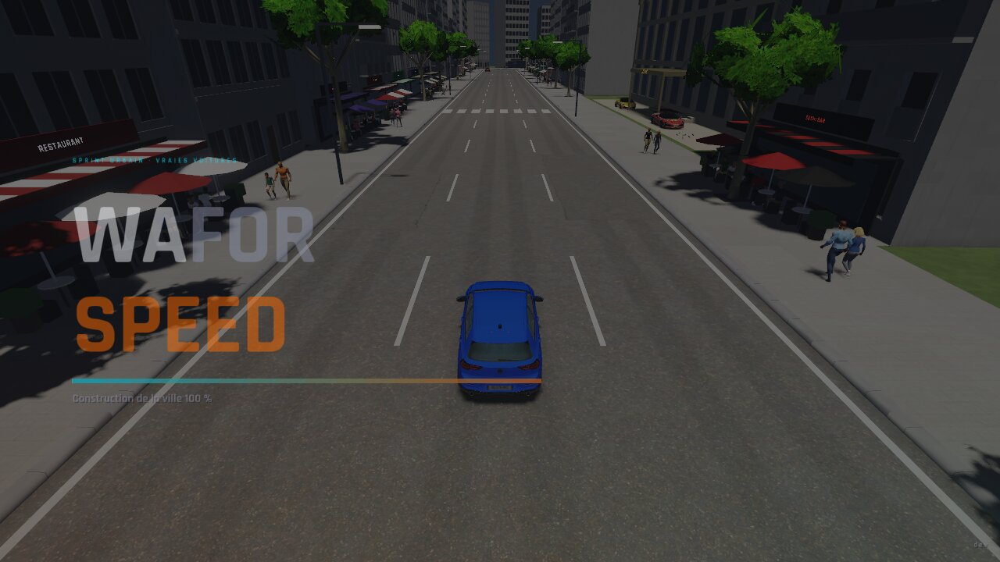
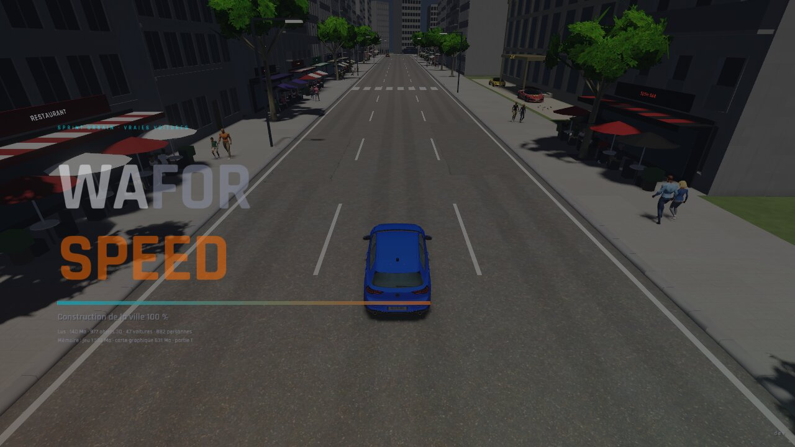
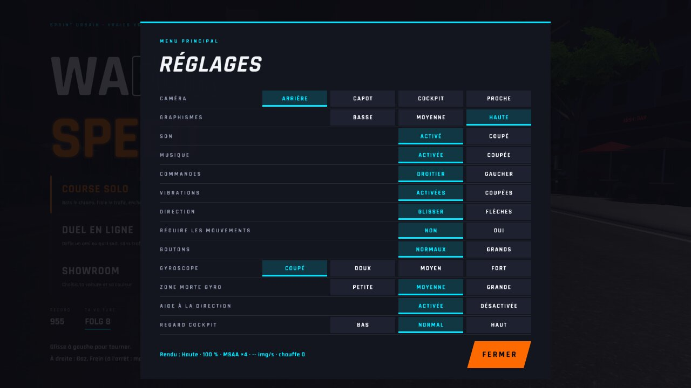
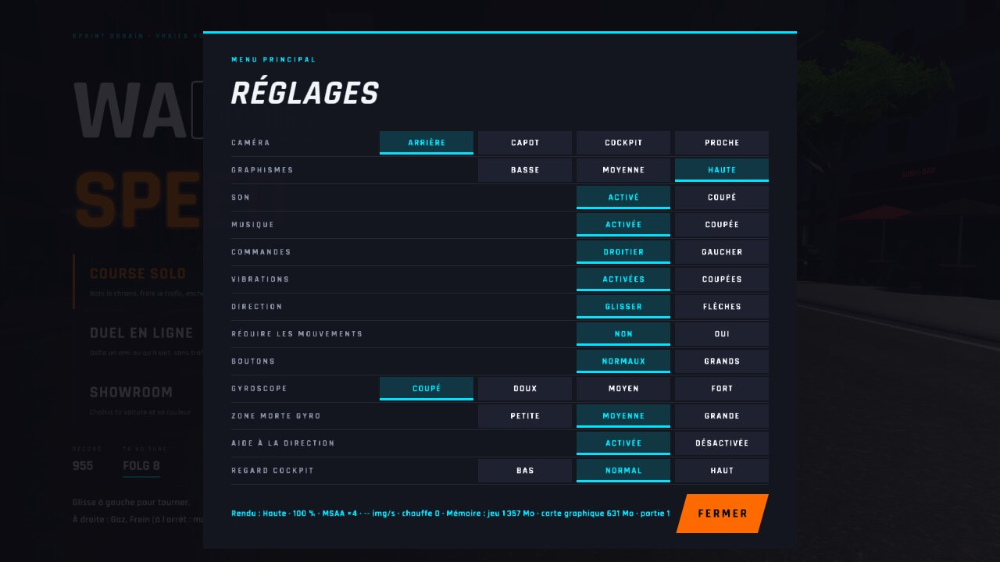
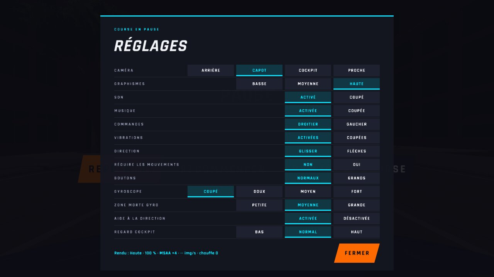
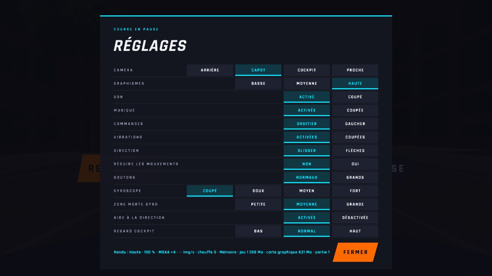

# WFS-297 — captures avant / après (tools/qa/captures_pr.sh)

Branche `feature/waforspeed-297` comparée à `origin/main` ; bancs : chargement menu2 ; filtre : `@(chargement-*|reglages-pause|reglages-menu)`.

| Capture | Avant (main) | Après (branche) |
|---|---|---|
| `chargement-0` |  |  |
| `chargement-1` |  |  |
| `chargement-2` |  |  |
| `chargement-erreur` |  |  |
| `chargement-fondu` |  |  |
| `reglages-menu` |  |  |
| `reglages-pause` |  |  |
