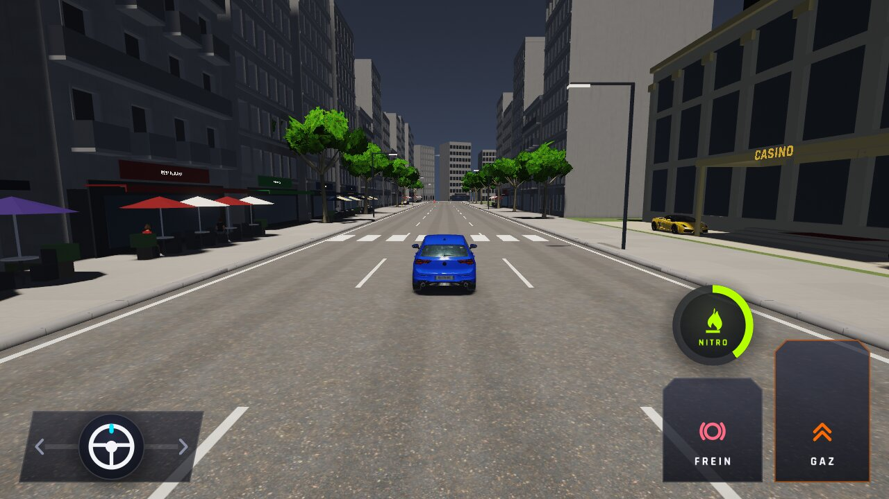

# WFS-301 — captures avant / après (tools/qa/captures_pr.sh)

Branche `feature/waforspeed-301` comparée à `origin/main` ; bancs : cuisson ; filtre : `cuisson-*`.

| Capture | Avant (main) | Après (branche) |
|---|---|---|
| `cuisson-paquet-corrompu` |  |  |
| `cuisson-paquet-jour` |  |  |
| `cuisson-paquet-nuit` |  |  |
| `cuisson-sans-paquet` |  |  |
