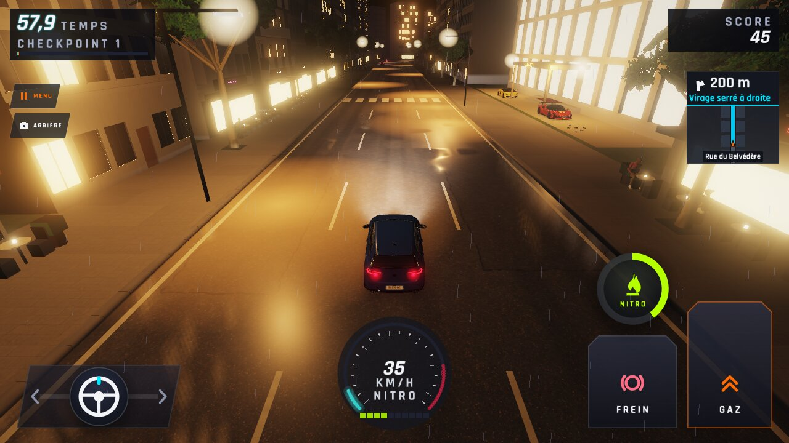
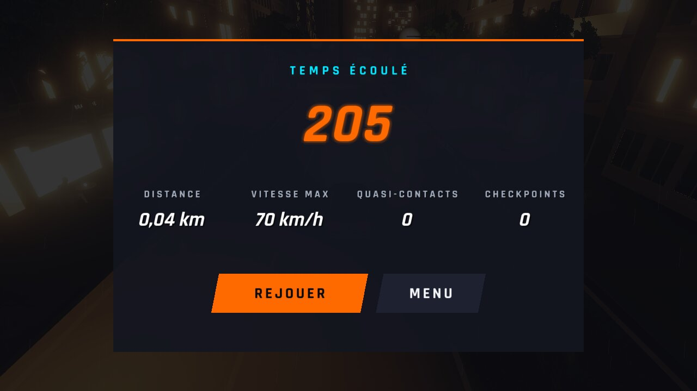
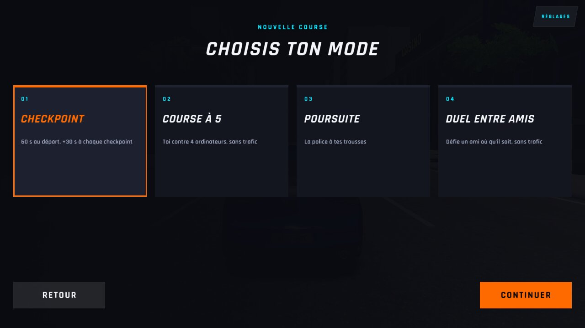
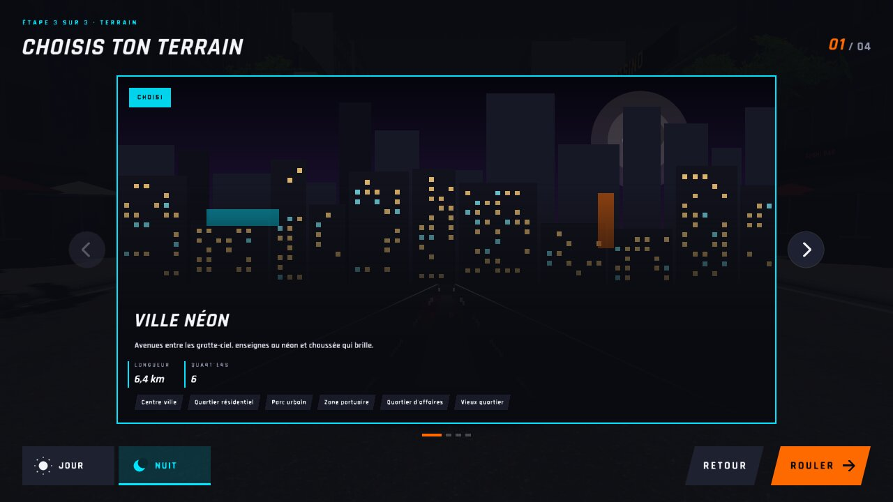
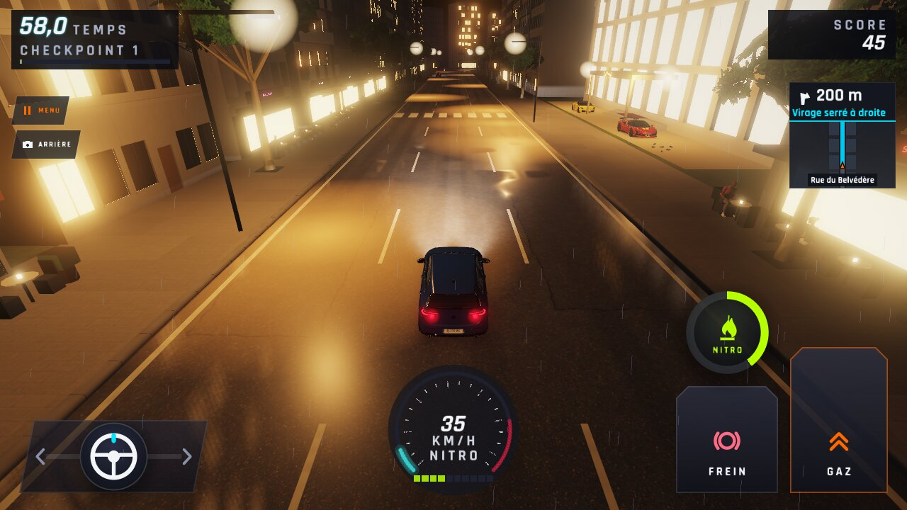
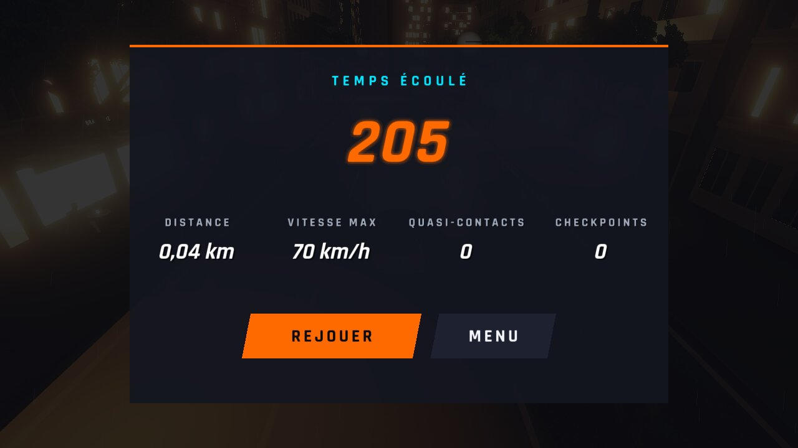
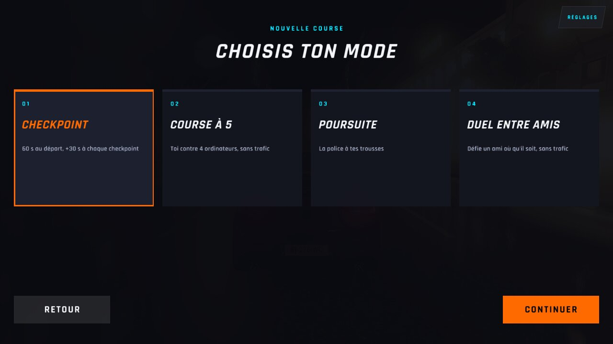
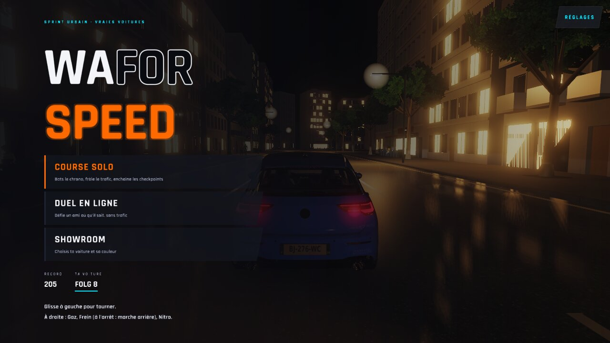
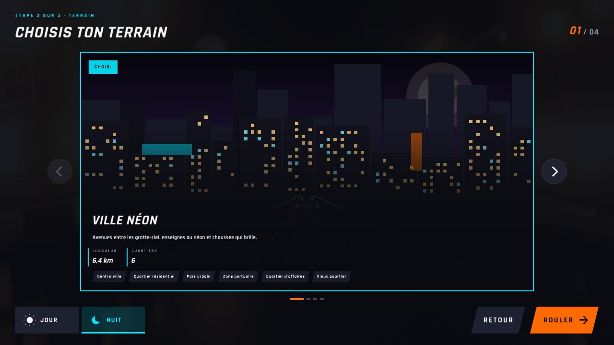

# WFS-301 — captures avant / après (tools/qa/captures_pr.sh)

Branche `feature/waforspeed-301` comparée à `origin/main` ; bancs : cuisson ; filtre : `*`.

| Capture | Avant (main) | Après (branche) |
|---|---|---|
| `avec-paquet-parcours-course` | — |  |
| `avec-paquet-parcours-fin` | — |  |
| `avec-paquet-parcours-mode` | — |  |
| `avec-paquet-parcours-retour-menu` | — |  |
| `avec-paquet-parcours-terrain` | — |  |
| `cuisson-paquet-corrompu` | — |  |
| `cuisson-paquet-jour` | — |  |
| `cuisson-paquet-nuit` | — |  |
| `cuisson-sans-paquet` | — |  |
| `sans-paquet-parcours-course` | — |  |
| `sans-paquet-parcours-fin` | — |  |
| `sans-paquet-parcours-mode` | — |  |
| `sans-paquet-parcours-retour-menu` | — |  |
| `sans-paquet-parcours-terrain` | — |  |
