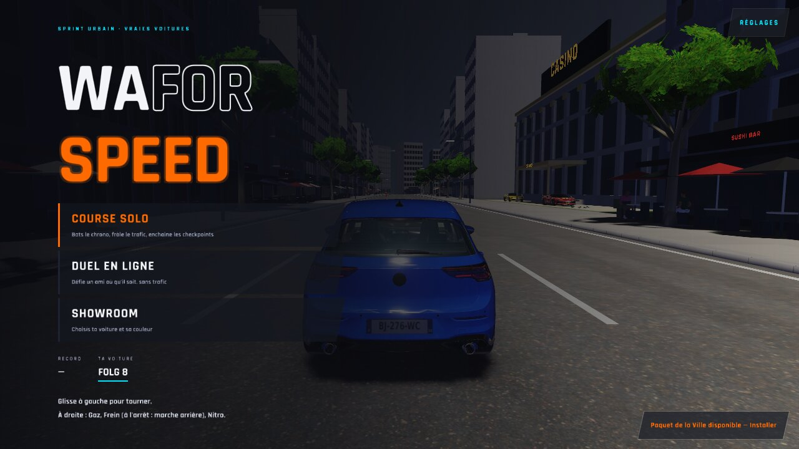
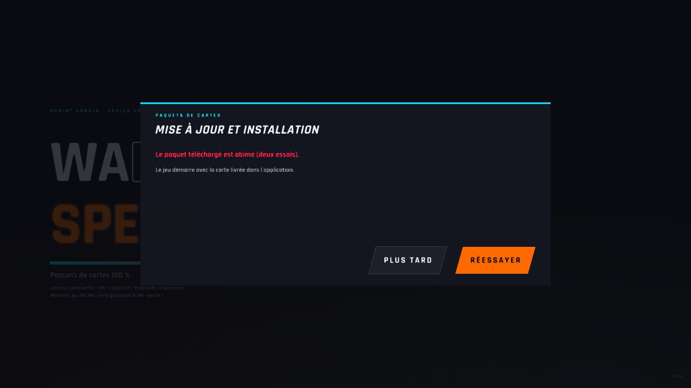
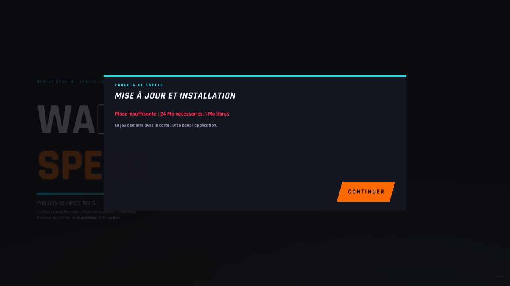
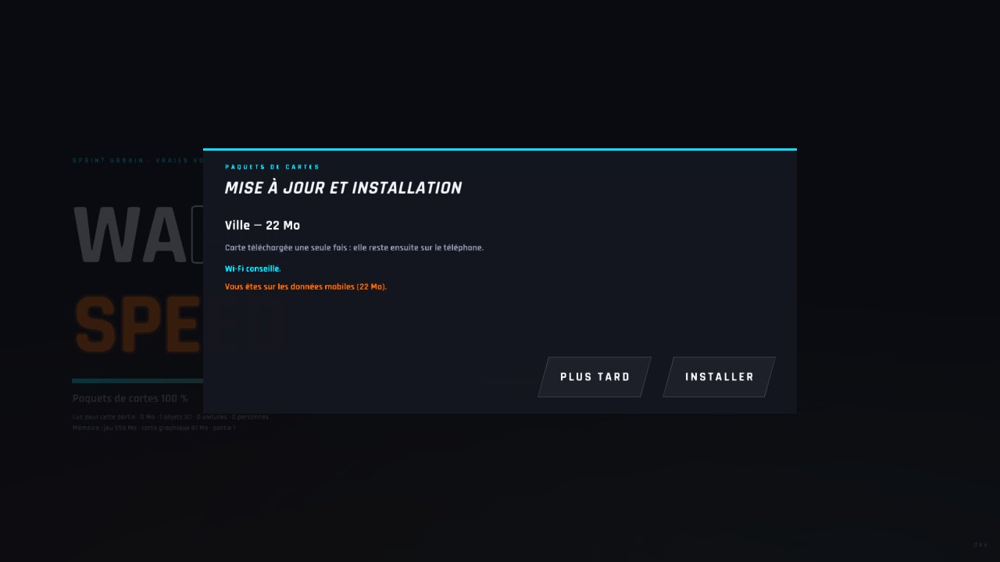
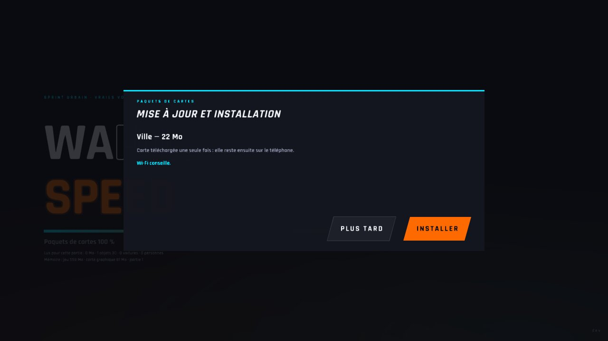
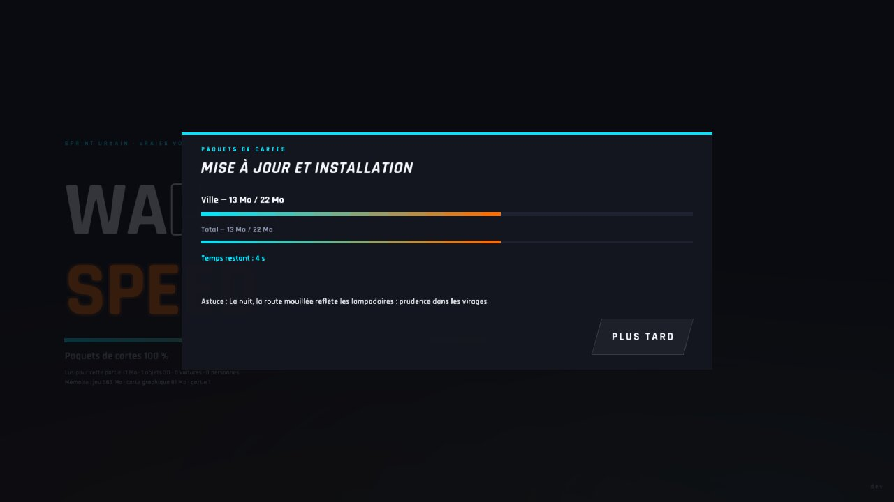

# WFS-306 — captures avant / après (tools/qa/captures_pr.sh)

Branche `feature/waforspeed-306` comparée à `origin/main` ; bancs : paquets paquets-tel:2400x1080 ; filtre : `*`.

| Capture | Avant (main) | Après (branche) |
|---|---|---|
| `paquets-bandeau-menu` | — |  |
| `paquets-coupure` | — |  |
| `paquets-echec` | — |  |
| `paquets-place` | — |  |
| `paquets-proposition-mobile` | — |  |
| `paquets-proposition-wifi` | — |  |
| `paquets-telechargement` | — |  |
