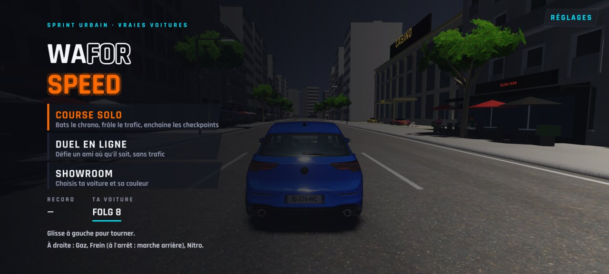
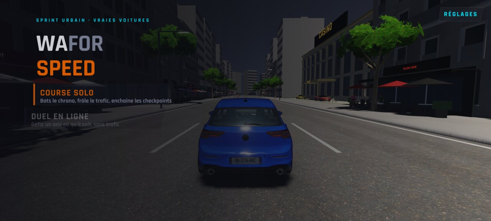
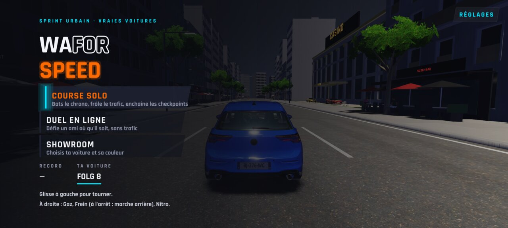
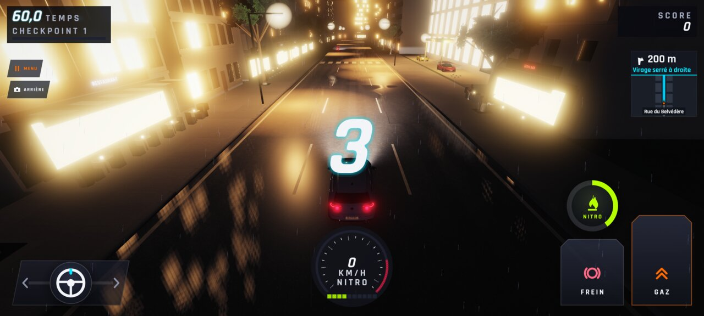
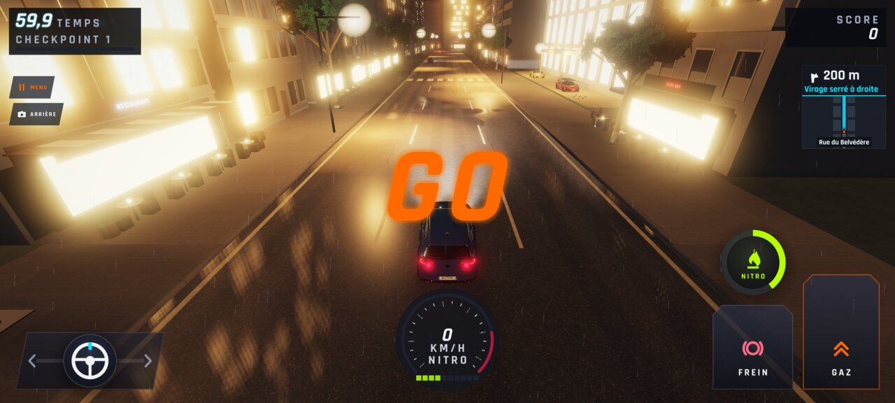
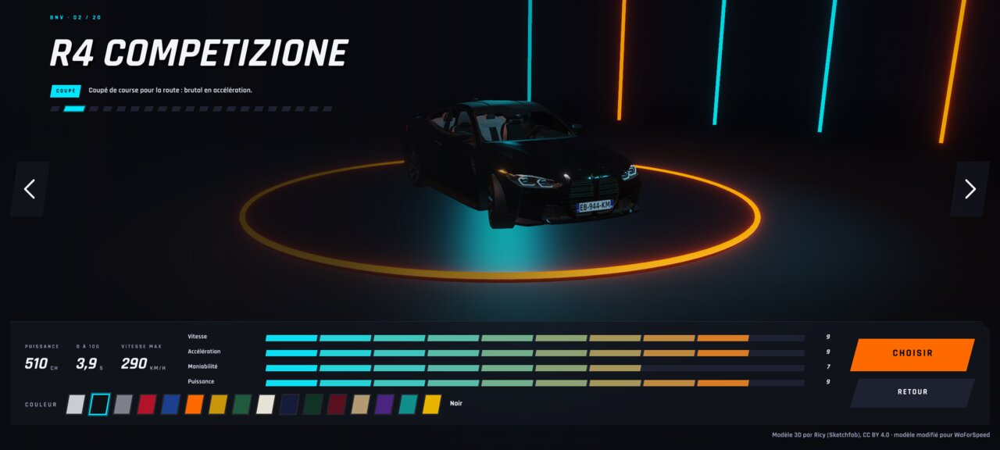
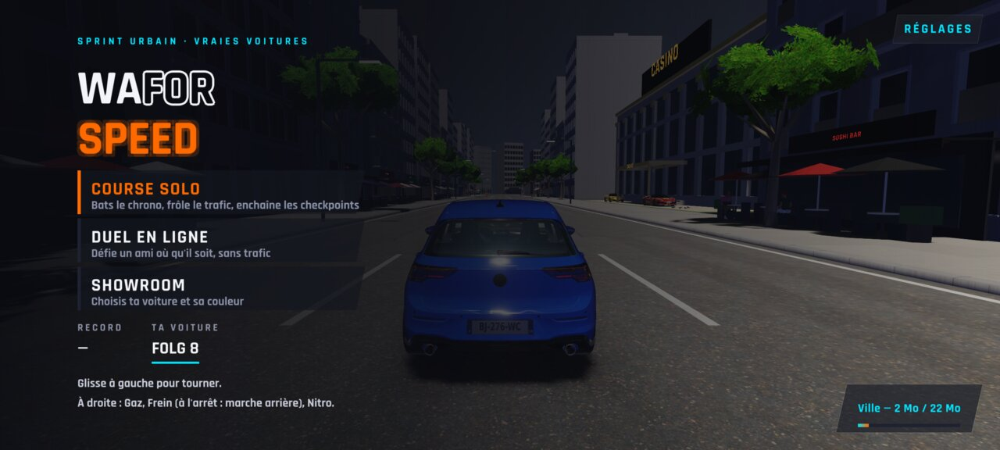
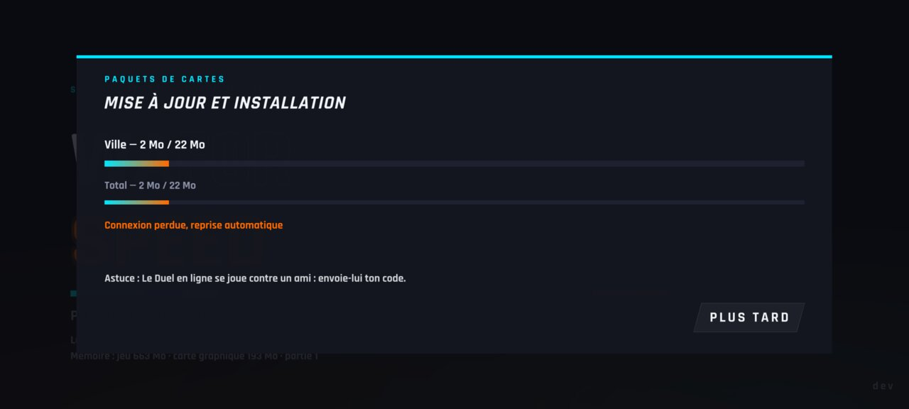
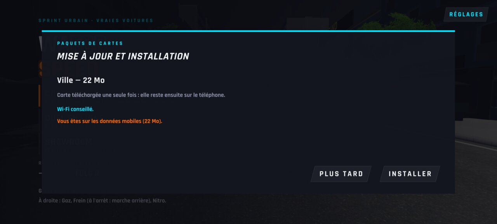
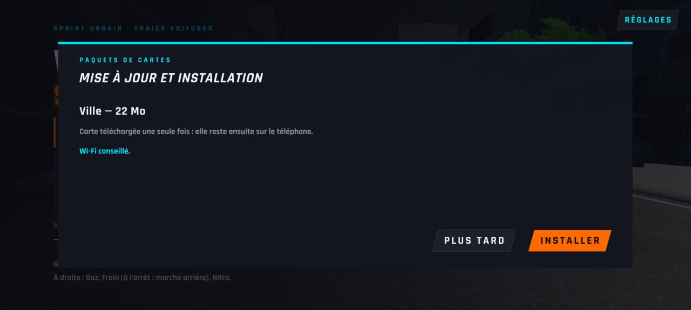

# WFS-306 — captures avant / après (tools/qa/captures_pr.sh)

Branche `feature/waforspeed-306` comparée à `origin/main` ; bancs : paquets:2400x1080 menu1:2400x1080 ; filtre : `[mp][ea][nq]*`.

| Capture | Avant (main) | Après (branche) |
|---|---|---|
| `menu-0` |  |  |
| `menu-anim` |  |  |
| `menu-appui` |  |  |
| `menu-depart-3` |  |  |
| `menu-depart-go` |  |  |
| `menu-showroom` |  |  |
| `paquets-bandeau-menu` | — |  |
| `paquets-bandeau-progression` | — |  |
| `paquets-coupure` | — |  |
| `paquets-echec` | — |  |
| `paquets-menu-proposition-mobile` | — |  |
| `paquets-menu-proposition-wifi` | — |  |
| `paquets-place` | — |  |
| `paquets-proposition-mobile` | — |  |
| `paquets-proposition-wifi` | — |  |
| `paquets-telechargement` | — |  |
