# WFS-307 — captures avant / après (tools/qa/captures_pr.sh)

Branche `feature/waforspeed-307` comparée à `origin/main` ; bancs : paquets:2400x1080 ; filtre : `paquets-[tcm]*`.

| Capture | Avant (main) | Après (branche) |
|---|---|---|
| `paquets-coupure` |  | 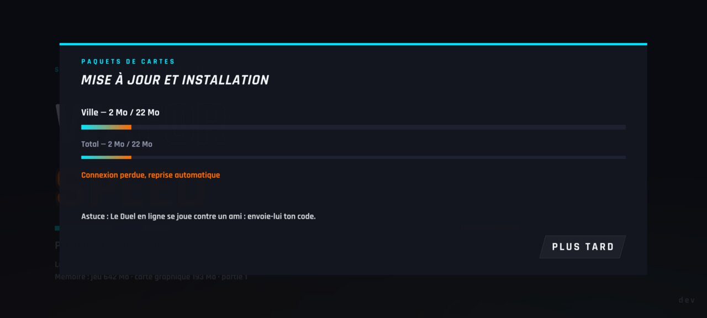 |
| `paquets-course-corniche` | — | 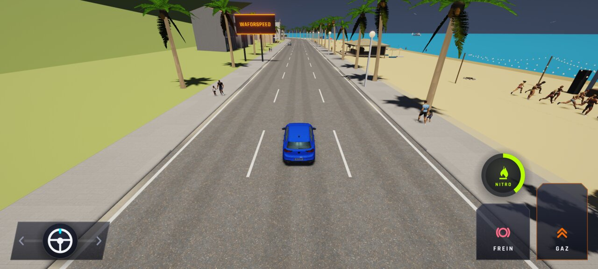 |
| `paquets-course-pendant` | — | 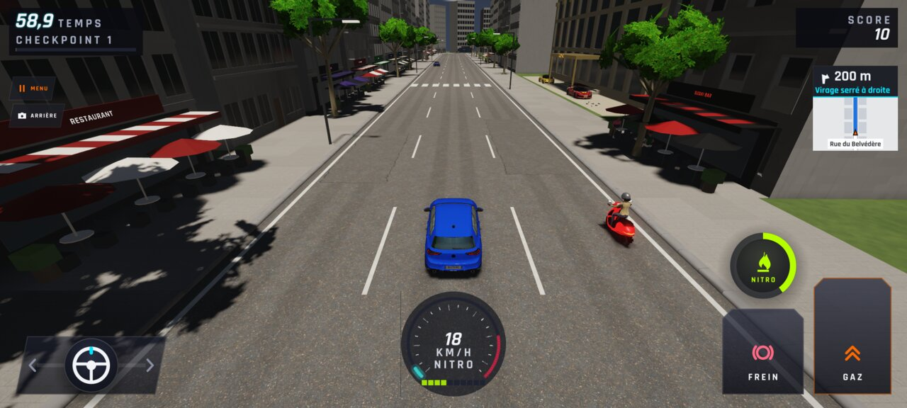 |
| `paquets-menu-prete` | — | 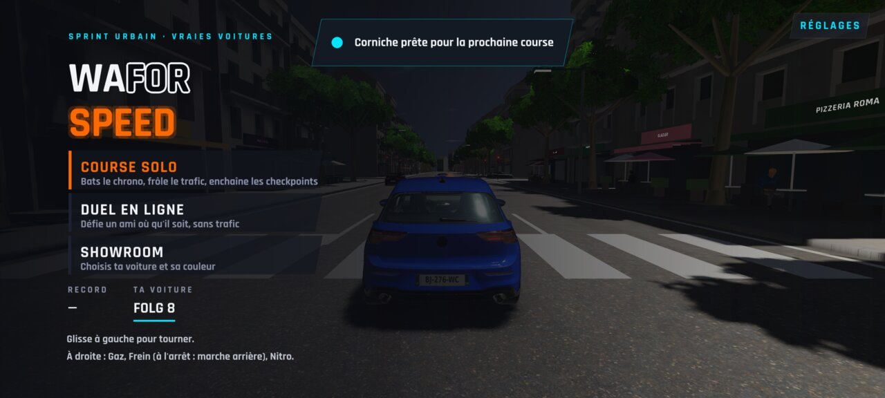 |
| `paquets-menu-proposition-mobile` |  | 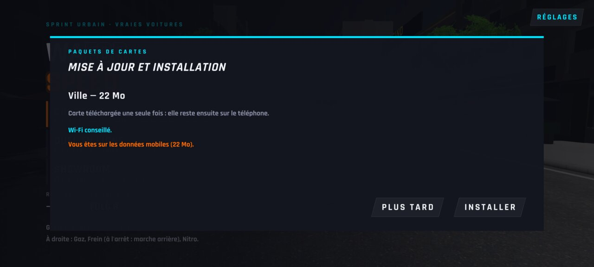 |
| `paquets-menu-proposition-wifi` |  | 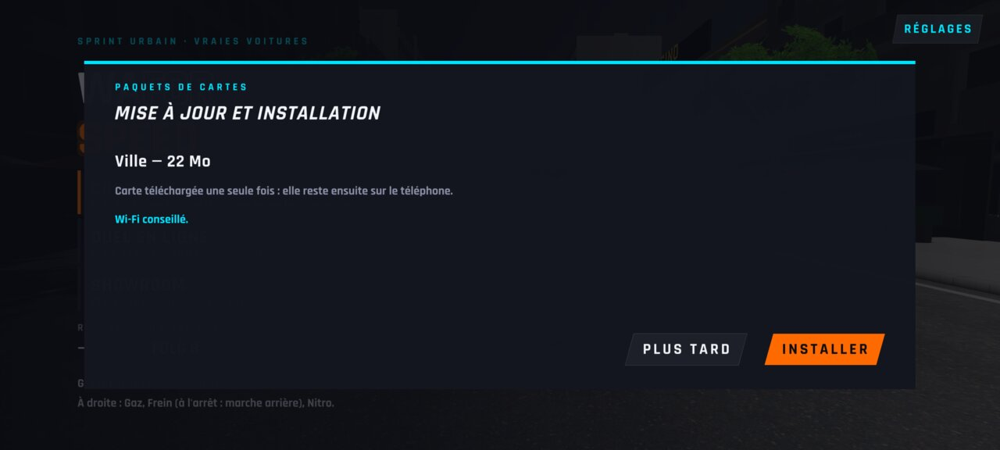 |
| `paquets-telechargement` |  | 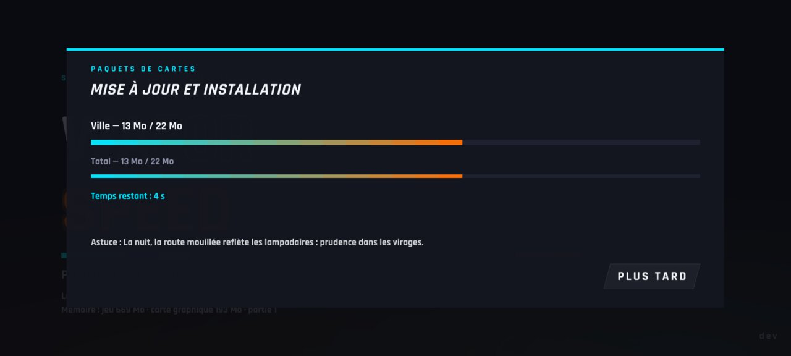 |
| `paquets-terrain-apres-suppression` | — | 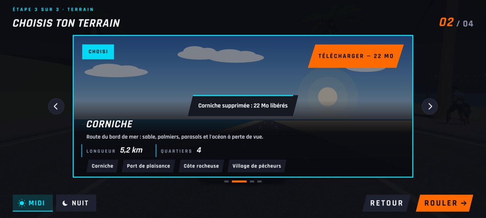 |
| `paquets-terrain-installee` | — | 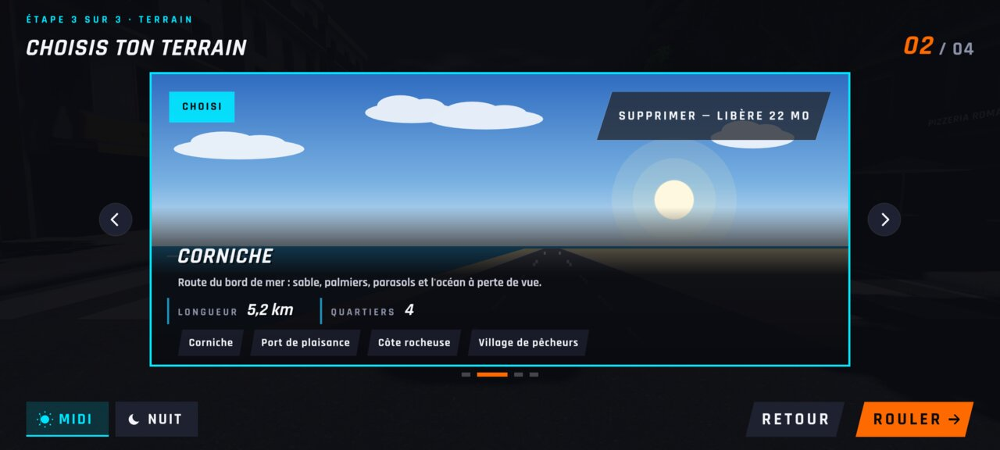 |
| `paquets-terrain-mobile` | — | 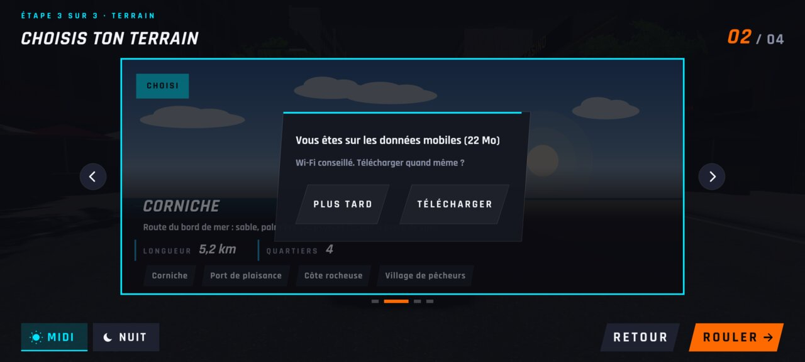 |
| `paquets-terrain-progression` | — | 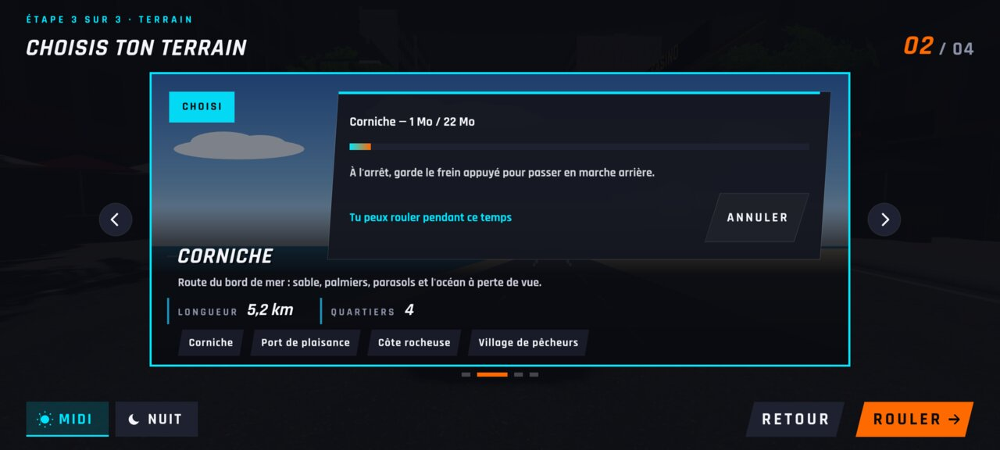 |
| `paquets-terrain-sans-connexion` | — | 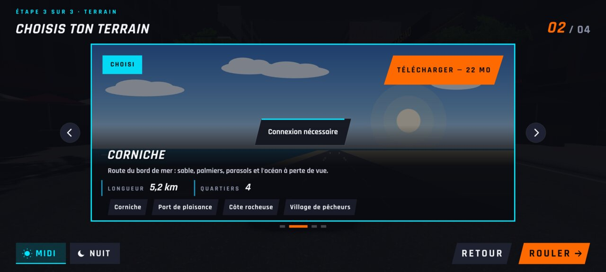 |
| `paquets-terrain-supprimer` | — | 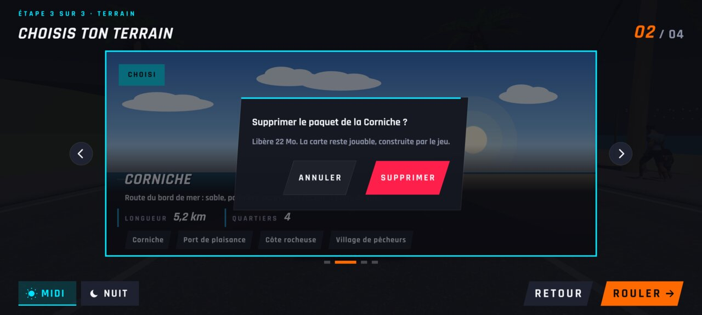 |
| `paquets-terrain-telecharger` | — | 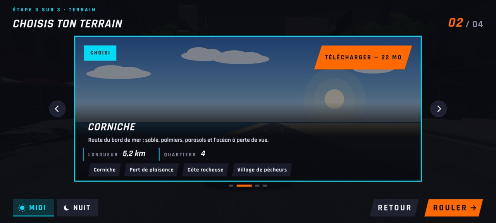 |
