# WFS-308 — captures avant / après (tools/qa/captures_pr.sh)

Branche `feature/waforspeed-308` comparée à `origin/main` ; bancs : cgu:2400x1080 menu2:2400x1080 ; filtre : `[cr][ge][ug]*`.

| Capture | Avant (main) | Après (branche) |
|---|---|---|
| `cgu-coche` | — | 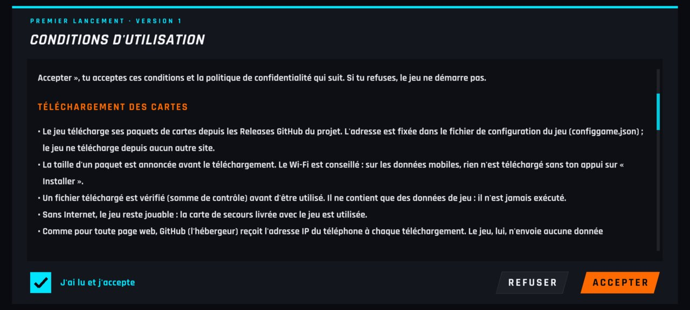 |
| `cgu-defile` | — | 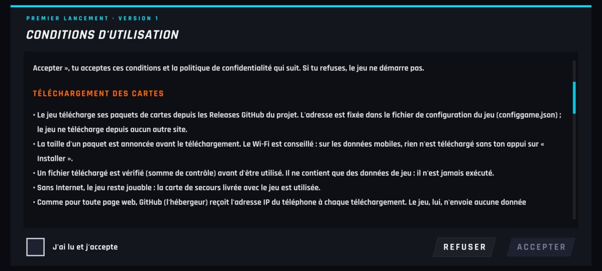 |
| `cgu-premier` | — | 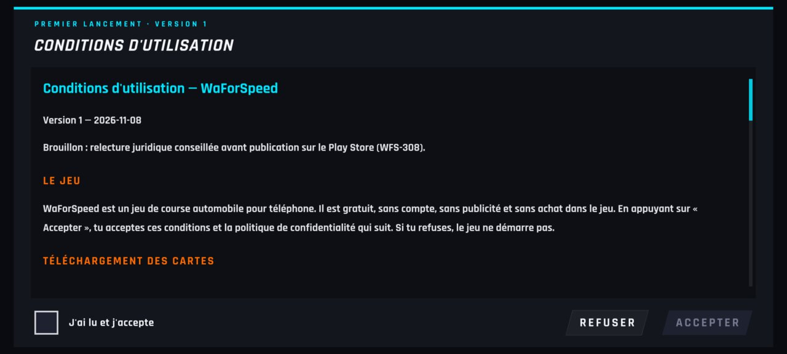 |
| `cgu-refus` | — | 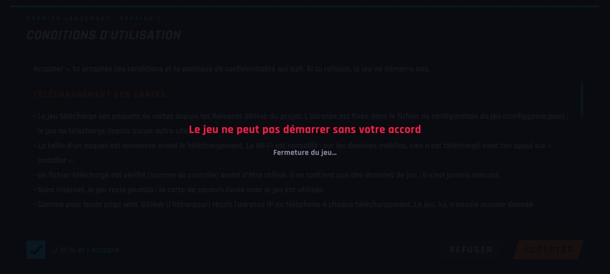 |
| `reglages-cgu-bouton` | — |  |
| `reglages-cgu-lecture` | — | 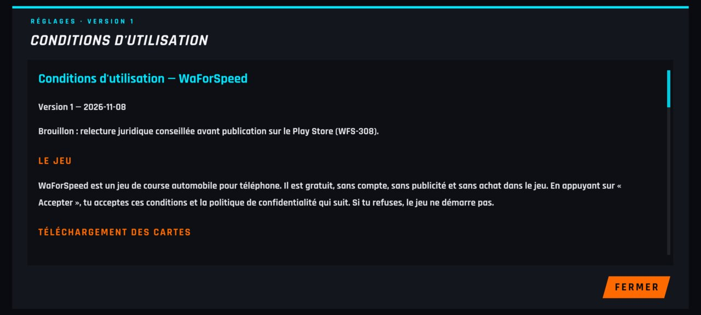 |
| `reglages-108` | 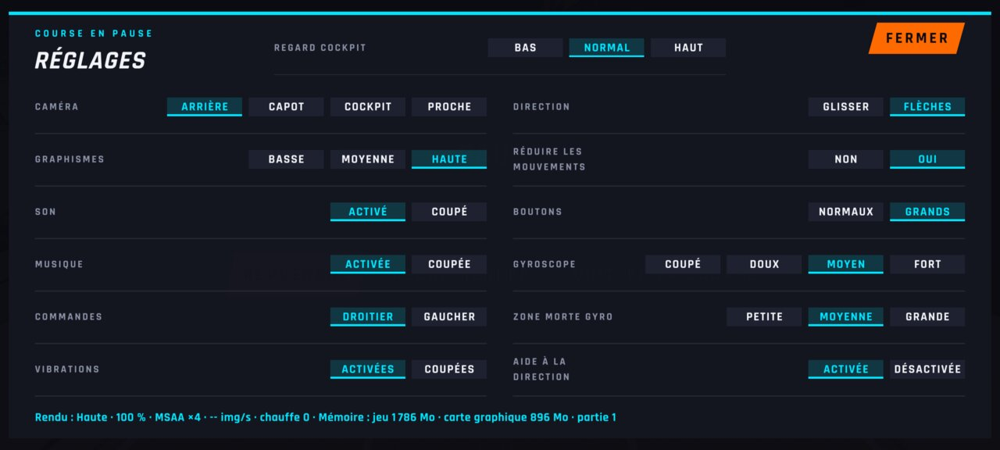 | 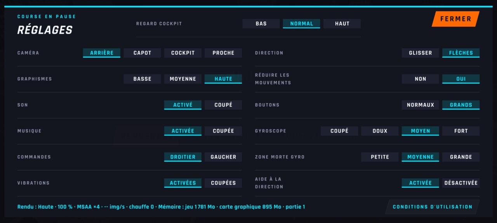 |
| `reglages-basse` |  | 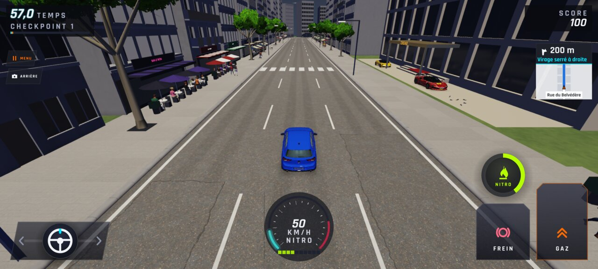 |
| `reglages-commandes` |  | 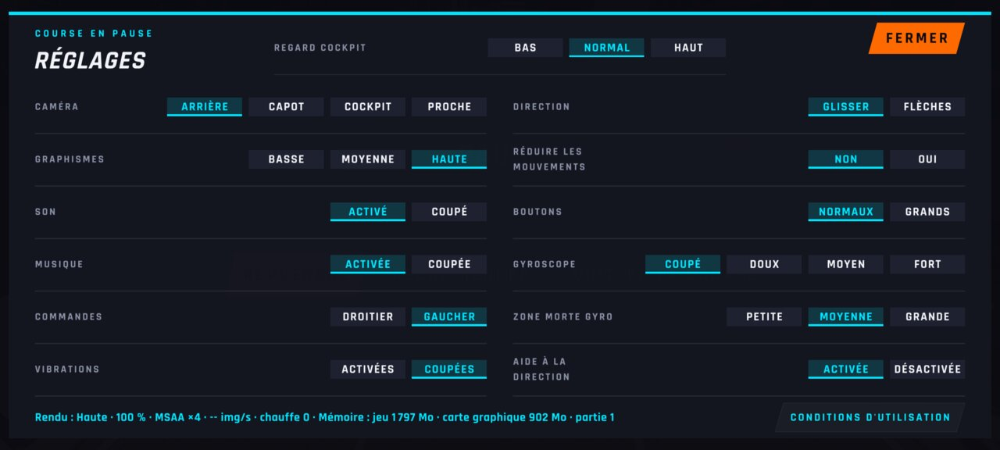 |
| `reglages-menu` | 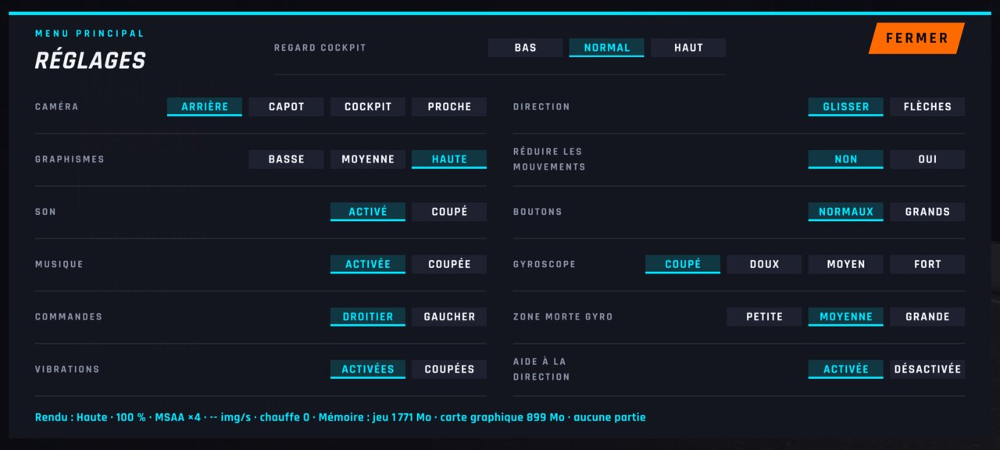 | 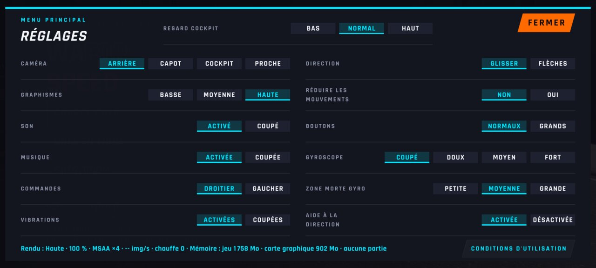 |
| `reglages-musique` | 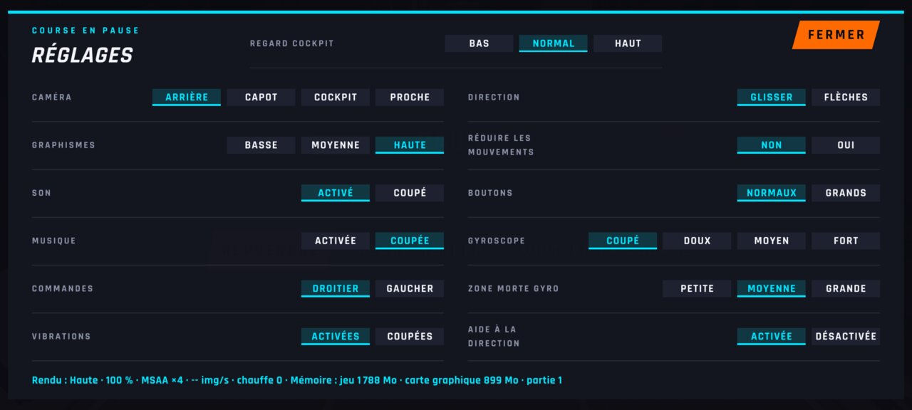 | 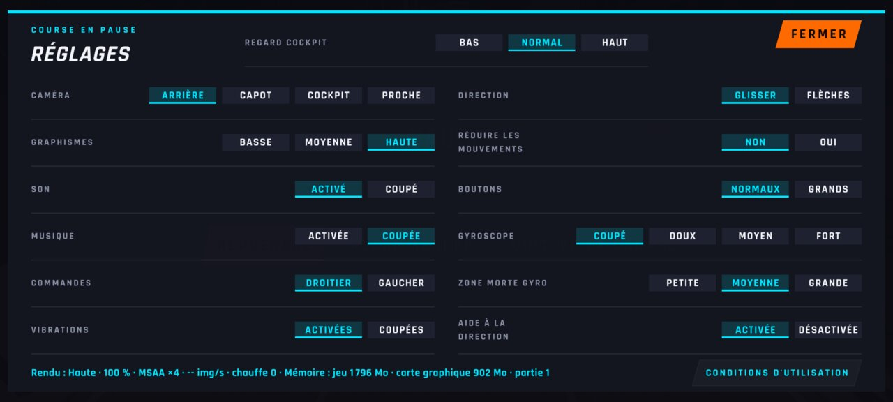 |
| `reglages-pause` | 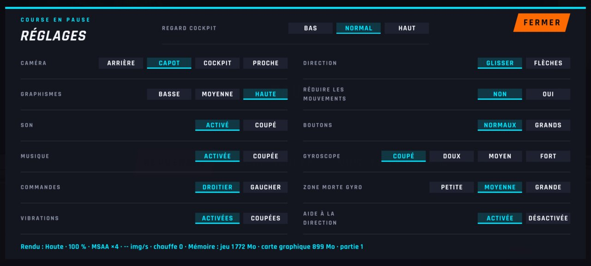 | 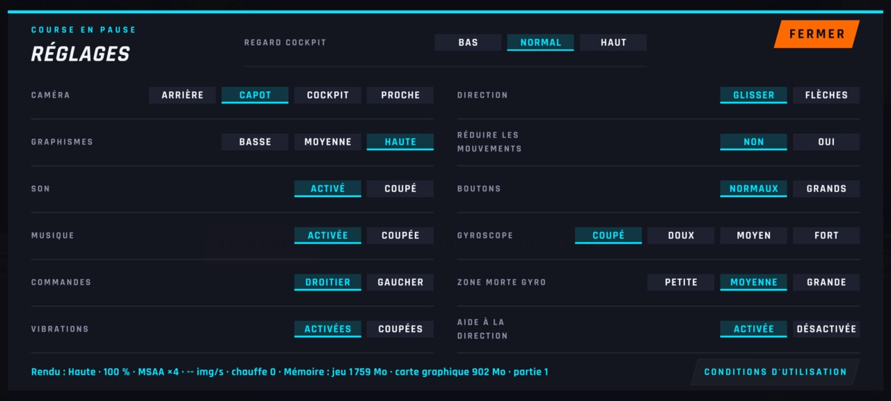 |
| `reglages` | 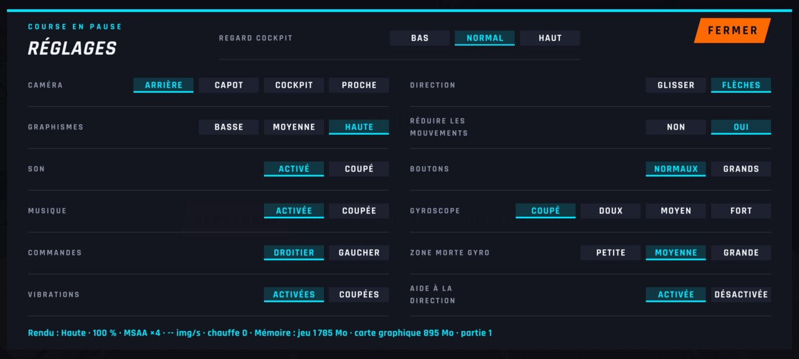 | 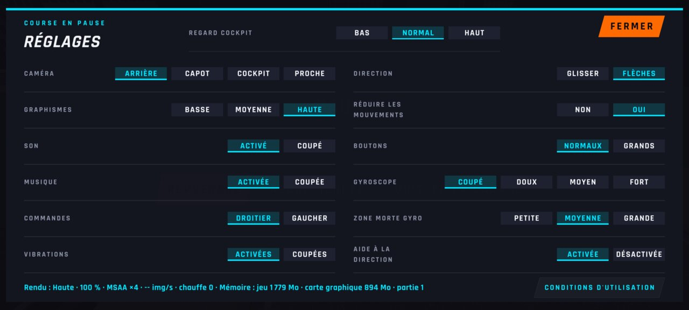 |
