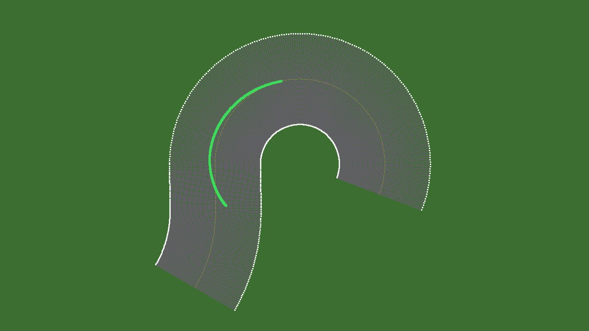
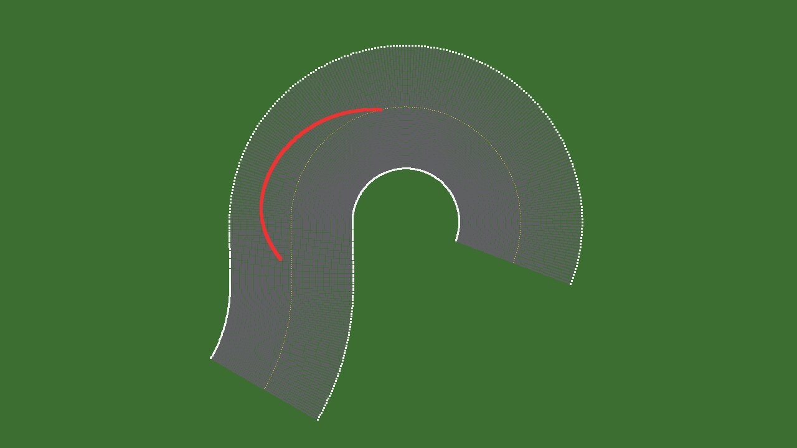
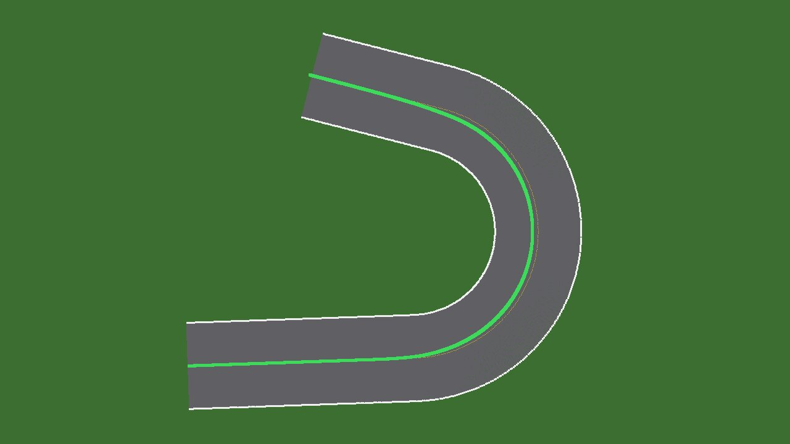
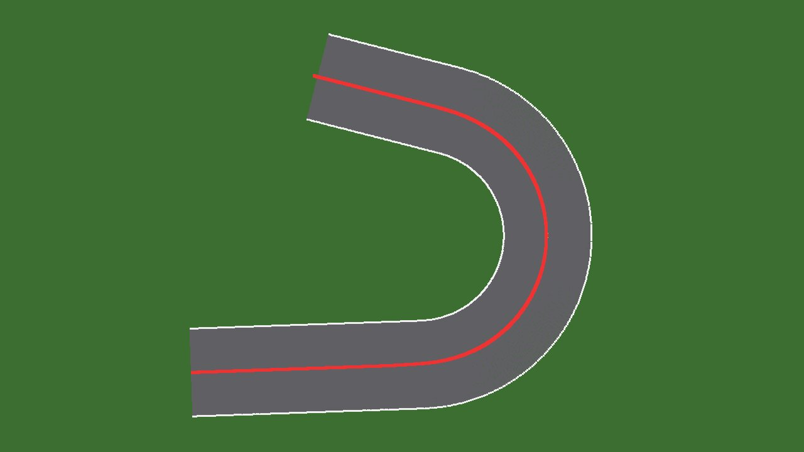
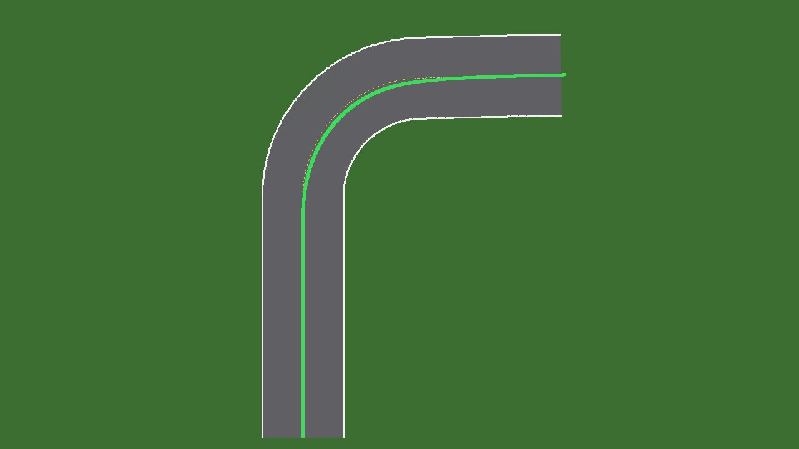
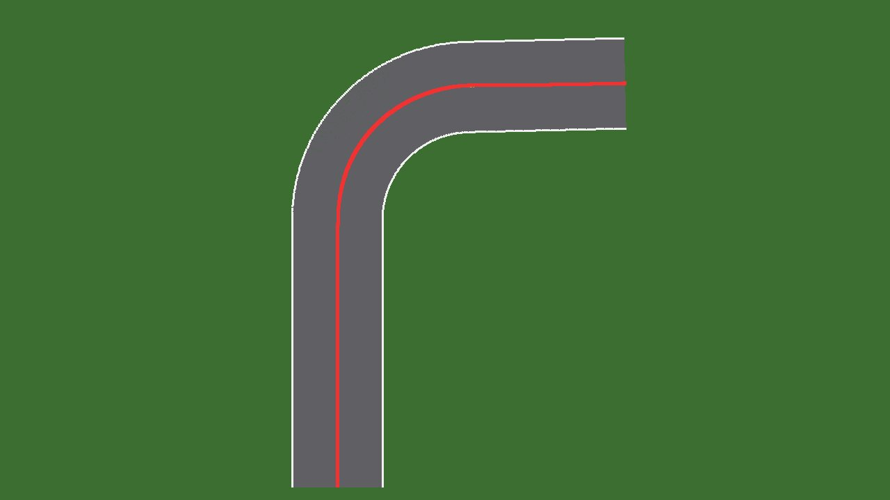

# WFS-316 — captures avant / après (tools/qa/captures_pr.sh)

Branche `feature/waforspeed-316` comparée à `origin/main` ; bancs : virages ; filtre : `virages-*-dessus-*`.

| Capture | Avant (main) | Après (branche) |
|---|---|---|
| `virages-anneau-dessus-apres` | — |  |
| `virages-anneau-dessus-avant` | — |  |
| `virages-epingle-30-dessus-apres` | — |  |
| `virages-epingle-30-dessus-avant` | — |  |
| `virages-virage90-dessus-apres` | — |  |
| `virages-virage90-dessus-avant` | — |  |
