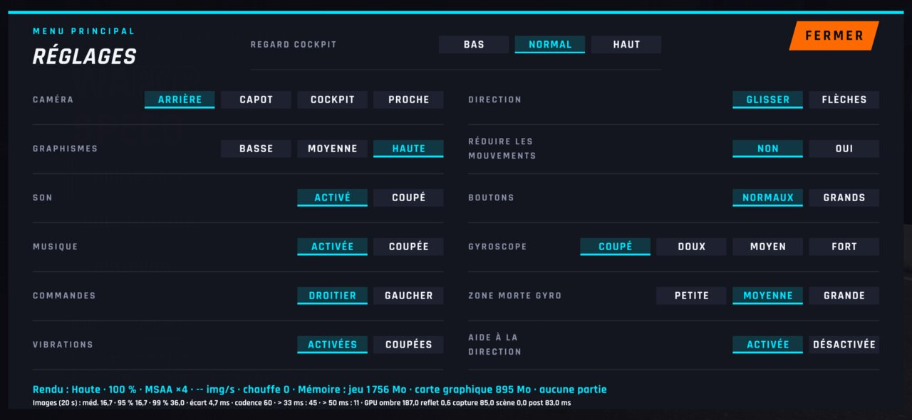
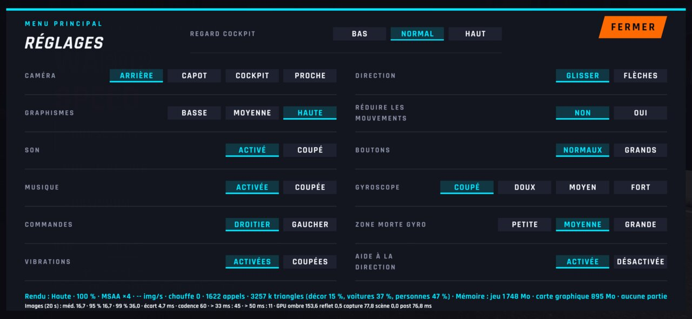
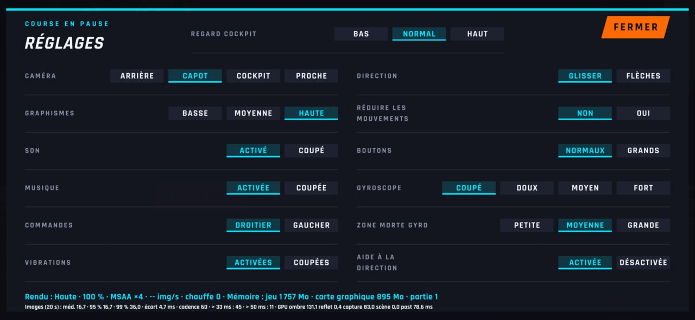
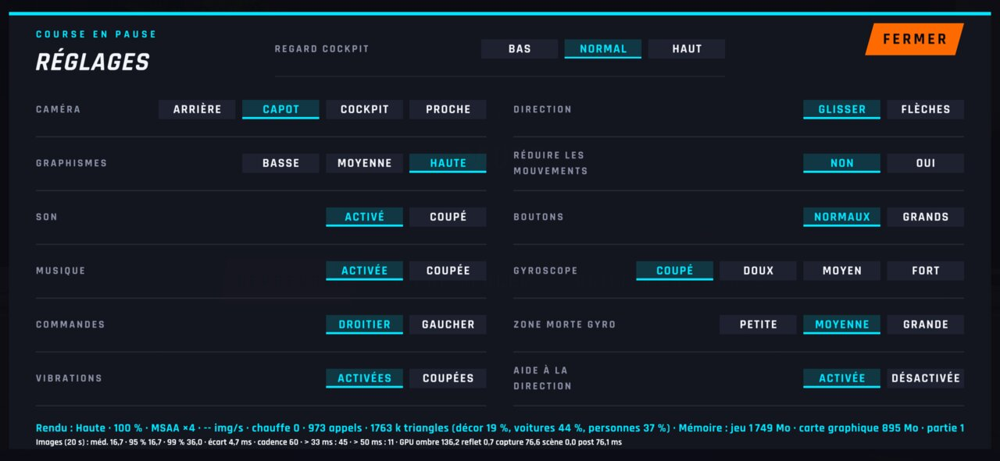
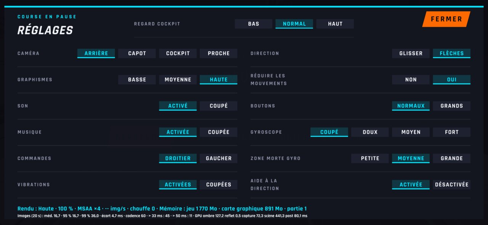
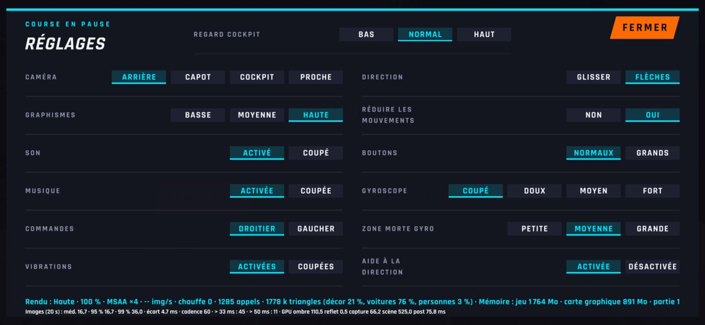

# WFS-317 — captures avant / après (tools/qa/captures_pr.sh)

Branche `feature/waforspeed-317` comparée à `origin/main` ; bancs : menu2:2340x1080 ; filtre : `@(reglages-pause|reglages-menu|reglages)`.

| Capture | Avant (main) | Après (branche) |
|---|---|---|
| `reglages-menu` |  |  |
| `reglages-pause` |  |  |
| `reglages` |  |  |
