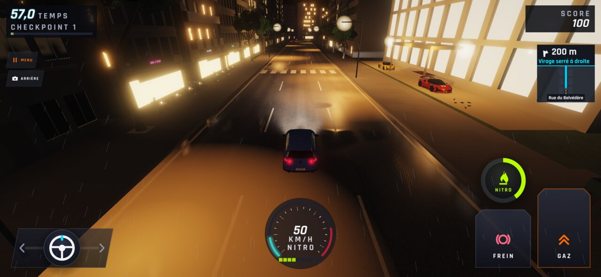
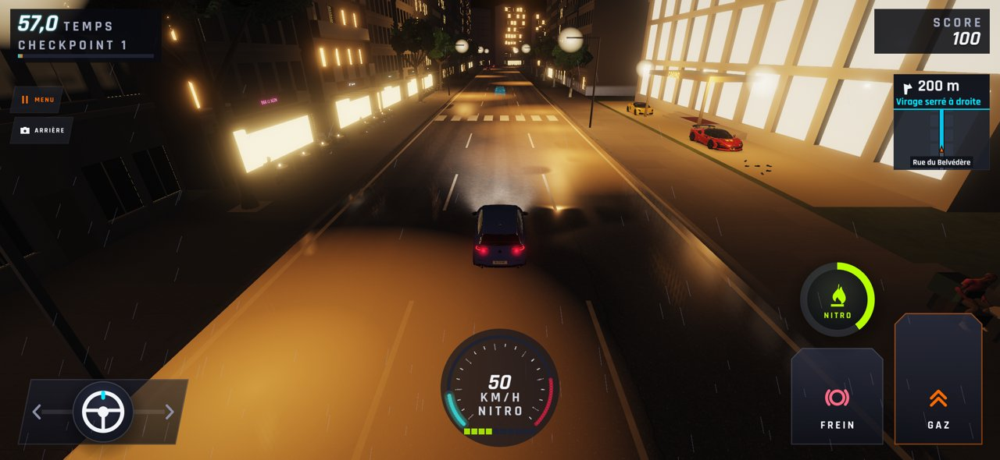
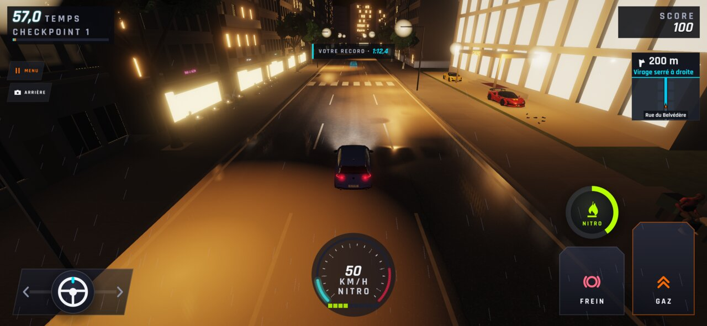
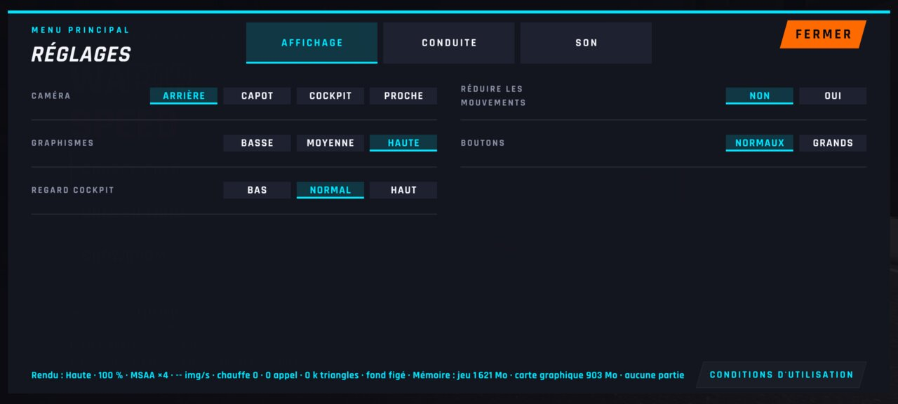
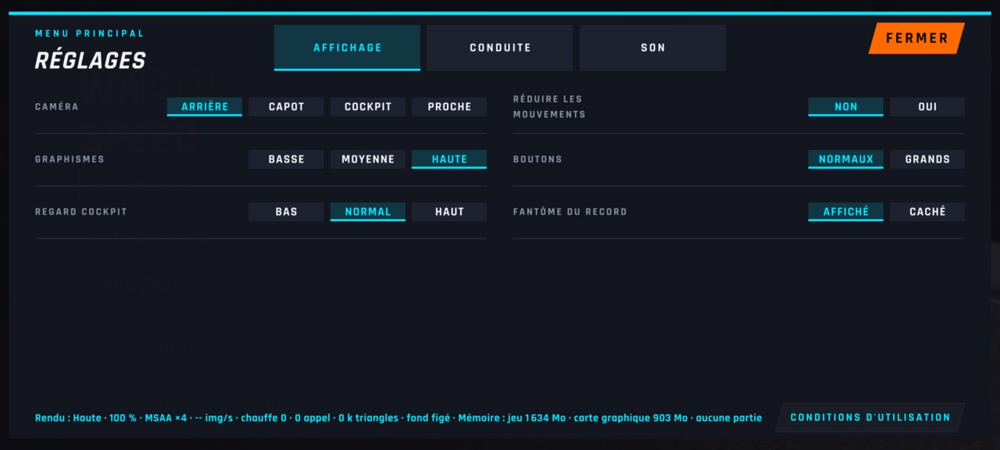
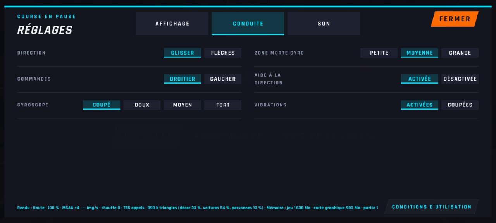
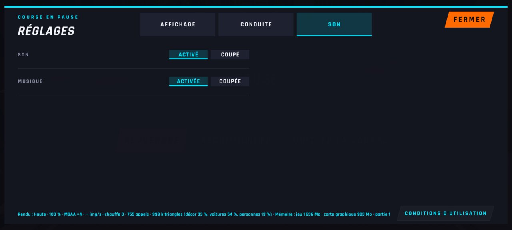
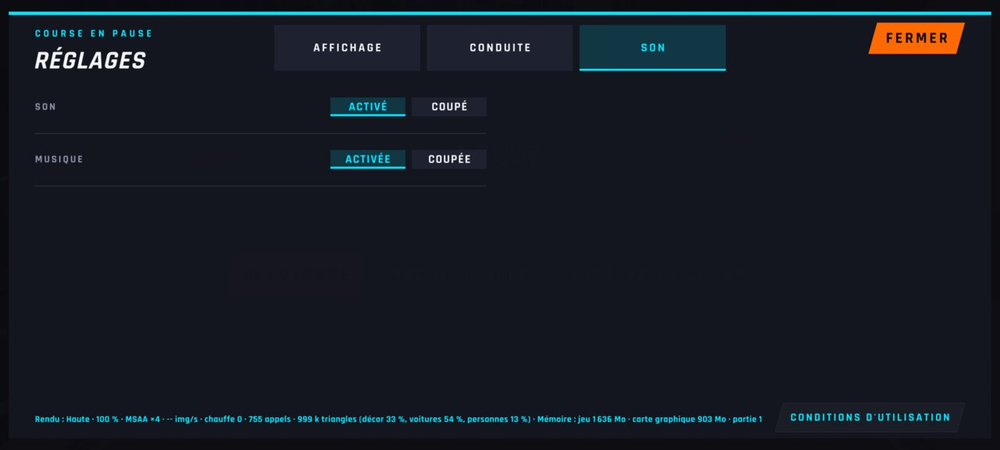

# WFS-318 — captures avant / après (tools/qa/captures_pr.sh)

Branche `feature/waforspeed-318` comparée à `origin/main` ; bancs : fantome:2340x1080 reglages-onglets:2400x1080 ; filtre : `*`.

| Capture | Avant (main) | Après (branche) |
|---|---|---|
| `fantome-cache-nuit` |  |  |
| `fantome-etiquette-nuit` |  |  |
| `reglages-onglet-affichage-menu` |  |  |
| `reglages-onglet-conduite-pause` |  |  |
| `reglages-onglet-son-gaucher` |  |  |
| `reglages-onglet-son-pause` |  |  |
