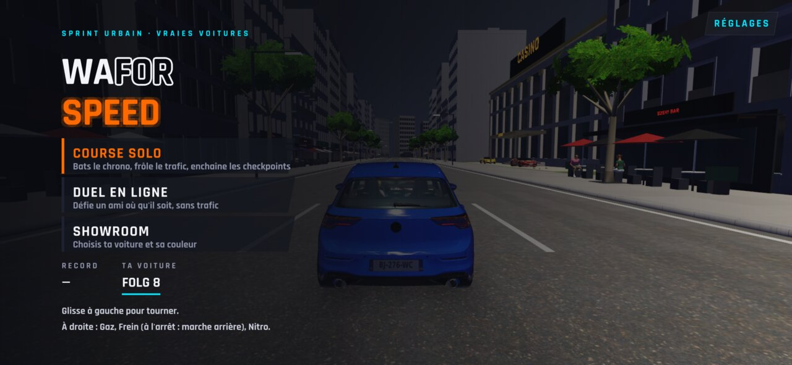
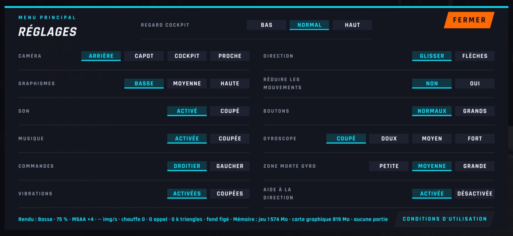
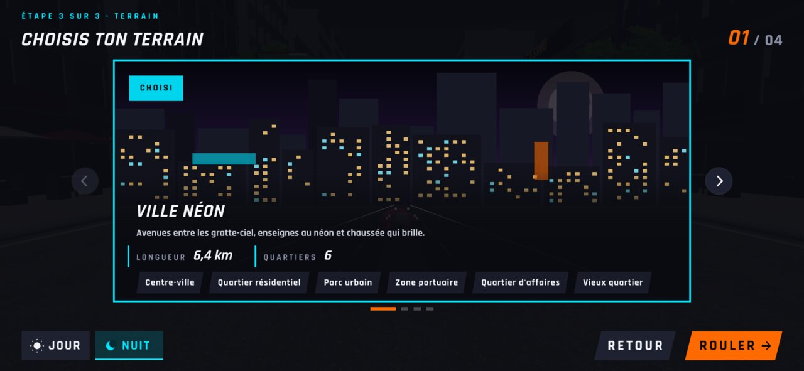
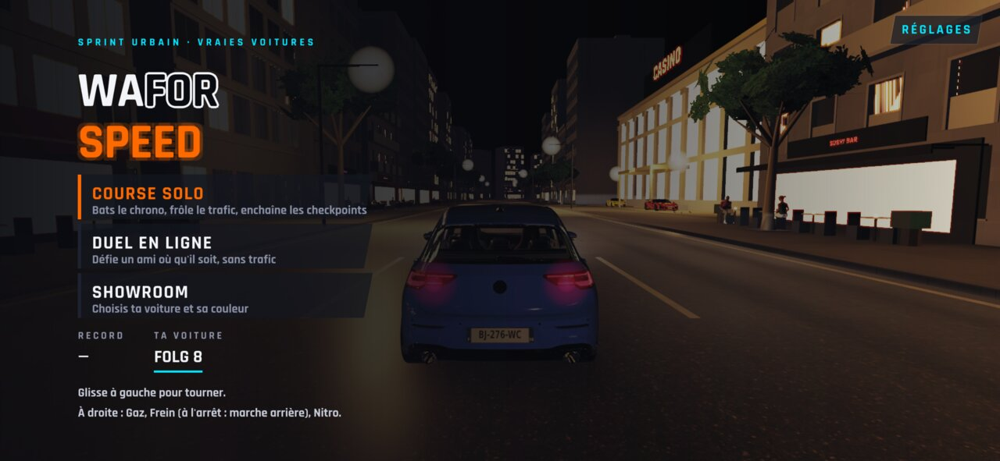
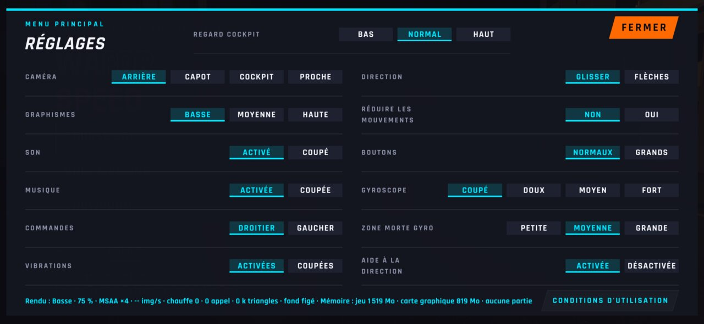
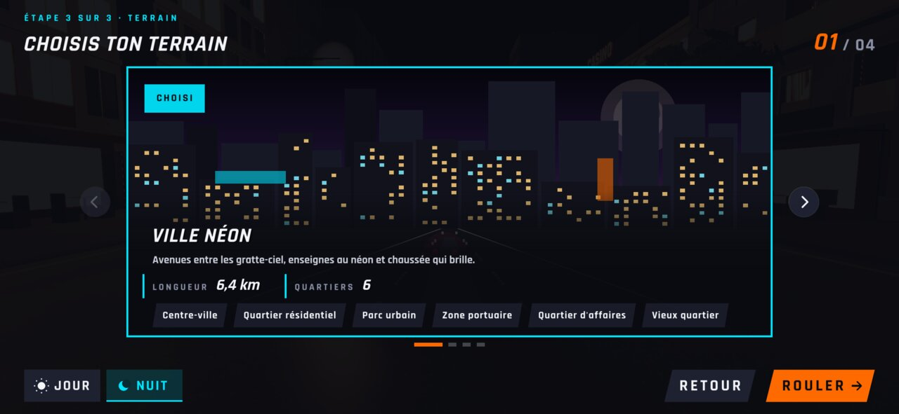

# WFS-329 — captures avant / après (tools/qa/captures_pr.sh)

Branche `feature/waforspeed-329` comparée à `origin/main` ; bancs : perf:2340x1080 ; filtre : `*`.

| Capture | Avant (main) | Après (branche) |
|---|---|---|
| `menu-ville-jour-1s` | — |  |
| `menu-ville-jour-3s` | — |  |
| `menu-ville-jour-reglages` | — |  |
| `menu-ville-jour-terrain` | — |  |
| `menu-ville-nuit-1s` | — |  |
| `menu-ville-nuit-3s` | — |  |
| `menu-ville-nuit-reglages` | — |  |
| `menu-ville-nuit-terrain` | — |  |
