# WFS-333 — captures avant / après (banc penetration)

Banc `penetration` (Ville de nuit, Golf, Checkpoint) lancé deux fois sur la même branche : « avant » avec `WFS_AVANT_333=1` (chocs d'avant WFS-333, interrupteur du banc seulement), « après » sans. Mesures du journal du banc écrites sur chaque image (vitesses, distance, recouvrement des emprises dessinées). Images annotées par `outils333/annoter.py` (hors dépôt).

| Capture | Avant (chocs d'avant WFS-333, `WFS_AVANT_333=1`) | Après (branche) |
|---|---|---|
| `penetration-accident-1` | 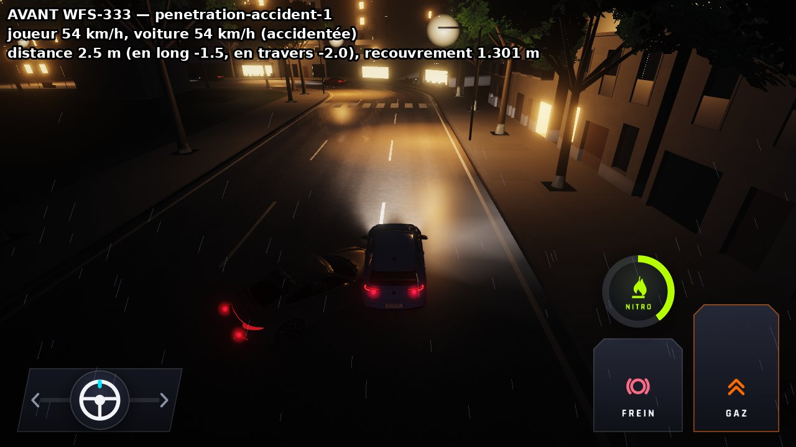 |  |
| `penetration-accident-2` | 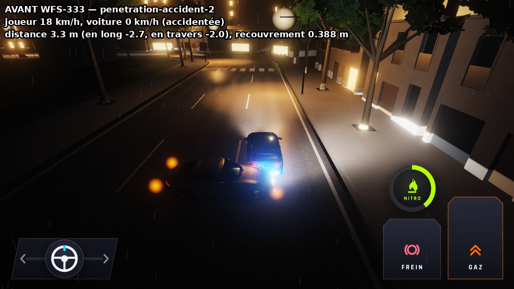 |  |
| `penetration-accident-3` | 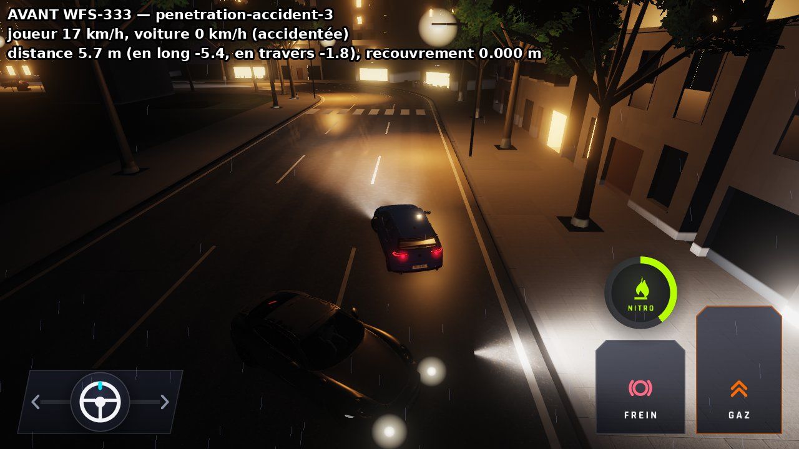 |  |
| `penetration-accident-4` | 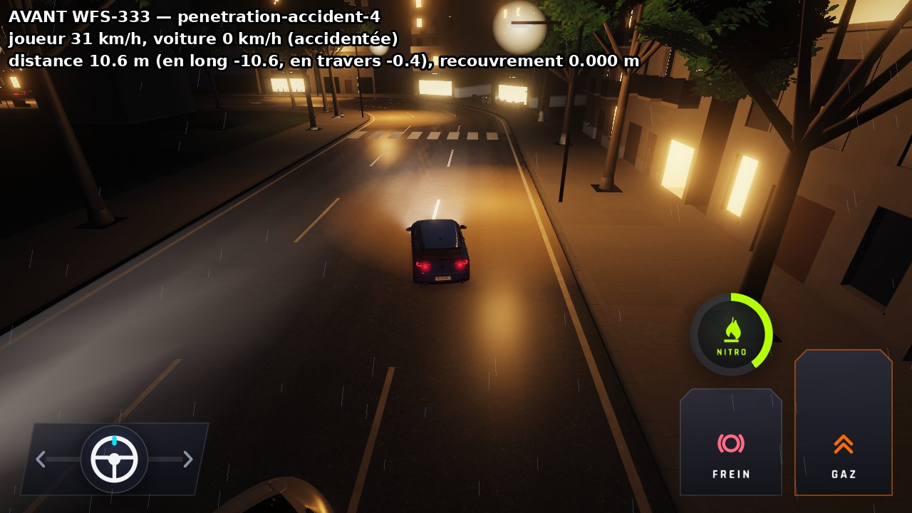 | 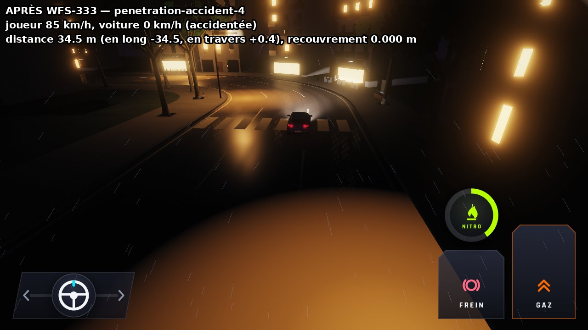 |
| `penetration-poursuite-1` | 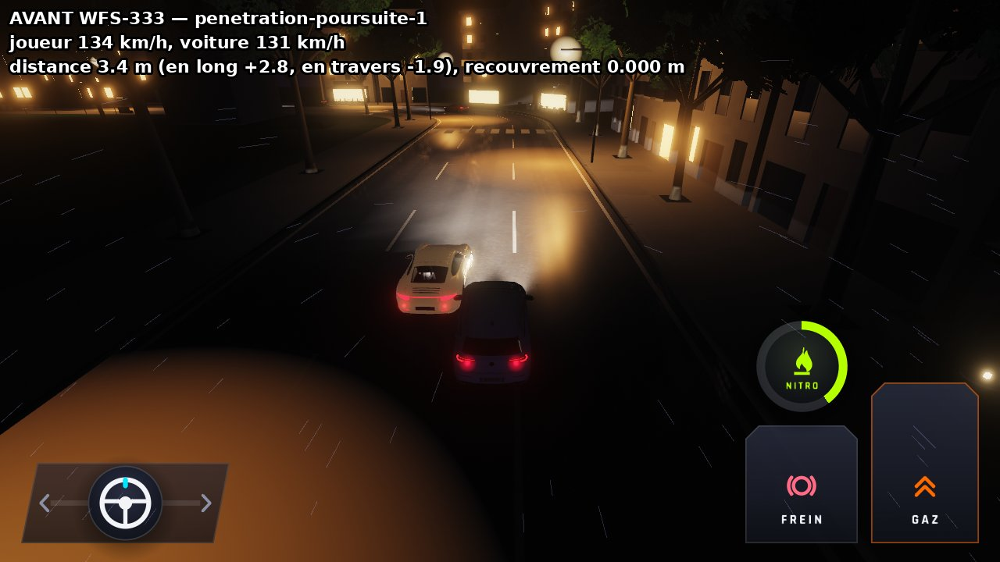 |  |
| `penetration-poursuite-2` |  |  |
| `penetration-poursuite-3` | 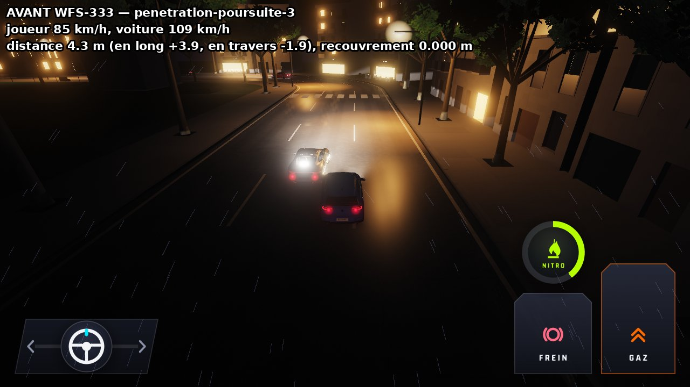 |  |
| `penetration-poursuite-4` | 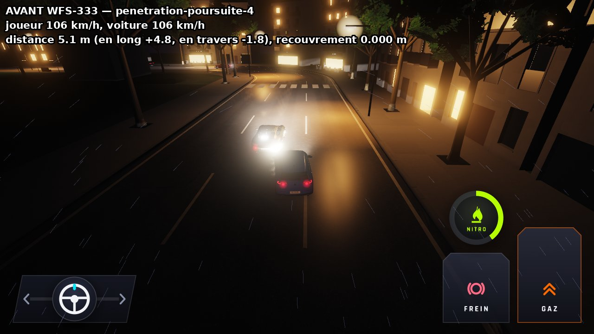 |  |
| `penetration-cockpit-1` | 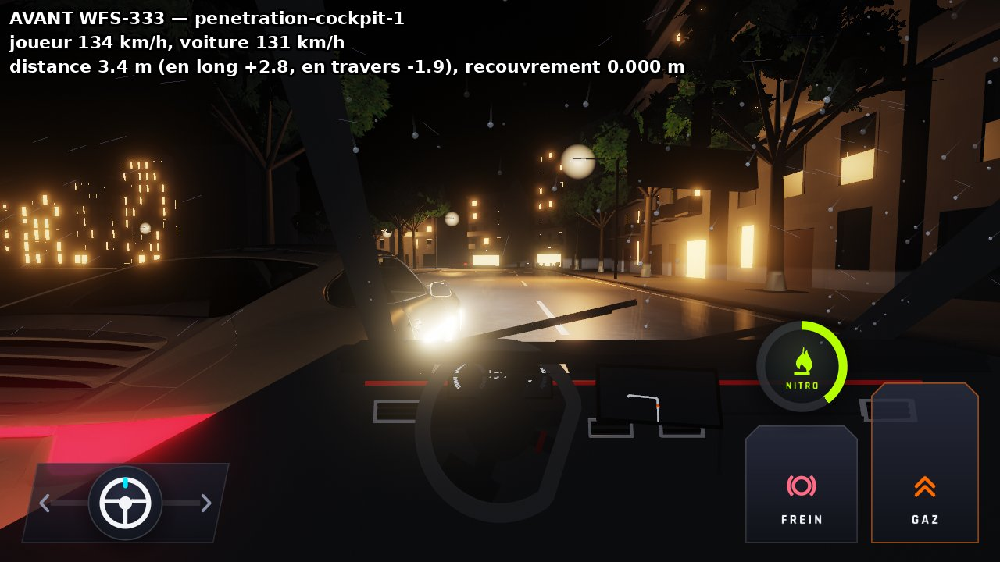 |  |
| `penetration-cockpit-2` |  |  |
| `penetration-cockpit-3` | 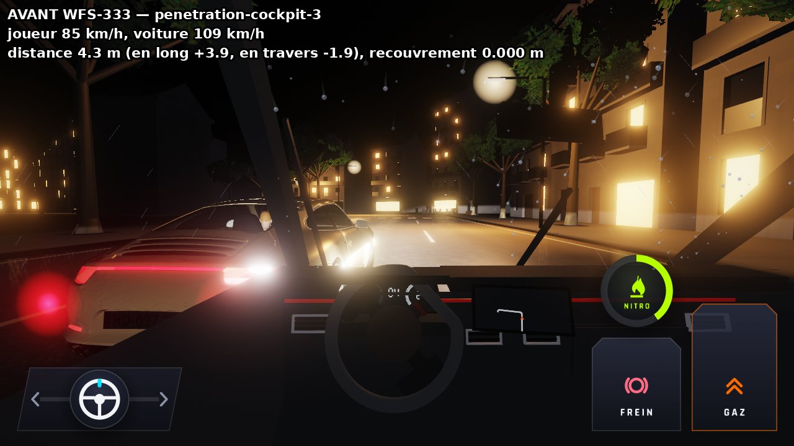 |  |
| `penetration-cockpit-4` | 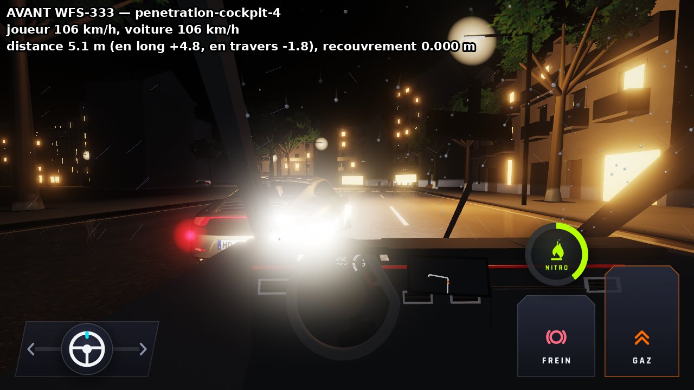 |  |
| `penetration-cockpit-4-sans-voisine` |  | 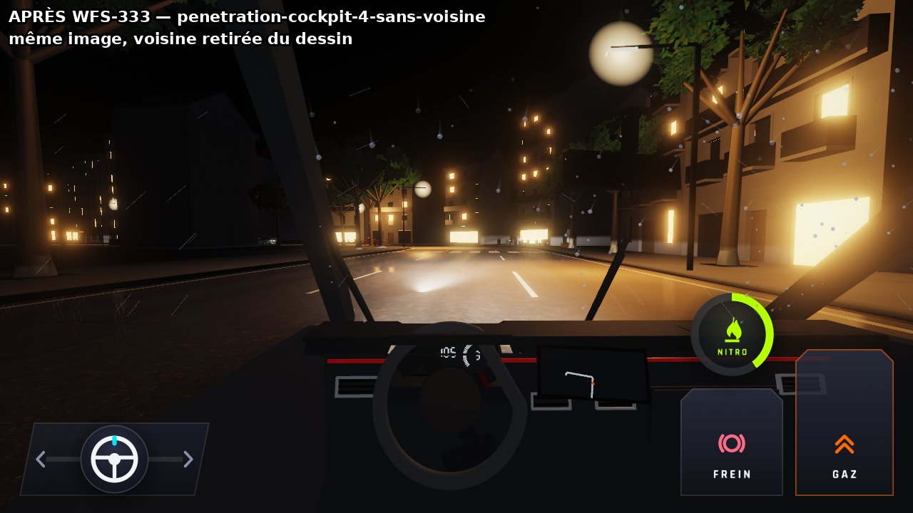 |
