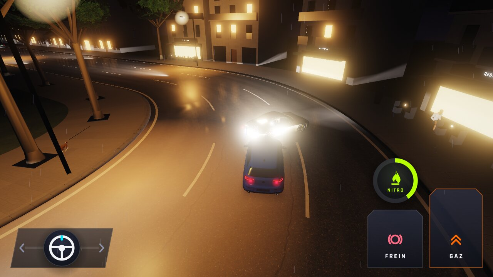
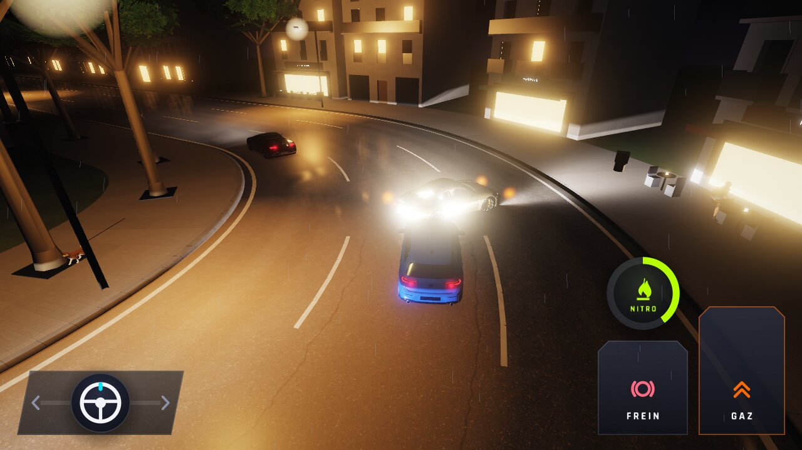
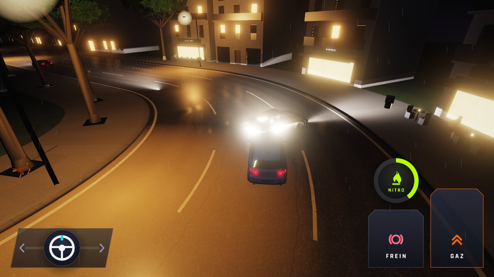
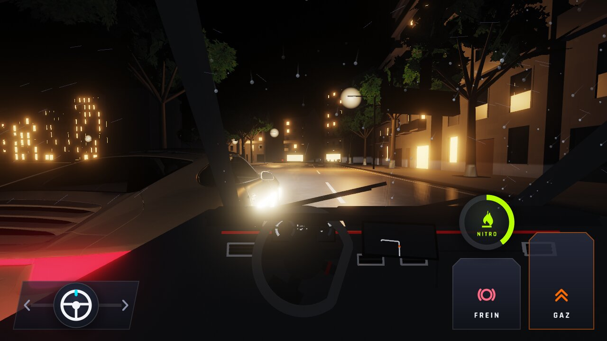
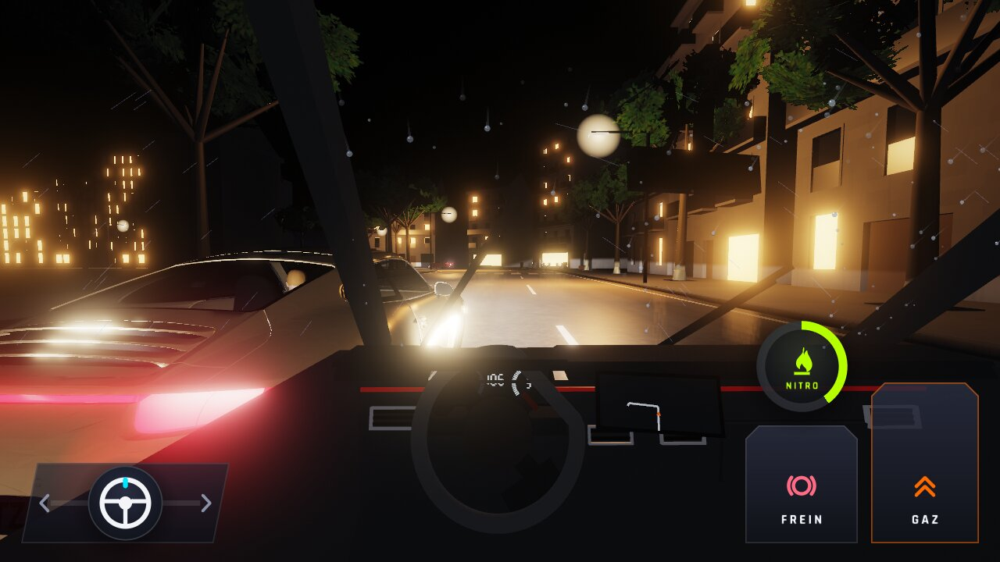
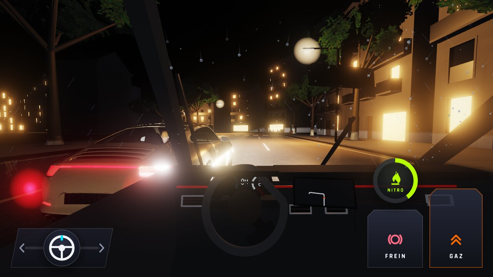
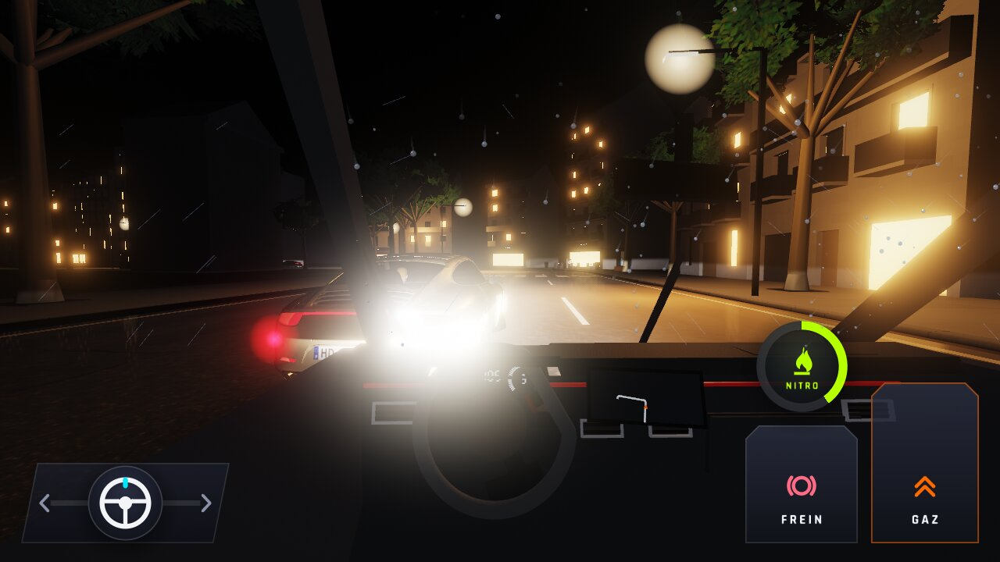
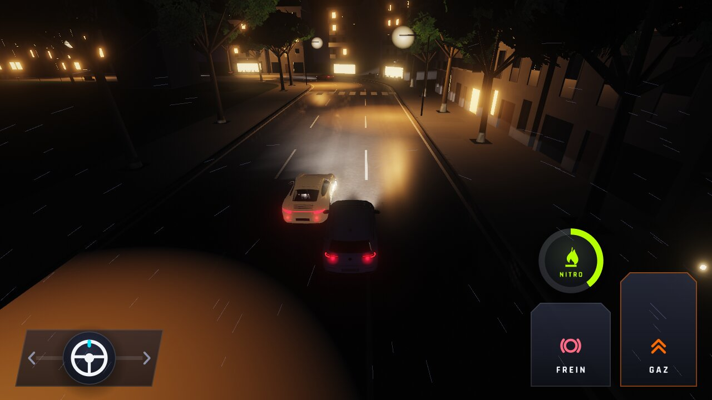
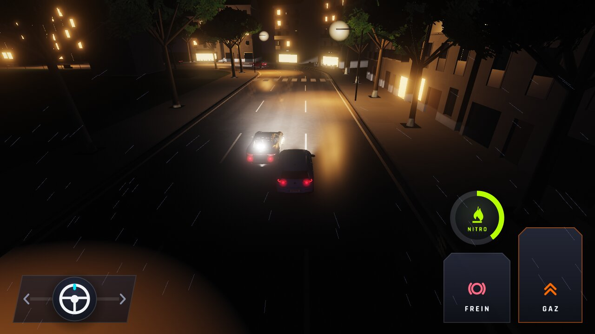
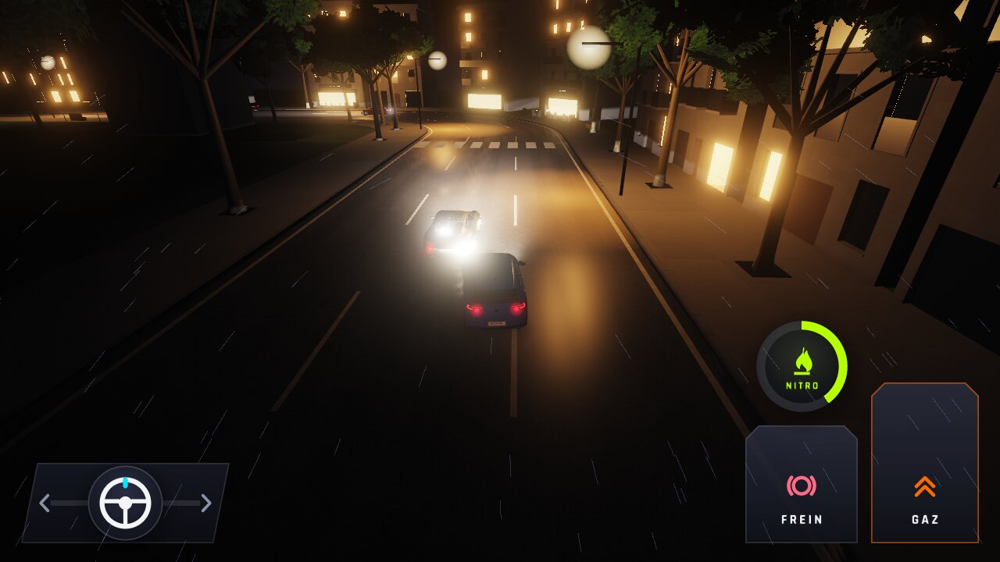

# WFS-333 — captures avant / après (tools/qa/captures_pr.sh)

Branche `feature/waforspeed-333` comparée à `origin/main` ; bancs : penetration ; filtre : `*`.

| Capture | Avant (main) | Après (branche) |
|---|---|---|
| `penetration-accident-1` | — |  |
| `penetration-accident-2` | — |  |
| `penetration-accident-3` | — |  |
| `penetration-cockpit-1` | — |  |
| `penetration-cockpit-2` | — |  |
| `penetration-cockpit-3` | — |  |
| `penetration-cockpit-4` | — |  |
| `penetration-poursuite-1` | — |  |
| `penetration-poursuite-2` | — |  |
| `penetration-poursuite-3` | — |  |
| `penetration-poursuite-4` | — |  |
