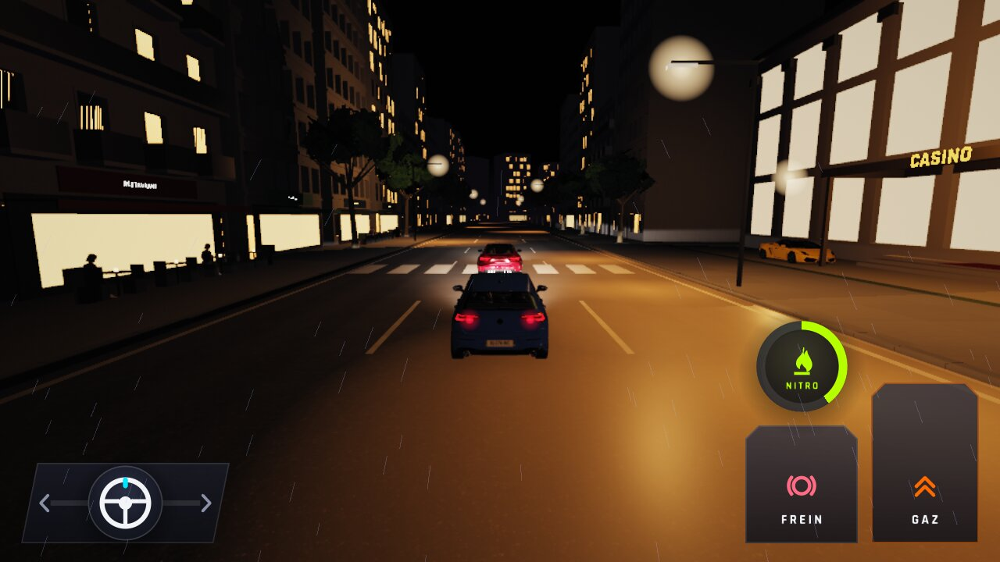
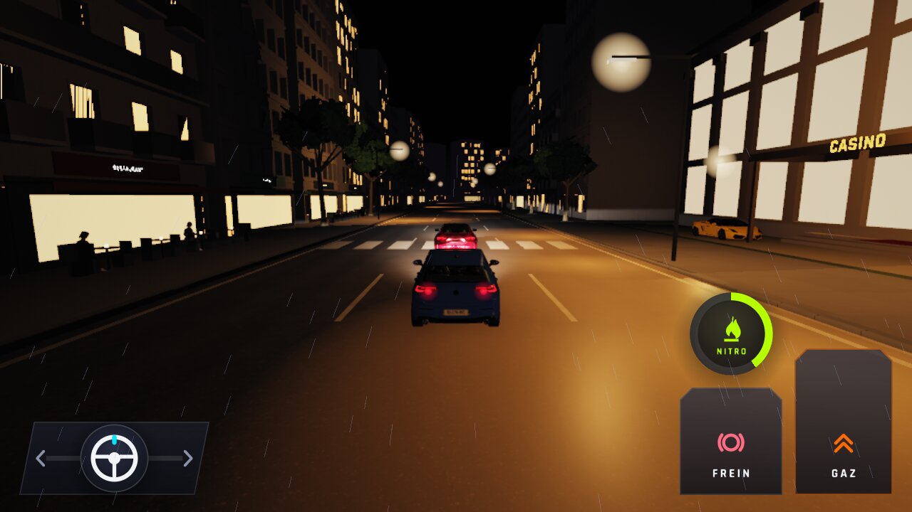
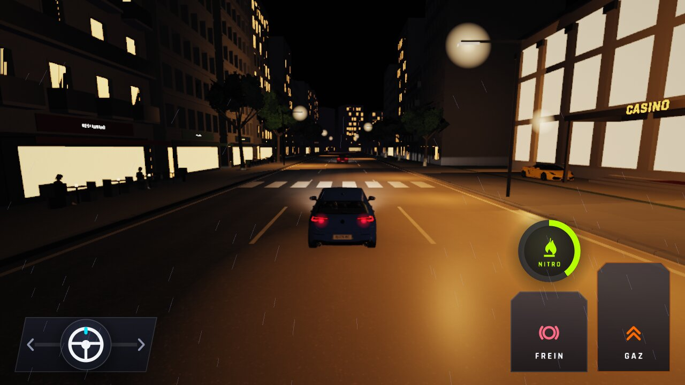
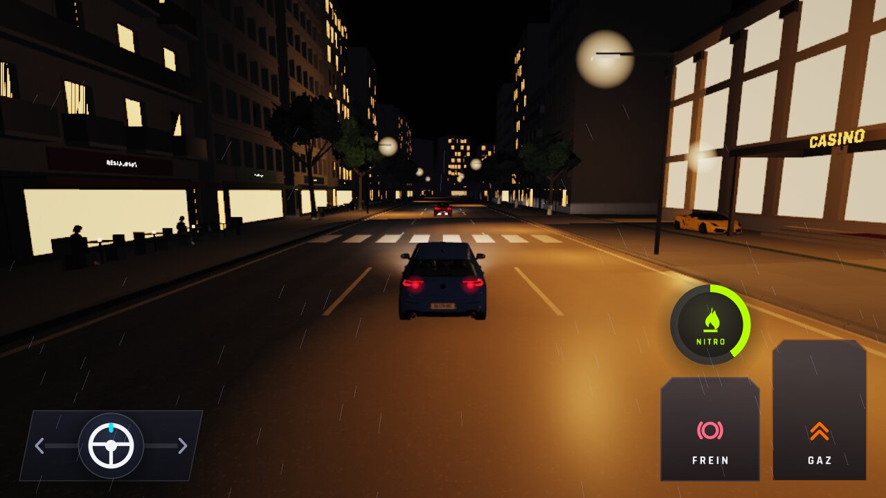
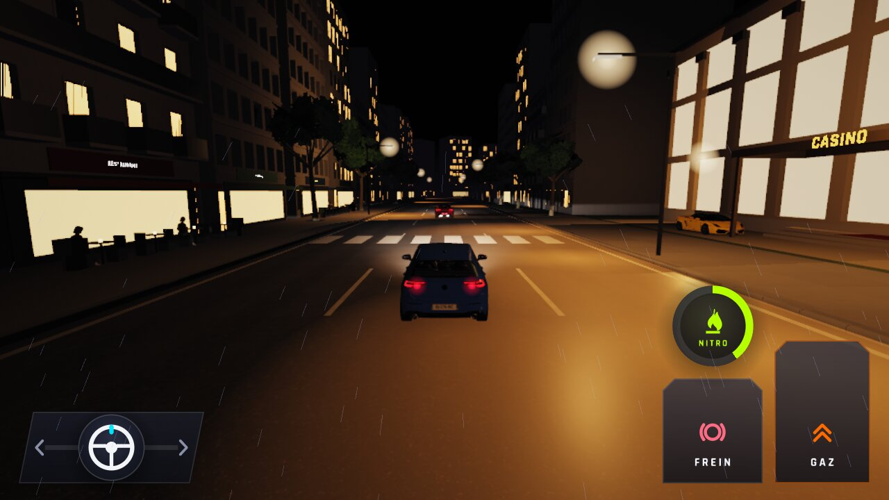
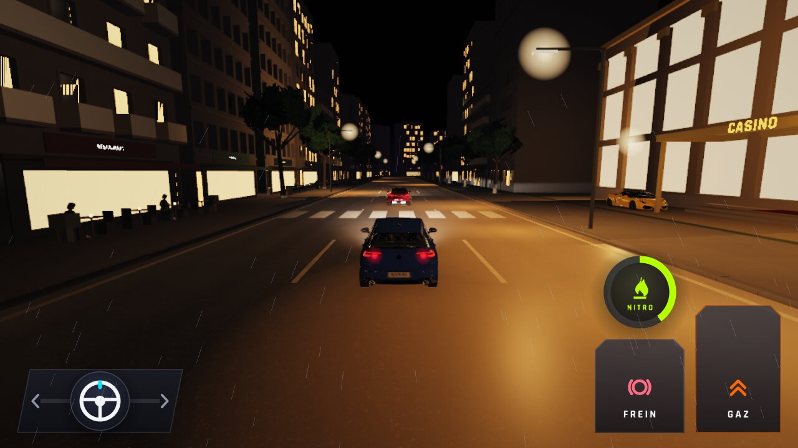
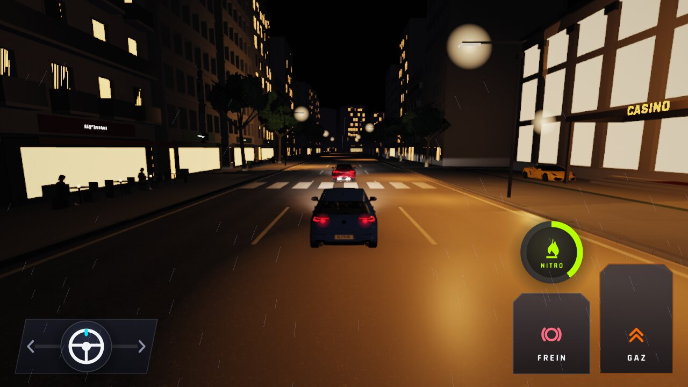
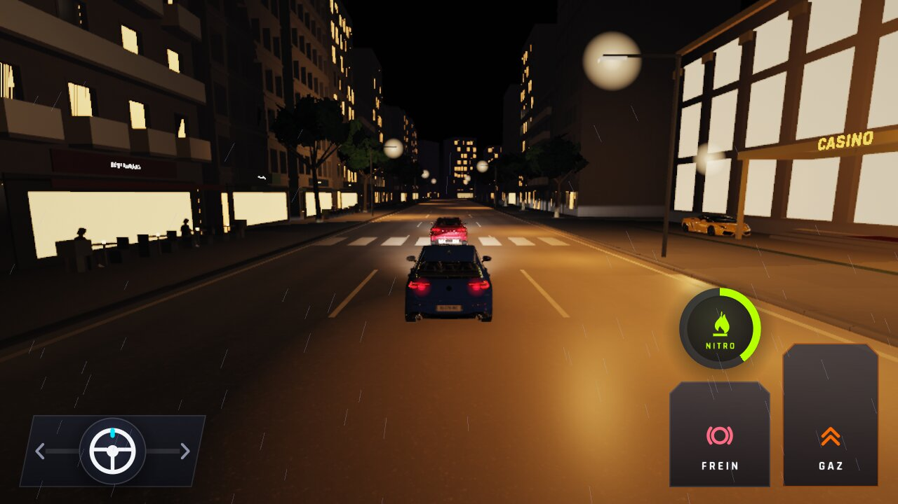

# WFS-335 — captures avant / après (tools/qa/captures_pr.sh)

Branche `feature/waforspeed-335` comparée à `origin/main` (6aaf41b5, avec le bench_lod.cpp de 2fcd39a7 : sans la suite lod-passage, qui demande le relevé de la branche) ; banc : lod:1280x720 ; filtre : `lod-*basse`.

| Capture | Avant (main) | Après (branche) |
|---|---|---|
| `lod-campagne-150-basse` |  |  |
| `lod-campagne-300-basse` |  |  |
| `lod-campagne-50-basse` |  |  |
| `lod-circuit-150-basse` |  |  |
| `lod-circuit-300-basse` |  |  |
| `lod-circuit-50-basse` |  |  |
| `lod-course5-nuit-arriere-basse` |  |  |
| `lod-course5-nuit-proche-basse` |  |  |
| `lod-course5-nuit-proche-loin-basse` |  |  |
| `lod-fondu-ville-100-basse` |  |  |
| `lod-fondu-ville-105-basse` |  |  |
| `lod-fondu-ville-110-basse` |  |  |
| `lod-fondu-ville-115-basse` |  |  |
| `lod-fondu-ville-70-basse` |  |  |
| `lod-fondu-ville-80-basse` |  |  |
| `lod-fondu-ville-85-basse` |  |  |
| `lod-fondu-ville-90-basse` |  |  |
| `lod-nuit-trafic-10-basse` |  |  |
| `lod-nuit-trafic-25-basse` |  |  |
| `lod-nuit-trafic-50-basse` |  |  |
| `lod-nuit-trafic-loin-100-basse` |  |  |
| `lod-nuit-trafic-loin-130-basse` |  |  |
| `lod-nuit-trafic-loin-170-basse` |  |  |
| `lod-nuit-trafic-loin-60-basse` |  |  |
| `lod-nuit-trafic-loin-80-basse` |  |  |
| `lod-passage-100px-basse` | — |  |
| `lod-passage-110px-basse` | — |  |
| `lod-passage-40px-basse` | — |  |
| `lod-passage-45px-basse` | — |  |
| `lod-passage-48px-basse` | — |  |
| `lod-passage-50px-basse` | — |  |
| `lod-passage-60px-basse` | — |  |
| `lod-passage-70px-basse` | — |  |
| `lod-passage-80px-basse` | — |  |
| `lod-passage-90px-basse` | — |  |
| `lod-passage-95px-basse` | — |  |
| `lod-plage-150-basse` |  |  |
| `lod-plage-300-basse` |  |  |
| `lod-plage-50-basse` |  |  |
| `lod-ville-150-basse` |  |  |
| `lod-ville-300-basse` |  |  |
| `lod-ville-50-basse` |  |  |
