# WFS-336 — captures avant / après

Agent : lead-dev. Banc `perf` (pilote automatique du banc, vue du joueur), Ville, `WFS_PERF_AVANCE` = 0 / 10000 / 36000, `WFS_PERF_AVANCE_RENDU=0`,
`WFS_PERF_CHAUFFE=30`, `WFS_PERF_IMAGES=90`, `WFS_PERF_CAPTURE=1` (dernière image mesurée) ; nuit : `WFS_MOMENT=nuit` ; Poursuite : banc `course5`.
**Avant** = `origin/main` (+ la seule ligne de capture du banc) ; **après** = la branche. JPG 1280 px, qualité 85.

| Mesure : TrafficSystem (banc perf, Ville, médiane de 90 images) | Haute avant (main) | Haute après | Basse avant | Basse après |
|---|---|---|---|---|
| départ (0 image) | 12 appels / 9 547 tri. | 12 / 9 547 (2 véhicules) | 0 / 0 | 0 / 0 |
| ≈ 2 min 50 (10000 images) | 76 / 86 119 | 25 / 11 331 (2 véhicules) | 31 / 59 603 | 2 / 24 291 (2 véhicules) |
| 10 min, jour (36000 images) | **201 / 170 554** | **94 / 58 020** (3 véhicules) | 56 / 138 966 | 30 / 32 680 (2 véhicules) |
| 10 min, nuit | **222 / 170 596** | **100 / 58 032** (3 véhicules) | 70 / 139 207 | 35 / 32 784 (2 véhicules) |
| voitures au total | monte (54 → 114 au relevé du test, `--avant`) | **54 constant** | | |

| Capture | Avant (main) | Après (branche) |
|---|---|---|
| `ville-haute-depart` — Ville, Haute, départ (0 image) | 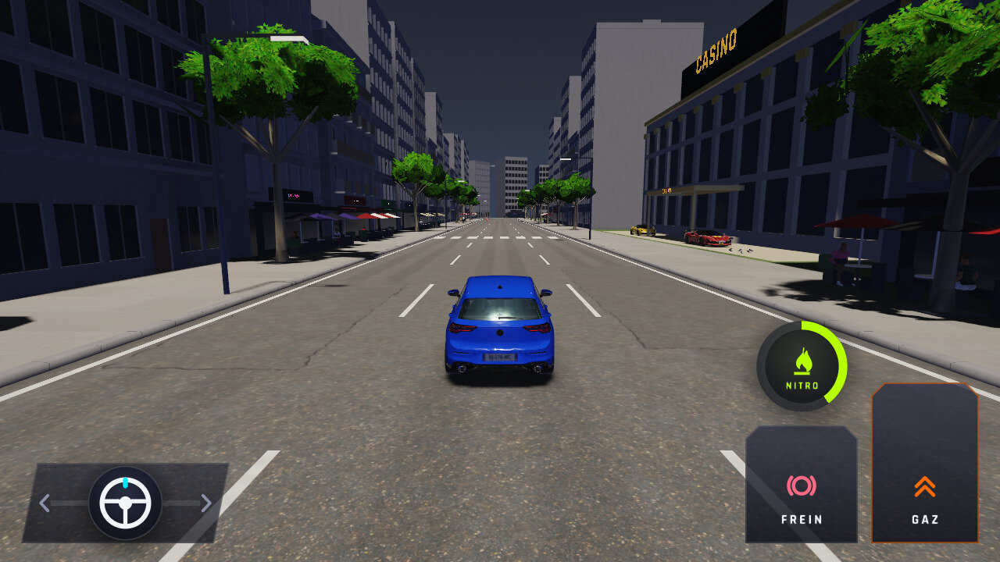 |  |
| `ville-haute-2min50` — Ville, Haute, ≈ 2 min 50 (10000 images) : la Golf du pilote automatique du banc sort de la route, **sur main comme sur la branche** (pilote du banc, hors ticket) | 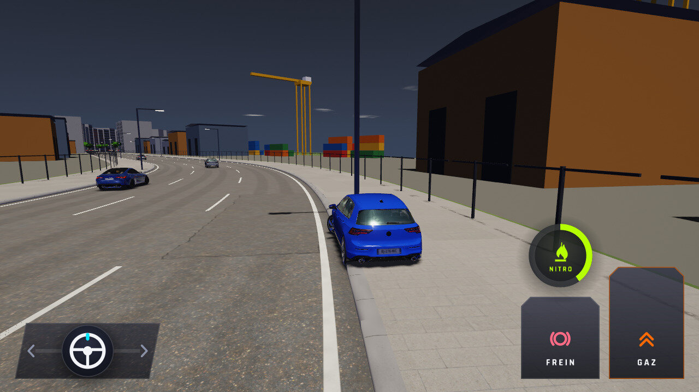 | 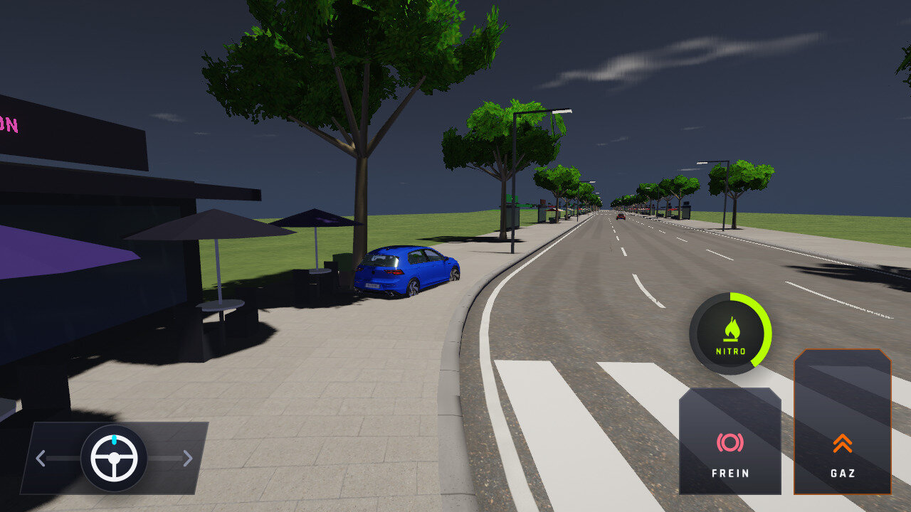 |
| `ville-haute-10min` — Ville, Haute, 10 min (36000 images) : Golf sur la chaussée | 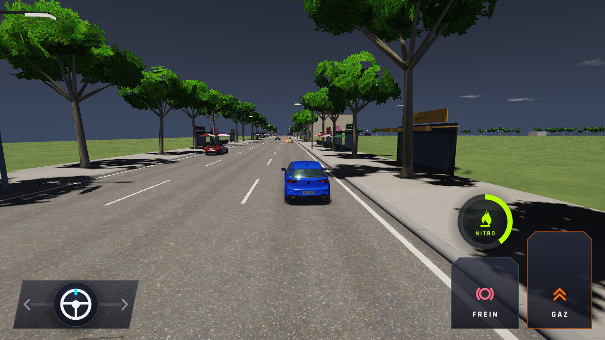 | 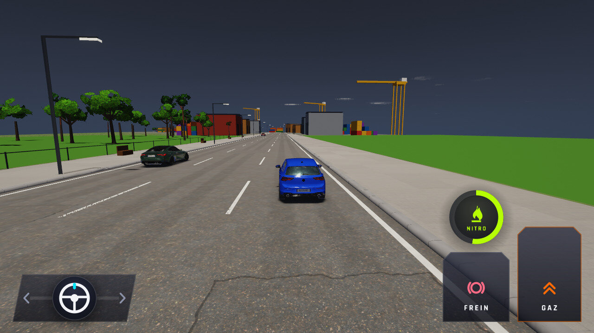 |
| `ville-basse-10min` — Ville, Basse, 10 min : Golf sur la chaussée | 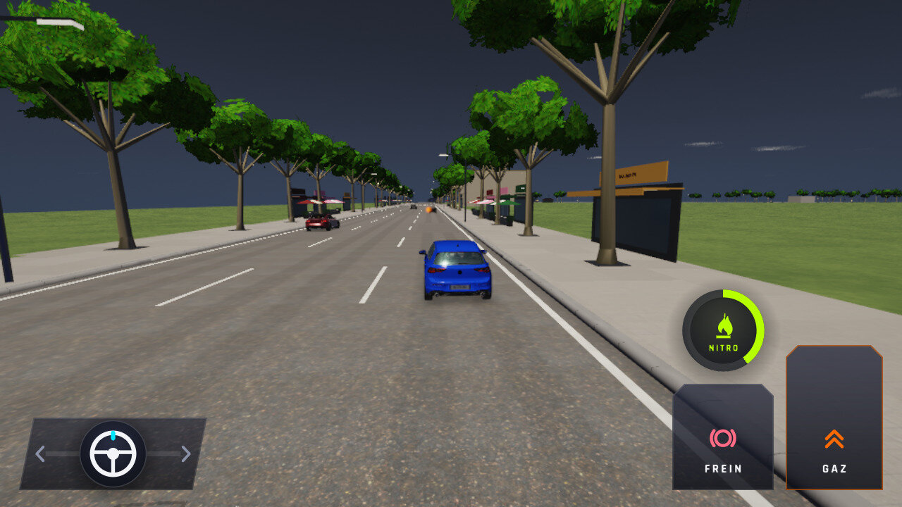 | 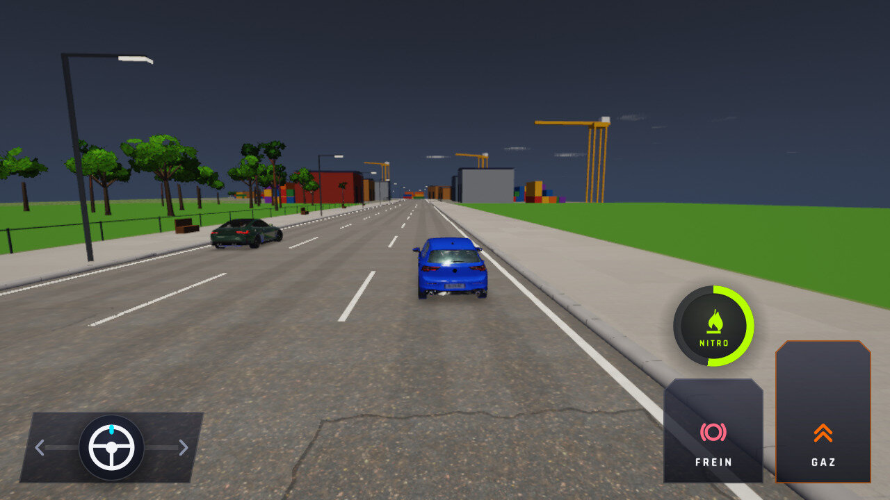 |
| `ville-nuit-haute-10min` — Ville de nuit, Haute, 10 min : Golf sur la chaussée, phares du trafic | 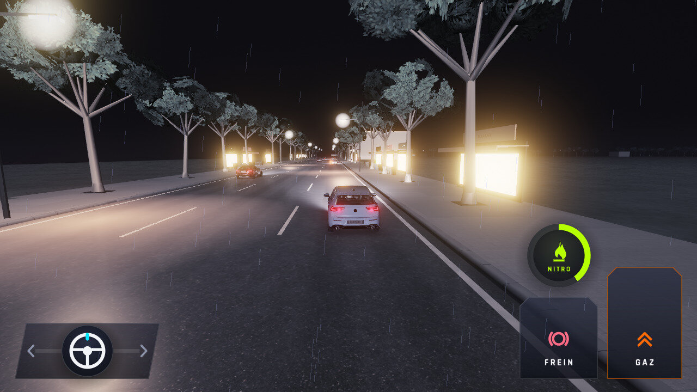 | 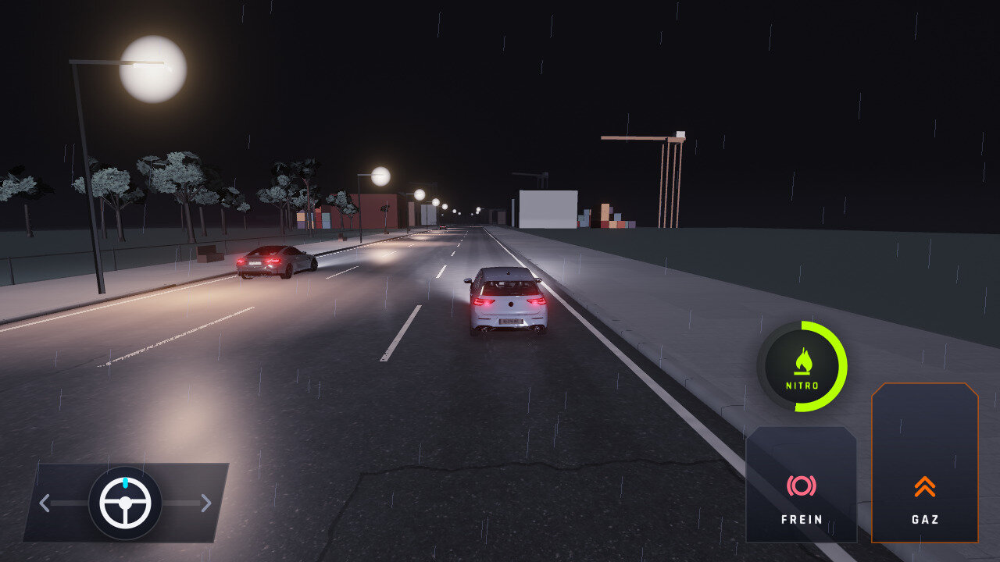 |
| `ville-nuit-basse-10min` — Ville de nuit, Basse, 10 min | 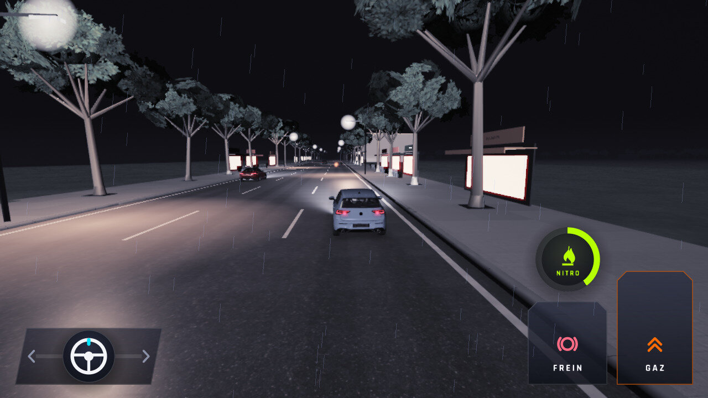 | 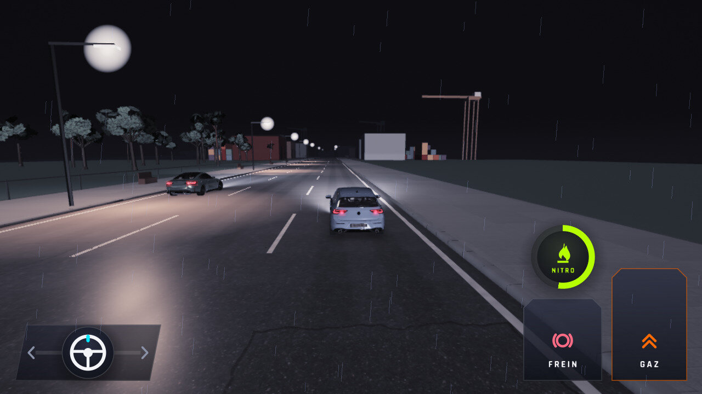 |
| `poursuite-police` — Poursuite (trafic dense, garde son propre trafic) : aucune voiture qui disparaît | 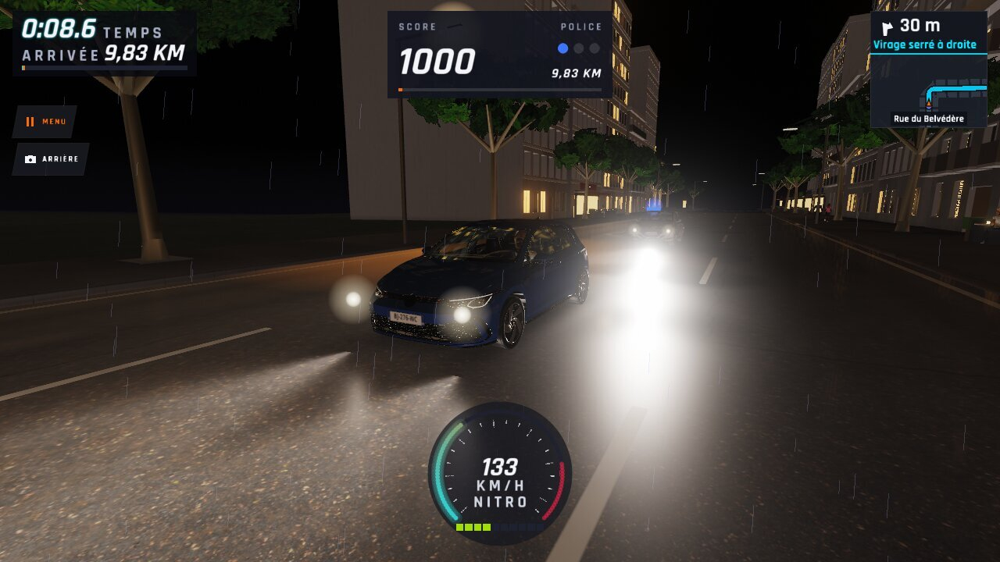 |  |
| `poursuite-police-basse` — Poursuite, Basse | 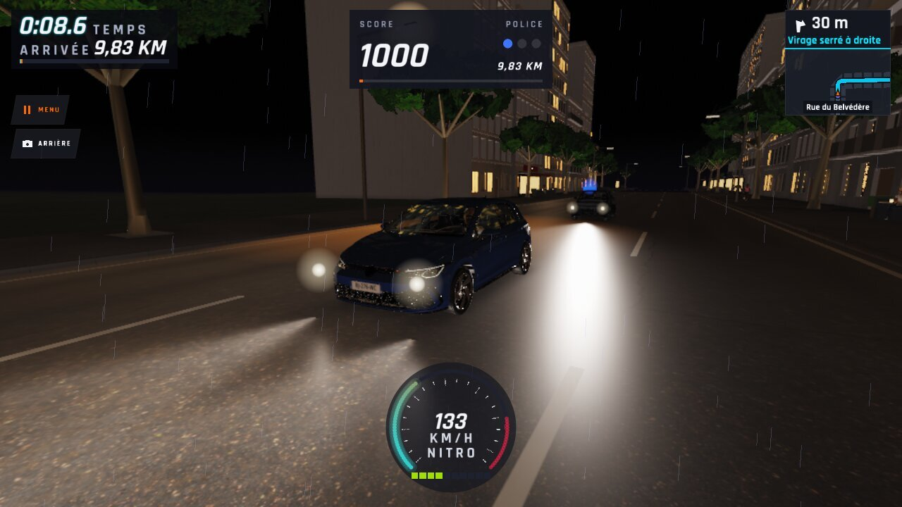 |  |
| `poursuite-bouchon` — Poursuite, bouchon |  | 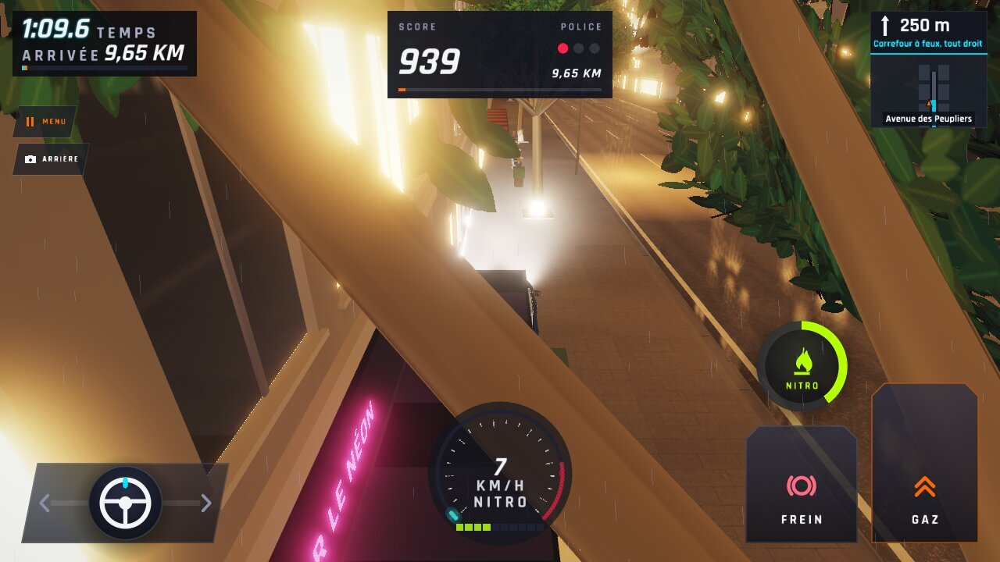 |
