# WFS-337 — captures avant / après (tools/qa/captures_pr.sh)

Branche `feature/waforspeed-337` comparée à `origin/main` ; bancs : halos:1280x720 ; filtre : `*`.

| Capture | Avant (main) | Après (branche) |
|---|---|---|
| `halos-160-0` |  | 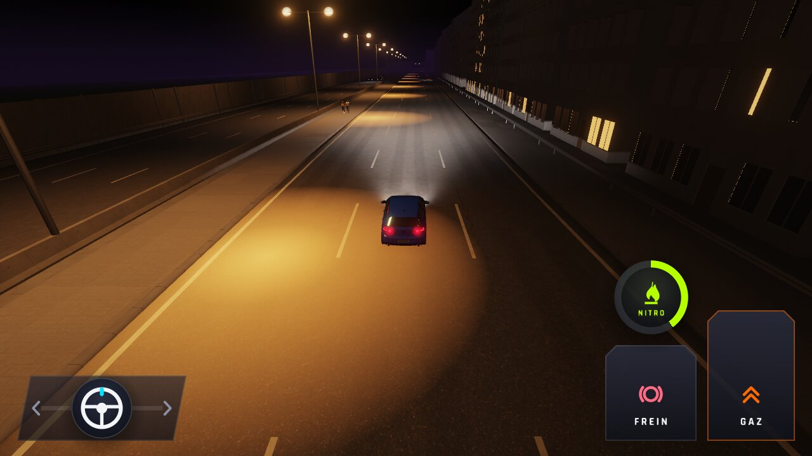 |
| `halos-160-1` | 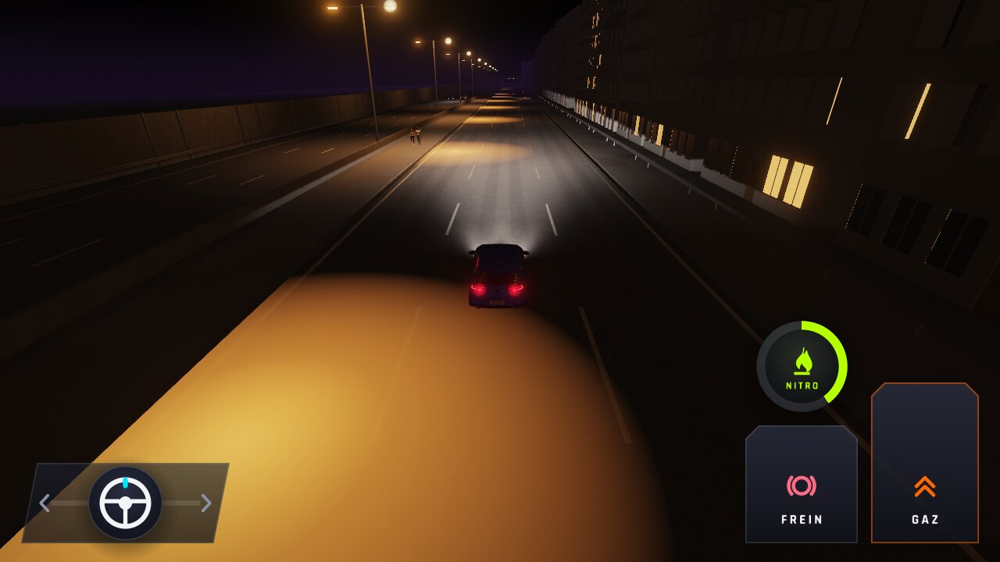 |  |
| `halos-160-2` |  | 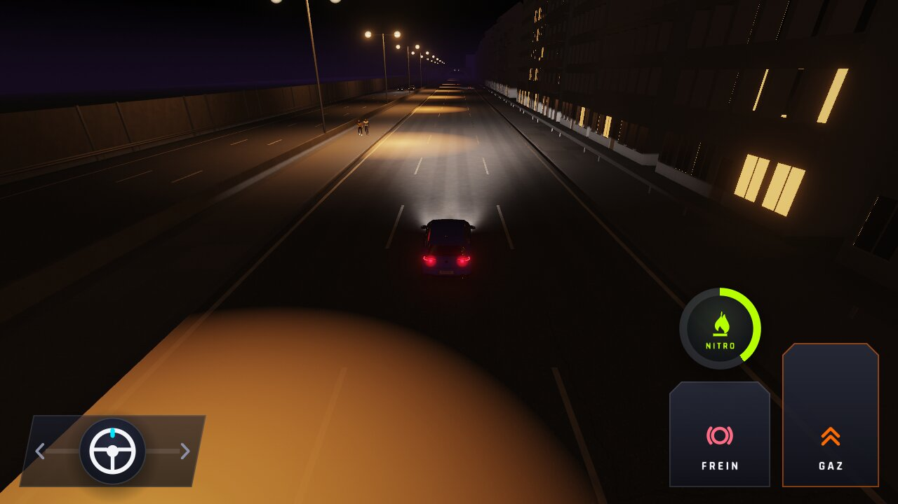 |
| `halos-160-3` | 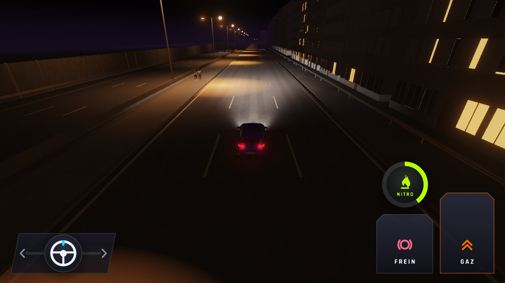 | 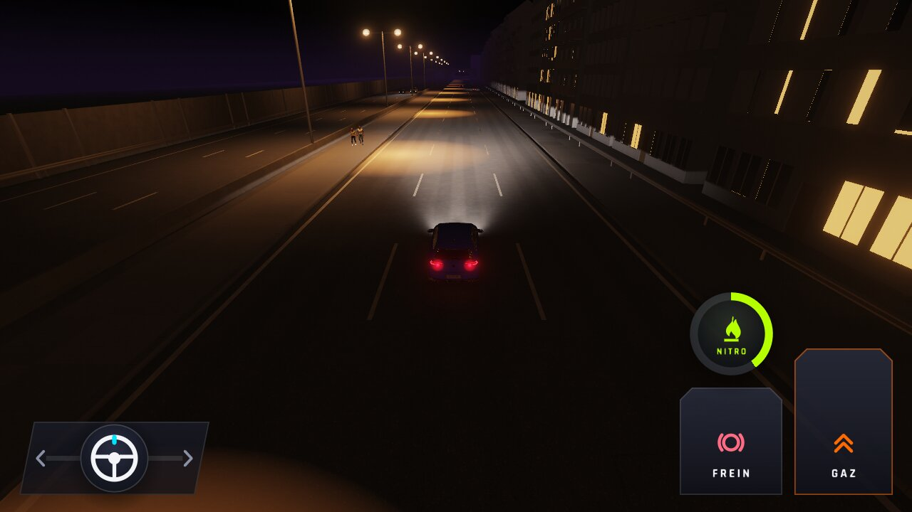 |
| `halos-160-4` |  | 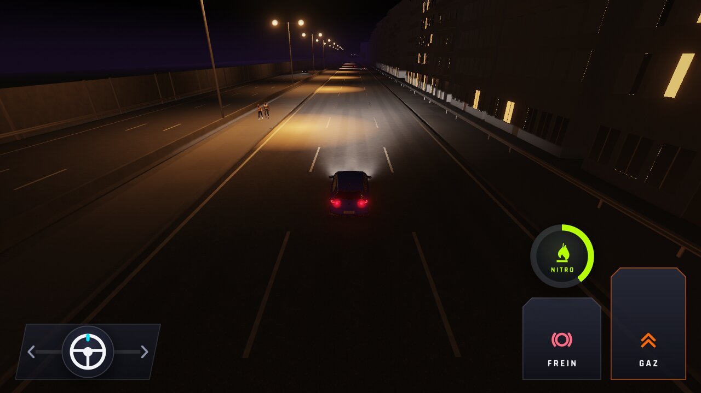 |
| `halos-160-5` |  | 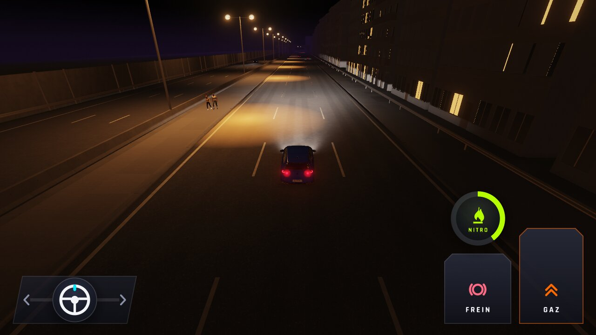 |
| `halos-50m` | 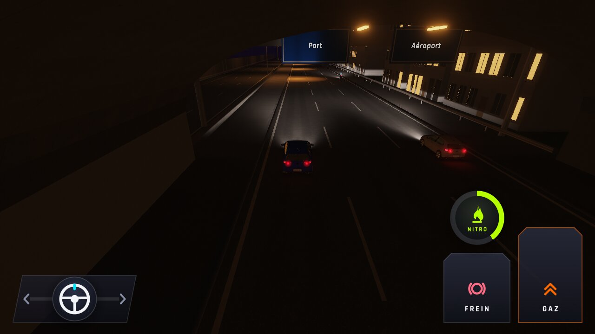 |  |
| `halos-poursuite` | 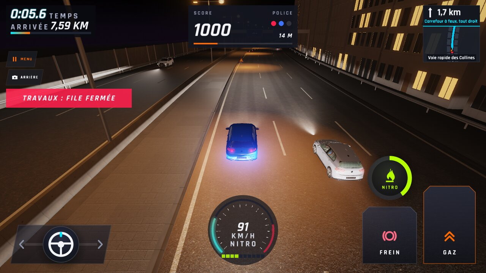 | 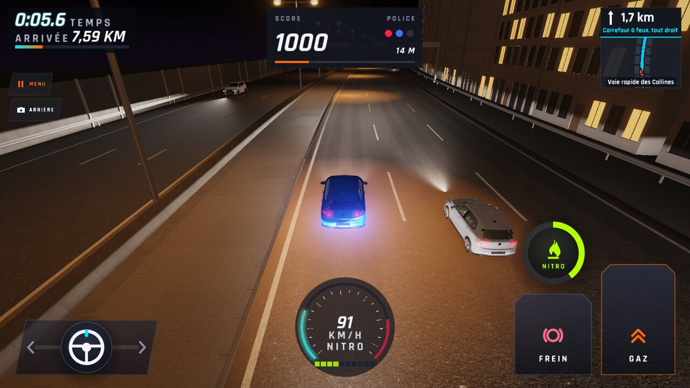 |
| `halos-pres` |  | 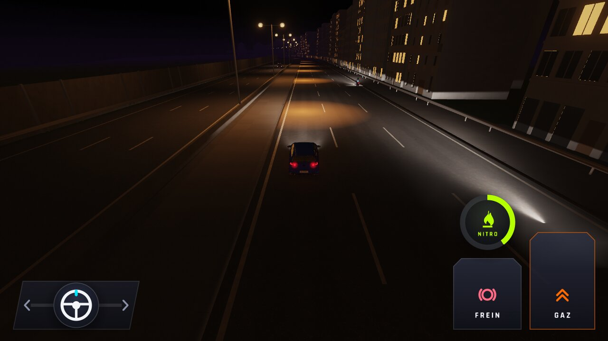 |
| `halos-rue` | 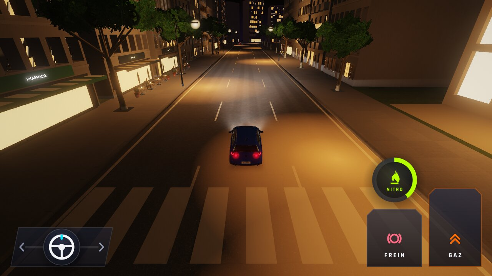 |  |
| `halos-pres-zoom` (×6, têtes du candélabre) | 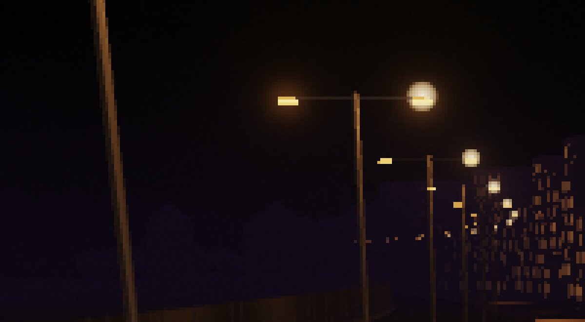 | 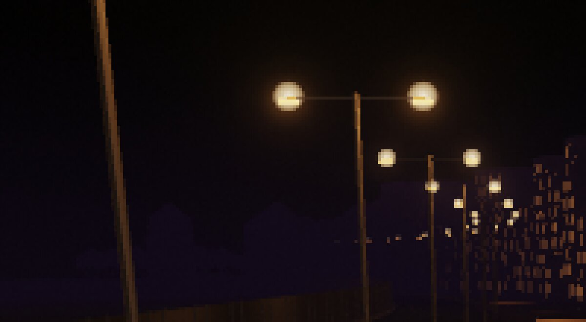 |
