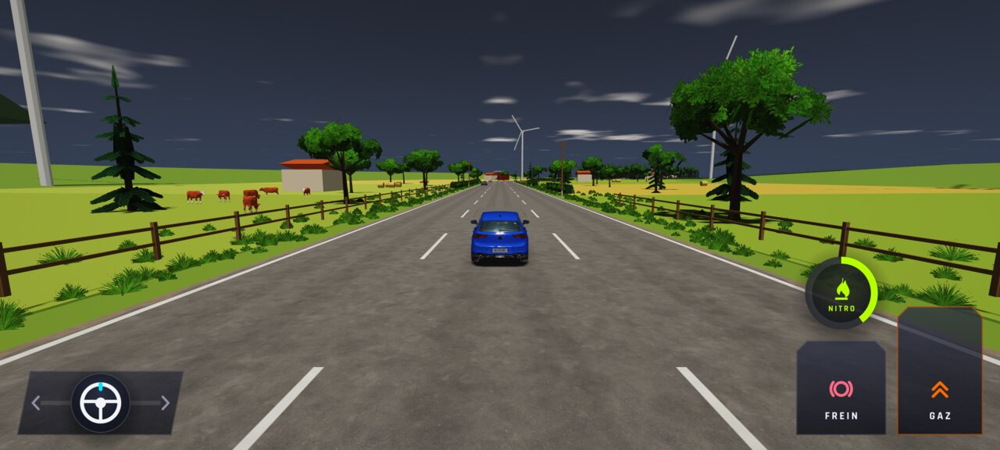
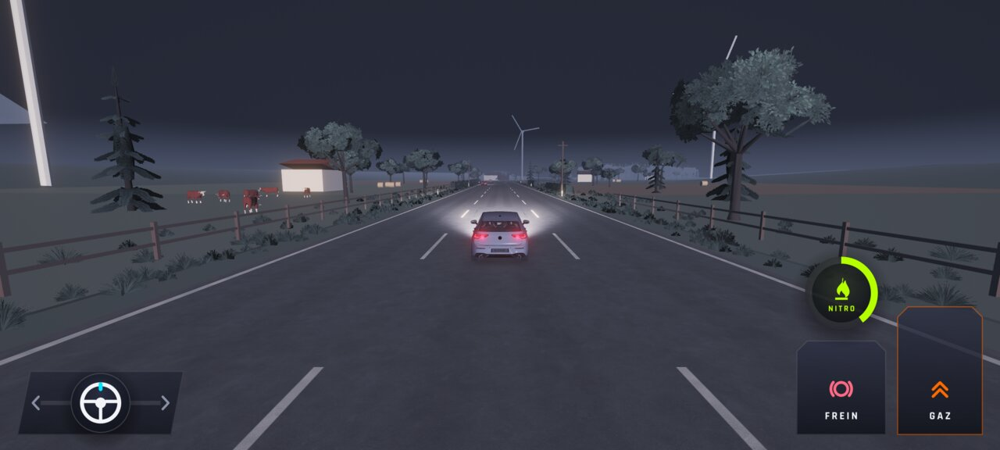
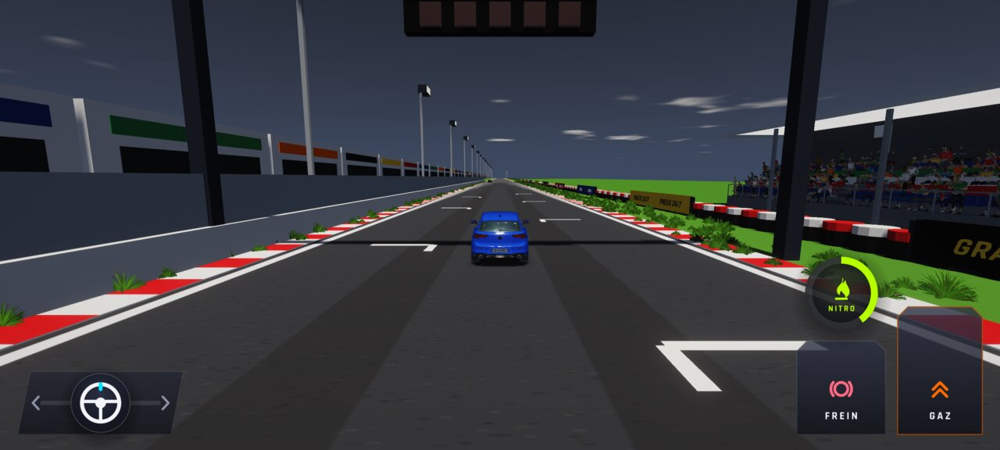
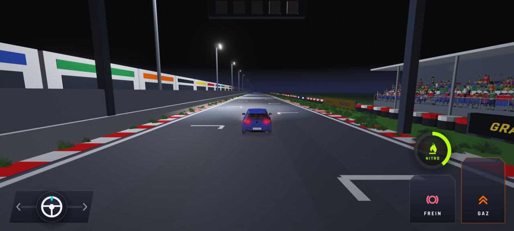
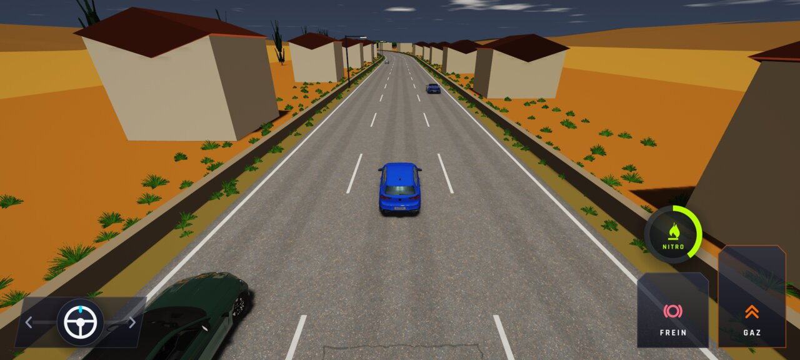
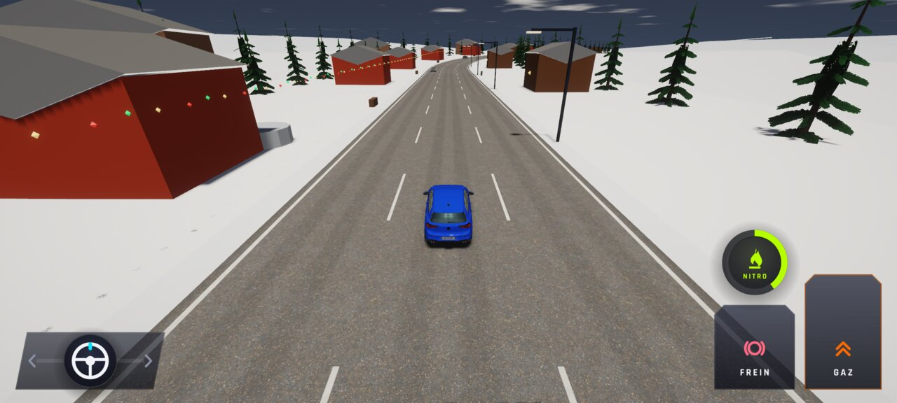
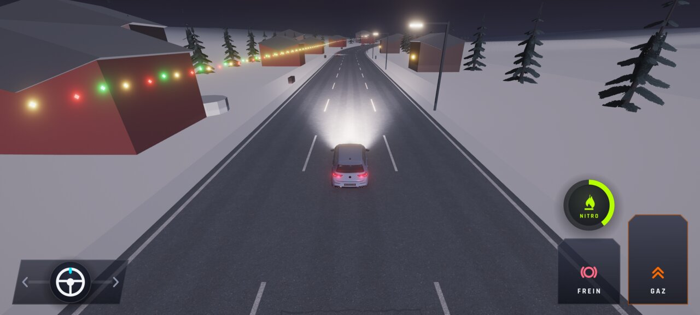
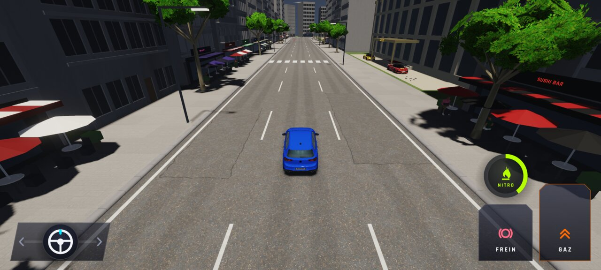
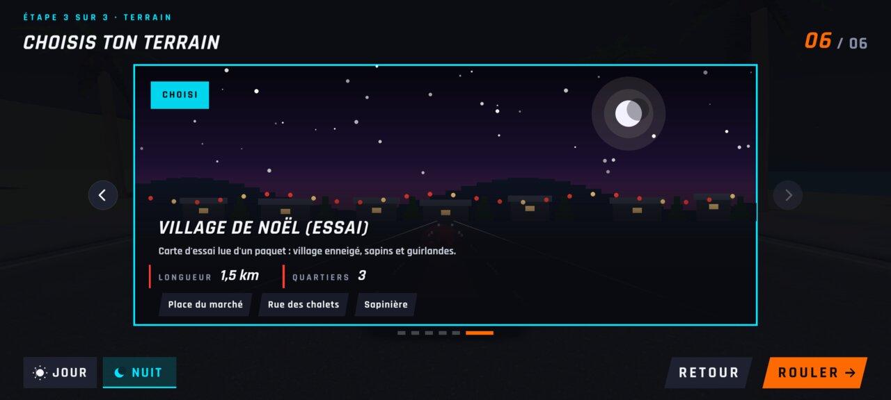
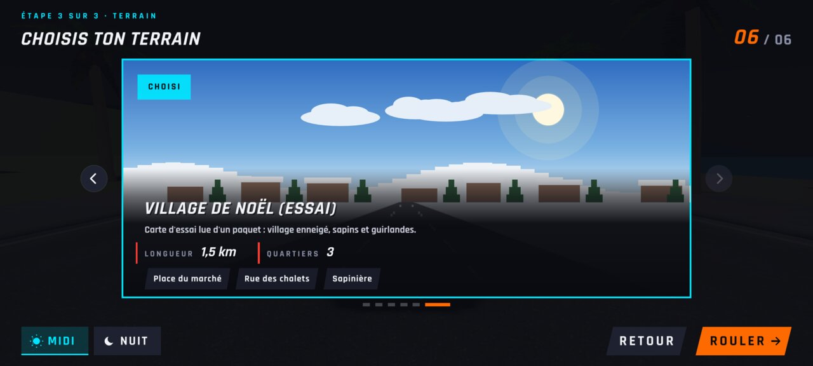

# WFS-343 — captures avant / après (tools/qa/captures_pr.sh)

Branche `feature/waforspeed-343` comparée à `origin/main` ; bancs : paquets:2400x1080 cartes:2400x1080 ; filtre : `@(donnees-*|carte-campagne-jour|carte-campagne-nuit|carte-circuit-jour|carte-circuit-nuit)`.

| Capture | Avant (main) | Après (branche) |
|---|---|---|
| `carte-campagne-jour` |  |  |
| `carte-campagne-nuit` |  |  |
| `carte-circuit-jour` |  |  |
| `carte-circuit-nuit` |  |  |
| `donnees-automne-jour` | — |  |
| `donnees-noel-jour` | — |  |
| `donnees-noel-nuit` | — |  |
| `donnees-retour-ville` | — |  |
| `donnees-terrain-noel-nuit` | — |  |
| `donnees-terrain-noel` | — |  |
