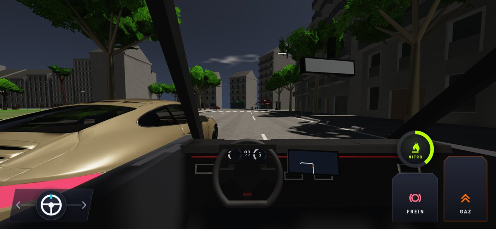
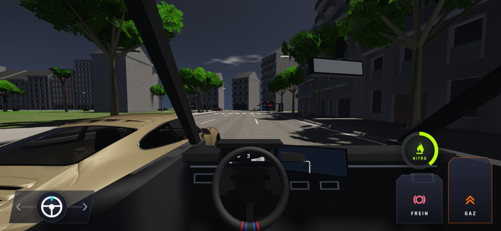
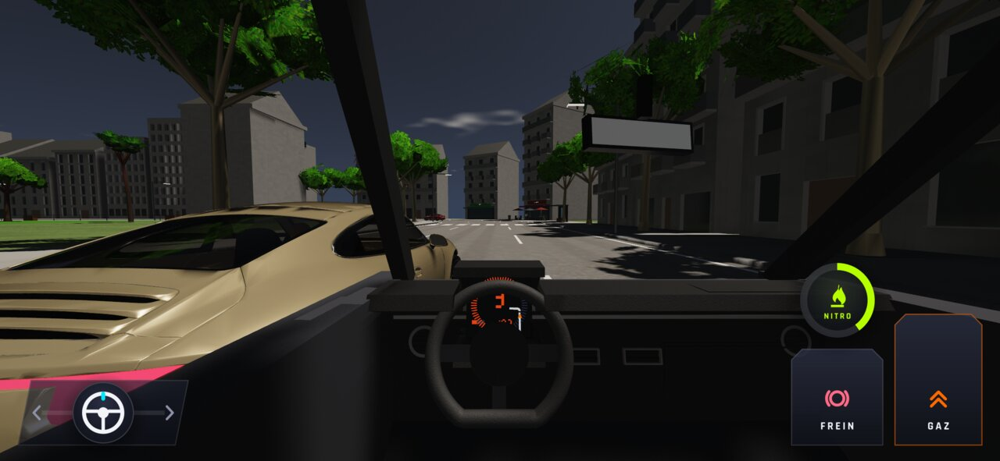

# WFS-349 — captures avant / après

Bancs : `penetration` (2340 × 1080, Golf, Ville de nuit, voisine à 1,9 m), `cockpit` (2340 × 1080, Golf, X5, 500 Abarth) — produits par
`tools/qa/captures_pr.sh` ; `cockpit-voisine` (banc neuf, 1280 × 720 ; « -2340 » : 2340 × 1080) : « avant » = ancienne portière
(même banc, construit avec l'ancienne géométrie), « après » = branche. Les vues Poursuite et accident (inchangées) sont retirées.

| Capture | Avant (main) | Après (branche) |
|---|---|---|
| `penetration-cockpit-1` |  |  |
| `penetration-cockpit-2` |  |  |
| `penetration-cockpit-3` |  |  |
| `penetration-cockpit-4` |  |  |
| `penetration-cockpit-4-sans-voisine` |  |  |
| `cockpit-voisine-golf-gauche-1m9-devant-normal` |  |  |
| `cockpit-voisine-golf-gauche-1m9-devant-normal-2340` | — |  |
| `cockpit-voisine-golf-droite-1m9-devant-normal` |  |  |
| `cockpit-voisine-golf-nuit-gauche-1m9-devant-normal` |  |  |
| `cockpit-voisine-x5-gauche-1m9-devant-normal` |  |  |
| `cockpit-voisine-x5-gauche-1m9-devant-normal-2340` | — |  |
| `cockpit-voisine-x5-nuit-gauche-1m9-devant-normal` |  |  |
| `cockpit-voisine-abarth-gauche-1m9-devant-normal` |  |  |
| `cockpit-voisine-abarth-gauche-1m9-devant-normal-2340` | — |  |
| `cockpit-voisine-abarth-droite-1m9-devant-normal` |  |  |
| `cockpit-voisine-abarth-nuit-gauche-1m9-devant-normal` |  |  |
| `cockpit-golf-jour` |  |  |
| `cockpit-golf-virage` |  |  |
| `cockpit-golf-nuit` |  |  |
| `cockpit-x5-jour` |  |  |
| `cockpit-x5-virage` |  |  |
| `cockpit-x5-nuit` |  |  |
| `cockpit-abarth-jour` |  |  |
| `cockpit-abarth-virage` |  |  |
| `cockpit-abarth-nuit` |  |  |
