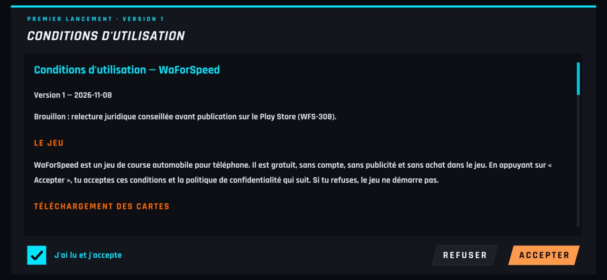
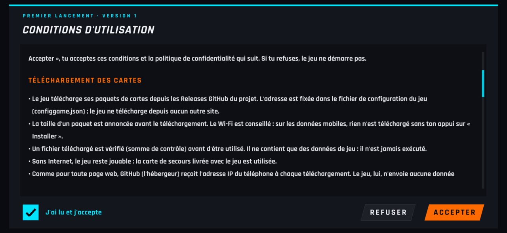
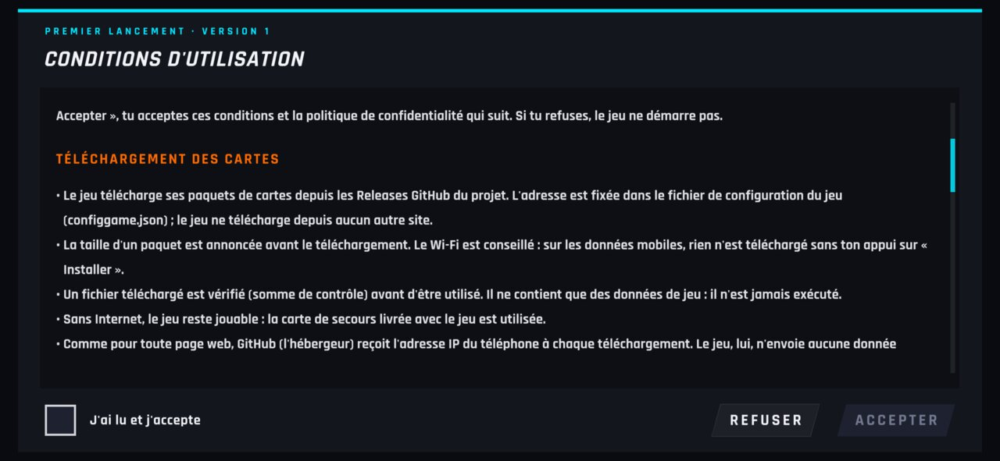
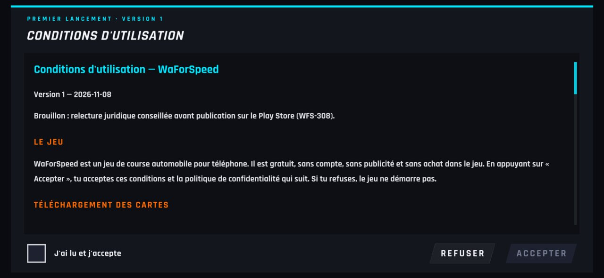
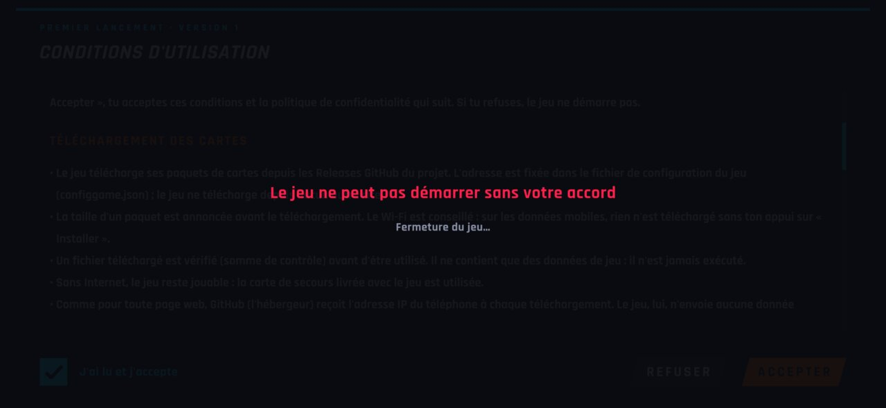
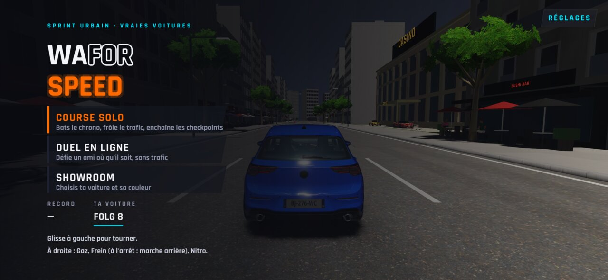
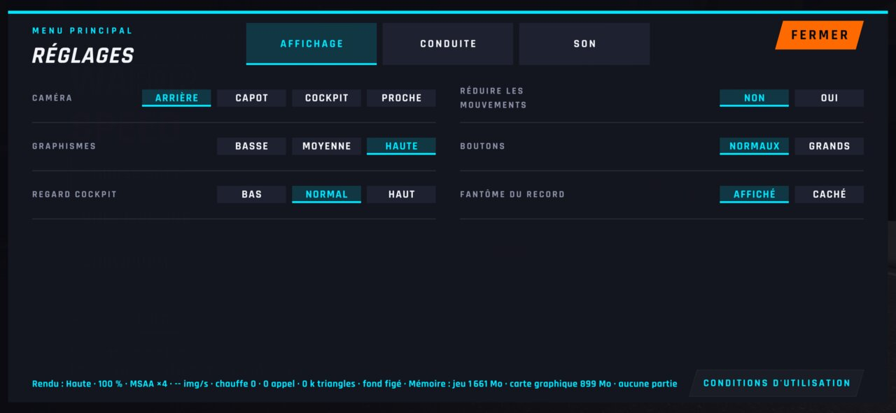
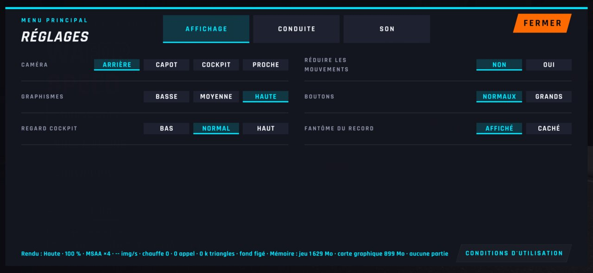
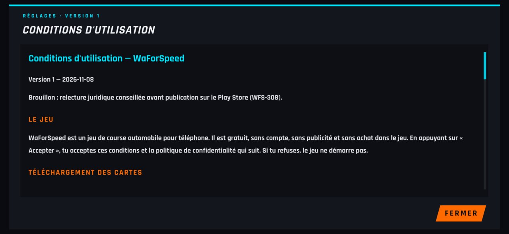

# WFS-355 — captures avant / après (tools/qa/captures_pr.sh)

Branche `feature/waforspeed-355` comparée à `origin/main` ; bancs : cgu:2340x1080 ; filtre : `*`.

| Capture | Avant (main) | Après (branche) |
|---|---|---|
| `cgu-accepter-appuye` | — |  |
| `cgu-coche` |  |  |
| `cgu-defile` |  |  |
| `cgu-premier` |  |  |
| `cgu-refus` |  |  |
| `cgu-reprise` |  |  |
| `cgu-retour-jeu` |  |  |
| `reglages-cgu-bouton` |  |  |
| `reglages-cgu-lecture` |  |  |
