# WFS-364 — captures avant / après (tools/qa/captures_pr.sh)

Branche `feature/waforspeed-364` comparée à `origin/main` ; bancs : vitrines-feux:2400x1080 ; filtre : `*`.

| Capture | Avant (main) | Après (branche) |
|---|---|---|
| `vitrine-corsa-0` |  | 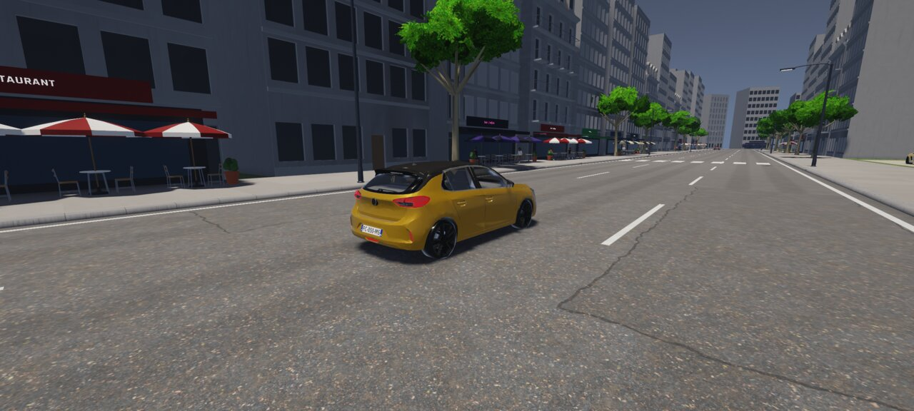 |
| `vitrine-corsa-a0` |  | 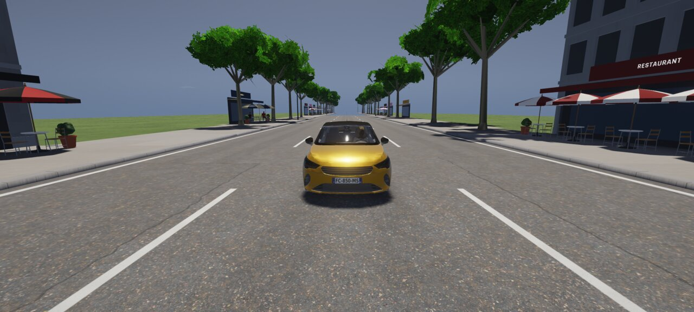 |
| `vitrine-corsa-a1` | 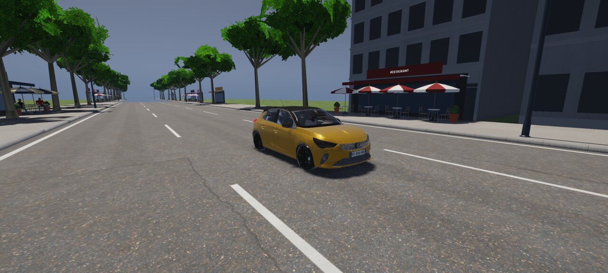 |  |
| `vitrine-corsa-a2` |  | 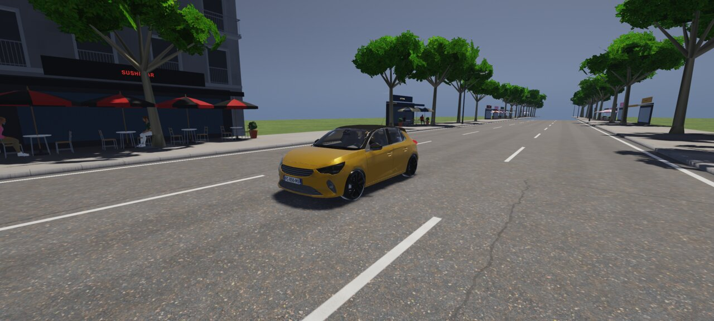 |
| `vitrine-corsa-bas` | 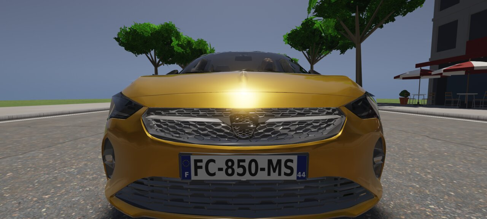 | 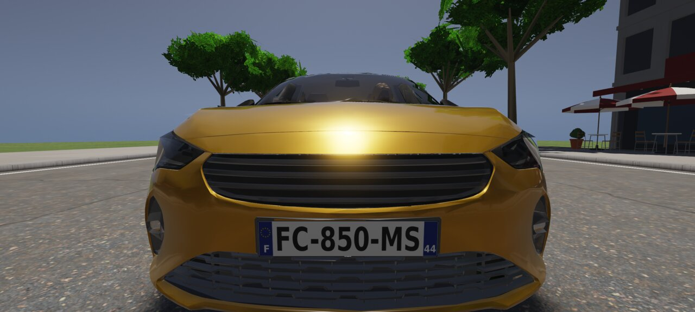 |
| `vitrine-corsa-bas1` | 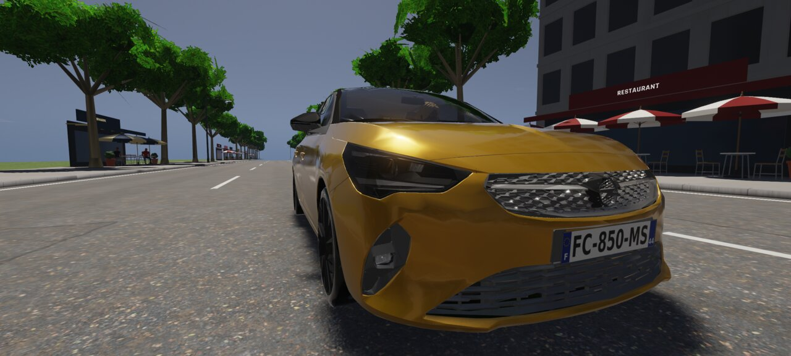 | 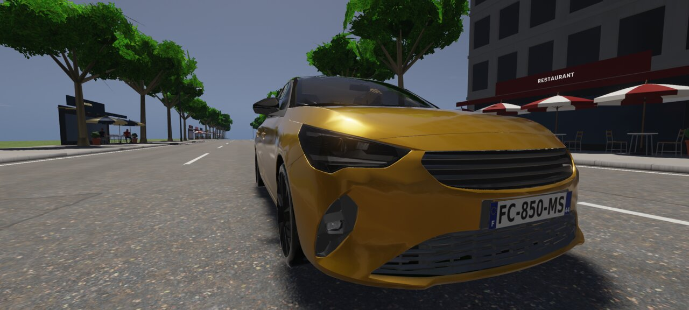 |
| `vitrine-corsa-bas2` |  | 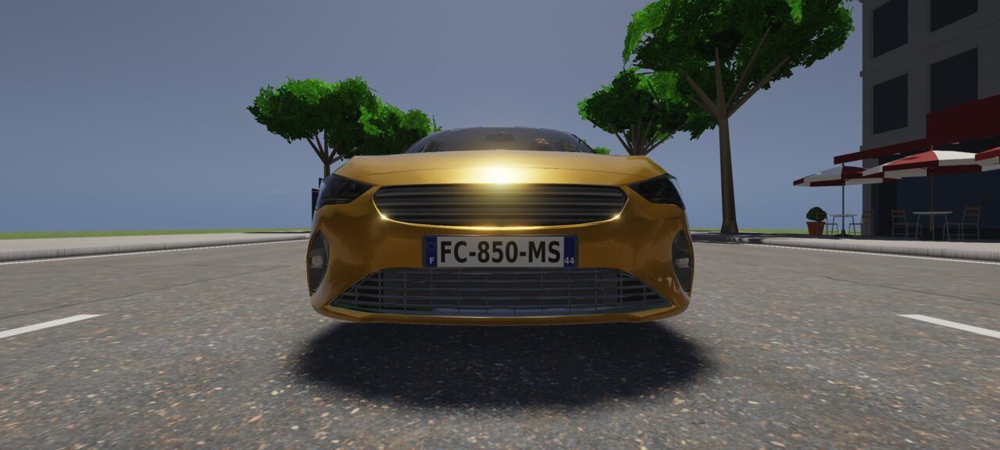 |
| `vitrine-corsa-feux` | 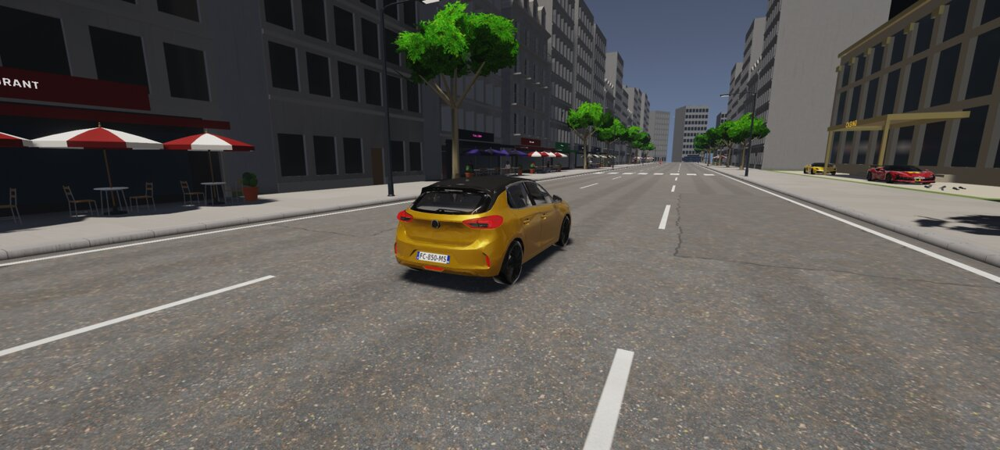 |  |
| `vitrine-golf-0` |  | 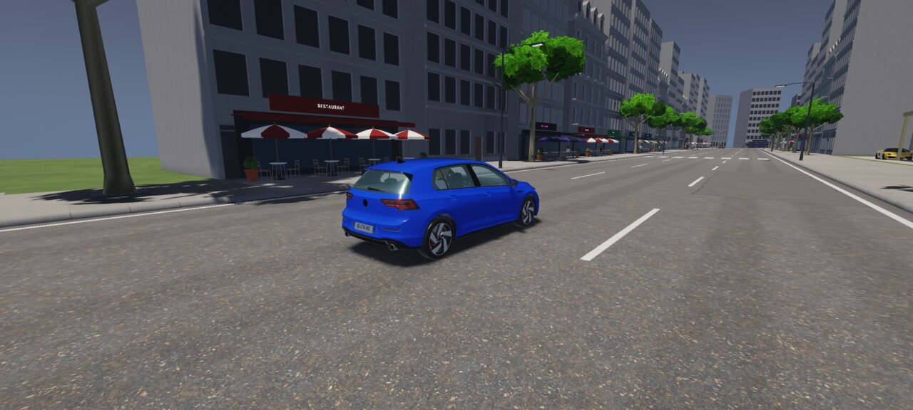 |
| `vitrine-golf-a0` |  | 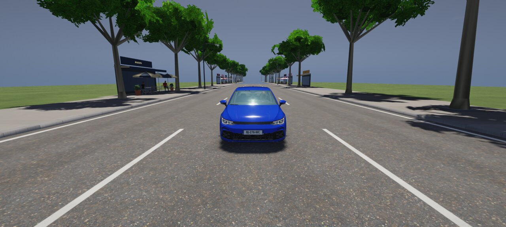 |
| `vitrine-golf-a1` | 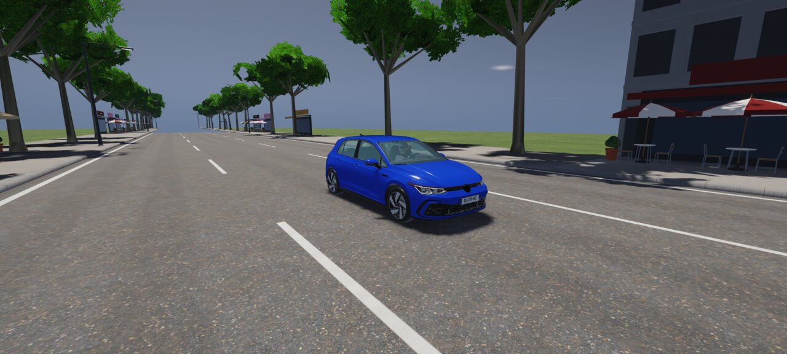 |  |
| `vitrine-golf-a2` | 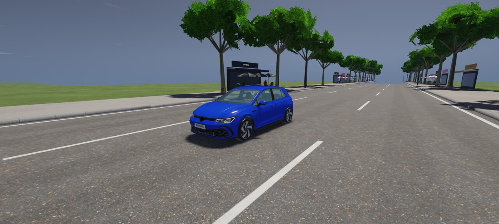 |  |
| `vitrine-golf-bas` | 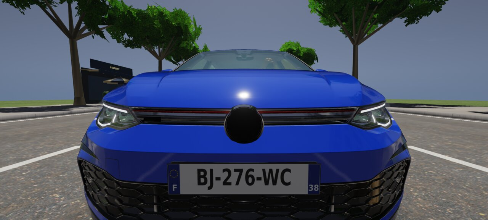 | 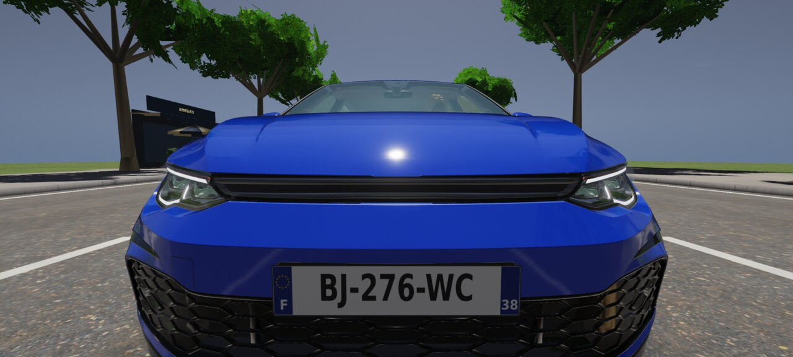 |
| `vitrine-golf-bas1` | 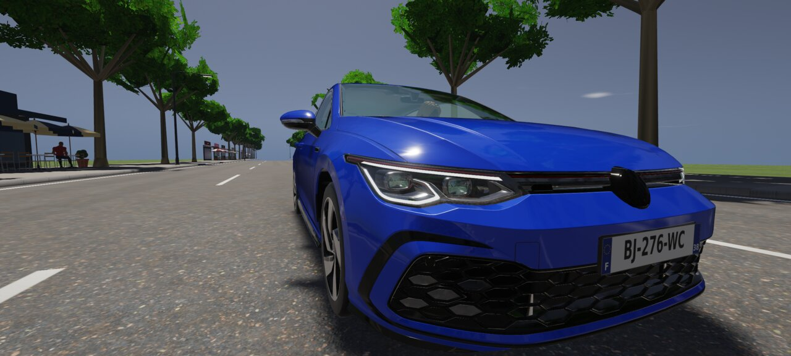 | 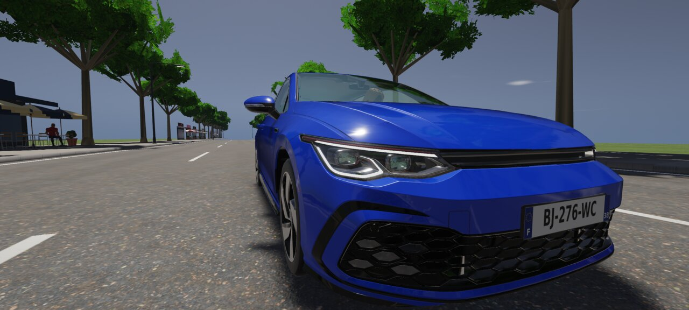 |
| `vitrine-golf-bas2` |  | 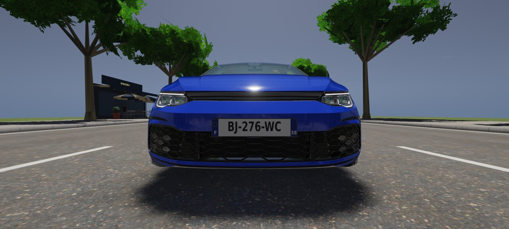 |
| `vitrine-golf-feux` |  | 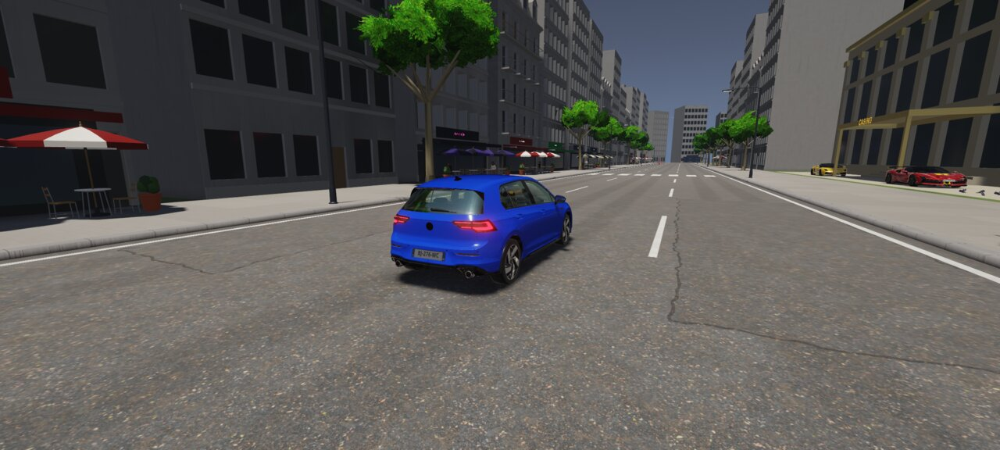 |
