# WFS-374 — captures avant (main) / après (branche)

Banc `depart-campagne` (nouveau, 1280x720) : Campagne, XR5, retour au menu → Campagne → décompte, doigt posé sur GAZ pendant le
décompte et tenu après le GO (vrais appuis tactiles), puis 2e doigt sur la case SCORE (haut à droite) : capture prise doigt encore
sur SCORE. Les captures « avant » viennent de origin/main compilé avec ce seul banc ajouté (sans le correctif).

| Moment | Avant (main) | Après (branche) |
|---|---|---|
| Réelle | 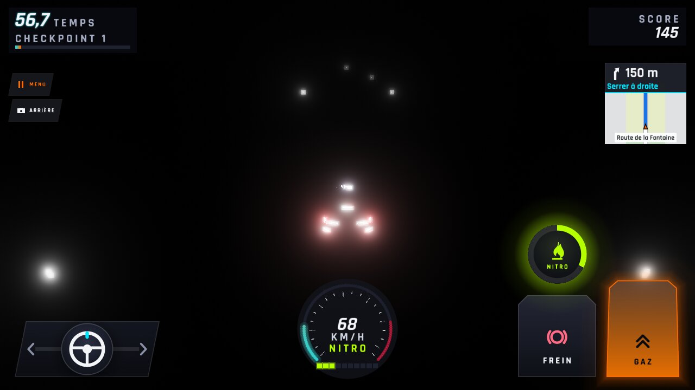 | 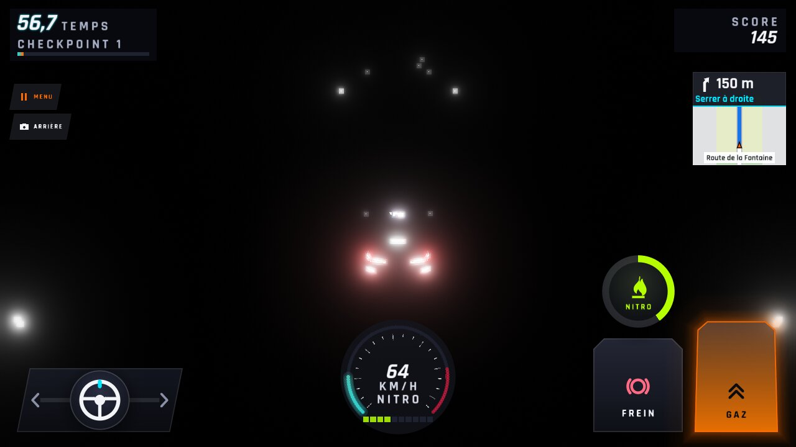 |
| Aube | 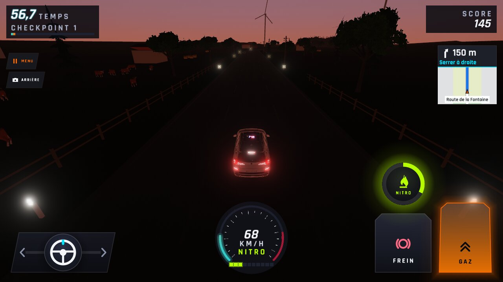 | 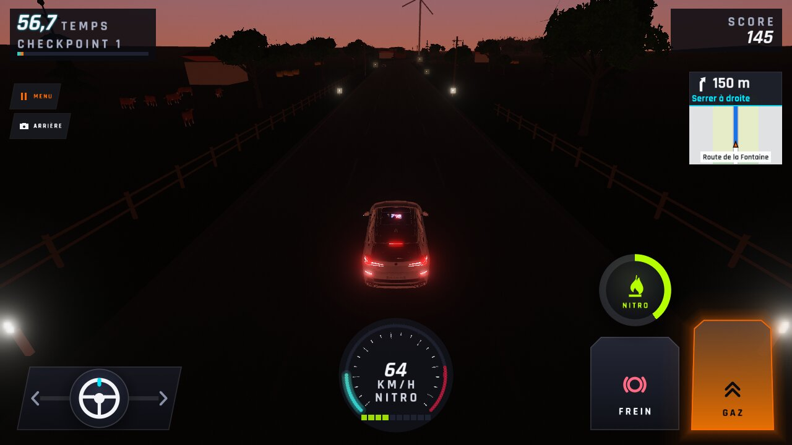 |
| Matin | 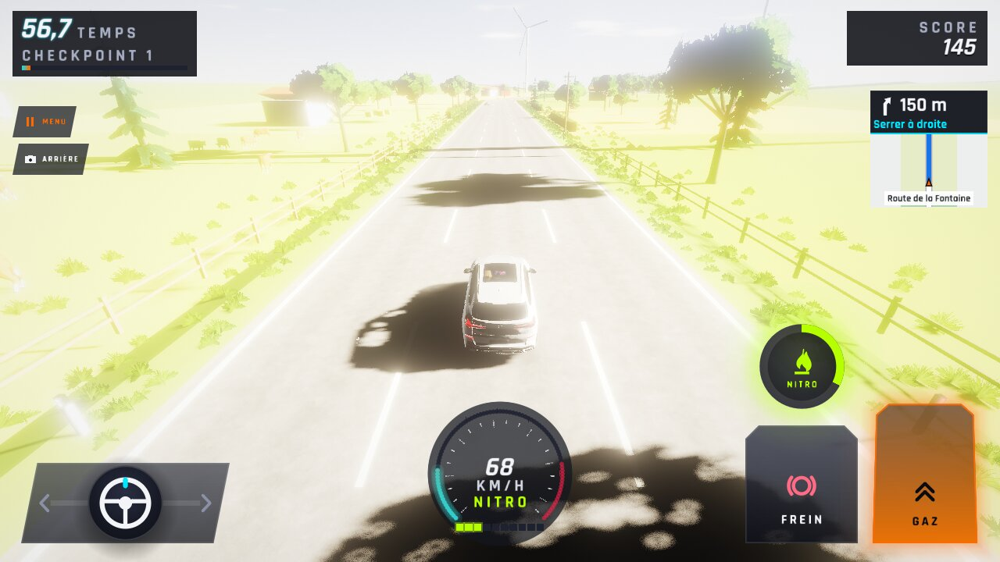 | 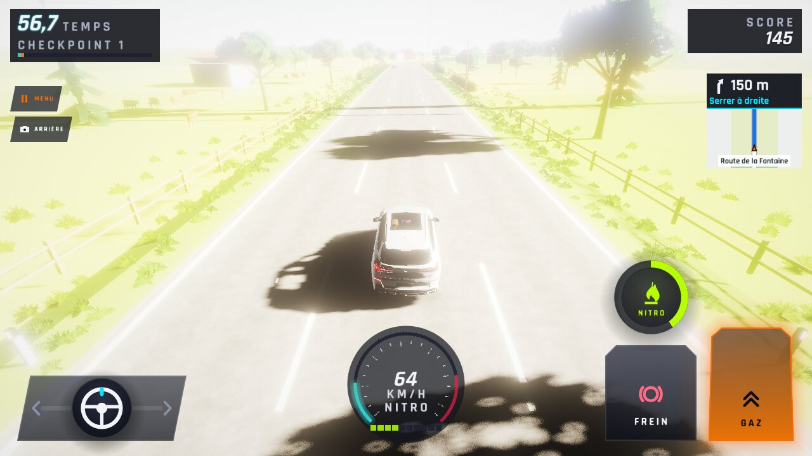 |
| Midi | 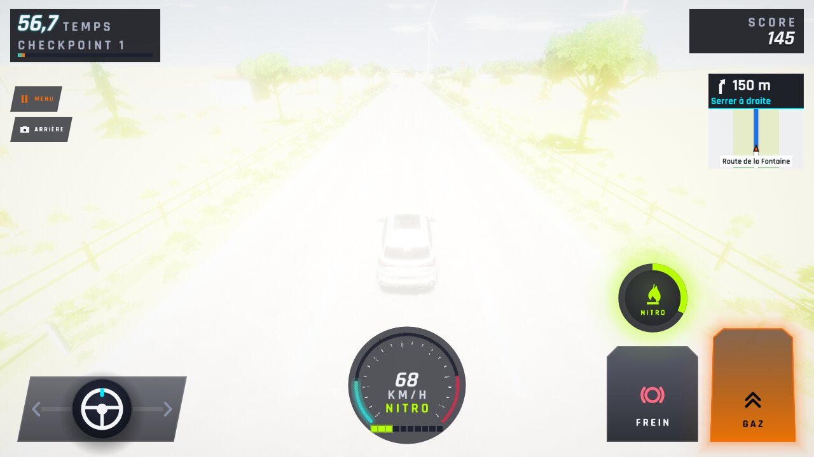 |  |
| Dorée | 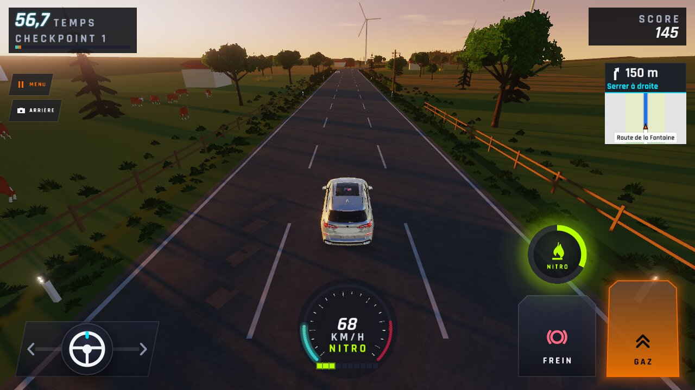 | 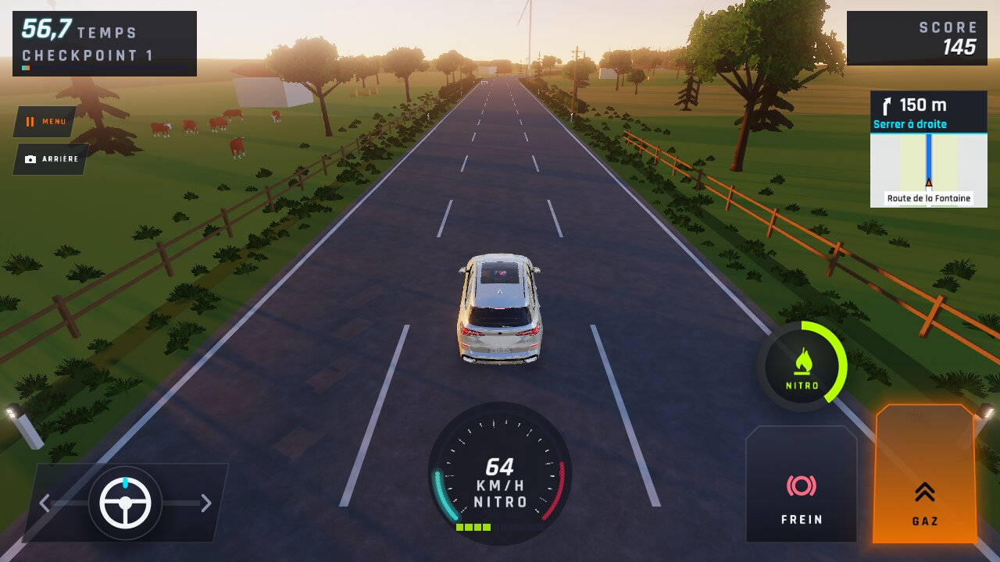 |
| Nuit | 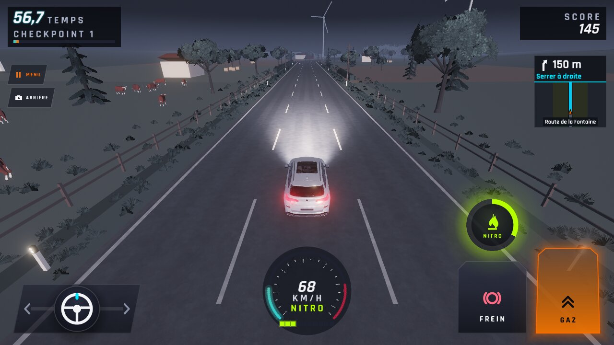 | 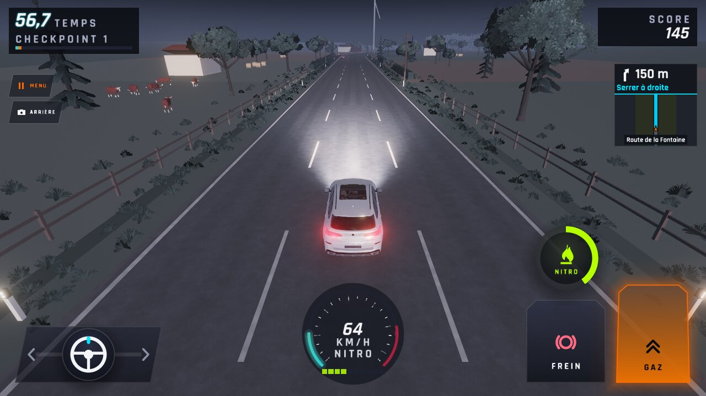 |
| Banc `effets`, nitro-lignes (vrai bouton nitro) |  | 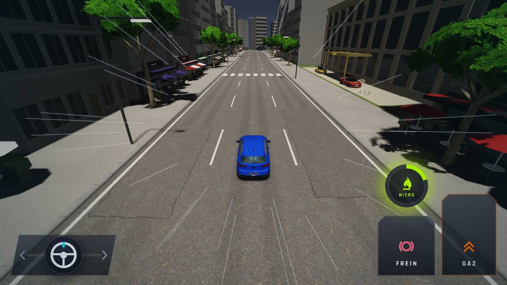 |

À regarder : **avant**, l'anneau NITRO est allumé (halo vert) alors que le doigt est sur SCORE (ANO-233) ; **après**, il reste
éteint. GAZ orange (tenu) sur toutes les images ; 57,9 à 58,0 km/h 3 s après le GO dans les 6 moments, avant comme après. La
lumière trop blanche de Midi / Matin vient de l'éclairage (ANO-232 → WFS-375), hors de ce ticket.
