# WFS-375 — captures avant / après

Banc `menu1` (1280x720, lavapipe), horloge du banc réglée au 2026-11-09 22:15 (`faketime`). Avant : `origin/main` 03ccc2e + le même scénario de banc (seul le banc ajouté, pour montrer le défaut). Après : branche `feature/waforspeed-375`.

| Capture | Avant (main) | Après (branche) |
|---|---|---|
| `terrain-0` | 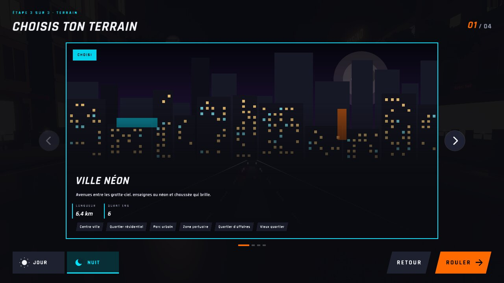 |  |
| `terrain-1` |  | 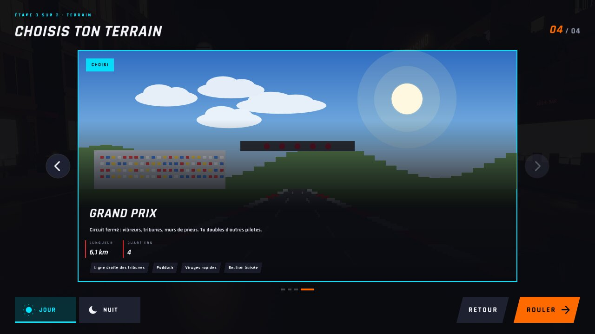 |
| `terrain-rouler` | 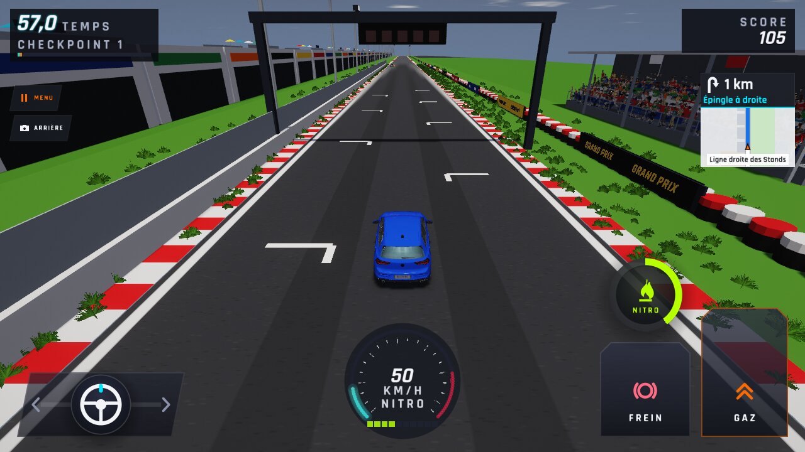 |  |
| `terrain-jour-2appuis` | 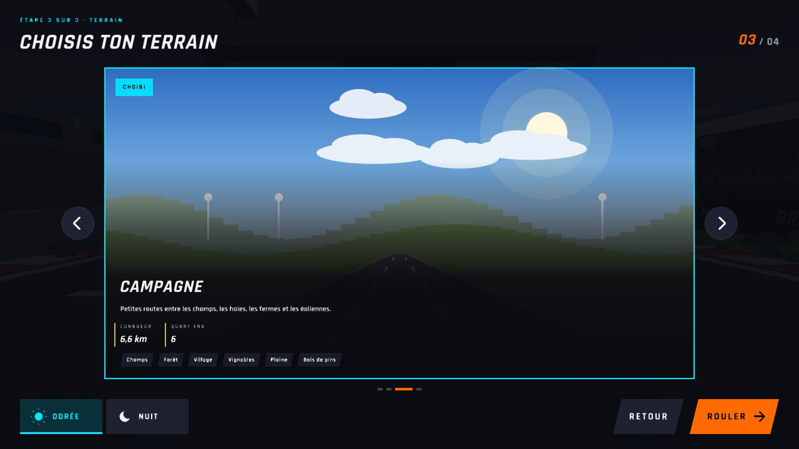 | 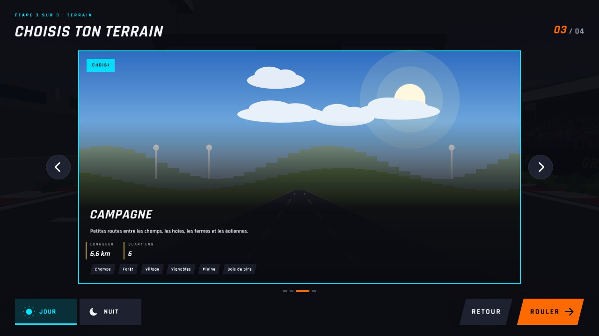 |
| `terrain-campagne-jour` | 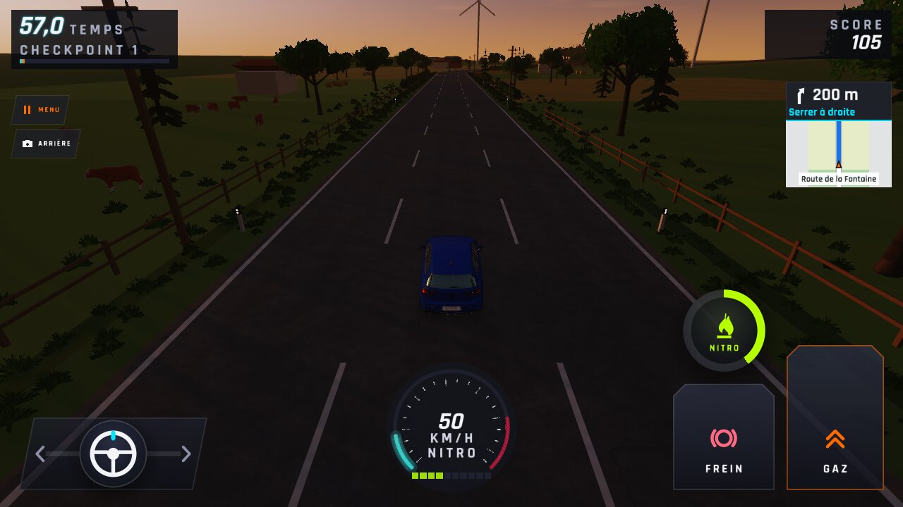 | 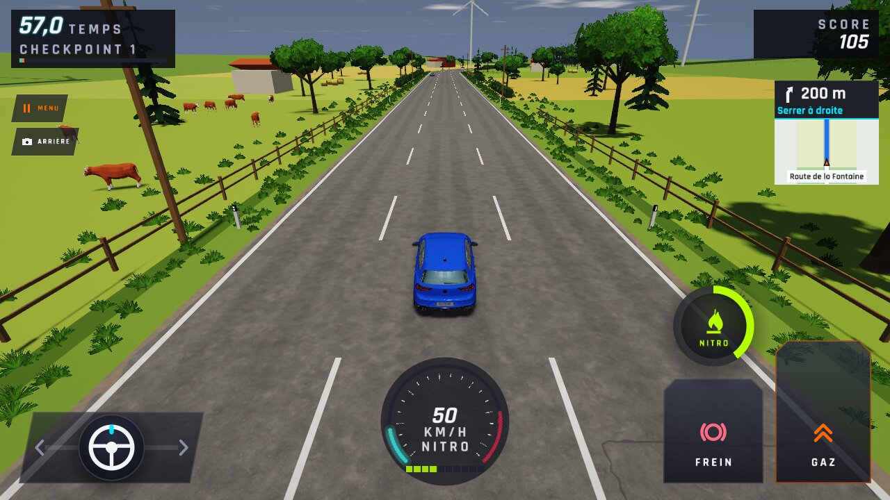 |
| `terrain-nuit-2appuis` | 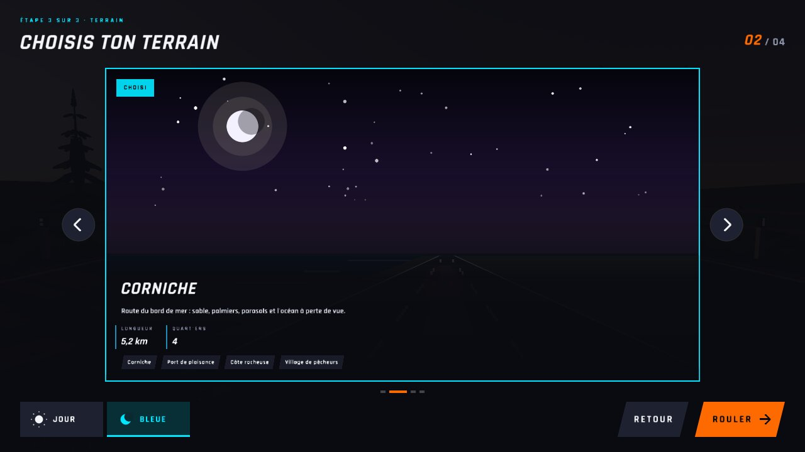 | 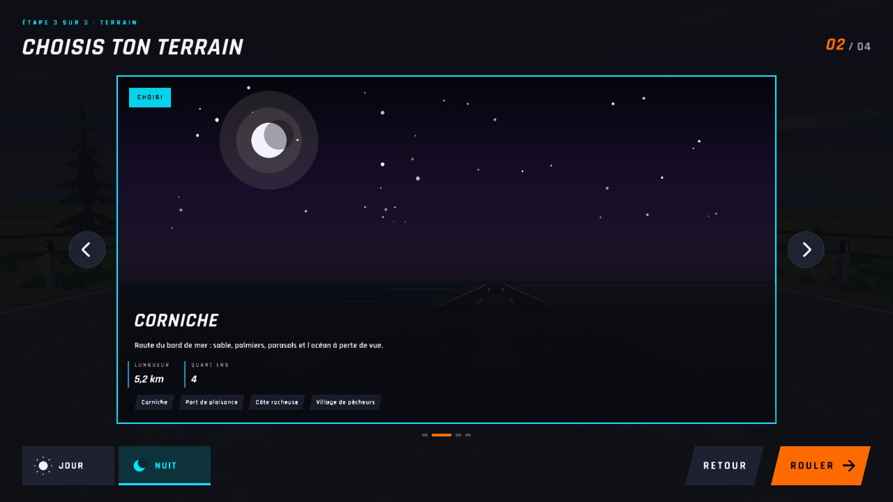 |
| `terrain-corniche-nuit` | 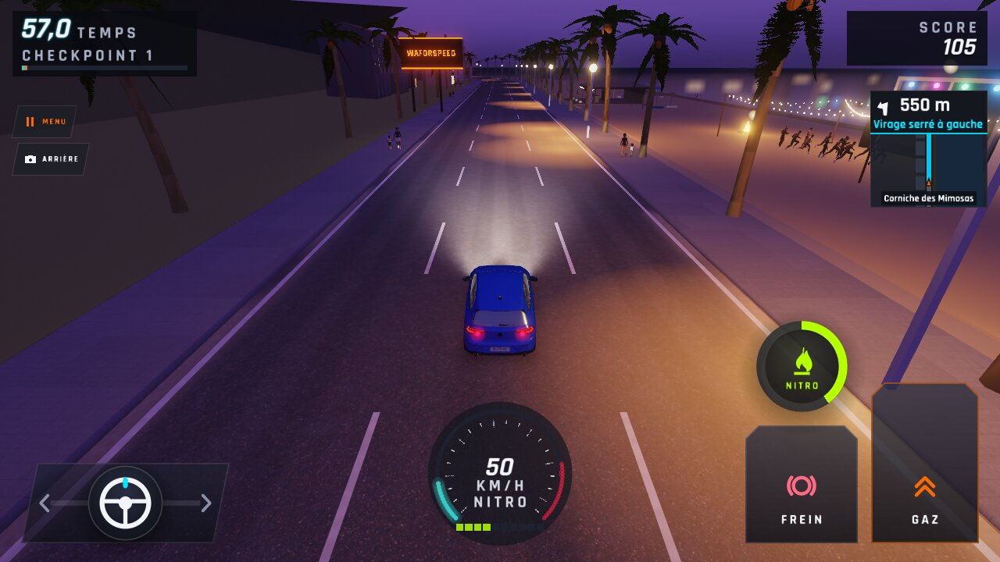 | 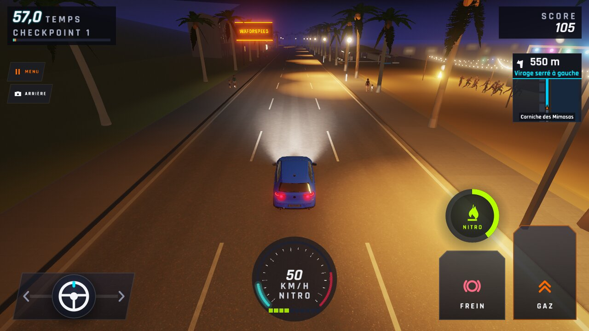 |
| `parcours-terrain` | 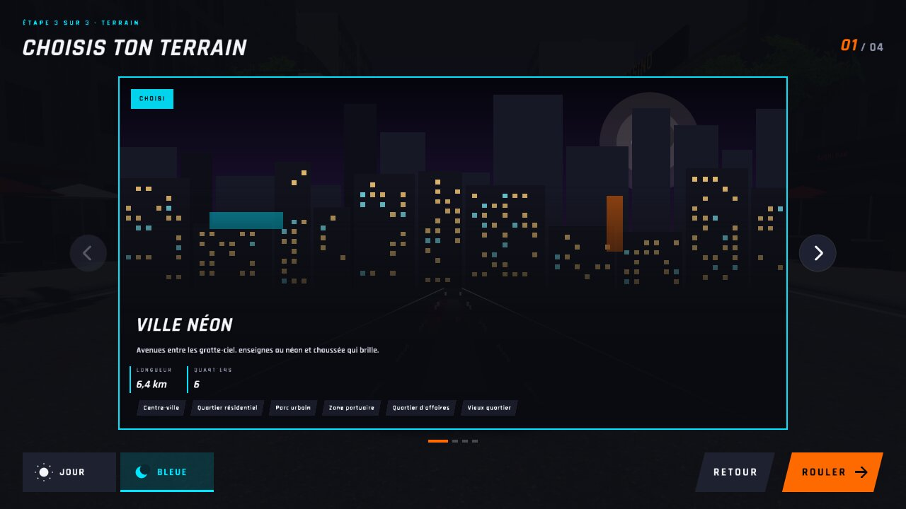 |  |
