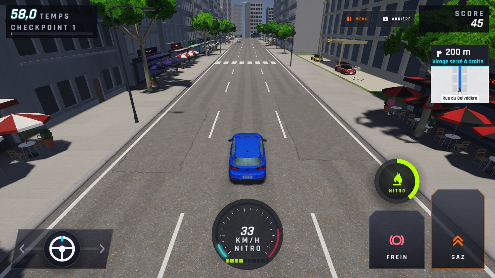
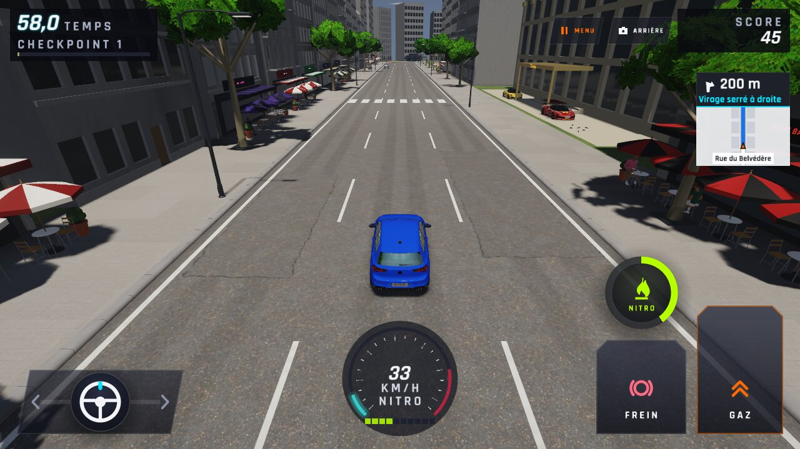
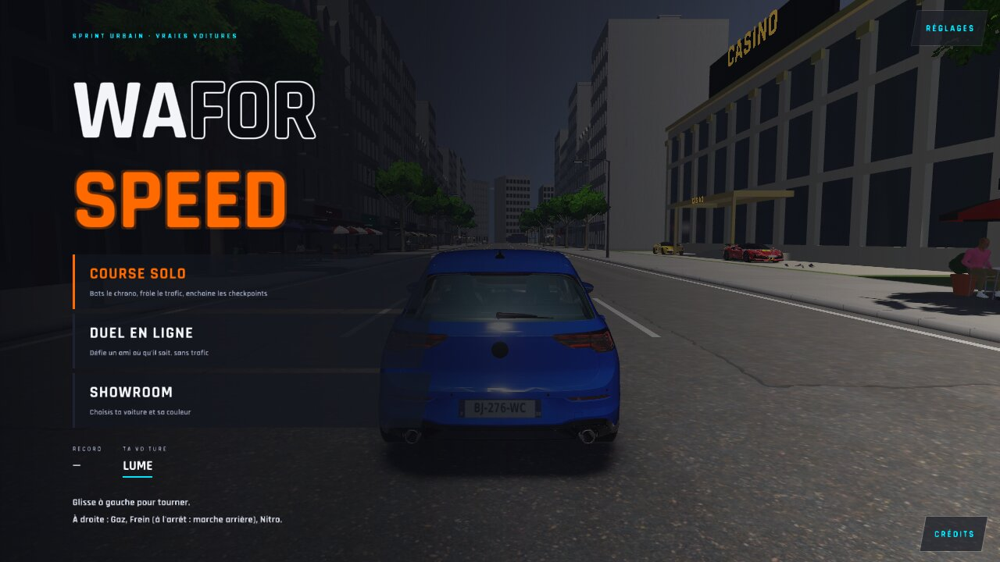
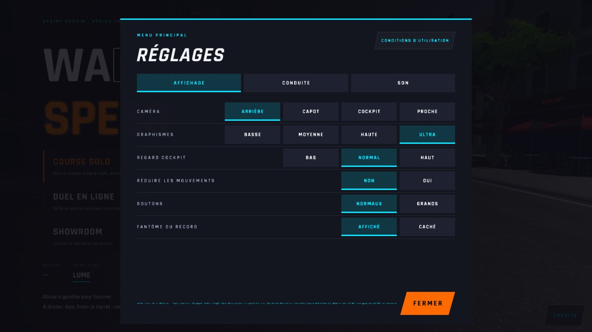
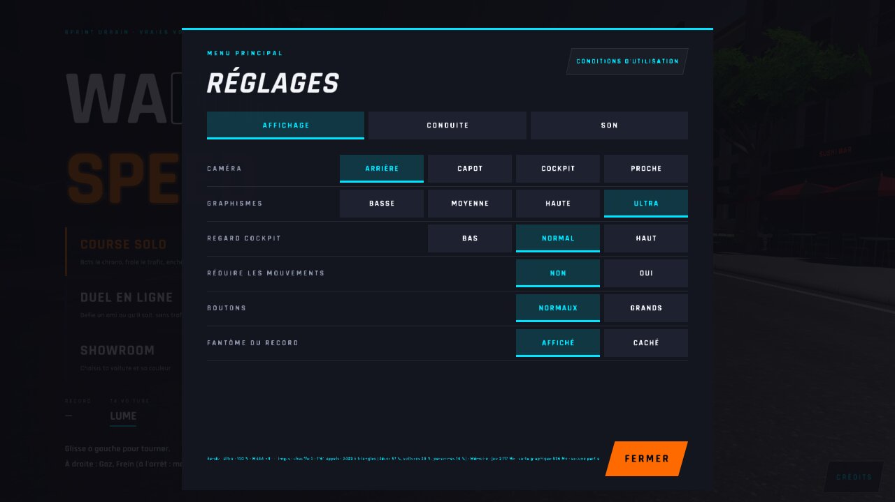

# WFS-377 — captures avant / après (tools/qa/captures_pr.sh)

Branche `feature/waforspeed-377` comparée à `origin/main` ; bancs : realisme ; filtre : `+(parcours-ultra-course|reglages-qualite-ultra|parcours-ultra-retour|reglages-diagnostic)`.

| Capture | Avant (main) | Après (branche) |
|---|---|---|
| `parcours-ultra-course` |  |  |
| `parcours-ultra-retour` |  |  |
| `reglages-diagnostic` |  |  |
| `reglages-qualite-ultra` |  |  |
