# WFS-381 — captures avant / après (banc WFS_BANC=brume, 1280x720, lavapipe)

Avant = `origin/main` + le seul banc `brume` (le banc n'existe pas sur main) ; après = branche `feature/waforspeed-381`. Écart = |après − avant| × 8.

| Capture | Avant (main) | Après (branche) | Écart ×8 |
|---|---|---|---|
| `brume-campagne-haut-jour` | 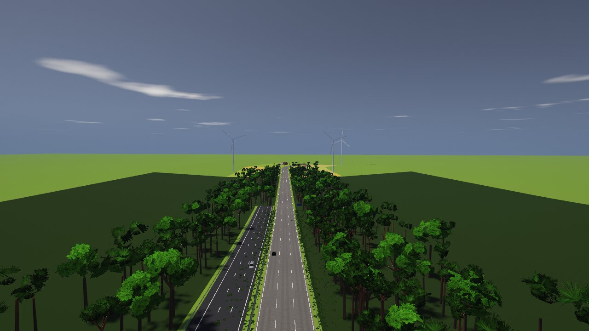 | 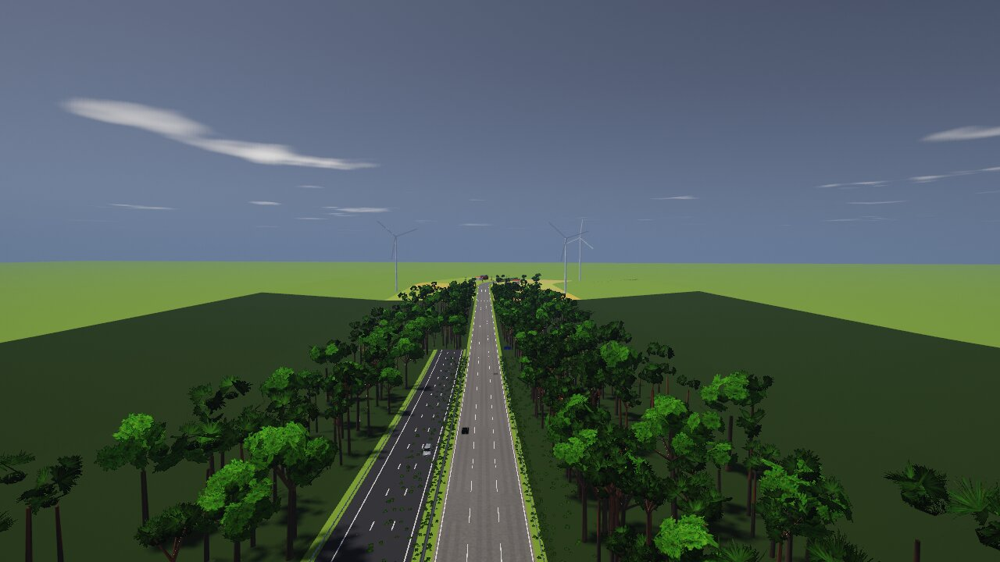 | 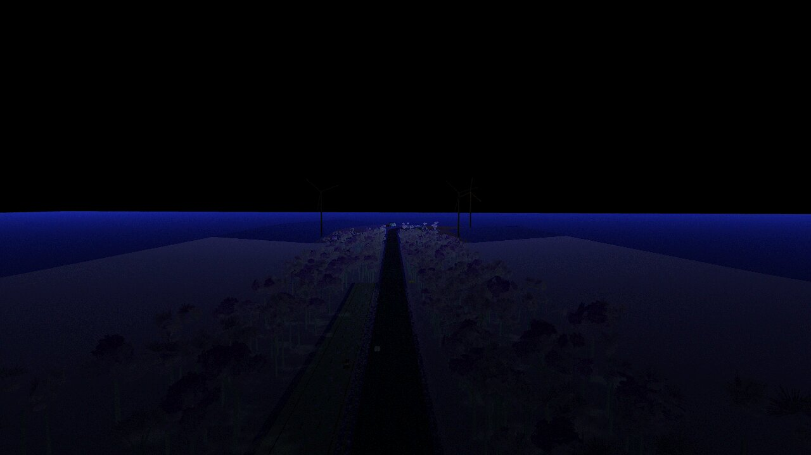 |
| `brume-campagne-jour` |  | 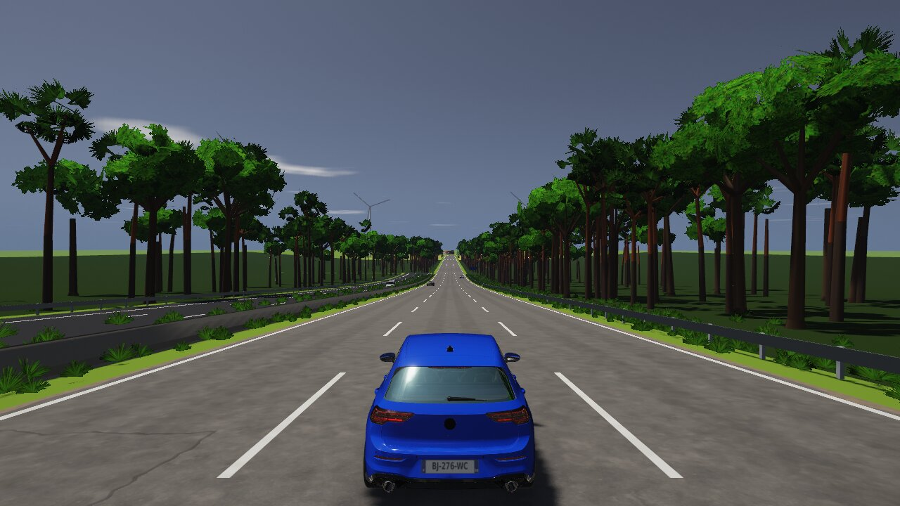 | 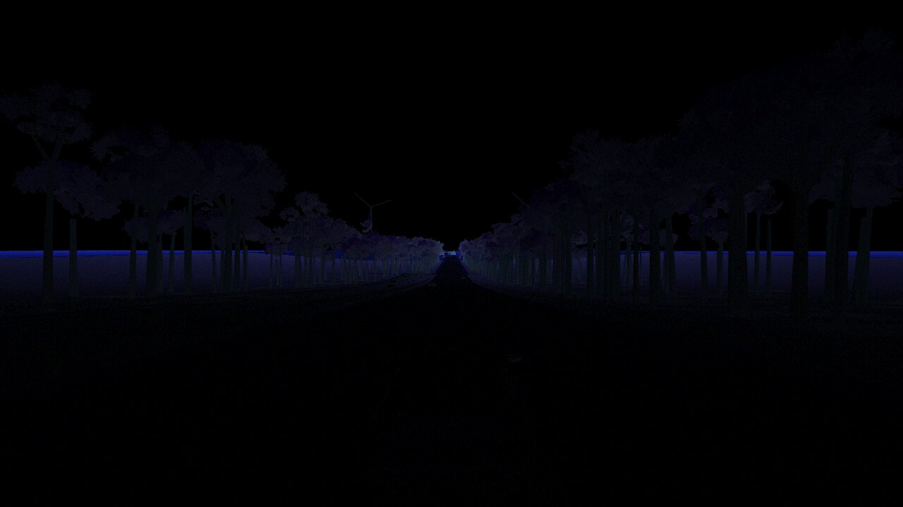 |
| `brume-corniche-haut-jour` | 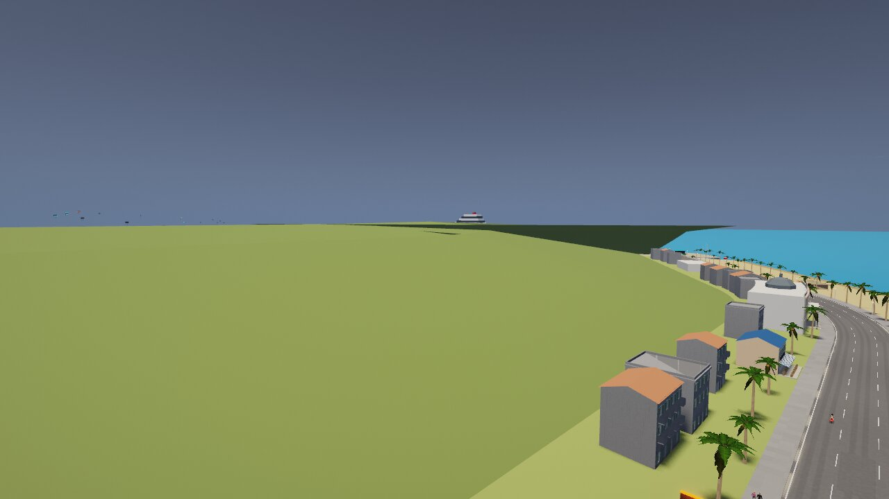 | 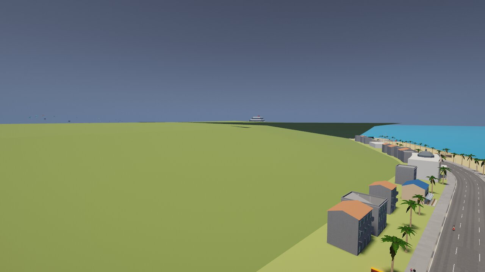 | 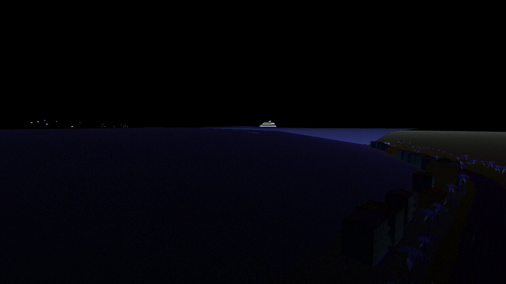 |
| `brume-corniche-jour` | 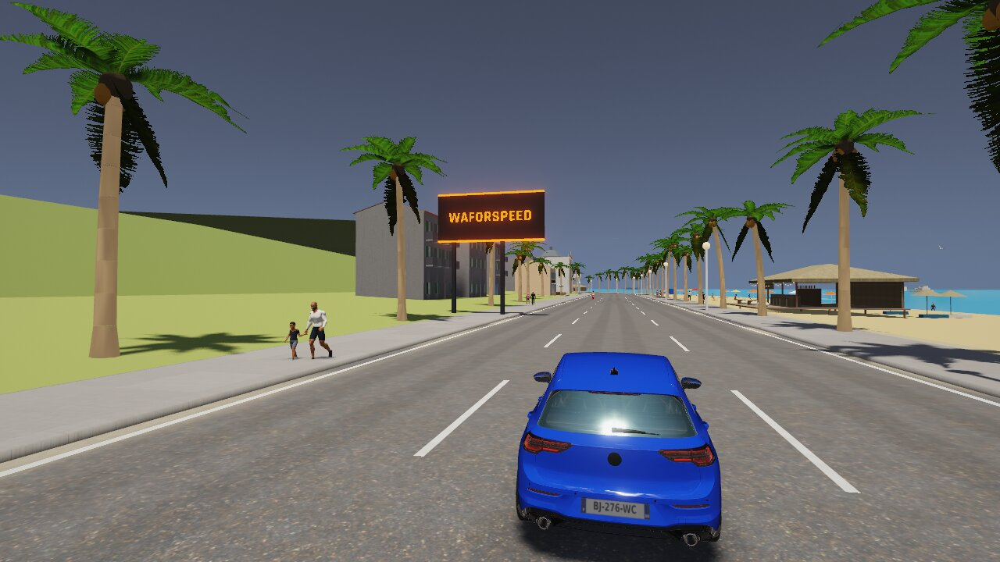 |  | 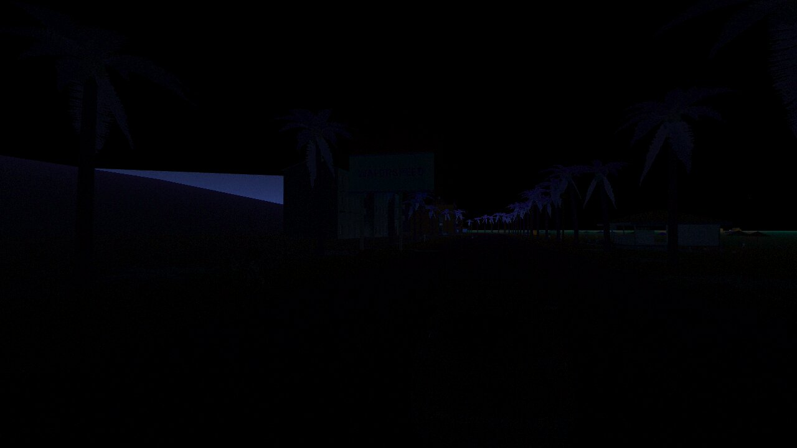 |
| `brume-corniche-nuit` | 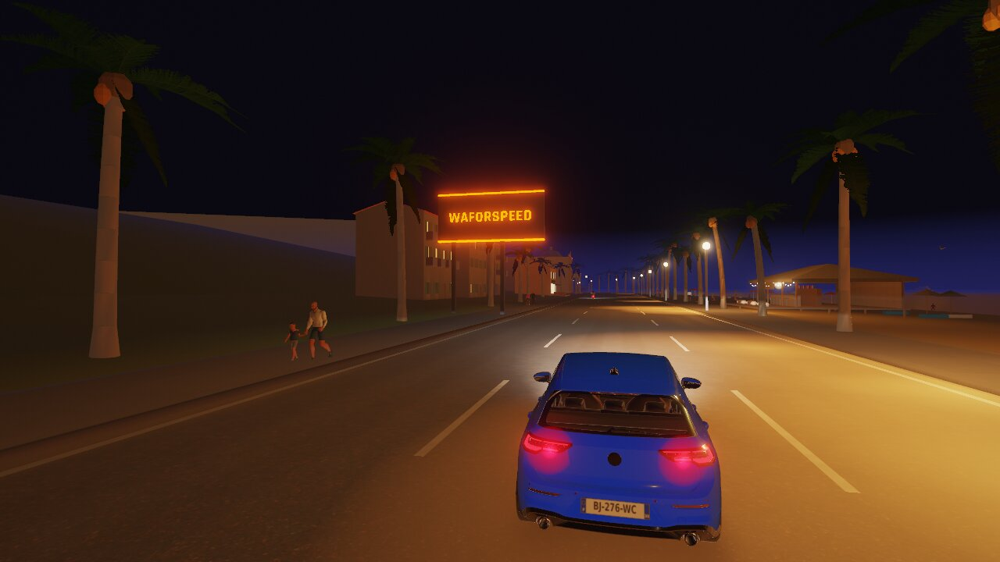 |  |  |
| `brume-ville-haut-jour` | 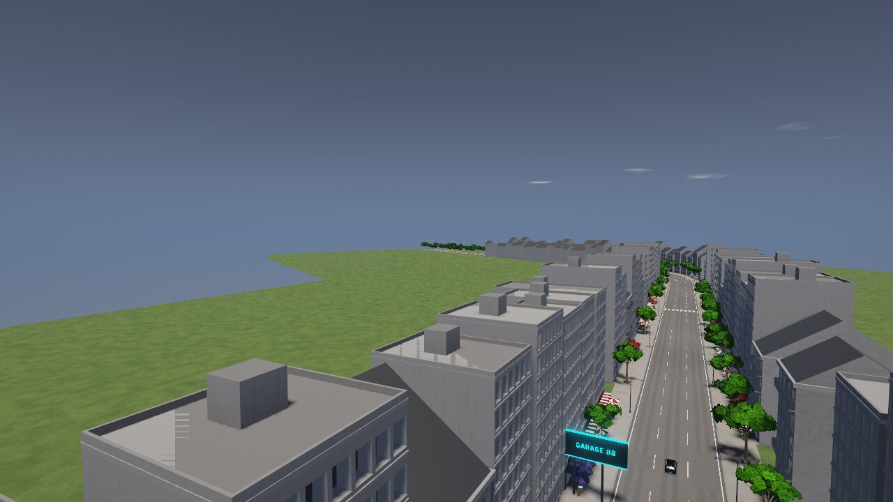 |  | 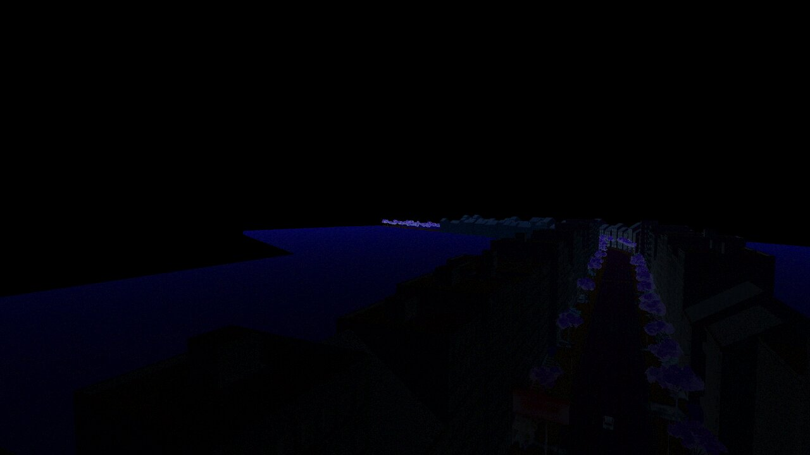 |
| `brume-ville-jour` | 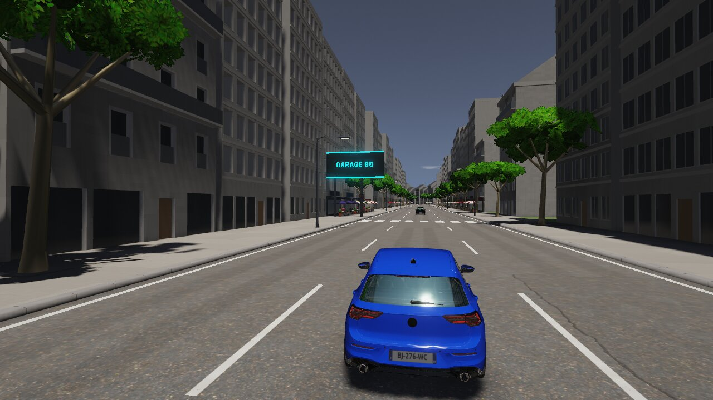 | 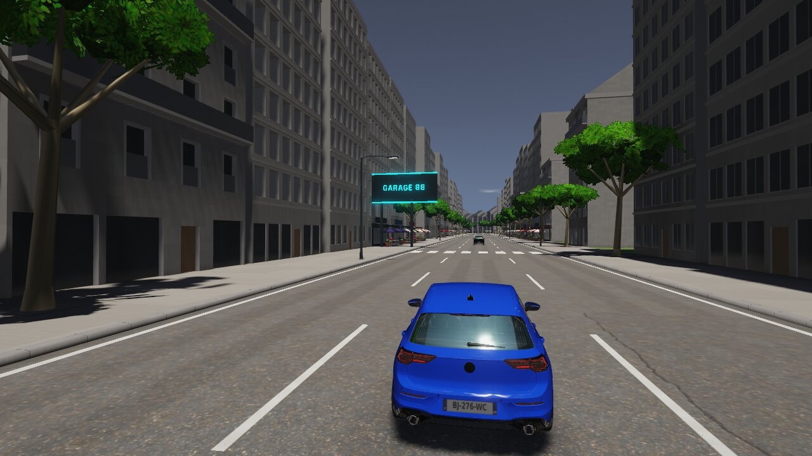 | 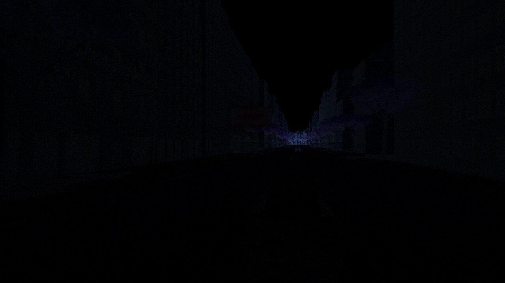 |
