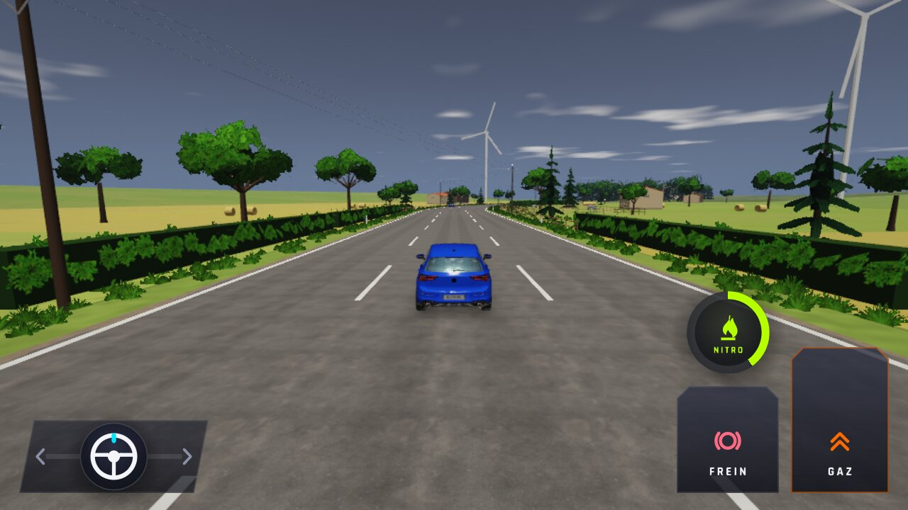
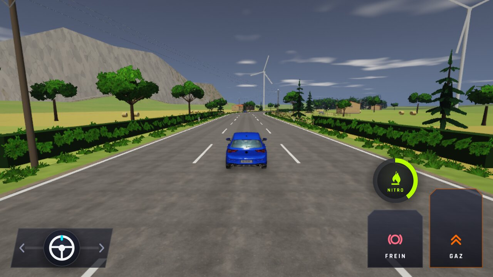
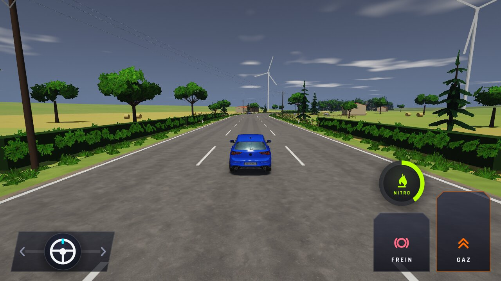
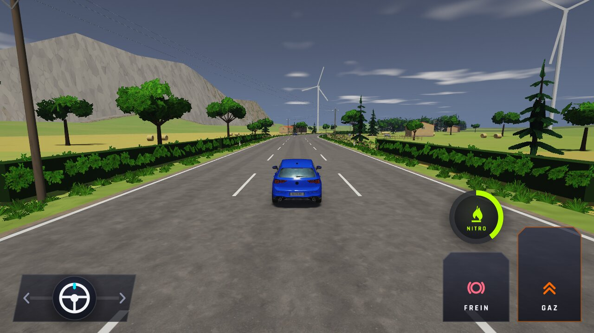

# WFS-387 — captures avant / après (tools/qa/captures_pr.sh)

Branche `feature/waforspeed-387` comparée à `origin/main` ; bancs : campagne-objets:1280x720 campagne:1280x720 perf ; filtre : `*`.

| Capture | Avant (main) | Après (branche) |
|---|---|---|
| `campagne-objets-bottes-nuit` | — |  |
| `campagne-objets-bottes-pres` | — |  |
| `campagne-objets-bottes` |  |  |
| `campagne-objets-cloture-nuit` | — |  |
| `campagne-objets-cloture` |  |  |
| `campagne-objets-ferme-nuit` |  |  |
| `campagne-objets-ferme-soleil` | — |  |
| `campagne-objets-ferme` |  |  |
| `campagne-objets-hangar-moyen` | — |  |
| `campagne-objets-hangar-nuit` | — |  |
| `campagne-objets-hangar` |  |  |
| `campagne-objets-poteau-nuit` | — |  |
| `campagne-objets-poteau` |  |  |
| `campagne-objets-vigne-nuit` |  |  |
| `campagne-objets-vigne` |  |  |
| `carte-campagne-autoroute-nuit` |  |  |
| `carte-campagne-autoroute` |  |  |
| `carte-campagne-cascade-nuit` |  |  |
| `carte-campagne-cascade` |  |  |
| `carte-campagne-chevaux-nuit` |  |  |
| `carte-campagne-chevaux` |  |  |
| `carte-campagne-col-haut` |  |  |
| `carte-campagne-col-nuit` |  |  |
| `carte-campagne-col` |  |  |
| `carte-campagne-epingle-nuit` |  |  |
| `carte-campagne-epingle` |  |  |
| `carte-campagne-haut-du-col` |  |  |
| `carte-campagne-moutons-nuit` |  |  |
| `carte-campagne-moutons` |  |  |
| `carte-campagne-peage-nuit` |  |  |
| `carte-campagne-peage` |  |  |
| `carte-campagne-rondpoint-nuit` |  |  |
| `carte-campagne-rondpoint` |  |  |
| `carte-campagne-vaches-nuit` |  |  |
| `carte-campagne-vaches` |  |  |
| `carte-campagne-vignes-nuit` |  |  |
| `carte-campagne-vignes` |  |  |
| `carte-campagne-village-nuit` |  |  |
| `carte-campagne-village` |  |  |
| `perf-campagne-basse` |  |  |
| `perf-campagne-haute` |  |  |
| `perf-circuit-basse` |  |  |
| `perf-circuit-haute` |  |  |
| `perf-plage-basse` |  |  |
| `perf-plage-haute` |  |  |
| `perf-ville-basse` |  |  |
| `perf-ville-haute` |  |  |
