# WFS-392 — captures avant / après (tools/qa/captures_pr.sh)

Branche `feature/waforspeed-392` comparée à `origin/main` ; banc : `WFS_NEIGE=tunnels WFS_BANC=neige`, 1280x720.

**Images « avant »** : `origin/main` (a020ea5… puis bd1a08db, même code du jeu) avec seulement le 2e tunnel de la carte d'essai (`paquets/sources/noel-test`) et les captures du banc (`neige_banc.cpp`) de la branche, sans la correction : sur `main`, la carte d'essai n'a qu'un tunnel et le banc n'a pas ces captures. Le gros plan du luminaire n'a pas d'image « avant » (il n'y avait aucun luminaire).

| Capture | Avant (main) | Après (branche) |
|---|---|---|
| `neige-tunnel-entree-arriere` | 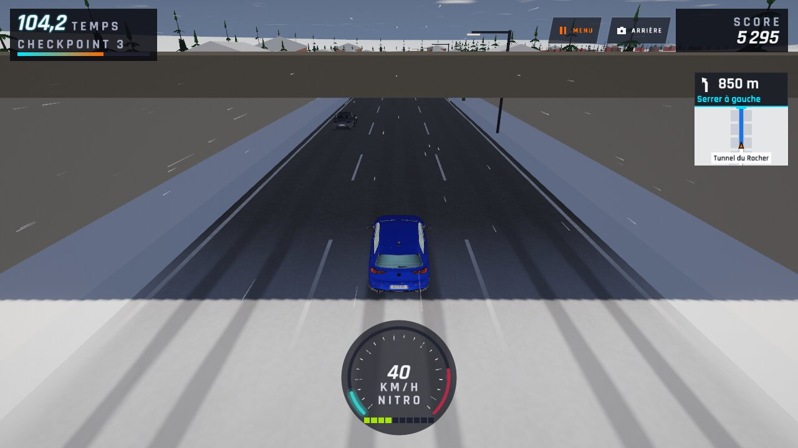 | 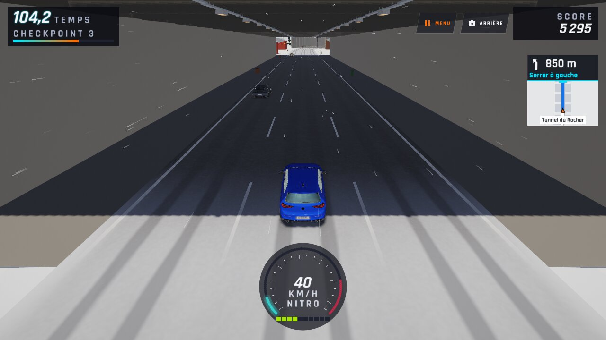 |
| `neige-tunnel2-arriere-jour` | 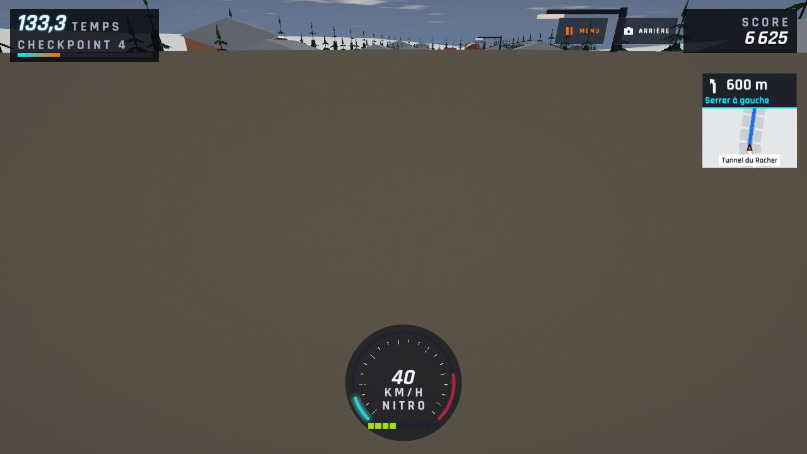 | 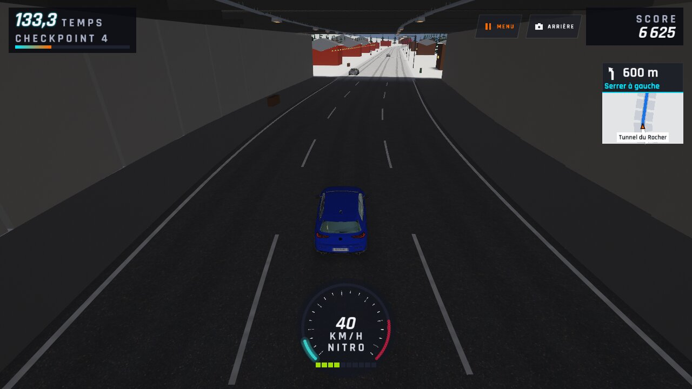 |
| `neige-tunnel2-arriere-nuit` | 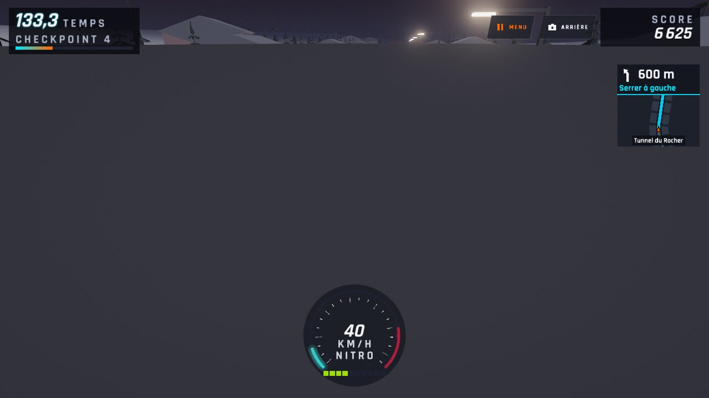 | 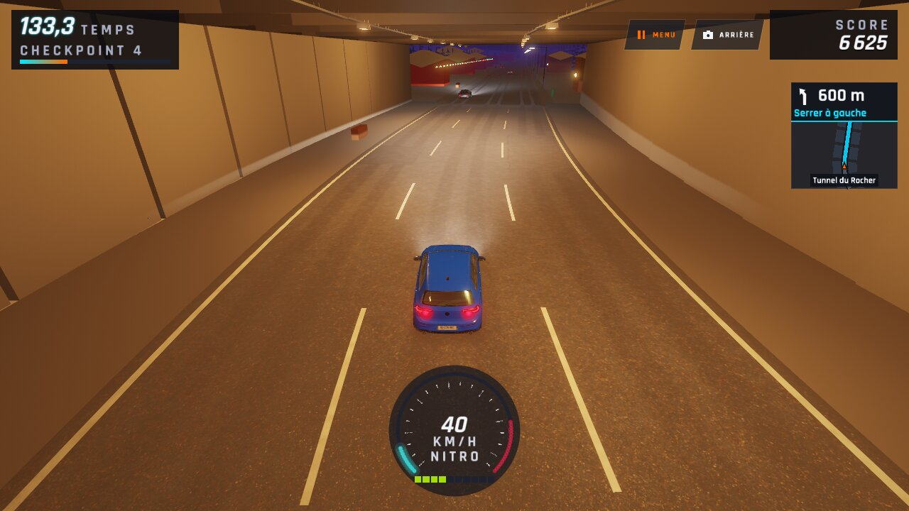 |
| `neige-tunnel2-cockpit-jour` | 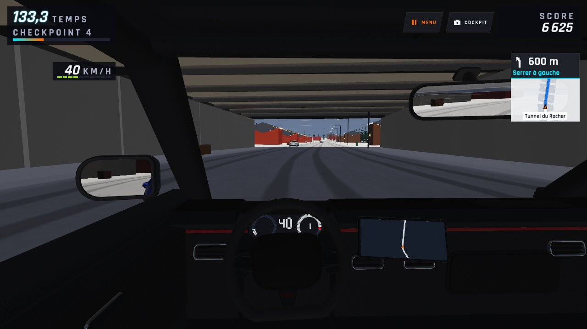 | 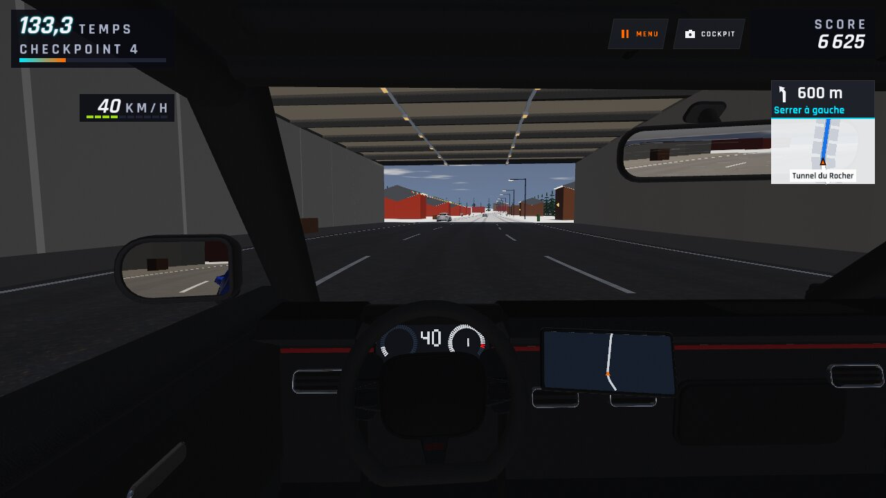 |
| `neige-tunnel2-cockpit-nuit` | 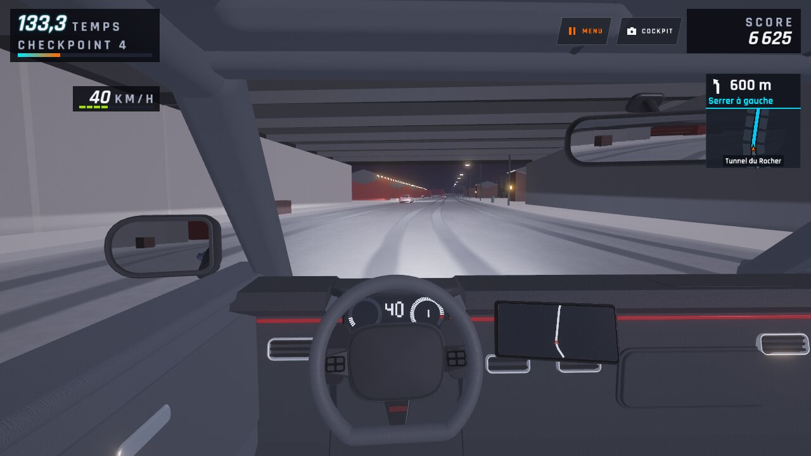 | 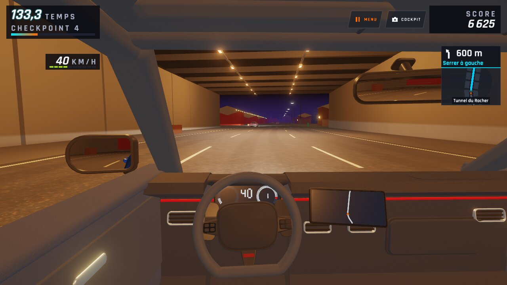 |
| `neige-tunnel2-luminaire-jour` | — | 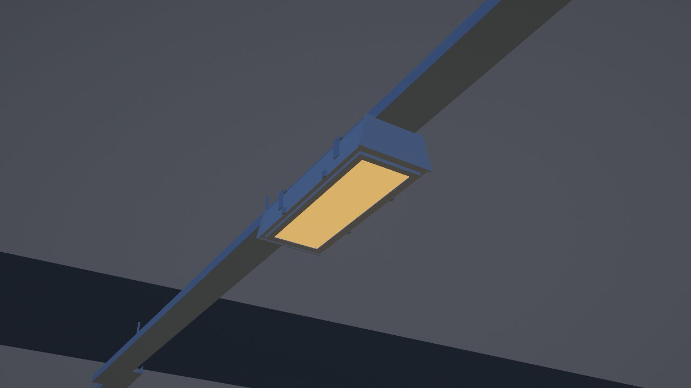 |
| `neige-tunnel2-luminaire-nuit` | — | 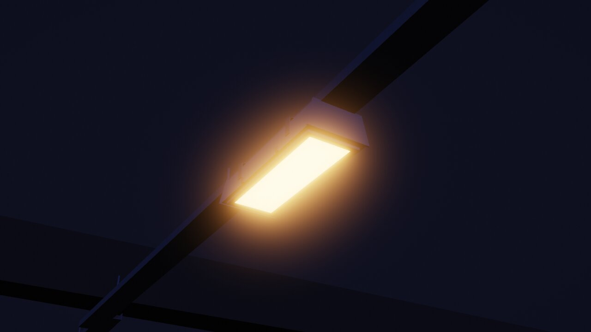 |
