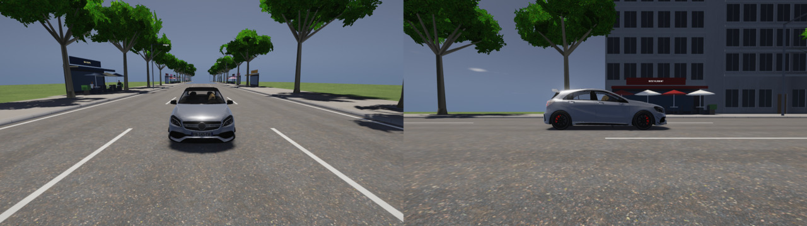
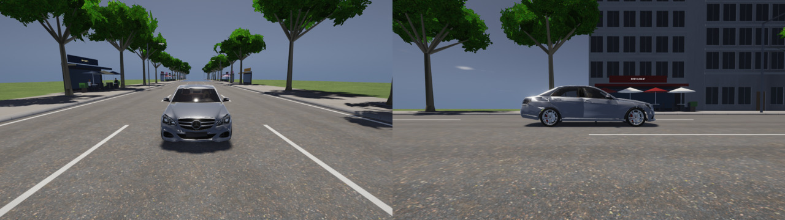
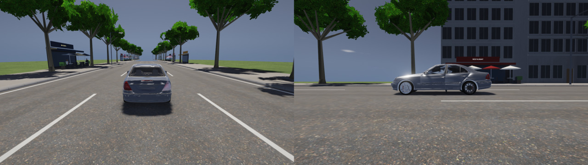
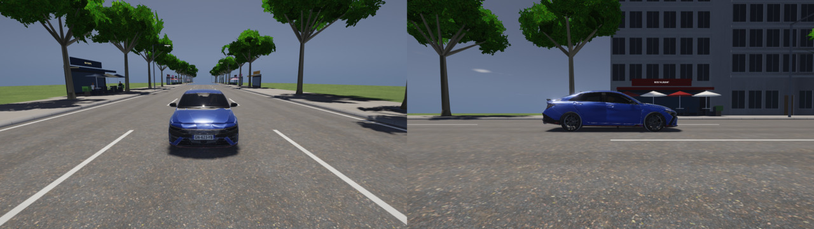
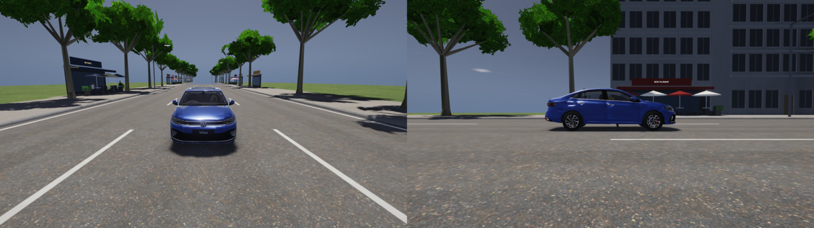
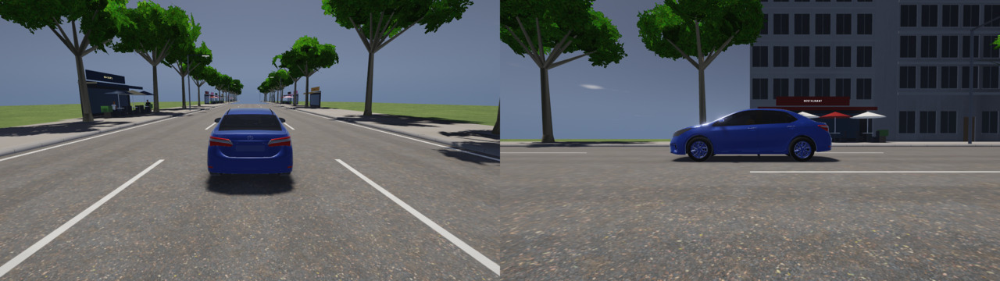

Agent : Claude, agent artiste (01UY1Vv2ph)

## Demande
WFS-396 (découpe de WFS-360 par le PO) : trouver, vérifier (licence CC0 / CC BY, mesures ±1 %, ≤ 8 Mo, sans marque) et convertir les remplaçants de l'**A 45** (Classe E W212, choix du PO) et de l'**Elantra N** (berline sportive compacte, au plus 2 choix proposés au PO), sans rien brancher dans le jeu.

## Résultat : refus motivé pour les deux places (décision du PO, 2026-11-10 00:18 UTC, option a)
Aucun modèle libre trouvé ne tient les 6 mesures dans ±1 %, et la tolérance n'a pas de dérogation. **Rien n'est converti dans `assets/cars/remplacants/`** ; le jeu ne change pas. Les deux meilleurs modèles de chaque place passent au nouveau ticket **WFS-397** (dev-artiste-3d), qui corrigera leur seul écart avec du code (hauteur de caisse, position des roues).

### Méthode
- Recherche de code GitHub (`filename:license.txt`, ~1 000 fichiers de licence lus), clone partiel dans le bac à sable de la session, rien exécuté, licence lue dans le `license.txt` de Sketchfab.
- Conversion dans le bac à sable avec les outils du dépôt, **non modifiés** : `tools/simplifier_voiture.mjs` puis `tools/convert_car.mjs`.
- Mesure par `build/corriger_voitures --essai` (même mesure que `test_fidelite_voitures` : longueur hors tout, largeur sans rétroviseurs, hauteur hors antenne, empattement, voies). La fiche et le `.wfm` de l'a45 ont été permutés **en local** puis remis, sans rien écrire ni pousser.
- Fiches réelles : `references/reel/voitures/remplacants-wfs396.json` (4 voitures, sources, statut « à confirmer »).

### Place de l'A 45 (RG-01)
| Modèle (licence, auteur, dépôt) | Longueur | Largeur | Hauteur | Empattement | Voie AV | Voie AR | Poids, triangles | Verdict |
|---|---|---|---|---|---|---|---|---|
| **Classe E W212** (CC BY 4.0, Peter_D, `bujue600-arch/carVison`) | 4846 / 4868 (−0,5 %) | 1872 / 1854 (+1,0 %) ✅ | **1430 / 1470 (−2,7 %)** ❌ | 2851 / 2874 (−0,8 %) | 1596 / 1585 ✅ | 1596 / 1604 ✅ | 7,95 Mo, 74 k | refusé : caisse trop basse |
| **Classe E W211** (CC BY 4.0, BadKarma, `gibranalfarabi/portofolio-ar`) | 4818 / 4818 | 1819 / 1822 | 1459 / 1448 (+0,8 %) | 2847 / 2854 | **1524 / 1559 (−2,2 %)** ❌ | 1552 / 1552 ✅ (+28 mm) | 7,28 Mo, 129 k | refusé : roues avant rentrées (17 mm par roue, l'outil s'arrête à 15) |

Mesures après la correction `corriger_voitures`, en mm (modèle / réel). Écartés : C63 de LuizZed36 (bas poly, axes faux) ; C63 Coupé W205 (« GT Cars: Hyperspeed », origine douteuse) ; S65 W222 et BMW 7 F01 de Black Snow (pièces BeamNG `gavril_v8`, `etk800_screen` : origine non libre) ; CLS de RADEONGAMER (déjà écartée).
**Licence interdite** : l'« A45 AMG 2018 » de Lexyc16 est en CC BY 4.0 dans `tensornull/CarVision` et en CC BY-NC 4.0 dans `vladyslavhurzhyi/car-rent`. Licence contradictoire, donc non utilisée.

### Place de l'Elantra N (RG-02)
| Modèle (licence, auteur, dépôt) | Longueur | Largeur | Hauteur | Empattement | Voie AV | Voie AR | Poids, triangles | Verdict |
|---|---|---|---|---|---|---|---|---|
| **VW Virtus GT 2022** (CC BY 4.0, BHP3D, `PrathamSatpute/VehiclePredictiveMaintenance`) | 4561 / 4561 | 1740 / 1752 (−0,7 %) | **1467 / 1507 (−2,6 %)** ❌ | 2639 / 2651 (−0,5 %) | 1498 / 1511 | 1498 / 1496 | 12,7 Mo, 212 k (à alléger) | refusé : caisse trop basse, trop lourd |
| **Toyota Corolla E180 EU** (CC BY 4.0, Armored Wave, `oddalan/three-dee`) | 4620 / 4620 | **1813 / 1775 (+2,1 %)** ❌ | 1469 / 1465 | 2708 / 2700 | roues non reconnues | — | 6,3 Mo, 84 k | refusé : trop large, roues soudées |

Écartés : Corolla 2020 d'ItsDiyor (roues soudées à la caisse, atlas de jeu) ; Octavia de barking_dogo (empattement −2,8 %) ; Civic FD2, Leon Cupra, A4 2000 (moins de 25 k triangles) ; Lancer Evo X de BadKarma (matériaux sans nom, 30 k triangles) ; WRX STi 2010 (origine de jeu) ; « Accord 2017 » de L95XP (c'est un mod `mtn_caprice`).

### Téléchargements (bac à sable, rien dans le dépôt ; SHA-256)
| Modèle | Fichier | SHA-256 | Taille |
|---|---|---|---|
| W212 (Peter_D) | scene.gltf / scene.bin | a1e14552…a106822 / cfed9ca3…29fed44a | 238 832 / 20 244 980 o |
| W211 (BadKarma) | scene.gltf / scene.bin | 909a0f9e…508e79a8 / 76bad9a6…72811126 | 91 150 / 15 148 680 o |
| Virtus GT (BHP3D) | scene.gltf / scene.bin | 1bfe8554…47e5b8d7 / 70fbe3cb…3b72663afd6e7f5eac | 617 095 / 22 504 008 o |
| Corolla E180 (Armored Wave) | scene.gltf / scene.bin | 57ff461e…f4fe8ba5fdacf0b / f377f589…a0e6bb3f266f3f | 135 104 / 4 395 288 o |
Empreintes complètes au journal.

## Ce qui change dans le dépôt
- `references/reel/voitures/remplacants-wfs396.json` (nouveau) : fiches réelles W212, W211, Virtus GT, Corolla E180 (même format que `voitures.json`, statut « à confirmer »).
- `qa/pr/WFS-396/` : ce rapport et les captures.
- Rien dans `src/`, `shaders/`, `tools/`, `assets/` : **le jeu est identique à `main`**.

## Vérification
- `bash tools/qa/tests_cpu.sh build` : 94 tests réussis (dont `test_fidelite_referentiel`, qui lit le nouveau fichier, et `test_fidelite_voitures`).
- Mesures : `corriger_voitures --essai` (permutation locale restaurée ; `git status` propre ensuite).

## Captures (banc `vitrines-feux`, lavapipe, 1280×720, même rendu que la CI)
Permutation **locale** du `.wfm` (non poussée). « Avant » = voiture actuelle de `main`. Les autres images montrent les candidats étudiés et pourquoi ils sont refusés : ce ne sont pas des voitures livrées.
| | Face et profil bas (`WFS_VITRINE_BAS`) |
|---|---|
| A 45 actuelle (main) |  |
| W212 Peter_D (caisse −2,7 %) |  |
| W211 BadKarma (voie AV −2,2 % ; sens de l'avant à reprendre : rotation `180`) |  |
| Elantra N actuelle (main) |  |
| Virtus GT BHP3D (caisse −2,6 %) |  |
| Corolla E180 Armored Wave (+2,1 % en largeur) |  |

Vues de 3/4 et feux stop de chaque voiture : `qa/pr/WFS-396/<voiture>-a1.jpg`, `<voiture>-feux.jpg`.

## Limites et suite
- Fiches lues dans les résumés du moteur de recherche (pages non ouvertes : réseau de la session), comme les fiches actuelles : statut « à confirmer ».
- Les captures « après » ne montrent pas une voiture livrée : il n'y en a pas (refus motivé).
- **WFS-397** (PO) : W212 avec la caisse à remonter à ±1 % (repli : W211, roues avant écartées de 17 mm, `chrome_logo` retiré, rotation 180) ; Virtus GT avec la hauteur à ±1 % et le poids sous 8 Mo. Ce ticket demande du code, donc l'agent dev-artiste-3d. WFS-360 branchera ensuite.

🤖 Generated with [Claude Code](https://claude.com/claude-code)

https://claude.ai/code/session_01UY1Vv2phXsu9Xg9FAHdnN3
