# WFS-404 — captures avant / après (tools/qa/captures_pr.sh)

Branche `feature/waforspeed-404` comparée à `origin/main` ; bancs : garage:1280x720 cockpit:1280x720 (WFS_VOITURES=m4) ville:1280x720 (WFS_VILLE_LIEU=carte-ville-autoroute) voitures-retirees:1280x720 ; captures sans rapport avec le ticket retirées.

| Capture | Avant (main) | Après (branche) |
|---|---|---|
| `vitrines-planche` | — (banc nouveau) | 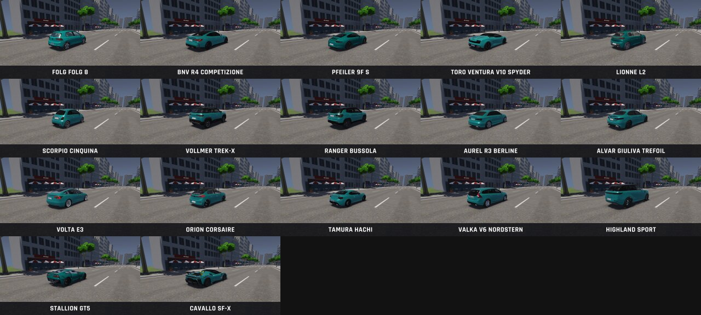 |
| `garage-0` | 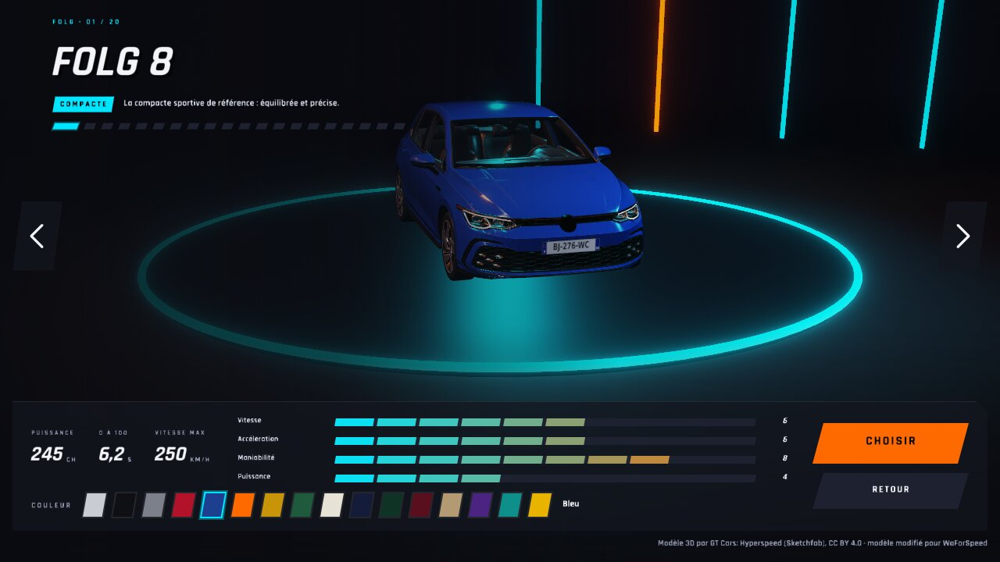 |  |
| `garage-m4` | 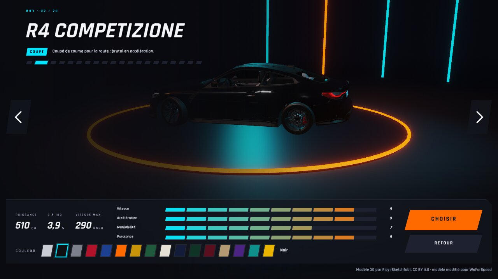 |  |
| `garage-suivant` | 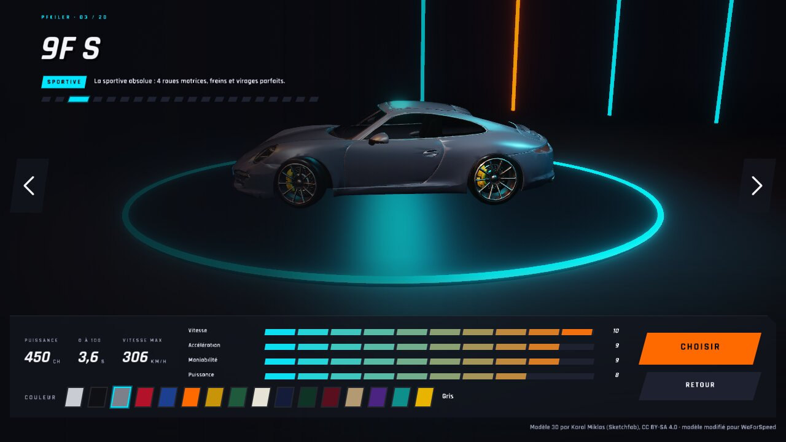 |  |
| `garage-1` |  | 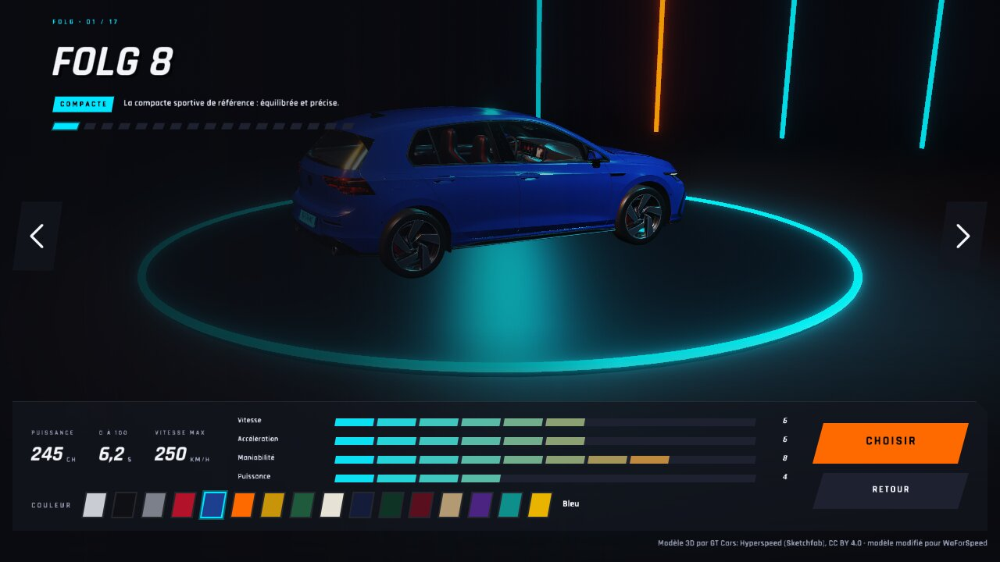 |
| `garage-2` | 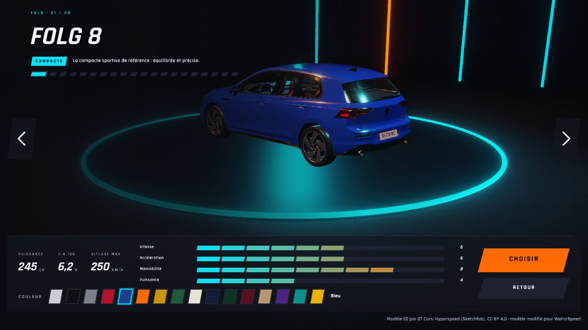 |  |
| `showroom-suivante-1` | 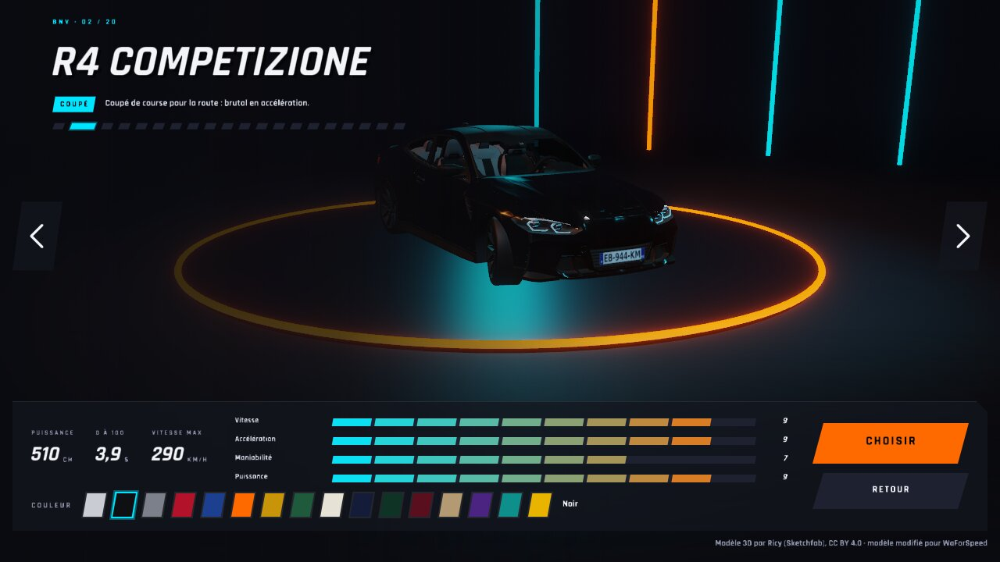 |  |
| `showroom-suivante-2` | 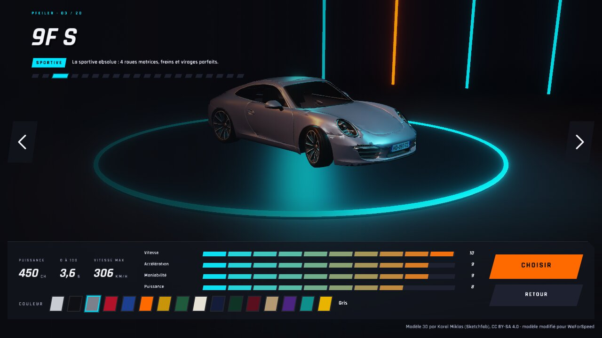 |  |
| `showroom-suivante-3` |  | 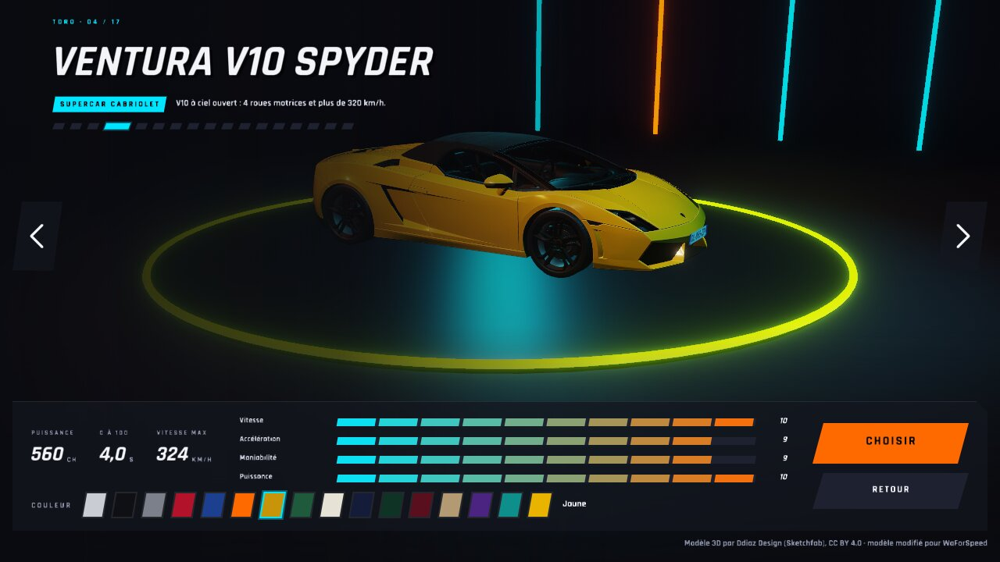 |
| `poursuite-camion` | — (banc nouveau) | 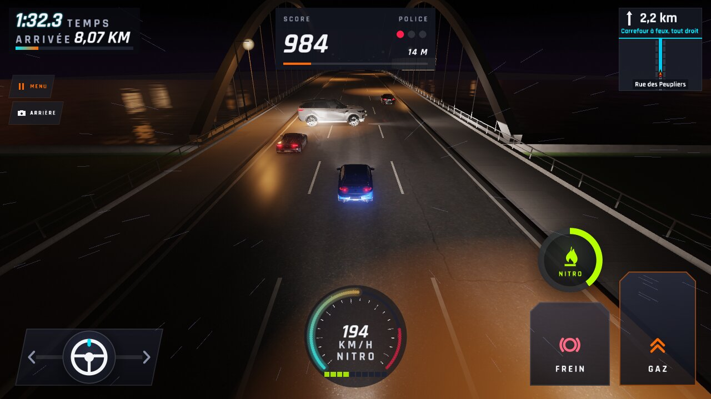 |
| `carte-ville-autoroute` |  | 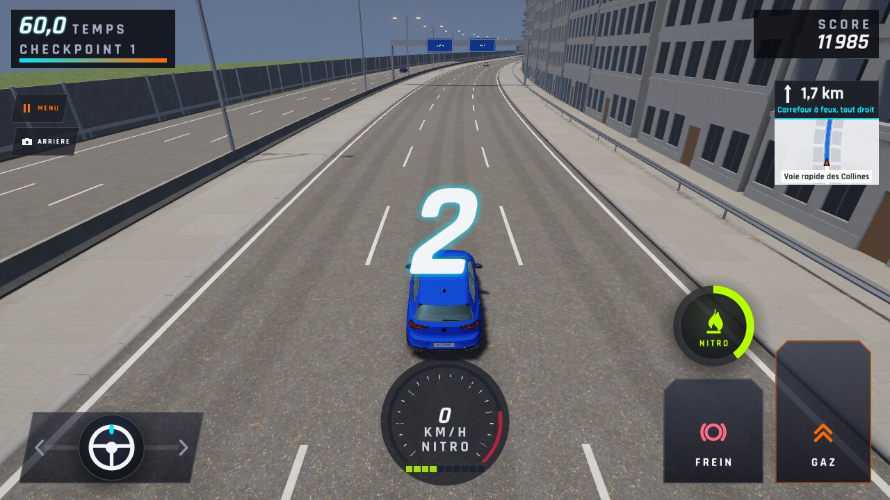 |
| `carte-ville-autoroute-nuit` | 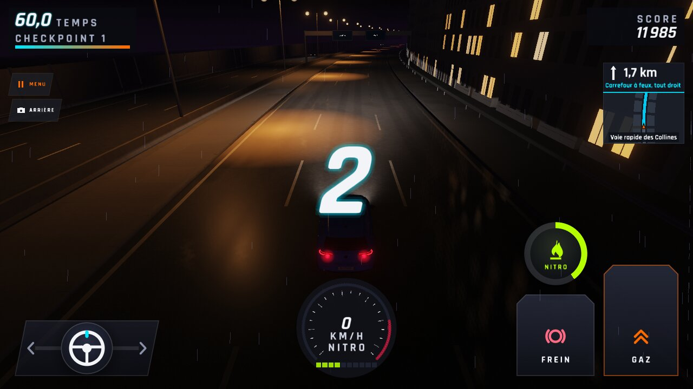 |  |
| `cockpit-m4-jour` |  | 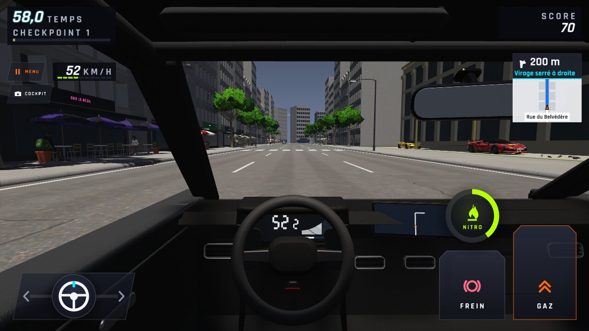 |
| `cockpit-m4-nuit` | 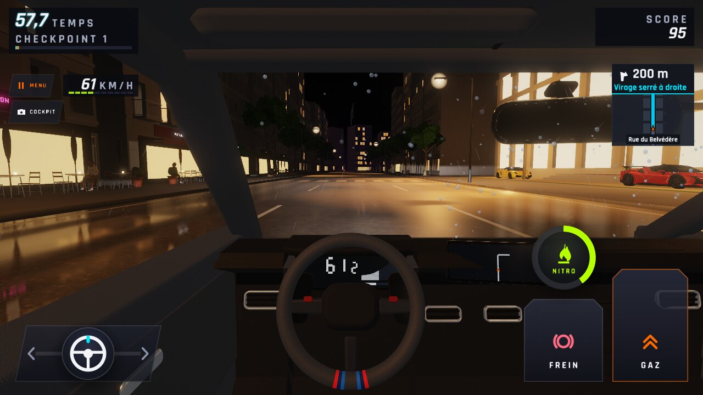 |  |
| `cockpit-m4-braquage` | 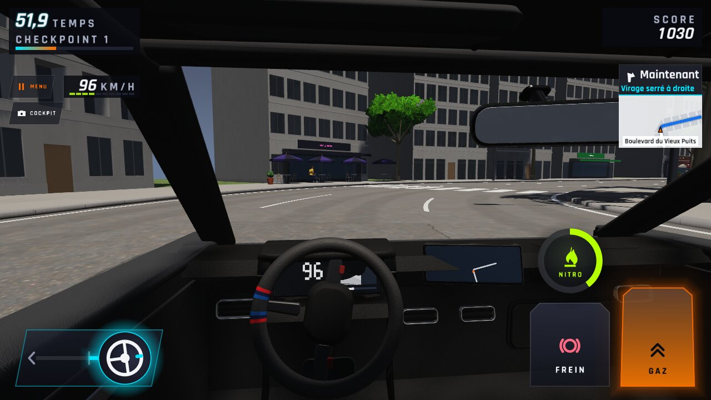 |  |
