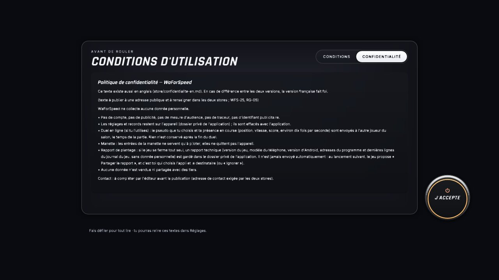
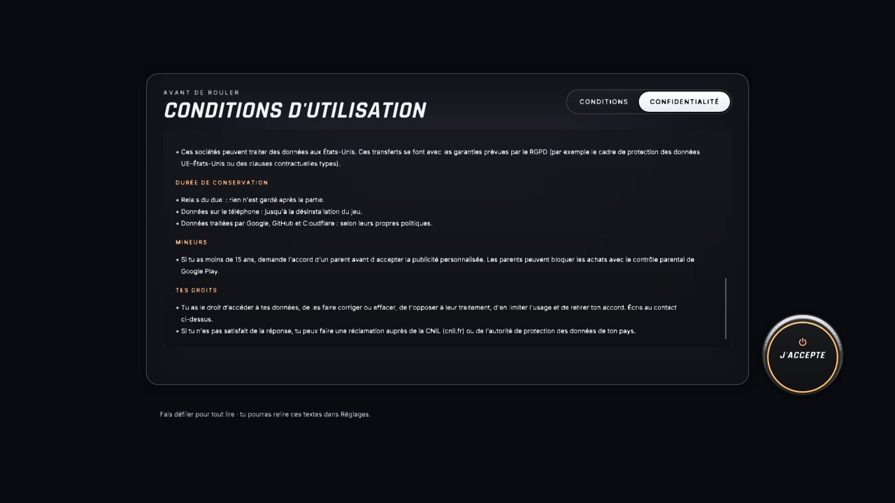
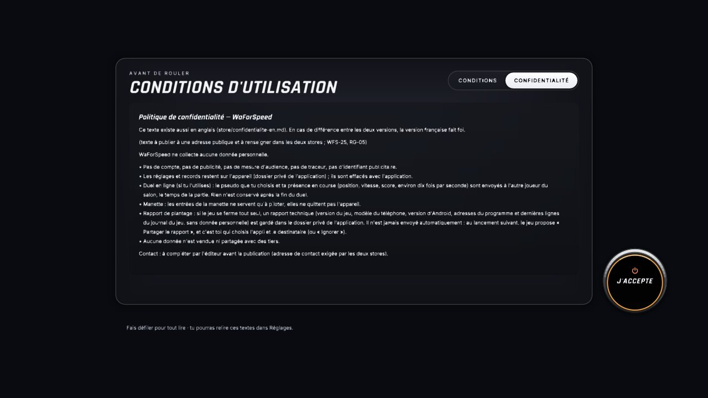
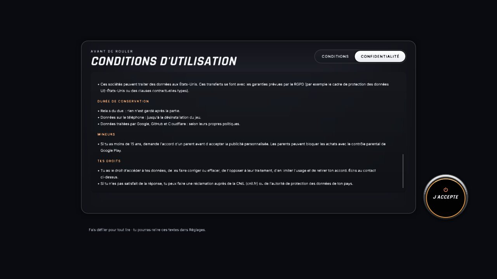
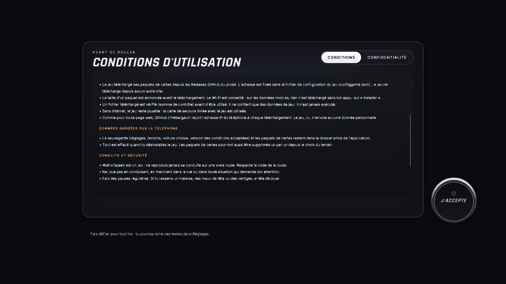
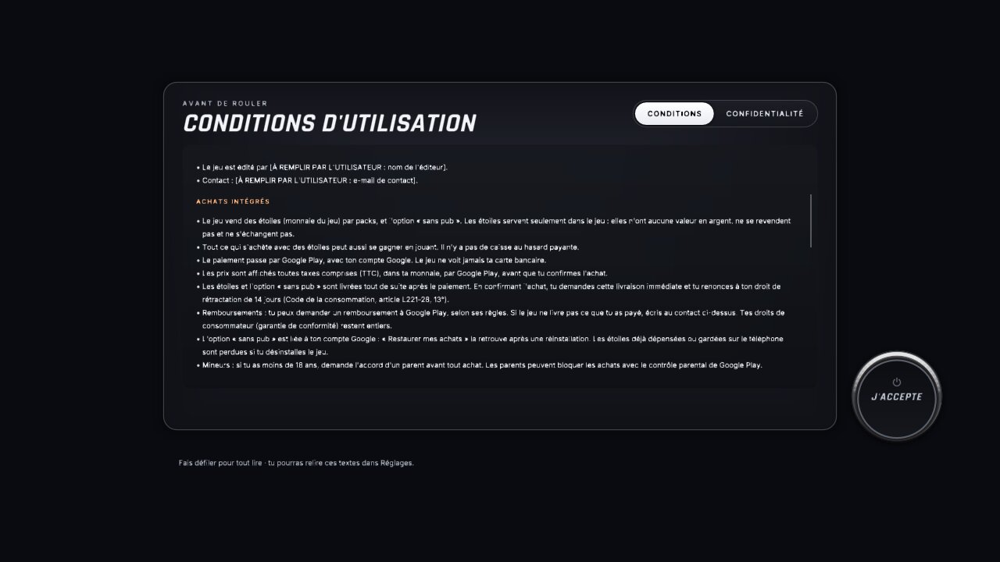
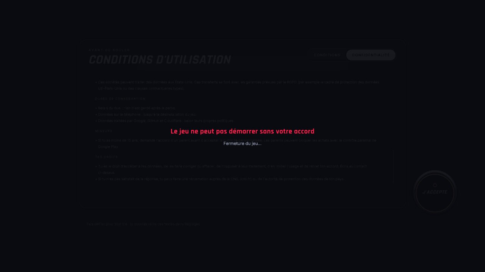
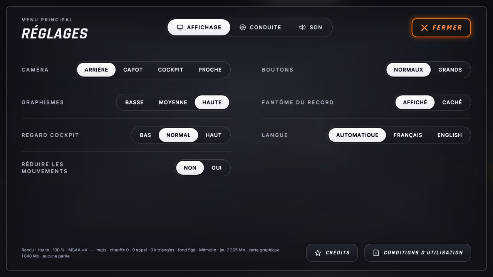
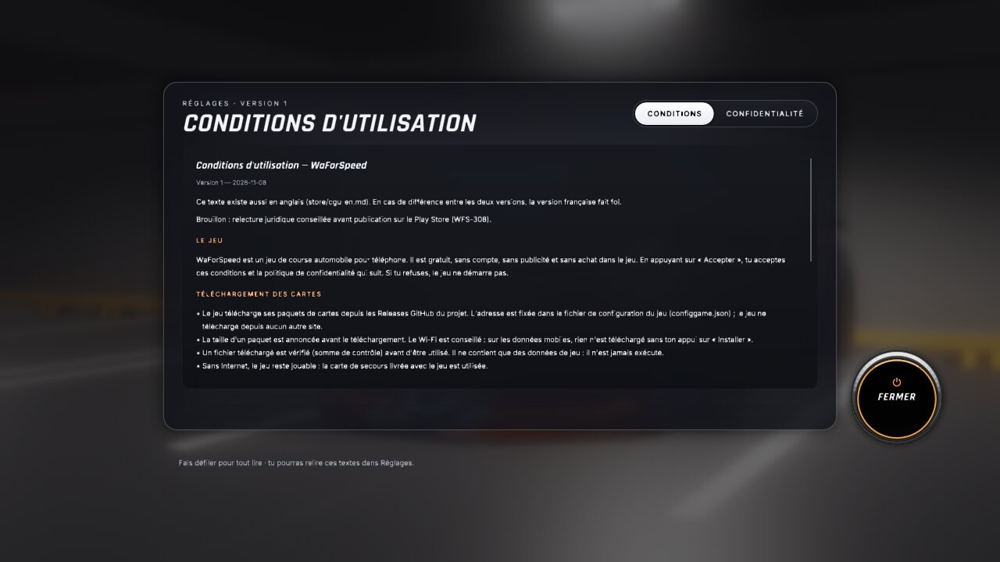

# WFS-408 — captures avant / après (tools/qa/captures_pr.sh)

Branche `feature/waforspeed-408` comparée à `origin/main` ; bancs : cgu:1280x720 ; filtre : `*`.

Captures « avant » : `origin/main` = `539399fc1f198447b431d0f06ee202d2f5adf18f` ; cache : 0 banc(s) relu(s), 1 banc(s) rejoué(s) ; main compilé : oui.

| Capture | Avant (main) | Après (branche) |
|---|---|---|
| `cgu-accepter-appuye` |  |  |
| `cgu-coche` |  |  |
| `cgu-defile` |  |  |
| `cgu-premier` |  |  |
| `cgu-refus` |  |  |
| `cgu-reprise` |  |  |
| `cgu-retour-jeu` |  |  |
| `reglages-cgu-bouton` |  |  |
| `reglages-cgu-lecture` |  |  |
| `textes-fr-cgu-haut` |  |  |
| `textes-fr-cgu-milieu` |  |  |
| `textes-fr-cgu-bas` |  |  |
| `textes-fr-cgu-lecture` |  |  |
| `textes-en-cgu-haut` |  |  |
| `textes-en-cgu-milieu` |  |  |
| `textes-en-cgu-bas` |  |  |
| `textes-en-cgu-lecture` |  |  |

## Captures ciblées (2e revue du lead dev, 2026-11-18)

| Capture | Avant (main) | Après (branche) |
|---|---|---|
| `cible-fr-cgu-p30` (CGU : achats, rétractation) |  |  |
| `cible-fr-cgu-p60` (CGU : duel en ligne) |  |  |
| `cible-fr-conf-p00` (confidentialité : responsable, adresse) |  |  |
| `cible-fr-conf-p40` (données qui quittent le téléphone) |  |  |
| `cible-fr-conf-p60` (pourquoi, sur quelle base) |  |  |
| `cible-en-cgu-p30` (CGU : achats, rétractation) |  |  |
| `cible-en-cgu-p60` (CGU : duel en ligne) |  |  |
| `cible-en-conf-p00` (confidentialité : responsable, adresse) |  |  |
| `cible-en-conf-p40` (données qui quittent le téléphone) |  |  |
| `cible-en-conf-p60` (pourquoi, sur quelle base) |  |  |
