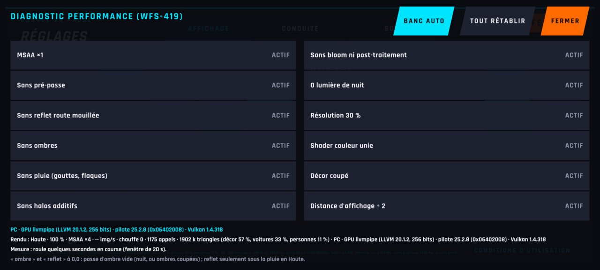
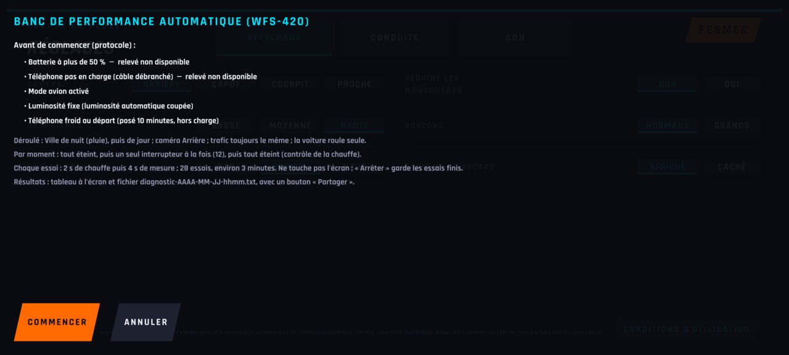
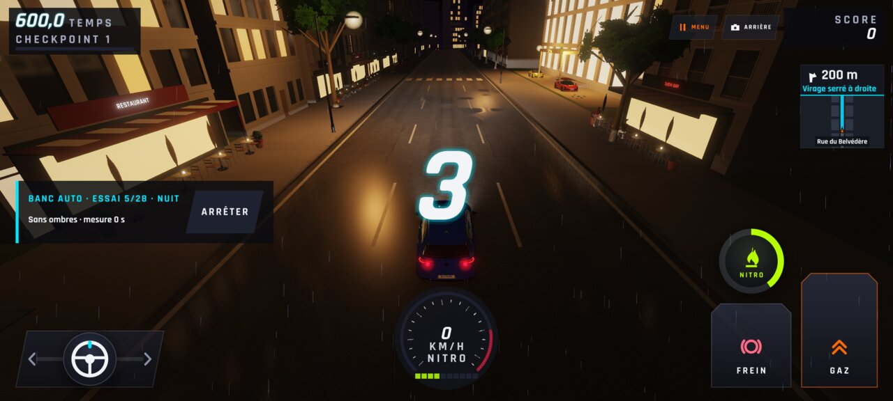
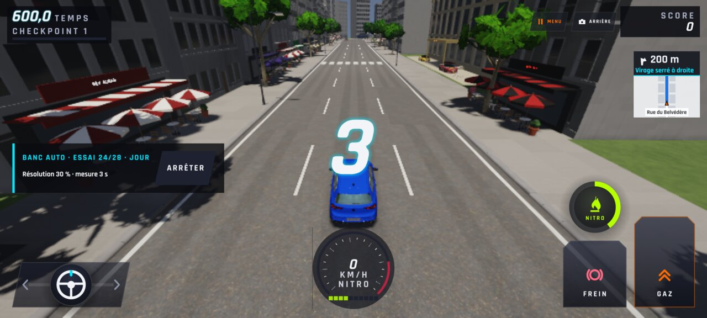
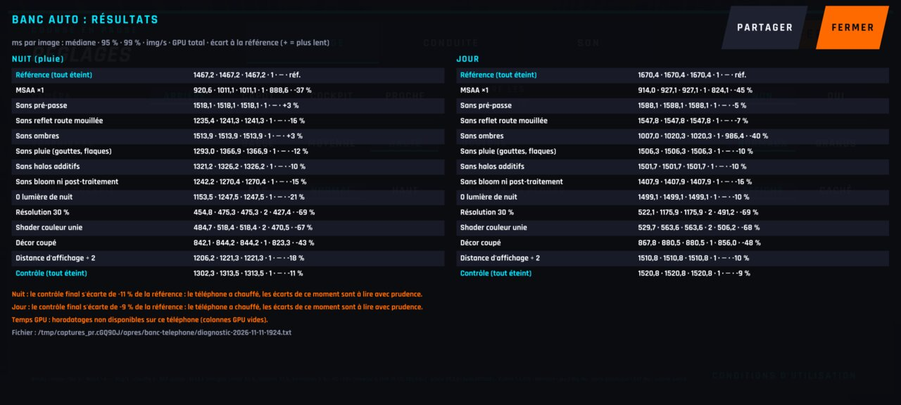
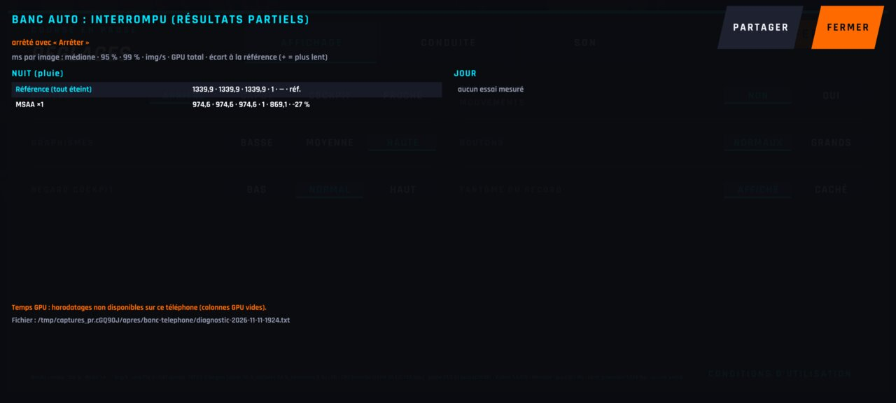

# WFS-420 — captures avant / après (tools/qa/captures_pr.sh)

Branche `feature/waforspeed-420` comparée à `origin/main` ; bancs : banc-telephone:2400x1080 ; filtre : `*`.

| Capture | Avant (main) | Après (branche) |
|---|---|---|
| `banc-tel-1-menu-cache` | — |  |
| `banc-tel-2-protocole` | — |  |
| `banc-tel-3-nuit-en-cours` | — |  |
| `banc-tel-4-jour-en-cours` | — |  |
| `banc-tel-5-resultats` | — |  |
| `banc-tel-6-arrete` | — |  |
