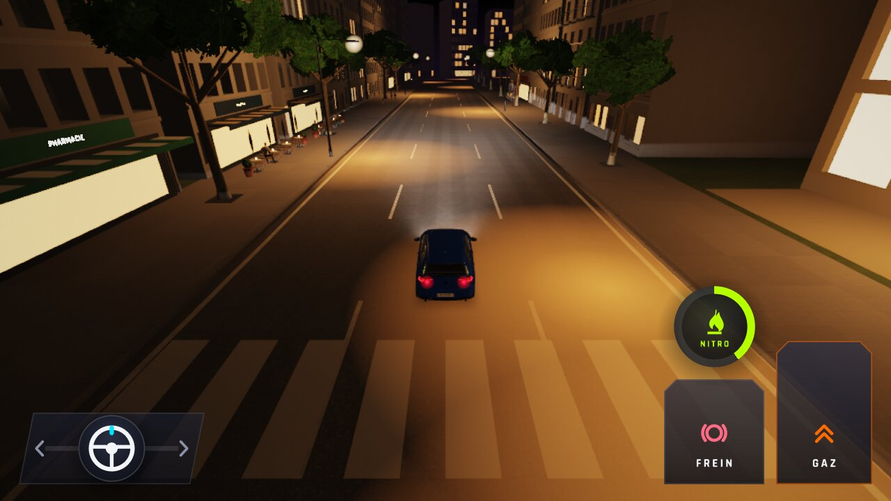
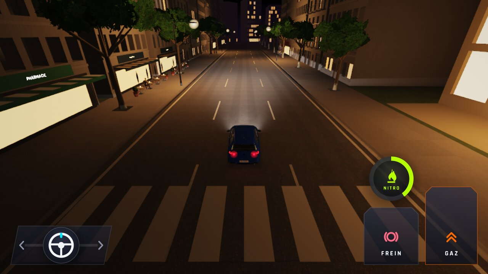
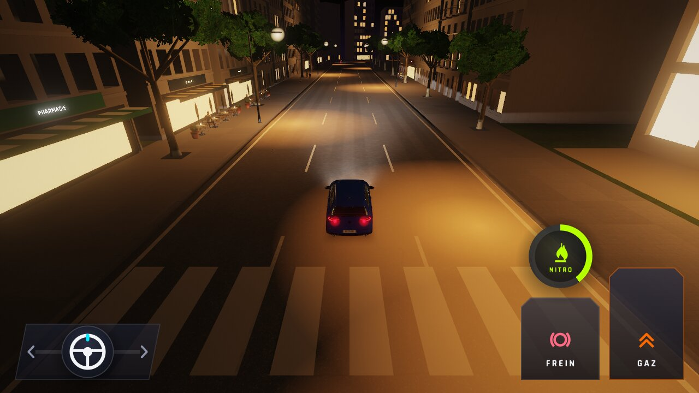
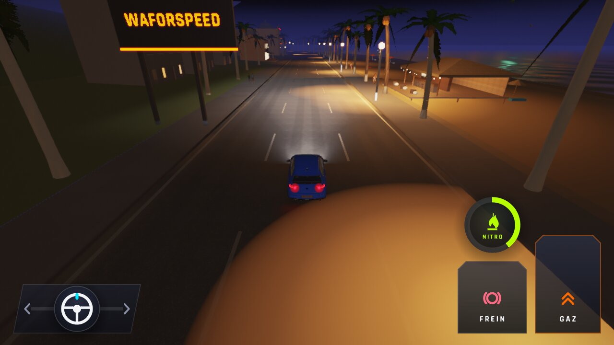
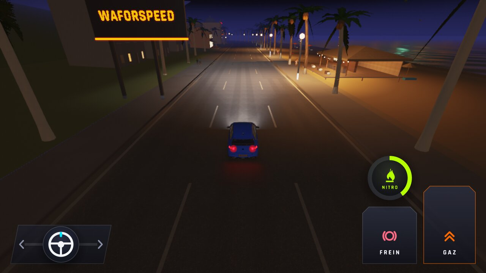
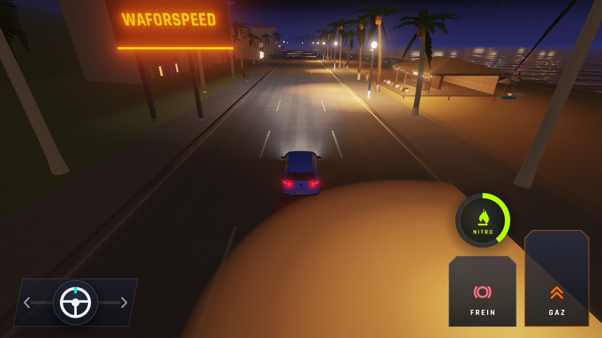

# WFS-421 — captures avant / après (banc `halos-sol`)

Banc d'essai PC (lavapipe, même rendu que la CI), `WFS_BANC=halos-sol`, 1280 x 720, nuit, temps sec, vue Poursuite, ≈ 17-21 m avant un lampadaire. « Avant » = `origin/main` + le fichier du banc seul (le banc n'existe pas sur `main`).

| Capture | Avant (main) | Après (branche) |
|---|---|---|
| `halosol-ville-basse` |  |  |
| `halosol-ville-moyenne` |  |  |
| `halosol-ville-haute` |  |  |
| `halosol-plage-basse` |  |  |
| `halosol-plage-moyenne` |  |  |
| `halosol-plage-haute` |  |  |
