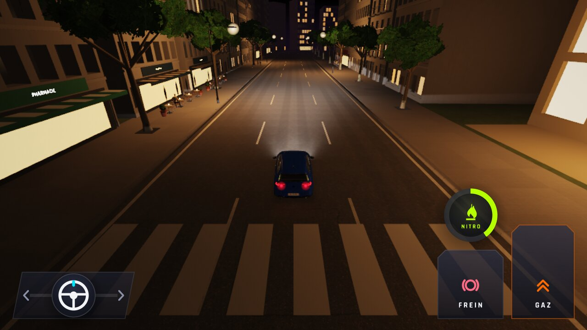
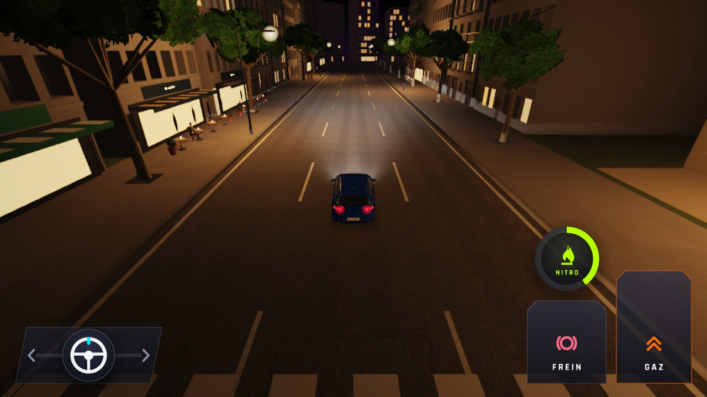
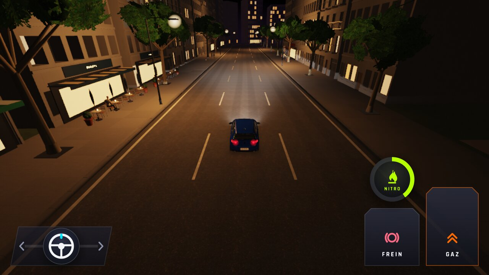
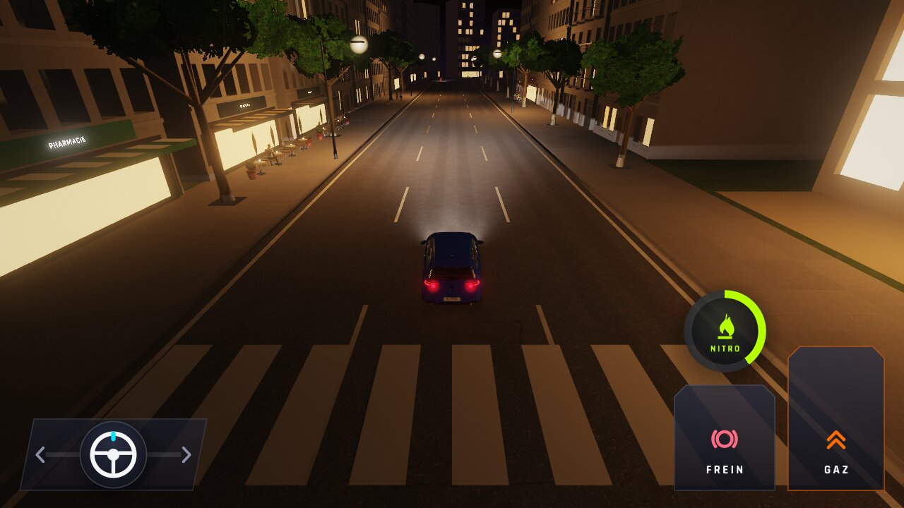
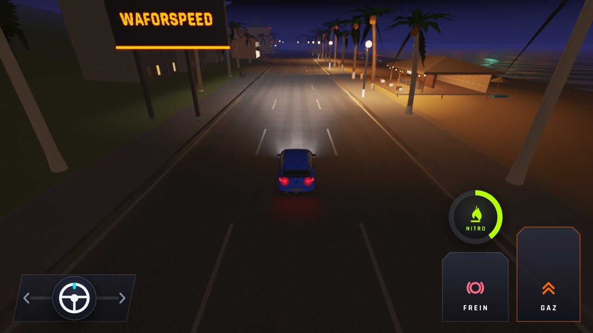
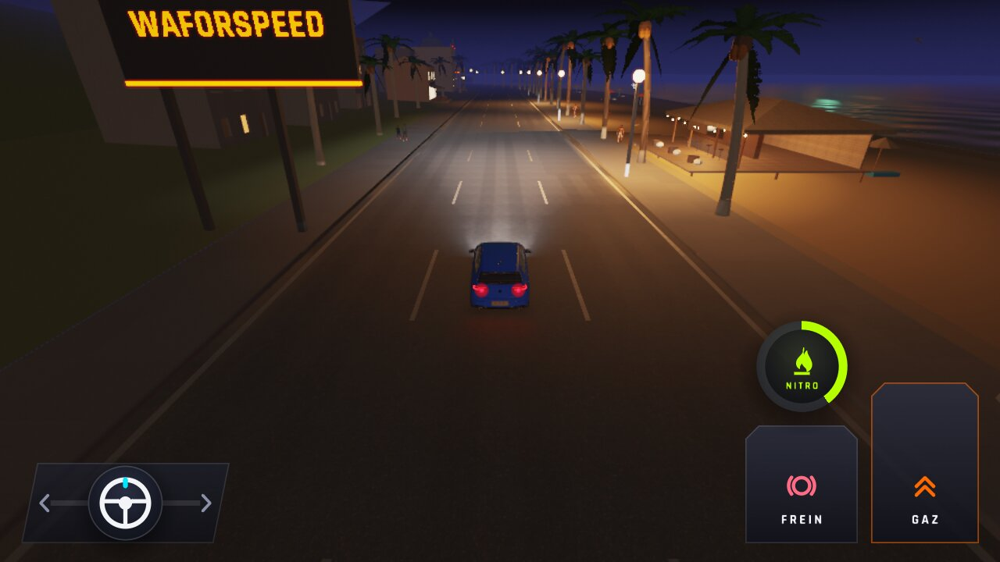
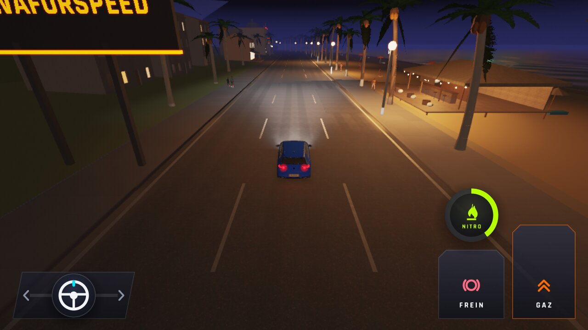
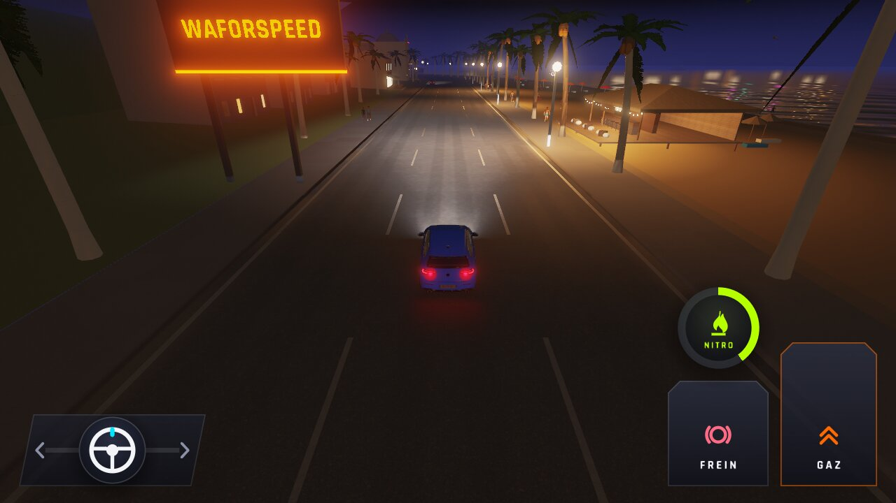

# WFS-423 — captures avant / après

Banc `lumieres-basse` ; 0 pixel différent sur les 10 captures.

| Capture | Avant (main) | Après (branche) |
|---|---|---|
| `lumbasse-ville-basse-1` |  |  |
| `lumbasse-ville-basse-2` |  |  |
| `lumbasse-ville-basse-3` |  |  |
| `lumbasse-ville-moyenne` |  |  |
| `lumbasse-ville-haute` |  |  |
| `lumbasse-plage-basse-1` |  |  |
| `lumbasse-plage-basse-2` |  |  |
| `lumbasse-plage-basse-3` |  |  |
| `lumbasse-plage-moyenne` |  |  |
| `lumbasse-plage-haute` |  |  |

