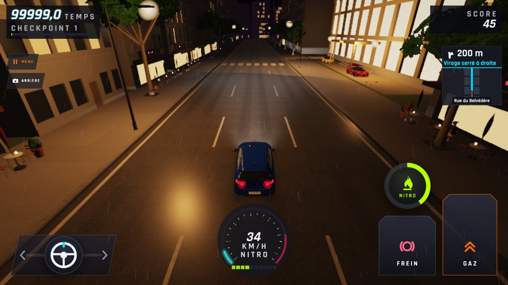
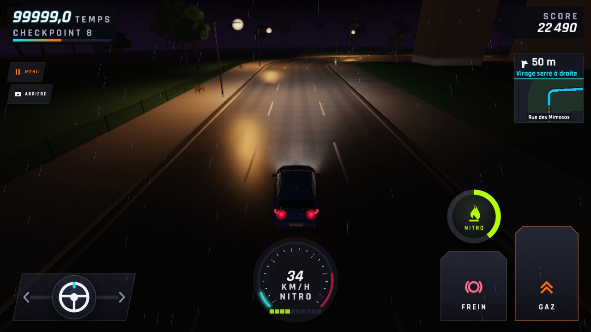
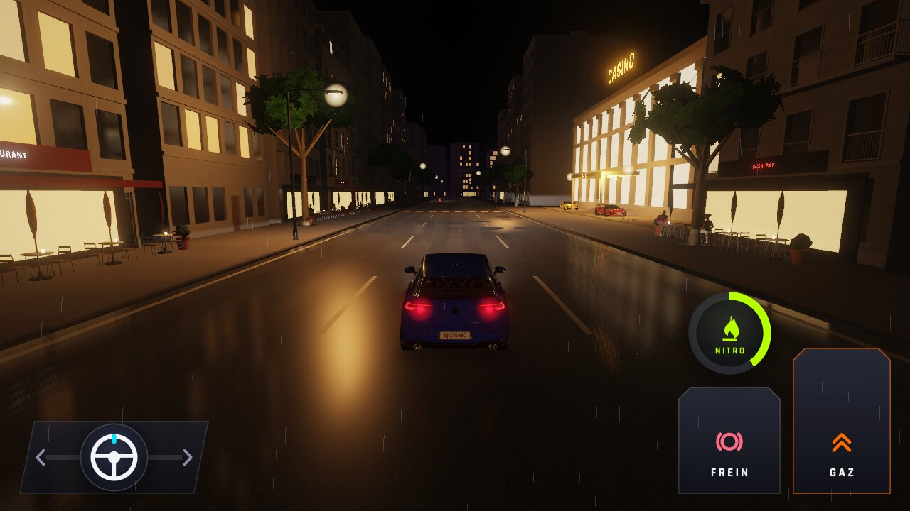
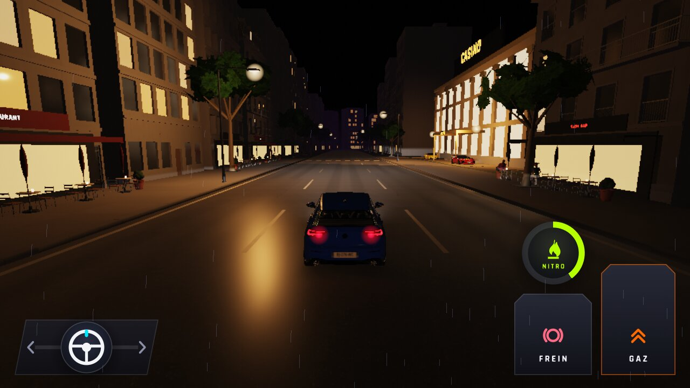
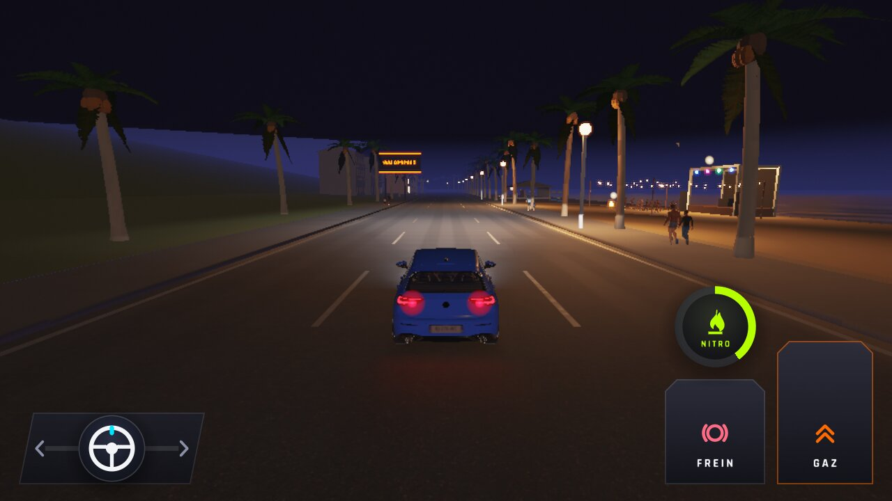
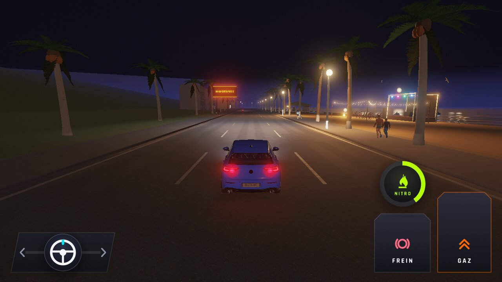
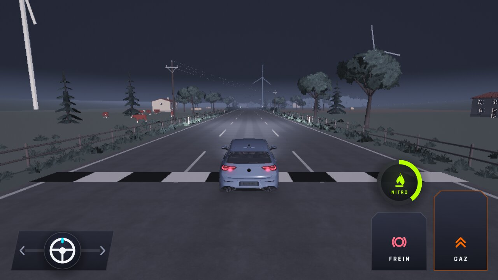

# WFS-425 — captures avant / après (tools/qa/captures_pr.sh)

Branche `feature/waforspeed-425` comparée à `origin/main` ; deux lancements de `tools/qa/captures_pr.sh WFS-425 perf` (banc PC, lavapipe, 1280 × 720), réunis ici :
- **`defaut-*`** : `WFS_PERF_SCENE=1 WFS_PERF_SCENE_QUALITE=basse WFS_PERF_IMAGES=10` (Ville de nuit, Basse, scène à 60 %, MSAA du niveau) ;
- **`x1-*`** : `WFS_CONFIG=<configgame.json avec diagnostic.msaa_x1 = 1> WFS_MOMENT=nuit WFS_PERF_CAPTURE=1 WFS_PERF_CHAUFFE=20 WFS_PERF_IMAGES=10` (4 cartes de nuit, Haute et Basse ; MSAA ×1 dès la 2e course).

**Les 14 images avant / après sont identiques octet par octet** (`cmp`) ; les 18 PNG d'origine des deux lancements (avant la réduction en JPG) sont identiques pixel par pixel.

| Capture | Avant (main) | Après (branche) |
|---|---|---|
| `defaut-scene-depart-basse` — Ville de nuit, Basse, MSAA du niveau (banc : ×4, lavapipe n'a pas de ×2 ; téléphone : ×2), départ |  |  |
| `defaut-scene-mimosas-basse` — Ville de nuit, Basse, MSAA du niveau, Rue des Mimosas (lieu de la mesure du téléphone) |  |  |
| `x1-perf-ville-Haute` — Ville de nuit, Haute, MSAA ×4 (1re course du banc : la clé MSAA ×1 du fichier n'est lue qu'au chargement) |  |  |
| `x1-perf-ville-Basse` — Ville de nuit, Basse, interrupteur MSAA ×1 |  |  |
| `x1-perf-plage-Basse` — Corniche de nuit, Basse, interrupteur MSAA ×1 |  |  |
| `x1-perf-plage-Haute` — Corniche de nuit, Haute, interrupteur MSAA ×1 |  |  |
| `x1-perf-campagne-Basse` — Campagne de nuit, Basse, interrupteur MSAA ×1 |  |  |
