# WFS-455 — captures avant / après

Branche `feature/waforspeed-455` comparée à `origin/main` (main compilé avec le seul banc de WFS-455 : filtre `WFS_REALISME_VUE` et vue `ville-arriere`, aucun changement de rendu). Bancs : `realisme` (vues ville-large, ville-arriere), `perf` (WFS_PERF_CARTE=ville). Lavapipe, comme la CI.

| Capture | Avant (main) | Après (branche) |
|---|---|---|
| `realisme-ville-large-jour-haute` | 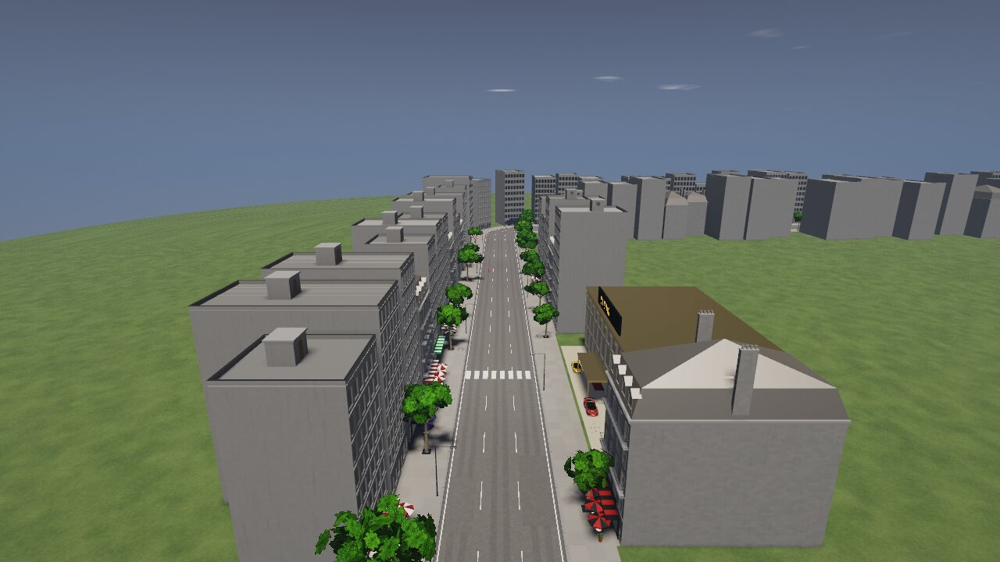 | 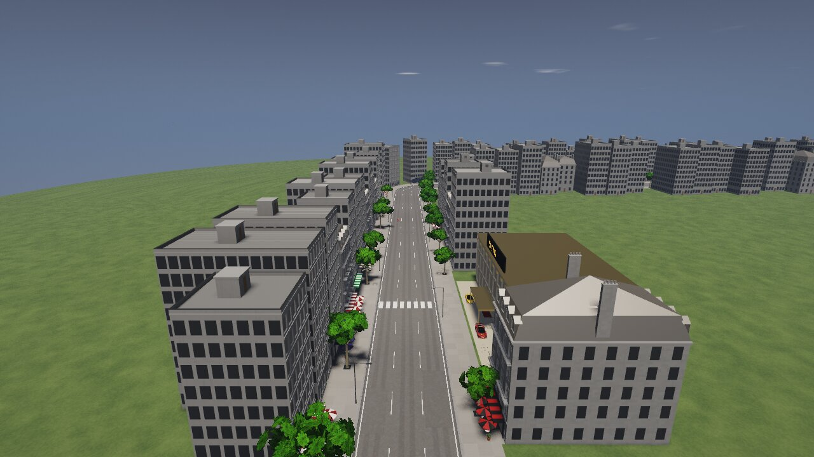 |
| `realisme-ville-large-nuit-haute` | 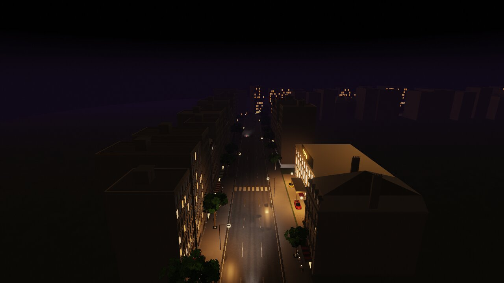 | 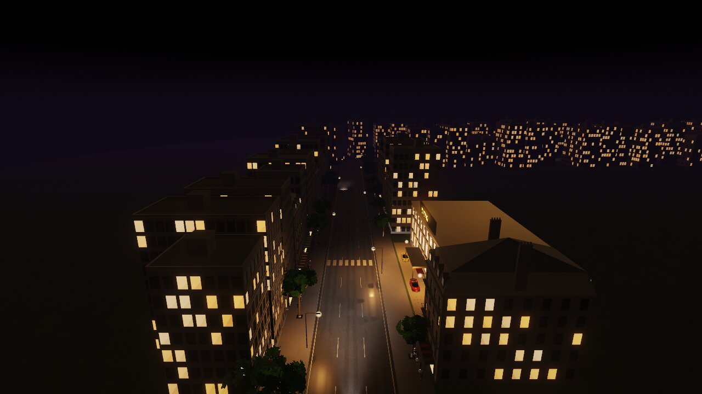 |
| `realisme-ville-large-jour-basse` | 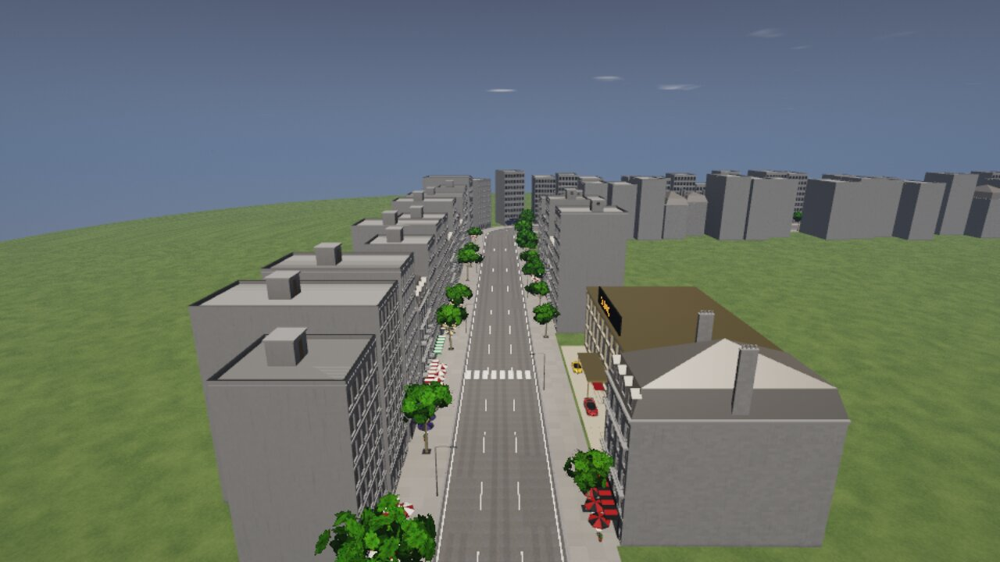 | 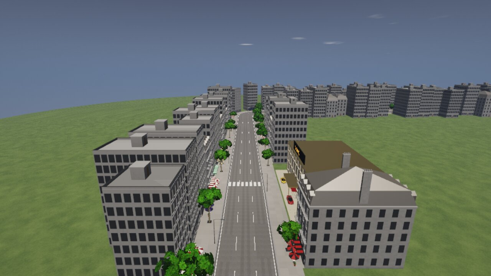 |
| `realisme-ville-large-nuit-basse` | 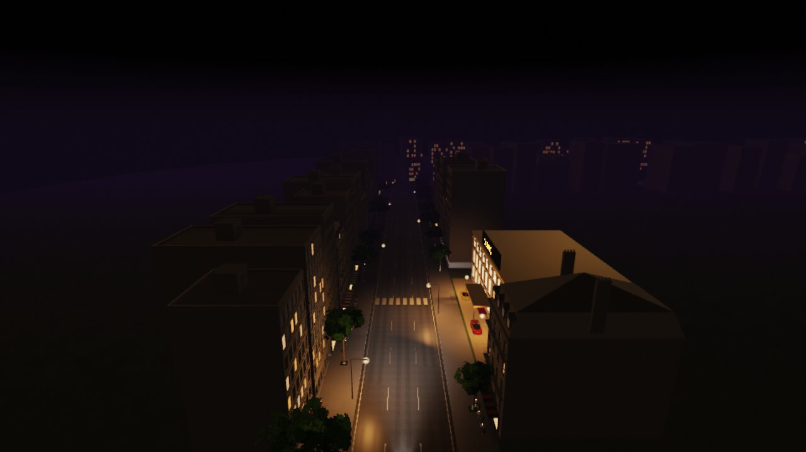 | 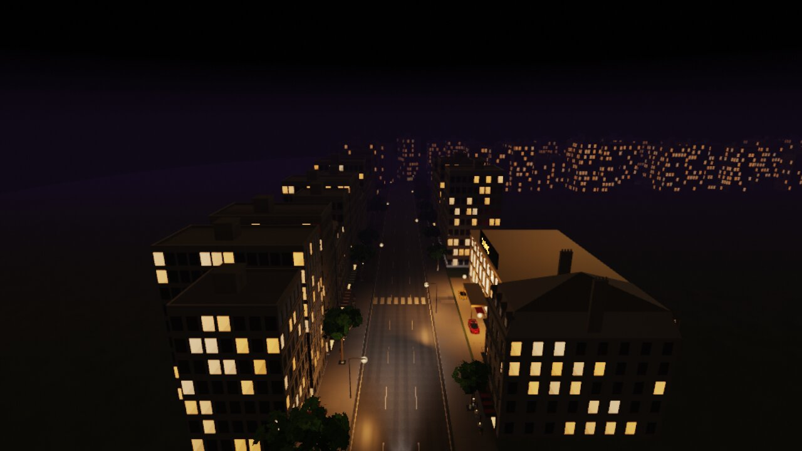 |
| `realisme-ville-arriere-jour-haute` | 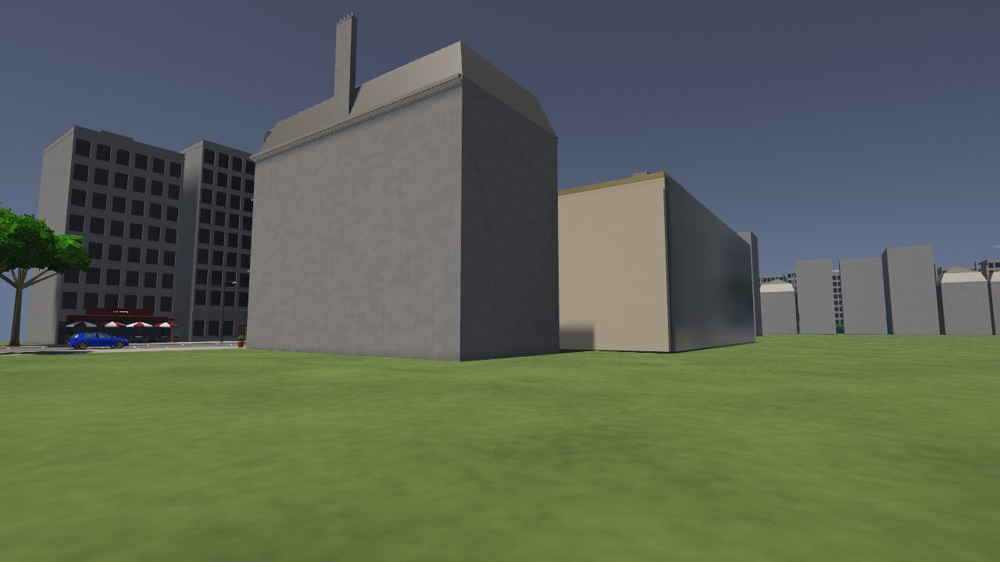 | 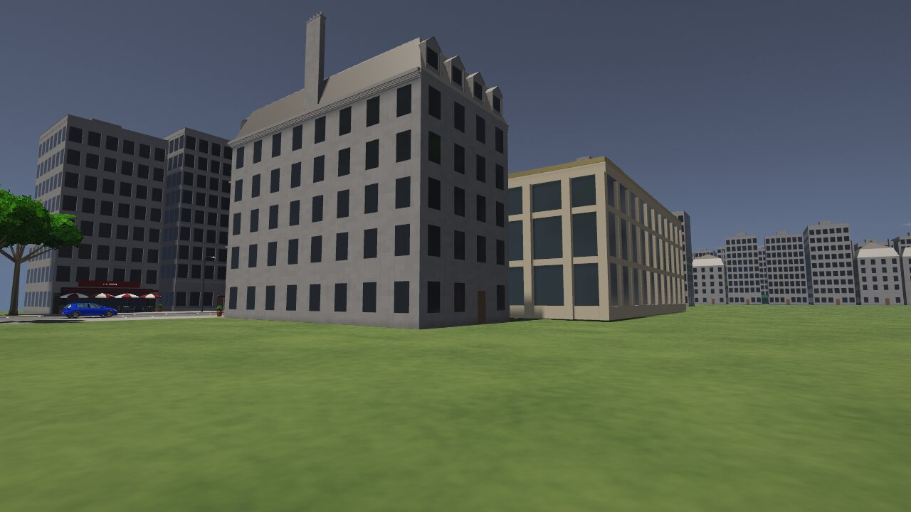 |
| `realisme-ville-arriere-nuit-haute` | 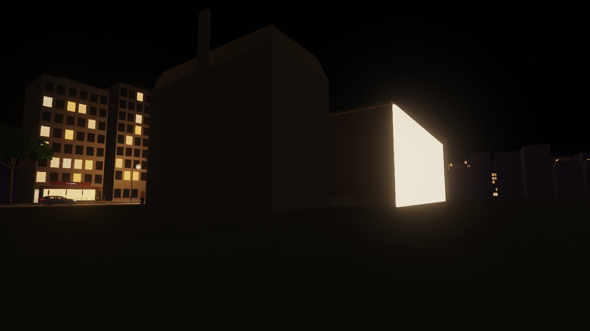 | 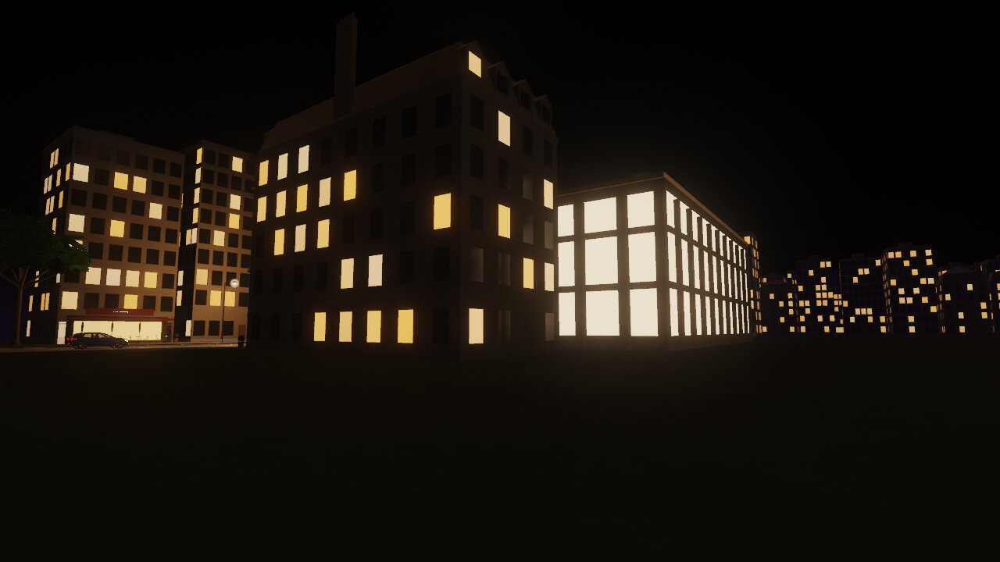 |
| `realisme-ville-arriere-jour-basse` | 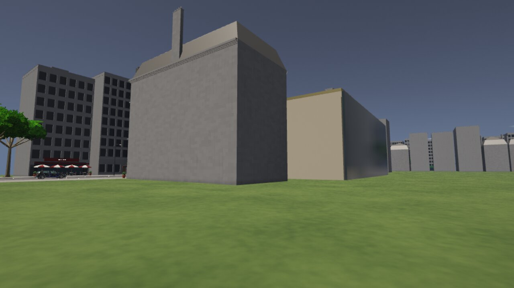 | 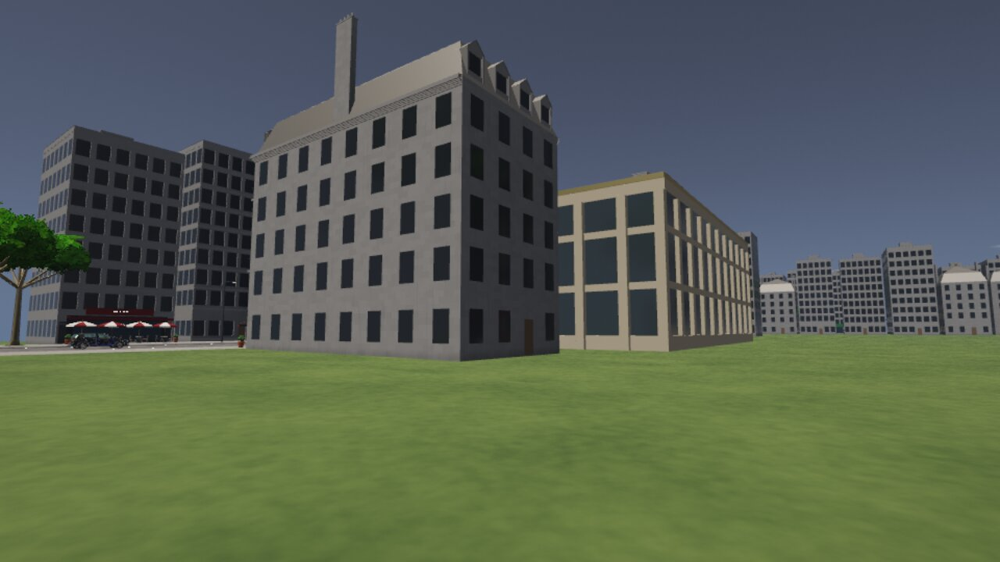 |
| `perf-ville-basse` | 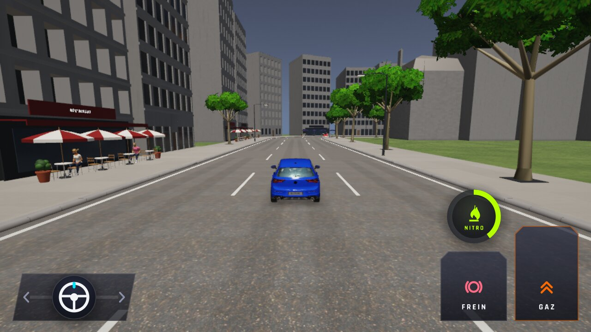 | 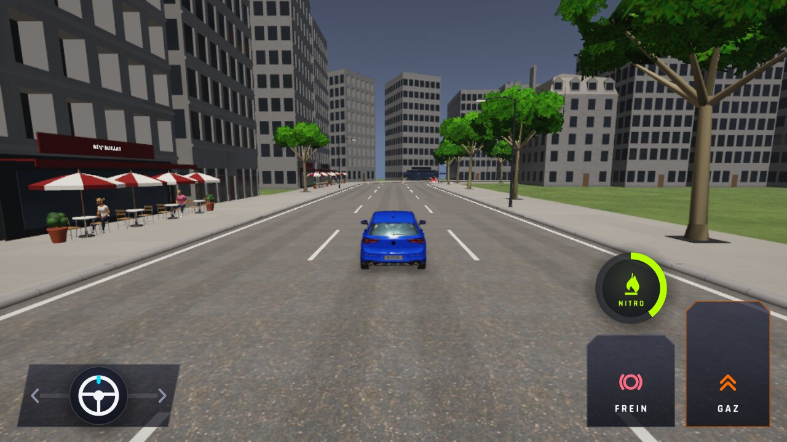 |
| `perf-ville-haute` | 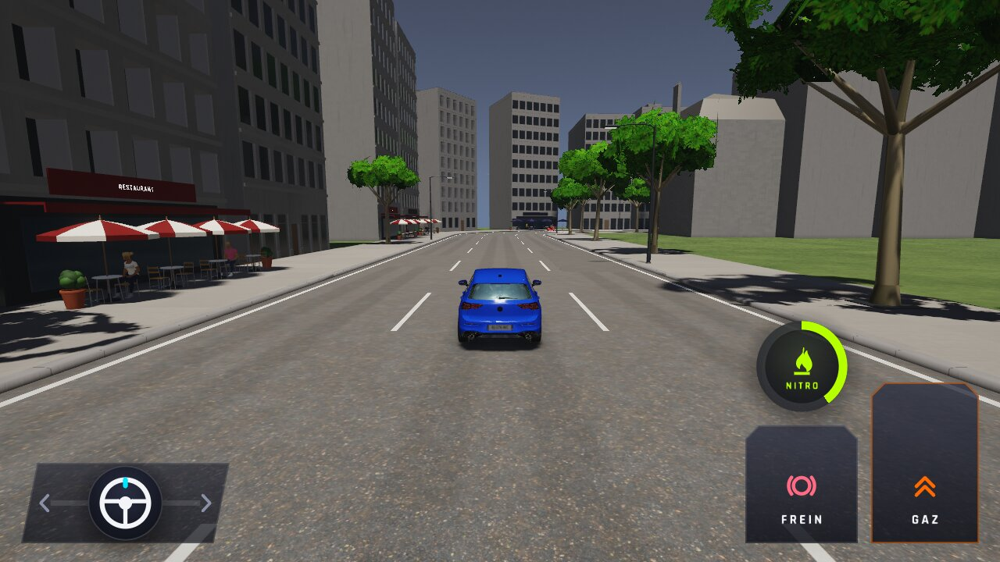 | 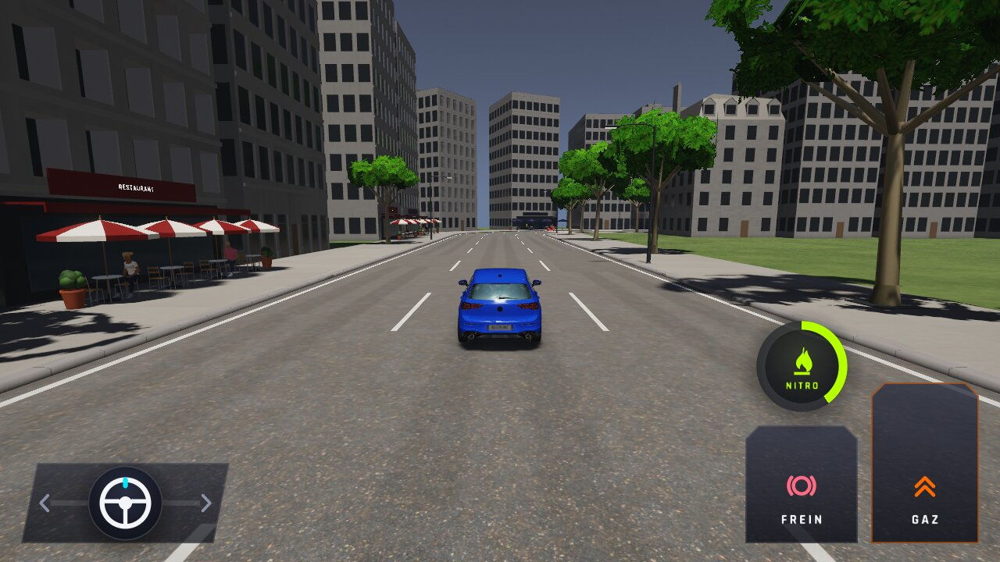 |
